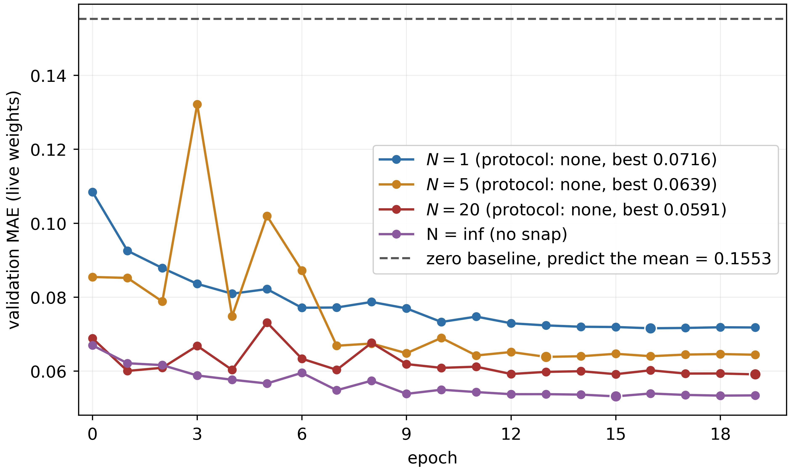
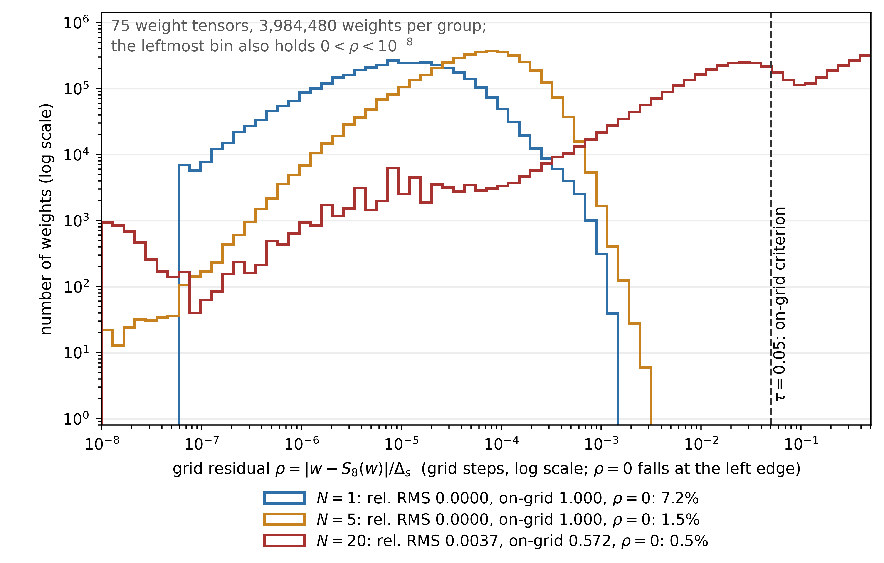
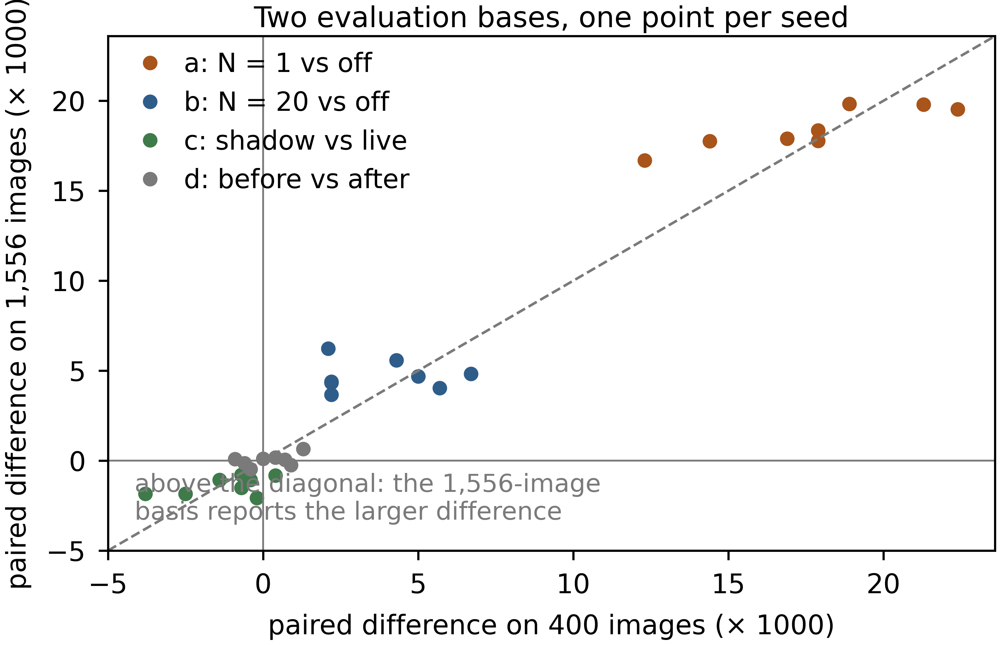
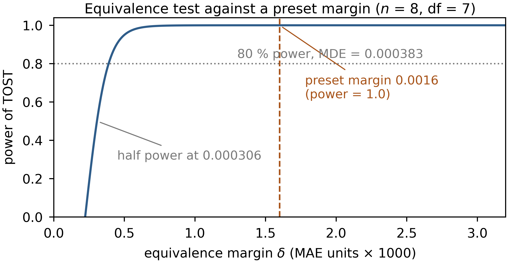
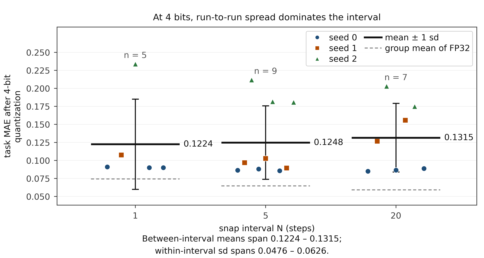
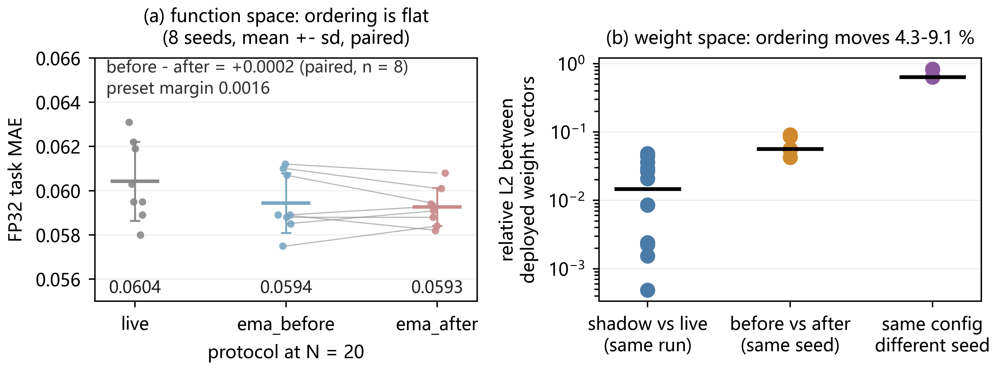
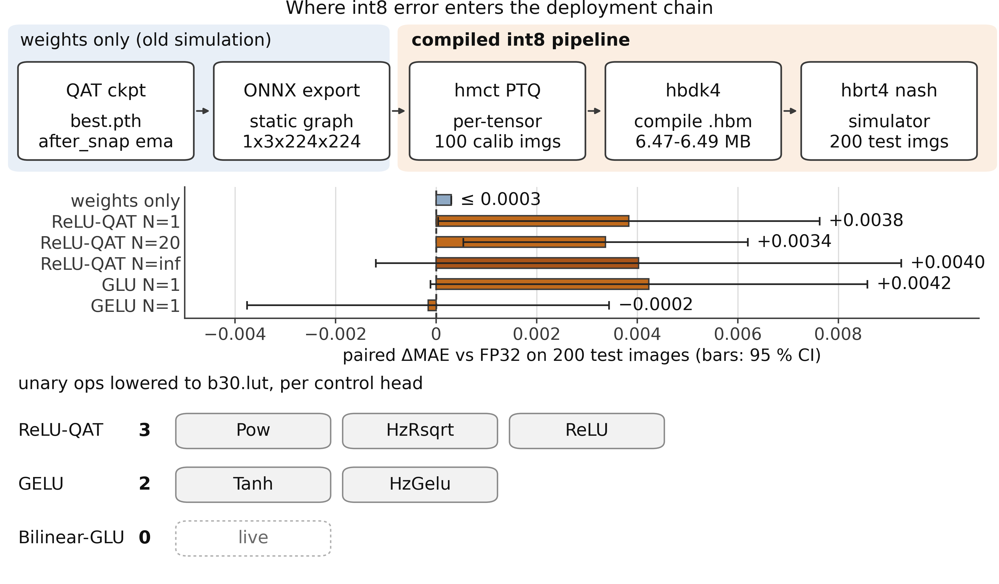
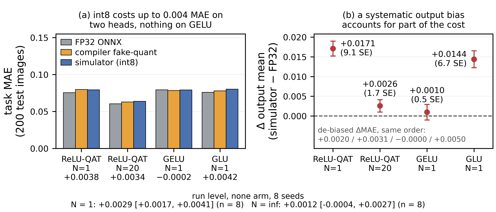

# Supplementary Material

**Supplementary Material for** *A Run-Level Evaluation Protocol for In-Place Weight Projection in 8-bit Quantization-Aware Training*. Tables and figures carry an S prefix; reference numbers follow the main text.

## Text S1. Extended related work and the literature-search protocol

### S1.1 Quantization-aware training and the two routes

Straight-through estimation is used widely; it was explicitly used and popularized by Bengio
et al. [1]. DoReFa-Net followed, quantizing weights, activations and gradients alike [27].
Pushing weights to very low precision during training is older still. BinaryConnect
binarizes the weights in the propagations while the update acts on a full-precision master
copy [28], Gupta et al. study limited numerical precision in training [42], Wang et al. make
8-bit floating point a usable training format [29], and stochastic rounding has been shown
to preserve the sub-grid information deterministic rounding discards, with a convergence
analysis [5]. ECO removes the master copy itself, keeping the parameters in low precision
and feeding each step's rounding error back through residual compensation [6].

A second line replaces hard rounding with something differentiable: ProxQuant writes quantization as a proximal operator and alternates rounding with descent [30], BinaryRelax approaches the discrete weights through a penalty-based relaxation [33], and Relaxed Quantization relaxes the discrete constraint and tightens it by annealing [31]. Both lines turn non-differentiable rounding into something trainable.

### S1.2 Integer-inference practice

Jacob et al. give a formulation under which inference runs in integer arithmetic only, and align the training-time simulation with it [7]. The white papers of Krishnamoorthi [8] and Nagel et al. [9] organize post-training quantization and quantization-aware training into recipes covering granularity and the choice of quantization points, which turns the placement of the quantize/dequantize (QDQ) nodes into a design surface with explicit decisions; the survey [32] classifies this family by training cost and granularity. Lee et al. model the transition of the quantizer itself as an explicit rate and schedule it during training [10]; Text S6.1, item 5, and Table S12 compare that rate with our interval.

### S1.3 Averaging, shadows and multi-model averages

Iterate averaging (Polyak–Juditsky [11]) and its exponential variant are standard practice, and Mean Teacher [12] popularized the EMA-shadow formulation in semi-supervised training. Two papers come close: SWALP averages weights stochastically during low-precision training [13], and SQWA averages quantized weights to improve generalization [14]; both average under quantization, but what they average is checkpoints or the trajectory, not the order of projection and averaging studied here. A more recent strand averages several models at once: stochastic weight averaging (SWA) takes equally weighted averages of a handful of iterates along the trajectory [15], and model soups add up, in weight space, different fine-tunings of one pretrained model [16]. Both rest on separately retrained models, so a flat region of the loss can be sampled repeatedly; averaging then merely recombines training cost already paid. The shadow studied here averages adjacent iterates inside one run, has never seen a second model and pays no extra training cost: the multi-model average lets errors of several models cancel, whereas the within-run shadow only low-pass filters along a single trajectory, and §5.3 reports what its presence changes.

### S1.4 Fidelity metrics, MQBench and layer-wise low-bit methods

Reported "quantization error" numbers are often a cosine or relative-L2 distance between
float and quantized outputs. In the 8-bit setting the problem is not that the number is
computed badly but that it saturates by construction: the exported real-time weights already
sit on the grid, so one more weight-side quantization is strictly idempotent and the cosine
is 1 by construction. A shadow, although off the grid, already lies within a small fraction
of one grid step, so the same number saturates as well. Once saturated it stops separating
good models from bad ones, and whether it saturates depends on whether a projection was
applied during training, not on deployment quality; §5.1 reports the measurements.
Compressing deployability into a single fidelity number has been questioned more
systematically: MQBench turns it into a reproducible benchmark aligned with concrete
deployment implementations [17], on the premise that one quantizer is realized differently
across backends (granularity, rounding, operator fusion) and that a fidelity number detached
from an implementation cannot summarize deployment quality.

On the low-bit side the criticism is older and more concrete: split the deployment error
into a proxy objective that can be optimized locally. SmoothQuant converts activation
outliers into a per-output-channel scale folded into the weights [18], so the difficulty
moves in weight space and what it amounts to in function space has to be measured; AdaRound
learns a data-driven rounding direction per weight [19]; BRECQ widens the reconstruction
target from a single layer to a block [20]. HAWQ characterizes layer sensitivity through the
spectrum of the Hessian, HAWQ-V2 through a trace-weighted variant, and both allocate bit
widths from it [21], [22]; a layer-wise proxy therefore cannot be just any quantity but must
relate directly to that layer's error, and once that relation depends on the recipe a
ranking no longer transfers across recipes. HAWQ and HAWQ-V2 address bit allocation, not the
scheduling of training-time projection, so they neither support nor refute the magnitude
claimed here. GPTQ decides the rounding direction of each weight from a layer-wise
reconstruction error [23], and AWQ uses an activation-aware scale to protect a small number
of salient channels [24]. Both show that whether low-bit quantization works at all depends
mainly on the design of the quantizer itself, not on some scheduling degree of freedom
inside training. Our setting is complementary rather than conflicting: the quantizer and the
scale granularity are held fixed over the whole sweep, and only the projection interval, the
moment at which the shadow is written and the averaging order move. The rounding mode is
listed separately as a third control (§5.4), so the run-to-run variation of §5.5 cannot be
read as an evaluation of those methods.

### S1.5 Literature-search protocol

The search was run over arXiv, Semantic Scholar, Google Scholar and dblp; keywords were
quantization-aware training, weight projection, stochastic rounding and EMA of quantized
weights; the cutoff was 2026-11-02. Work that updates a full-precision master copy under
simulated quantization only was excluded, with the four most recent such works, together
with two works that train directly with no master copy, listed in Table S1 as an
item-by-item comparison. Related work is fragmented across the six dimensions that matter here. First, whether the
training-time weights the optimizer holds are really overwritten in place onto the int8 grid
(physical int8 storage happens at export and compile time), with no high-precision master
copy kept, and whether the projection interval is swept. Second, whether the shadow averages
quantized weights, whether the EMA is written after projection, whether the full int8 chain
of the target NPU is run, and whether intervals are reported across seeds. Each cited design
covers only part of the six dimensions (Table S1).

Table S1 applies those criteria to the works closest to this design, cell by cell; every entry is judged only from what the paper in question says about its own training loop.

**Table S1.** Item-by-item differences from related work (search cutoff 2026-11-02)
| work | optimizer weights projected in place onto the int8 grid during training | high-precision master copy kept | interval treated as a variable | shadow averages quantized weights | EMA written after projection | full target-NPU chain | per-seed intervals reported |
|---|---|---|---|---|---|---|---|
| SWALP [13] | yes | yes | — | — | — | — | — |
| SQWA [14] | yes | yes | — | yes | — | — | — |
| BinaryRelax [33] | yes | yes | — | — | — | — | — |
| TR scheduling [10] | yes | yes | partly: per-layer transition rate, not comparable with $N$ | — | — | — | — |
| DQT [5] | yes | no (low-precision weights updated directly) | — | — | — | — | — |
| ECO [6] | yes | no (no master copy; the rounding error is injected into the momentum) | — | — | — | — | — |
| this paper | yes (in-place overwriting is one variable; physical int8 storage happens at export and compile time) | no (no full-precision master copy; the EMA shadow is an export-only copy that never enters the optimizer update) | yes (1, 5, 20, ∞) | yes | yes (before / after) | yes (hbdk4 and two runtimes) | yes (n = 8, paired run by run) |

**Note:** each cell is judged only from what each paper's text says about its training loop, not as an evaluation of the method; "—" means the paper did not treat that dimension as a variable or did not report it. The master-copy column asks whether the optimizer holds full-precision parameters; this paper's shadow averages quantized weights, serves export only and never enters the optimizer update, unlike the checkpoint averaging of SWALP and SQWA.

**Table S2.** Search log: databases, query terms, screening and outcome (cutoff 2026-11-02).
| field | entry |
|---|---|
| databases | arXiv (full text), Semantic Scholar, Google Scholar, dblp |
| query terms | quantization-aware training; weight projection; stochastic rounding; EMA of quantized weights |
| screening | title and abstract first, full text for the shortlist; a work was admitted only where its own text states its training loop |
| exclusion | work that keeps a full-precision master copy and only simulates quantization in the forward pass, apart from the closest such designs, which are compared item by item in Table S1 |
| outcome | 44 works cited, six compared item by item (Table S1); each cited design covers only part of the six dimensions |
| retained | databases, query terms, screening and exclusion rule; per-database hit counts were not retained |

## Text S2. Implementation and setup details

This text documents the operator, split construction and run inventory behind the main text. Section numbers refer to the main text; a table or figure number carrying an S prefix refers to this file, and a bare number to the main text.

### S2.1 Projected scope, grid drift and the clip bound

Only nn.Linear and nn.Conv2d weights are projected; normalization affine parameters and the positional embedding stay in floating point, because the target compiler does not quantize them.

Between steps, training moves the per-row maximum, and recomputing $s_o$ from the live
weights reads that change in, so successive grids are not identical. A single projection,
however, preserves the per-row maximum, from which $s_o$ is derived as that maximum divided
by $q_b$; the scale is therefore invariant to the projection itself, and the per-row scale
drifts only slightly during training.

**Scale provenance at export.** The deployment quantizer recomputes the scale from the tensor it exports, as the per-row maximum divided by $q_b$ (`scripts/deploy_table.py`), and the three protocols do not reach that step with the same tensor. For `live` the exported tensor is the last projected iterate, whose per-row maximum is exactly $q_b s_o$, so the export scale equals the scale used at the last training step. For `ema_before` the tensor is the unprojected shadow average, so its single export projection uses a scale that no training step used. For `ema_after` the tensor is an average of iterates projected with drifting scales, so the export scale is likewise new. The exported weights are then renormalized by that recomputed scale, which is why the 8 bit
export is idempotent only where the quantizer and the training grid agree; Table S7 measures what
that recomputation costs per protocol.

The lower clip bound $-q_b-1$ never binds: a row's entries are bounded by $q_b s_o$ in magnitude, so the rounded value always lands in $[-q_b, q_b]$ and $S_b$ is the symmetric projection.

Table S3 lists the full training and quantization configuration; the main text keeps only the entries its argument uses.

**Table S3.** Training and quantization configuration.
| item | value |
|---|---|
| optimizer | AdamW, lr 1e-4, cosine annealing over 20 epochs |
| batch / precision | 64, bf16 autocast, gradient clipping 1.0 |
| EMA decay | 0.99 |
| snap bits during training | 8 |
| initial seeds | 0-7 for the five main sequences (split_seed fixed at 0, initialization only); 0-2 elsewhere |
| zero baseline (predict validation-split mean) | 0.15526728 on the 1,556-image external subset; 0.1553 on the fixed 3,556-image split (split_seed = 0) and 0.1552 / 0.1516 on the older splits of seeds 1 and 2; 0.1625 / 0.1489 / 0.1483 on the 400-image deployment subset of those three splits; 0.0044 on the KonIQ-10k data axis |
| deployment-eval subset | primary basis: the 1,556-image external subset that took no part in epoch selection (the validation split minus the 2,000-image monitor subset, §5.2); comparison: the first 400 images of each run's own validation split (partly overlapping those 2,000) |
| compute | single RTX 4080 Laptop (12 GB, driver 617.14, CUDA 13.2 / PyTorch 2.12.0; timm 1.0.27, ONNX Runtime 1.26.0, OpenVINO 2026.4.1 + NNCF 3.4.0, hbdk 4.7.5), 834–891 s/run for training alone at 20 epochs (about 25 min including per-epoch monitoring evaluation and export) |

### S2.2 What the overwrite writes: two levels of storage

Two levels have to be kept apart: the overwrite here acts on floating-point tensors—under bf16 autocast the parameters are still of a floating type, and what is written back is their dequantized value at the grid point; physical int8 storage happens only at export and compile time.

The operator overwrites in place the parameters the optimizer holds: there is no full-precision master copy and no straight-through gradient, and gradients accumulate on the quantized weights. It differs in mechanism from straight-through fake quantization (torch FakeQuant, Brevitas, LSQ and the like), where the optimizer updates only floating-point weights and quantize/dequantize happens in the forward pass alone; we do not claim the two are equivalent.

### S2.3 The two averaging orders: narrow coincidence and a one-dimensional instance

The block below continues the argument of §3.3 from the commuting equation onward, reproduced from the main text; the argument does not rest on the nonlinearity of $S_b$ as such: $S_b$ acts on only one of the two terms. On the left it rounds the convex combination $\gamma m + (1-\gamma)W$; on the right only $W$ is rounded and the unprojected shadow $m$ is left off the grid. The two sides coincide only under narrow conditions — the combination lands back on a grid point, the per-row scale behind the projection matches, and $W$ is already projected. A one-dimensional instance shows that the two orders end at different points (not an estimate of a general magnitude): with unit grid step, $\gamma = 0.9$, $m = 0.3$ and $W = 0.7$, the left-hand side is $S_b(0.34) = 0.00$, while the right-hand side is $0.9 \times 0.3 + 0.1 \times S_b(0.7) = 0.37$. The right-hand side keeps the unprojected shadow $m$ and adds the projected increment; the left-hand side first averages the two, then projects the average.

Table S4 writes the three orders out step by step, with the exported tensor and the equation each corresponds to.

**Table S4.** Per-step order of operations, shadow maintenance and exported weights of the three update protocols.
| protocol | per-step order of operations | shadow | exported | eq. |
|---|---|---|---|---|
| live | optimizer step → $W_t \leftarrow S_b(W_t)$ | live | $W_T$ | (9) |
| ema_before | optimizer step → $m_t = E_\gamma(m_{t-1}, W_t)$ → $W_t \leftarrow S_b(W_t)$ | running average of unprojected iterates, $m_t$ | $m_T$ | (7) |
| ema_after | optimizer step → $W_t \leftarrow S_b(W_t)$ → $m_t = E_\gamma(m_{t-1}, W_t)$ | running average of projected iterates, $m_t$ | $m_T$ | (8) |

### S2.4 Split construction, reselection history and the archived runs

Our first version of the deployment table reused the seed-0 split for every run; the seed-1/2 checkpoints had trained on part of it, and one has a true MAE of 0.0579, while the old fixed-split evaluation reported a value about 0.019 low (that table was not kept). The fixed-split sequences no longer mix in evaluation-subset difficulty. The remaining cells (the three protocols at interval 5, ema_after at $N = \infty$, and the older runs at seeds above 0) still use a split per run and are read descriptively only.

The distinction matters, because an earlier version of this pipeline let live skip projection as well, which silently turned it into a pure FP32 run and produced a spurious 30 % "win". The corrected protocol is the one reported here; the buggy runs are archived and excluded (Fig. 1).

Figure S1 shows the live validation MAE over the 20 epochs for the five main-configuration sequences, one curve per interval plus projection switched off; the epoch is selected on these curves before any deployment quantization.



**Figure S1.** Validation MAE of the live weights (live protocol, seed 0) over training, one curve per interval plus projection off (N = ∞); dashed is the zero baseline 0.1553. Best 0.0716 (1), 0.0639 (5), 0.0591 (20), 0.0532 (∞). From each run's history.csv (2,000 validation images), so the FP32 column of the §5.2 deployment table, on 400 images, reads 0.002–0.003 higher.

### S2.5 Run inventory and token layout

The backbone ends with AdaptiveAvgPool2d to a 14×14 spatial grid, flattened by mean over the width axis, a linear frame token and a learned positional embedding.

Grid: the basis for run-level inference is five main-configuration sequences of 8 initial
seeds each (live at intervals 1, 20 and infinity, ema_after and ema_before at interval 20;
split_seed fixed at 0, only the initialization varying), 40 runs at 20 epochs. An earlier
batch was run on the older basis: 15 main-sweep runs, namely 3 snap intervals {1, 5, 20} × 3
protocols at seed 0 (9 runs) plus 6 extra-seed runs (ema_after at seeds 1 and 2 for
intervals 1 and 20, 4 runs; ema_before at seeds 1 and 2 for interval 20, 2 runs), 20 epochs
each. A further 15 runs: 2 at the projection-free endpoint (live and ema_after), 6 extra
seeds at interval 5 (three protocols × seeds 1, 2), 3 on a fixed split (split_seed = 0,
initial seeds 1, 2, 3, ema_after, interval 20), and 4 γ sweeps at interval 20 and seed 0 (γ
= 0.9 and 0.999, each for ema_before and ema_after). Deployment readings are
tabulated for 65 of these 70 runs in `quant_runs/deploy_table_v3.csv`; the rest contribute only
training-side curves. The effect of topping the five main sequences and the STE arm up from three
seeds to eight is read in Table S20, which sets the first reading beside the delivered one.

Device time is recoverable without re-running anything: `train.py` writes the seconds each
epoch took into the `sec` column of `history.csv`, and summing that column over the 359 runs of
the snapshot gives 84.8 device hours on the single RTX 4080 Laptop named in the main text
(`quant_runs/compute_table.csv`). By family: main sequences 21.2 h over 79 runs, ResNet-18
architecture axis 15.4 h over 88, CIFAR-10 arm 12.2 h over 64, 60-epoch control 11.2 h over 16,
learning-rate control at $10^{-3}$ 6.9 h over 36, at $3\times10^{-3}$ 5.8 h over 24, KonIQ-10k axis
5.1 h over 32, stochastic-rounding control 3.8 h over 8, mechanism runs 2.0 h over 9, head
controls 1.0 h over 2, and the withdrawn run 0.3 h. The column covers the training step and the
monitoring evaluation of the same epoch; export quantisation, compilation and the held-out
evaluation are outside it.

### S2.6 Exploratory scope and notation

Every other comparison in §5 (the remaining pairings, the same contrasts at the 6 bit and 4 bit bases, and the two extrapolation axes of §5.5) is exploratory and uncorrected for multiplicity, except that the four 6 bit contrasts are corrected post hoc as a family of their own (Holm, four tests), which does not make them pre-specified; the tables report its point estimates and intervals as they stand. Unless marked otherwise, every cross-seed comparison is made on the fixed split, and the 4 bit section is not compared in absolute terms across bases: it reports only per-seed relative quantities, against that run's own zero baseline and against that run's FP32 deployment MAE. In the notation of §3.4, ema_after against live being negative means the shadow protocol is better.

## Text S3. Additional 8 bit diagnostics and equivalence-test details

This supplement carries the diagnostics and the equivalence-test detail shortened out of §5.1–§5.3 of the main text; equation numbers refer to the main text, while table and figure numbers carrying an S prefix refer to this file.

### S3.1 Grid residuals, centered cosines and the four idempotence preconditions

**Per-image paired differences behind the last column of Table S5.** The last column is the
largest per-image paired difference between 8 bit and FP32 MAE on the same 400 images, in
absolute value over the runs of that interval ($\Delta$ = 8 bit − FP32, positive meaning the
8 bit model reads higher). All 5 runs at interval 1 give 0.0000, the 9 runs at interval 5
stay within 0.0003, and 12 of the 14 runs at interval 20 within 0.0004, the other two being
−0.0010 (an interval containing 0) and +0.0014, the latter an additional run (95 % CI
[+0.00027, +0.00248], excluding 0). A single experiment cannot tell sampling fluctuation
from a real degradation.

**Table S5 note.** Each row gives the extremes over all main-configuration runs (γ = 0.99 and split_seed = seed, i.e. the older batch; the fixed-split subsets of the five main sequences are not included in this table) at that interval, including the live protocol. $\varepsilon$ and $f$ are residuals of the exported weights on the grid (eqs. 4 and 16); §5.4 reports the error of each projection event itself, which is also eq. 4 but acts on a different object.

**The 6 bit and 4 bit cosines.** Apparent discrimination appears only at 6 bits (cosine ≈ 0.9962, relative L2 ≈ 0.088) and 4 bits (cosine 0.9792–0.9809, relative L2 0.197–0.206; Fig. S2). Every 6 bit and 4 bit number here and below refers to export-time post-training quantization (PTQ): the projection width during training is fixed at 8 bits (Table S3), and no 6 bit or 4 bit QAT model was trained.

**The four preconditions, item by item.** Idempotence is a property of this convention, not
an empirical finding. It requires the same operator and scale rule (symmetric,
per-output-channel, step = per-row maximum / $q_b$), the same rounding rule (nearest on both
sides), no clipping overflow, and an exported tensor that already lies on the training grid.
Break any one of the four and it no longer holds. The fourth is the one that needs care,
because the deployment quantizer recomputes the scale from the tensor it receives (Text
S2.1). At interval 1 the live weights are on the grid and the export scale equals the scale
of the last training step, so re-projecting moves them by 8e-9; the shadows at interval 20
sit off-grid by up to 0.0037, receive a scale that no training step used, and move by up to
4.1e-3 (Table S7). $S_b$ is itself a nearest-grid-point projection, so $\rho_{oj} \le 0.5$
holds almost by tautology (eq. (15)), and writing it as a "saturation condition" carries no
information; what decides whether the metric reads a constant is the four preconditions
above. The three 8 bit protocols of this paper satisfy the first three for every weight and
the fourth only approximately for the shadows, and only 3.6 % of the weights are more than
0.45 grid steps away (Fig. S2). 6 bit and 4 bit make the metric informative again because
the deployment quantizer changes the grid: change the bit width and both the scale and the
grid points change, so the idempotence precondition disappears outright. That is not because
$\rho$ falls outside some interval; 0.9962 and 0.9792–0.9809 are cosines after $q_b$ has
been changed, and they are a different quantity from $\rho$. The same reason explains the
per-tensor and the p99 clipping readings of §5.5: once the scale changes, the absolute error
is dominated by the choice of grid.

**The distribution behind Fig. S2.** Figure S2 spreads that distribution out: 3,984,480 weights in all, one point per interval whereas Table S5 spans all three protocols. At interval 1 the weights sit on the grid within numerical noise; at interval 20 the distribution broadens to relative RMS 0.0037 and on-grid fraction 0.572. The tail above $\rho = 0.1$ is close to uniform; the leftmost bin also holds weights with $0 < \rho < 10^{-8}$.

Table S5 collects the grid residual, the on-grid fraction and the per-image 8 bit versus FP32 difference per interval, Figure S2 the distribution behind the residual column, and Table S6 the relative L2 distances between exported weight vectors.

**Table S5.** Grid residual of the deployed weights, the on-grid fraction, and the per-image 8 bit versus FP32 paired difference summarized per interval (largest absolute value).
| snap interval | relative RMS residual ε (eq. 4) | on-grid fraction f (eq. 16) | largest absolute 8 bit − FP32 paired difference |
|---|---|---|---|
| 1 | 0.0000 | 1.000 | 0.0000 |
| 5 | 0.0000 – 0.0004 | 0.951 – 1.000 | 0.0000–0.0003 |
| 20 | 0.0000 – 0.0037 | 0.571 – 1.000 | 0.0000–0.0014 |
**Note:** Extremes over all main-configuration runs at that interval, including the live protocol; $\varepsilon$ and $f$ are residuals on the grid (eqs. 4 and 16). The interval-20 upper end is the ema_after seed-0 run at 0.00366, reported as 0.0037. Batch definition and per-image paired differences: Text S3.1.



**Figure S2.** Distribution of the per-weight grid residual $\rho$ of eq. (15) over the 75 projected tensors, log-log axes, for the ema_after run at seed 0.

**Table S6.** Relative L2 distance between exported weight vectors.
| comparison | n pairs | relative L2 range | reading |
|---|---|---|---|
| shadow vs live weights, same run | 12 | 0.0005 – 0.0483 | displacement of the shadow against the live weights |
| ema_before vs ema_after, same interval and seed | 5 | 0.0427 – 0.0909 | displacement due to the averaging order |
| same configuration, different seed | 9 | 0.6371 – 0.8349 | displacement due to retraining, about an order of magnitude larger |

**Table S7.** What the export projection does to the exported tensor, per protocol, at 8 bits. "Reused" means the export scale equals the last training-step scale; "recomputed" means it is derived from the exported tensor and used by no training step.
| protocol, interval | exported tensor | export scale | relative L2 | cosine |
|---|---|---|---|---|
| live, 1 | last projected iterate | reused | 7.2e-9 - 8.1e-9 | 1.0000 |
| live, 20 | last projected iterate, drifted | recomputed | 3.2e-5 - 4.1e-3 | 1.0000 |
| ema_before, 20 | unprojected shadow mean | recomputed | 2.95e-3 - 3.69e-3 | 1.0000 |
| ema_after, 20 | mean of projected iterates | recomputed | 2.93e-3 - 3.67e-3 | 1.0000 |
**Note:** Relative L2 between the exported tensor and the result of applying the deployment rule
(scale = per-row maximum / $q_b$, nearest rounding, clamp to $[-q_b, q_b]$) once more, over the
75 projected tensors and 8 initial seeds of the main configuration. The centered
cosine of eq. (17) is bounded by Proposition 1: with $\kappa = 0.9999$ on these tensors,
$\cos_c \ge 1 - 2(\mathrm{rel}/\kappa)^2 \ge 0.99997$ on the largest row, and the measured value
is 0.999994, so it prints as 1.0000 at four decimals in every row -- which is why the metric
cannot separate the protocols even where the weights do move. `scripts/resolution_bound.py`
reports $\varepsilon$, $\kappa$ and the bound for each checkpoint
(`quant_runs/resolution_bound.json`). For comparison, two protocols of one configuration differ by
0.0427-0.0909 and two seeds by 0.6371-0.8349 (Table S6), one to two orders of magnitude above
the export projection; that gap, not an identity of the weights, is what makes the fidelity
metric uninformative.

### S3.2 The evaluation basis and the full note to Table 2

**Table 2 note.** The table gives point estimates; the paired differences and their 95 % confidence intervals are in Table 3 of the main text and quant_runs/paired_report.md. The last
column is the FP32 MAE of the same batch of runs on the external subset that took no part in
epoch selection (1,556 images, i.e. the validation split minus the 2,000-image monitoring
subset). The FP32 column of this table is no lower than it in every row (the interval-1 live
row ties), and the difference is the epoch-selection optimism, which grows with the interval
(§5.2). The unit of the intervals is the run: each of the five main configuration sequences
has 8 initial seeds on a fixed split (split_seed = 0), n = 8, df = 7, paired run by run;
each row of this table is still a single-run point estimate (seed 0). The inferential
quantity takes the 1,556 images that took no part in epoch selection as the main basis and
the 400-image subset as the control. Against switching projection off, interval 1 reads
+0.018457 [+0.017498, +0.019415] (run-level, $n = 8$, 1,556 images) and +0.017750
[+0.014973, +0.020527] (400 images), and interval 20 reads +0.004723 [+0.004028, +0.005417]
and +0.003800 [+0.002243, +0.005357]. Both contrasts are 8/8 of the same sign (sign test p =
0.0078).

Figure S3 gives the per-seed paired differences of contrasts a–d under the 400-image and the 1,556-image bases.



**Figure S3.** Per-seed paired differences under the 400-image and the 1,556-image bases (contrasts a–d, eight points each, dashed line = equality): the points of the shadow contrast c fall on both sides of the line, so the two bases support different significance conclusions.

### S3.3 Equivalence bounds, the margin sensitivity and the power curve of Fig. S4

**Sensitivity of the TOST to the margin.** A post-hoc sensitivity analysis puts the critical
bound at 0.000252, 6.4 $\times$ below the preset bound. Tightening the bound to 0.0005 still
gives $p = 0.0026$. At bounds of 0.001, 0.0003 and 0.0032 the $p$ values are
$3.7\times10^{-5}$, 0.027 and $1.2\times10^{-8}$, so all five bounds (the preset 0.0016
included) lead to the same conclusion. On the age scale 0.0016 corresponds to 0.16 years,
and it is exactly 1 % of the zero baseline. The bound was not set so that the test would
pass.

**The 6 bit cross-check.** Applying the same 0.0016 bound post hoc to the 6 bit contrast d
(4 of 8 positive, 4 of 8 negative) gives $p = 0.0030$, which still passes at $\alpha =
0.05$. That bound, however, was pre-specified for the 8 bit main basis: the 6 bit paired
standard error is 0.000338 (2.9 $\times$ the 0.000118 of the main basis) and the 80 % MDE
rises to 0.0011, so the bound is only 1.4 $\times$ the MDE (at the main basis the preset
bound is 6.4 $\times$ the critical bound and 4.2 $\times$ the MDE). We therefore quote the
number only to record what a post-hoc application of the 8 bit bound would return, not as
evidence of equivalence at 6 bits. The direction readings at that basis are a separate
matter: the four 6 bit contrasts are corrected as one post-hoc family of their own (Holm,
four tests, $1.3\times10^{-7}$, $2.9\times10^{-4}$, $0.018$ and $0.42$), which leaves a, b
and c of one sign after correction without promoting any of them to pre-specified. Neither
reading changes the pre-specified claims here.

The quantities behind the curve — MDE at 80 % power, the post-hoc critical bound and the power achieved at the preset bound — are collected for both evaluation bases in Table S8.

**Table S8.** The fields behind Fig. S4.
| quantity | 1,556 images | 400 images |
|---|---|---|
| MDE at 80 % power | 0.000383 | 0.000897 |
| critical bound, post hoc | 0.000252 | n/a |
| standard error | 0.000118 | n/a |
| paired sd $\sigma_d$ | 0.000333 | n/a |
| power at margin 0.0016 | 1.0 | n/a |
| margin at half power | 0.000306 | n/a |

Fig. S4 plots the power of the equivalence test (df = 7, standard error taken from the 1,556-image basis, $SE_{\bar D} = 0.000118$, paired sd $\sigma_d = 0.000333$) against the margin delta: the dashed preset 0.0016 has power 1.0, the dotted MDE at 80 % power is 0.000383, and the curve reaches half power at 0.000306.

Figure S4 plots the power curve those fields describe.



**Figure S4.** Power of the equivalence test (df = 7, standard error taken from the 1,556-image basis, $SE_{\bar D} = 0.000118$, with a paired sd of $\sigma_d = 0.000333$) as a function of the margin delta. The dashed line is the preset 0.0016 (power 1.0), the dotted line the MDE at 80 % power, 0.000383; the curve reaches half power at 0.000306.

### S3.4 The seven per-image ordering comparisons

The seven per-image paired comparisons made earlier, at the image level on single runs, are exploratory descriptions only, not protocol conclusions: none of the seven exceeds 0.0014 and the sign changes with the seed (interval 1: −0.00070 [−0.00155, +0.00015]; the three seeds at interval 5: +0.00015, −0.00045, +0.00011; the three seeds at interval 20: +0.00132 [+0.00002, +0.00262], +0.00016, −0.00084). Uncorrected, 2/7 are nominally significant and of opposite sign ($+0.00132$, $p = 0.047$; $-0.00084$, $p = 0.037$); after Holm and Benjamini–Hochberg correction 0/7 survive (smallest $p = 0.037$ against the first Holm step of $0.05/7 = 0.0071$).

## Text S4. Robustness checks, mechanism controls and the compiled toolchain

This text sets out, section by section, the material the main text states only in summary. S4.1
gives the robustness checks of the 4 bit contrast, S4.2 the diagnostics behind the interval
effect, S4.3 the itemized readings of the three mechanism controls, S4.4 the note to Table
4, S4.5 the relation between projection schedules and the interval, S4.6 the note to Table
5, and S4.7-S4.8 the compilation, grid and per-node detail of the vendor chain.

### S4.1 Robustness of the 4 bit contrast

Among the three finite intervals, interval 20 is the best at 8 and 6 bits (counting the
projection-free endpoint, the best setting is N = ∞, see Table 2), and there seeds 1 and 2
degrade to 0.1267–0.2030 while seed 0 stays at 0.0849 (Fig. S5). The earlier single-seed reading
("a longer interval buys 4 bit robustness") came from comparing a lucky seed with an unlucky
one: the three 4 bit means differ by no more than 0.0091 (0.1224 / 0.1248 / 0.1315), while the
within-interval seed sd is 0.0476–0.0626, 5–7× the between-cluster spread. A descriptive
sum-of-squares decomposition of these 21 4 bit MAEs (an unbalanced design, interval first, seed
within interval second) puts 0.57 % on the interval, 88.4 % on the seed and 11.1 % on the
residual, i.e. standard deviations of 0.0119, 0.1492 and 0.0187. Table S10 shows this
between-run variation contains both the data split (56.6 %) and the initialization (10.0 %);
this design cannot separate their shares of the 4 bit spread. Interval 5 had an sd of 0.0012
when the first round held only 3 runs; counting in the 6 extra-seed runs raises its sd to
0.0510 and its mean to 0.1248, so "interval 5 is stable at 4 bits" was an artifact of an
insufficient sample. This is reported as an observation, not a claim about 4 bit quantization
in general (the three intervals hold n = 5, 9 and 7), and seed coverage is still uneven.

Figure S5 spreads the same runs out, the thick horizontal line the mean of each interval. On
this seed 0–2 basis the three interval means differ by no more than 0.0091 while the
within-interval sd is 0.0476–0.0626. After topping each of the five main configuration
sequences up to 8 initial seeds on a fixed split, the run-to-run sd at 4 bit is
0.0365–0.0774 against 0.0020 at 8 bit, yet the direction of the mean agrees with 8 and 6 bit
(the 6 bit pair is 8/8 of one sign and is reported in §5.2 on the same 1,556-image basis).
The 4 bit readings in this section use the same 1,556-image external subset as the 8 bit ones: against switching
projection off, the per-seed paired differences at interval 20 and interval 1 are +0.0047
and +0.0185 (1,556 images) on FP32, and +0.0123 [−0.0251, +0.0497] and +0.0710 [+0.0013,
+0.1406] at 4 bit (3/8 and 2/8 reversed; the exact two-sided sign test for interval 1 gives
$p = 0.289$). The t interval excludes zero only because the mean is large relative to its
standard error (its lower bound of +0.0013 sits 1.9 % of a half-width from zero, while the
paired sd of 0.0833 exceeds the effect of 0.0710 itself), whereas the sign test asks whether
the direction is stable, and 2 of the 8 seeds reverse it. The median difference is $+0.0777$
and the Hodges-Lehmann estimate $+0.0696$, with a bootstrap interval over the 8 seeds of
$[+0.0149, +0.1245]$ (for the interval-20 contrast the same batch reads $+0.0107$, $+0.0102$
and $[-0.0180, +0.0404]$); the three summaries agree in direction with the preceding
sentence. For 4 bit the primary statistic is the per-seed paired t interval (every 4 bit
conclusion below uses it); the median, the Hodges-Lehmann estimate and the bootstrap are
robustness checks only and do not constitute post-hoc selection. All three reach the same
conclusion: the mean points positive, but the paired sd of 0.0833 exceeds the effect and the
per-seed direction cannot be resolved. The t interval is carried by a heavy tail: the two
largest positive pairs (+0.2024 and +0.1417) alone account for 61 % of the mean of +0.0710,
and dropping the largest lowers the mean to +0.0522. Read through the sign test, therefore,
the reading is indistinguishable: at 4 bit the degradation is the largest, and its per-seed
direction cannot be resolved.

The two 4 bit endpoints of projection-off (0.1535 and 0.1040) are still seed-0 single-run
readings, and cannot be used to compare protocols; over the eight seeds projection-off (live,
$N = \infty$) gives a 4 bit mean of 0.1361 with sd 0.0365. GPTQ [23] and AWQ [24] change the
quantizer itself, whereas the quantizer is fixed here and only the projection interval and the
averaging order are moved, so the run-to-run variation observed here cannot be read as an
evaluation of those methods.

Taking the 22 runs that have a 4 bit reading together (including the projection-off endpoint):
7 of them are worse than their own zero baseline; mae_4 has median 0.1027, mean 0.1267, sd
0.0484 and range 0.0849-0.2337; the degradation relative to each run's own FP32 has median
1.50x and maximum 3.56x. Three descriptive checks: the Spearman rho of mae_4 against the global
weight max is -0.131, against p95 +0.073, against the cross-run normalized extremity +0.194; at
n = 22 the two-sided 5 % threshold is |rho| >= 0.423 and none of the three is significant. This
paper therefore writes "no attribution was detected" rather than "attribution was ruled out".

Table S9 summarizes the 21 runs interval by interval and Figure S5 shows them one at a time.

**Table S9.** Task MAE after 4 bit quantization, summarized per interval (the 21 runs of the same configuration, with 5, 9 and 7 of them at the three intervals).
| interval | n | 4 bit MAE mean | range | sd | 95 % CI |
|---|---|---|---|---|---|
| 1 | 5 | 0.1224 | 0.0899 – 0.2337 | 0.0626 | [0.0447, 0.2002] |
| 5 | 9 | 0.1248 | 0.0857 – 0.2117 | 0.0510 | [0.0856, 0.1640] |
| 20 | 7 | 0.1315 | 0.0849 – 0.2030 | 0.0476 | [0.0875, 0.1756] |

**Note:** the 95 % CI is a t interval over the runs within each interval ($n$ = 5, 9 and 7, with $t_{0.975}$ at the corresponding degrees of freedom); $n$ is small, so the intervals only describe the spread. The 4 bit readings of these 21 runs take each run's own 400-image deployment subset inside its validation split, which overlaps the epoch-selection monitoring subset.



**Figure S5.** Task MAE after 4 bit quantization, by snap interval: one marker per run (21 runs, 5, 9 and 7 per interval), seeds 0–2 distinguished by marker color and shape. Three protocols are mixed within each interval, so one seed can appear more than once; means and standard deviations are taken over all runs in the group.

### S4.2 Diagnostics behind the interval effect

* Projection error per event, measured before the quantized weights are written back, gauging
  the drift since the previous projection: at interval 1 it corresponds to a single optimizer
  step of displacement and has no reason to be zero. Averaged over each run's whole history
  rather than read off one converged event, it is 1.18–1.23e-3 across the nine interval-5
  main-configuration runs and 2.98–3.03e-3 across the seven at interval 20, relative RMS. The
  five interval-1 runs predate this column and carry no reading.

* Fraction of steps where projection was a fixed point (frozen_frac): 0.000 in every run
  recording the column. The model is never pinned to the grid, so "projection freezes learning"
  is not the mechanism behind the interval effect either.

* Shadow-vs-live distance grows with the interval (0.0005–0.0086 at interval 1, 0.021–0.048 at
  interval 20): with sparse projection the shadow averages drifting iterates — precisely the
  regime in which the ordering *should* have mattered, and it still does not move the metric.

Table S10 gives the nine cells of that design.

**Table S10.** Deployment FP32 task MAE of the 3 × 3 design over data split and parameter initialization.
| split split_seed | initial seed 1 | initial seed 2 | initial seed 3 | mean |
|---|---|---|---|---|
| 0 | 0.0582 | 0.0593 | 0.0588 | 0.0588 |
| 1 | 0.0593 | 0.0598 | 0.0574 | 0.0588 |
| 2 | 0.0569 | 0.0570 | 0.0576 | 0.0572 |
| mean | 0.0581 | 0.0587 | 0.0579 | 0.0583 |

**Note:** All nine cells use ema_after, interval 20, γ = 0.99 and 20 epochs; each entry is the
deployment FP32 task MAE over 400 validation images, with the split rebuilt from that run's own
split_seed. Cells (0,1), (0,2) and (0,3) are the fixed-split runs of §5, (1,1) and (2,2) are
main-configuration runs, and the remaining four were run for this table. The last cell is the
mean of all nine.

### S4.3 Itemized readings of the three mechanism controls

The cost co-varies with the number of overwrite events — 6,280 overwrites is worst, 1,260
next, 320 next, zero best. But the interval also changes the single-step displacement of a
projection (relative RMS 0.000 → 0.0012 → 0.0030), and the two vary in opposite directions,
so this design cannot separate the count from the magnitude; only the co-variation is stated
here. Three mechanism controls (weight-only 8-bit quantization (the paired FP32 interval
effect is $+0.0185$, so the $+0.0183$ below is the 8-bit reading); the 1,556 held-out images
as primary basis; all three groups use 8 seeds). First, raising the learning rate 30-fold
(1e-4 to 3e-3) lowers the interval-1 cost against projection-off from $+0.0183$ [$+0.0176,
+0.0191$] to $+0.0055$ [$−0.0009, +0.0118$], which eight seeds cannot separate from zero
(6/8 positive); the per-seed difference-in-differences is $−0.0130$ [$−0.0192, −0.0068$]
(7/8 negative), so the contraction itself is resolved even though the residual cost is not.
Second, tripling the budget from 20 to 60 epochs lowers the cost from $+0.0183$ to $+0.0138$
[$+0.0127, +0.0149$] (8/8), a per-seed change of $−0.0047$ [$−0.0057, −0.0036$] excluding
zero: slower convergence accounts for part of the cost, but a longer budget does not remove
it. Third, changing only the rounding at each projection to stochastic (interval still 1, 8
seeds) leaves a gap of $+0.00004$ [$−0.0006, +0.0007$] against switching projection off (5
seeds negative, 3 positive, paired t test $p = 0.89$; exact two-sided sign test $p =
0.727$). Nearest rounding on the same seeds reads $+0.0183$ [$+0.0176, +0.0191$] (8/8 of the
same sign). Stochastic minus nearest is $−0.0183$ [$−0.0194, −0.0172$] (8/8, paired t test
$p = 1.4\times10^{-9}$; exact two-sided sign test $p = 0.0078$), and the per-seed recovery
runs from 94.4 % to 105.9 % (mean 99.8 %). Under this recipe (int8, symmetric per output
channel, a fixed 20-epoch budget, deployment MAE as the criterion), stochastic rounding
removes nearly all of this cost, which is consistent with sub-step updates being lost at
each deterministic overwrite, although the lost updates themselves were not recorded.
Earlier work on direct low-precision training proved and analyzed it for convergence [5],
[6], and stochastic rounding for LLM training has its own theory-and-practice analysis [43];
what this section gives is its dose and recovery ratio on an int8 deployment grid (Fig. 3),
not the mechanism itself. The fix costs nothing: the grid, the interval and the training
budget all stay the same. These three mechanism controls (learning rate, budget, rounding
rule) are run at 8 bits only; 4 and 6 bits are left uncovered, as is a per-event record of
the optimizer moments.

Table S11 sets the three controls side by side on the same 400 images.

**Table S11.** Deployment task MAE on the same 400 validation images for three ways of handling the weights during training (seed 0; the STE rows add seeds 1 and 2 and the three-seed mean)
| Treatment | Protocol | FP32 | 8 bit | 6 bit | 4 bit |
|---|---|---|---|---|---|
| Overwrite every step | Projection, N = 1 | 0.0741 | 0.0741 | 0.0785 | 0.0900 |
| STE, no overwrite | STE, seed 0 | 0.0586 | 0.0579 | 0.0582 | 0.1265 |
| as above | STE, seed 1 | 0.0574 | 0.0568 | 0.0593 | 0.1035 |
| as above | STE, seed 2 | 0.0521 | 0.0522 | 0.0537 | 0.1323 |
| STE, three seeds | STE, mean ± sd | 0.0560 ± 0.0035 | 0.0556 ± 0.0030 | 0.0571 ± 0.0030 | 0.1208 ± 0.0152 |
| No projection | N = ∞ | 0.0552 | 0.0548 | 0.0575 | 0.1535 |

**Note:** The first and last rows are the interval-1 (live) and N = ∞ (live) rows of Table 2; all rows use 400 validation images, with the split rebuilt from each run's own seed, and the three STE rows are recomputed from ste_deploy_table.csv; the run-level three-mode pairing (eight seeds each, 1,556 images) is in quant_runs/ste_v3.csv and ste_runlevel.md. The 4 bit column is dominated by the seed-to-seed spread (sd 0.0152 across the STE seeds) and is not compared. The 400-image deployment subset of this table overlaps the epoch-selection monitoring subset (external-subset readings are in §5.2).

### S4.4 Table 4 in detail

**Note:** The first two columns record a shared line of work, not that those works use this paper's hyperparameters; the third column names what that line changes relative to overwriting every step. Readings use the main basis (weight-only 8 bit, the 1,556 images that took no part in epoch selection, eight initial seeds, fixed split, paired, $df = 7$): the first three rows come from §5.4, the last from contrasts a and b of §5.2; the STE and stochastic-rounding intervals contain zero, the nearest-rounding and interval-20 intervals do not. This paper compares against [5], [6] and [10] at the recipe level only and does not reproduce their original settings.

### S4.5 Projection schedules and the interval $N$

Projection schedules and the interval $N$: where they agree and where they do not. Work in that line, [10] for instance, schedules how fast the weights move between grid cells while keeping full-precision latent weights, so the quantity being scheduled is a transition rate rather than a binary projection; the two are related but not equivalent. The interval $N$ here only fixes how many
optimizer steps separate two full projections and is constant within a run. The two measure
different objects and their numbers are not directly comparable (Table S12).

Two differences follow. First, a schedule that moves the weights only part of the way to a
grid cell writes points between grid cells rather than switching projection on or off; §3
shows that when $S_b$ acts on one side of a convex combination only, averaging and
projection do not commute (Eq. (10)), so a partial transfer changes what is being averaged
rather than lowering $N$. Second, a schedule may let projection density vary over training
(sparse first, dense later), whereas $N$ is fixed within the 20 epochs and takes only 1, 5,
20 and $\infty$ here. Cost falls monotonically with $N$ but moves in the opposite direction
with the number of overwrites and with the per-event displacement (§5.4), and the two are
collinear in this design, so a sparse-then-dense schedule cannot be read as a linear
interpolation between two fixed-$N$ readings. What can be said is that a schedule which
changes only the number of full projections, not the per-event displacement or the rounding
rule, should land between the readings at the corresponding fixed $N$; that is not measured
here and is offered only as a testable conjecture.

Table S12 lines the two objects up axis by axis.

**Table S12.** Our interval $N$ against the transition rate of QAT
| axis | our interval $N$ | transition-rate scheduling [10] | what it implies for reading this paper |
| --- | --- | --- | --- |
| what is scheduled | the number of steps between two in-place projections; $N = 1$ projects every step, $N = \infty$ turns projection off | the rate at which weights move from float to quantized, i.e. how far each step advances | same role, different quantity; the numbers of the two cannot be compared directly |
| whether the weights are overwritten | yes: $W_t \leftarrow S_b(W_t)$, with no full-precision master copy | no: the optimizer holds float weights and quantization is applied in the forward pass only | the cost attribution of this paper applies to overwriting implementations only (§5.4) |
| whether shadow-versus-projection order is an independent variable | yes (ema_before / ema_after / live) | not treated as one | the ordering results of this paper say nothing about transition-rate scheduling |
| whether the conclusions transfer | projection off is best at 8 bit | not tested here | this paper cannot be read as saying that transition-rate scheduling does not work |

**Note:** "does not transfer" means only that the mechanistic conclusions of this paper cannot
be carried over to a non-overwriting implementation; it does not say that transition-rate
scheduling fails. Comparing the two requires re-running both under one implementation.

### S4.6 Table S15 in detail

The first three columns are task MAE on the same 200 test images (FP32 on the ONNX graph,
fake-quant from the compiler's own per-node simulation, simulator on the compiled instruction
stream). The brackets are per-image paired 95 % t intervals. $\Delta$MAE averages $|y_{\text{sim}}-y|-|y_{\text{FP32}}-y|$ and $\Delta$ output bias averages $y_{\text{sim}}-y_{\text{FP32}}$. The FP32 column uses all 200 images, while the paired columns use the images the
simulator emitted successfully, dropped per model, so $n$ is 199 for the ReLU-QAT N = 20 and
GELU rows and 200 for the other two. The de-biased $\Delta$MAE subtracts the mean output bias
from the simulator predictions and recomputes the mean difference against FP32. These 200
images are a slice of that validation split (val[800:1000]) and overlap the 2,000-image
monitoring subset (112 of 200 at seed 0, 119 of 200 at seed 1), so they carry the optimism of
epoch selection as well. The lower end of the ReLU-QAT N = 1 interval is +0.00005 (+0.0000
after rounding), so it does not contain zero; N = 20 reads [+0.0005, +0.0062], also excluding
zero, while GELU [−0.0038, +0.0034] and GLU [−0.0001, +0.0086] contain zero. These intervals
pair the 200 images of a single run per cell, so they support no inference across checkpoints
or toolchains. Text S7 lists the scripts and Table S13 maps each claim to its artifact and script. Algorithm 1 runs as a single entry point:
`scripts/fidelity_check.py` takes a checkpoint and a deployment quantizer and returns the branch
the model falls in, and `quant_runs/fidelity_check.json` holds its output for the six checkpoints
and the sixteen-checkpoint shadow sweep. The checker is packaged as a console command
(`pip install .` installs `fidelity-check`); run from the installed package inside a
checkout it returns the same six verdicts.

### S4.7 Projection-off cell, grid axis and per-node cosine

The static ONNX graph has an input of $1 \times 1 \times 3 \times 224 \times 224$ with a grid
of $14 \times 14$ and a sequence length of 1, the task of §4.

The projection-off checkpoint (live protocol, $N = \infty$, seed 0) compiles through the same
toolchain (.hbm 6,487,504 B, static estimate 992.9 µs), with an output bias of $-0.0040 \pm
0.0032$.

The deployment grid is a separate axis. Re-evaluating three checkpoints (live at N = 1, live
at N = $\infty$, ema_after at N = 20, all seed 0) on three deployment grids over 400
images: the difference between N = 1 and N = $\infty$ is +0.0192 [+0.0140, +0.0245] on
per-channel max, +0.0181 [+0.0127, +0.0235] on per-tensor max and +0.0213 [+0.0109, +0.0318]
on per-channel p99 clipping. None of the three intervals contains zero. But p99 clipping by
itself raises MAE by +0.0462 / +0.0441 / +0.0544, i.e. 2.1-2.6 $\times$ the interval-1
effect and an order of magnitude above the interval-20 effect of +0.0038: saturated weights
account for 1.4-1.5 %, the median ratio of p99 to max is 0.86, and the loss concentrates in
backbone.s3.b*.se.fc1. The grid choice is itself a larger error source (§8 item 7).

Per-node cosine is the cosine between a node's quantized output and the corresponding FP32
node's output over the 200 test images, as reported first-hand by the compiler
(*_quant_info.json). Aggregated by head we take the minimum over the nodes of that head. The
/head/ minima of the three heads are 0.997010 (ReLU-QAT), 0.990574 (GELU) and 0.983052
(bilinear_glu). The mean int8 cost on the same 200 images, $d = |y_{\mathrm{nash}} - y| -
|y_{\mathrm{FP32}} - y|$, is +0.003834, -0.000157 and +0.004233. The head with the highest
cosine costs the middle, the middle one costs the least, and the lowest-cosine head costs
the most. Over the three points only the first two heads swap places, so the order is
neither the same nor reversed. Head differences cannot be resolved: the key pair ReLU-QAT -
GELU is +0.004128 [-0.000449, +0.008704], $p = 0.077$; ReLU-QAT - GLU is -0.000399
[-0.004858, +0.004061] and GELU - GLU is -0.004398 [-0.009815, +0.001019], all three
intervals containing zero. At FP32 the head ranking of task MAE agrees with the cosine
ranking (0.075218 / 0.076687 / 0.076829) and the three paired intervals likewise all contain
zero. The three heads differ in architecture and in LUT count (ReLU-QAT 3, GELU 2, GLU 0,
Fig. S7), so head identity and quantization cost are confounded; we do not read this ranking
as causal. The worst node in the whole graph sits in the backbone (minimum 0.9422) and at
the FPN normalization (0.9698-0.9801); the lowest per-node cosine therefore falls in the
backbone rather than in the control head.

One row of the per-node table reports a cosine of $-1.000000$ (the mean of one LayerNorm). That
row carries no cosine value of its own and its threshold belongs to a neighboring node; probing
the tensor directly on the calibrated model gives a cosine of 1.000000 against the float graph.
Excluding it, the worst node in the GELU graph is 0.9471, not −1. A per-node cosine must be
read with the operation-assignment and data-type columns, never as a bare ranking.

### S4.8 Board measurements and their two limits

The four .hbm files from the control-head exports were then re-measured on an RDK S100P (system
4.0.5-Beta, kernel 6.1.158-rt58-DR, HBDK runtime 4.7.5, one BPU core). All four load, and the
compiled target nash-m matches the runtime on the board. Fed the 200 test images one at a time,
the board reproduces the simulator sample for sample: the largest absolute deviation over 800
inferences is 0, and the two images the simulator failed to emit come out normally on the
device, so on this platform the instruction-level simulator stands in for a board measurement.
In latency, hrt_model_exec averages 1.13–1.20 ms per frame over 200 frames on one thread
(820–878 FPS); repeats of the same model stay within 1.2 %, while the two batteries differ by
about 5 %, so we still make no latency comparison between heads. Driven one image at a time
through the python runtime, including python and data-loading overhead, single-stream latency
is 1.50–1.54 ms at the median and at most 1.85 ms at P99, and four threads on the single core
reach 1,092 FPS. Loading a model costs 0.76–0.82 s.

Two limits. First, the simulator reproduces the compiler's own fake-quant output to within
0.0009 MAE (below one standard error) on the three ReLU-QAT and GELU models, and to 0.0022
(about 1.1 standard errors) on the GLU head, correlating per sample at 0.993–0.998, so
whatever the look-up tables and fixed-point accumulation add is mostly under our resolution.
Second, the compiler's latency figure (991.3–993.3 µs per frame on a single core, 31.2 MB of
DDR traffic) is a static estimate for one image, 12–18 % below the 1.13–1.20 ms measured on
the board. It compares models on a single footing but is not an on-device latency, and the
spread across the four models is under 0.2 %, so we make no latency comparison between
heads.

## Text S5. External axes and cross-backend checks

**S1. Epoch selection and the STE control on the external subset (§5.2).**

The epoch at which the monitor bottoms is recorded too: across the 40 runs of the five main
sequences on the fixed split the median is 16.5 and the range 3-19. Projection-off and
interval 1 average 16.8 and 17.1, interval 20 reads 13.1 instead (two runs bottom out at
epochs 3 and 6), and the shadow protocols come earlier (medians 10 and 10.5). The STE
control is unchanged as well: over eight seeds its mean on the external subset is 0.0548 (sd
0.0012) against 0.0549 (sd 0.0007) for projection switched off, a gap of 0.0001, while
in-place overwriting on the same subset reads 0.0732 (sd 0.0011), 0.0184 above STE.

**S2. Per-seed readings on the architecture axis (§5.5, Tables S16 and S17).**

The per-seed paired difference is $+0.0079$ $[+0.0061, +0.0096]$ under live and $+0.0066$ $[+0.0043, +0.0088]$ under ema_after, and both pairs are of one sign on all 8 initial seeds (exact two-sided $p = 0.0078$). On the 1,556 images that took no part in epoch selection the protocol-averaged difference is $+0.0071$.

The axis was also run at the main learning rate (1e-4) over four intervals and, at interval 20, all three protocols; the cells are in Table S17 and are scored on the 1,556 images that took no part in epoch selection. Against projection off the paired differences are $+0.0726$ $[+0.0585, +0.0866]$, $+0.0432$ $[+0.0386, +0.0479]$ and $+0.0138$ $[+0.0130, +0.0146]$ at intervals 1, 5 and 20 (8/8 positive in each), while the shadow at interval 20 reads $-0.0002$ $[-0.0010, +0.0005]$ (2/8 positive) and the order $0.0000$ $[-0.0005, +0.0004]$ (5/8 positive), with an interval 0.0009 wide. On the 400-image deployment subset, which overlaps the 2,000-image monitoring subset and is therefore the optimistic basis, the same three contrasts read $+0.0722$ $[+0.0582, +0.0861]$, $+0.0426$ $[+0.0386, +0.0466]$ and $+0.0129$ $[+0.0113, +0.0145]$ (8/8 positive in each), the shadow $+0.0004$ $[-0.0010, +0.0017]$ (5/8) and the order $+0.0010$ $[-0.0002, +0.0022]$ (6/8). At this learning rate the network is far from converged: 0.1290 at interval 1 against 0.0564 with projection off. The row therefore measures how much progress each projection destroys while the budget is short, not the size of the cost at convergence, and it is read as directional.

**Note:** each cell is the mean of 8 initial seeds (0-7), each run rebuilding the split from its own seed; the endpoint cells of Table S16 use 400 validation images, the cells of Table S17 the 1,556-image external subset; for the sign of $\Delta$ see §3.4. The per-seed paired difference ($N = 1$ minus $N = \infty$) is $+0.0079$ $[+0.0061, +0.0096]$ under live and $+0.0066$ $[+0.0043, +0.0088]$ under ema_after, 8/8 of one sign in each pair (exact two-sided $p = 0.0078$); the protocol-averaged difference is $+0.0073$, $+0.0092$ and $+0.0424$ at 8, 6 and 4 bits. On the 1,556 images that took no part in epoch selection it is $+0.0071$ ($N = 1$ 0.0563, $N = \infty$ 0.0492). The zero baseline is computed on each run's own split; these 400 images overlap the 2,000-image monitoring subset used for epoch selection.

**S3. Per-seed readings on the data axis (§5.5, Table S18).**

The per-seed paired difference is $+0.0007$ $[-0.00003, +0.0015]$ under live (7/8 of one
sign, exact two-sided $p = 0.070$) and $+0.0008$ $[+0.0001, +0.0014]$ under ema_after (8/8,
$p = 0.0078$). Of the 16 paired differences, 15 are positive, the exception still being live
with seed 1 ($-1.2 \times 10^{-5}$, i.e. a tie at machine precision); but the lower end of
the live interval sits next to zero, so this axis is written as a direction only. At 4 bits
the sign flips (protocol mean $-0.0012$, the interval containing zero, overwriting is
better), as in the main experiment, driven by run-to-run variation and not interpreted here.

**Note:** each cell is the mean of 8 initial seeds; each run uses 400 validation images; the zero baseline of this task is 0.0044 (validation set, predicting its own mean). The per-seed paired difference ($N = 1$ minus $N = \infty$) is $+0.0007$ $[-0.00003, +0.0015]$ under live (7/8 of one sign, exact two-sided $p = 0.070$) and $+0.0008$ $[+0.0001, +0.0014]$ under ema_after (8/8, $p = 0.0078$); 15 of the 16 paired differences are positive, the exception being live with seed 1 ($-1.2 \times 10^{-5}$). The protocol-averaged difference is $+0.0007$ and $+0.0005$ at 8 and 6 bits, and $-0.0012$ at 4 bits (the interval containing zero). On the external subset (the 400 images left after subtracting the 1,110-image monitoring subset from the validation split’s 1,510 images, disjoint from the images used for epoch selection) the protocol-averaged difference is $+0.0007$ ($N = 1$ 0.00264, $N = \infty$ 0.00195).

**S4. Construction and diagnostics of the two open-source chains (§5.5, Table S19).**

Both chains export the PyTorch weights to static ONNX, first clear them in FP32 (largest
per-image MAE difference against torch 1.8e-08 and 3.8e-08, against a threshold of 1e-4),
then post-training quantize with the runtime's own quantizer, on the same 100-image
calibration set and the same 200 test images as the vendor chain. ONNX Runtime 1.26.0 (CPU
EP) uses the QDQ format, with per-tensor asymmetric activations and per-channel symmetric
weights; OpenVINO 2026.4.1 with NNCF 3.4.0 uses its default post-training preset. Two points
must be stated plainly. ONNX Runtime quantizes only the 66 convolutions, because a
whole-graph run lets the per-tensor scales of MatMul/Gemm be dragged down by activations of
±109 (the same exports collapse from 0.0751 to 0.2815, and an earlier whole-graph export in
the repository collapses to 0.2749, so this is not a script defect). On the OpenVINO side
the NNCF default keeps the weights of the 24 SE 1×1 convolutions and the 2 attention QK^T
matrices in fp32, so that chain is mixed precision rather than full int8.

**S5. Per-configuration quantization cost and the whole-graph diagnostic (§5.5, Table S19).**

The quantization cost is recorded here only as an observation, because the two chains do not agree. On OpenVINO the cost at the projection-off endpoint is $+0.0065$ (8/8 of the same sign, i.e. 8 positive and 0 negative) and only $+0.0039$ at interval 1 (7/1); on the ONNX Runtime convolutional chain the opposite holds, $+0.0058$ at the projection-off endpoint and $+0.0066$ at interval 1, pooled $+0.0062$. Both chains show quantization raising the two protocols together (0.005–0.007), but which endpoint is pushed harder depends on the quantizer, which is also where the retention ratios come from, one below 1 (0.868) and one slightly above it (1.039). It looks more like an interaction between the quantizer and the weight distribution, and we have not measured the layer at which a mechanism could be specified.

Three boundaries. First, the whole-graph int8 ONNX Runtime version is one diagnostic row of Table S19: its interval effect is inflated to $+0.1375$ and its quantization cost is above $+0.20$, a collapse caused by a mismatched quantization configuration, not evidence that more projection is more afraid of quantization. Second, both open-source chains run on CPU, so their latencies are only relative references (OpenVINO reads 15.36 and 3.90 ms per image in FP32 and int8) and no hardware conclusion rests on them. Third, they cover only the relu_qat head, the interval-1 and projection-off endpoints, and 200 test images, a coarser basis than the 1,556-image main protocol, so absolute levels are not compared cell by cell with Table 2; only the within-chain comparison, before against after quantization, is made.

**S6. Table S19 note: basis of the interval effects, retention ratios and artifacts.**

**Note:** the interval effect is interval 20 minus projection off on the vendor chain and interval 1 minus projection off on the two open-source chains; the absolute value of the former is not comparable with the latter (§3.4 sign convention: a positive value means more projection is worse). Retention ratio = the int8 interval effect ÷ the interval effect of the same batch in FP32. Per-image intervals and per-node cosines for the vendor row are in §5.5 and Table S15; the intervals of the two open-source chains come from the per-seed paired differences over the 8 seeds ($df = 7$, $t_{0.975} = 2.3646$), with an exact two-sided sign test. The FP32 column of the two open-source chains is the same because they read the same exports and the same 200 images. Artifacts: `quant_runs/backend2_report.md`, `quant_runs/backend_ov_report.md`.

## Text S6. Threats to validity, data statement and artifact map

### S6.1 The three items carried over from §8

Items 3, 5 and 6 keep the numbers they have in the main list.

3. The seed is not decoupled: it sets both the data split and the parameter initialization,
so the spread across seeds carries a split difference and an initialization difference at
once. To separate them we ran a 3 × 3 design over split_seed and initial seed (Table S10).
The mean deployment FP32 MAE over the nine cells is 0.0583, and a two-way sum-of-squares
decomposition gives 56.6 % for the split, 10.0 % for the initialization and 33.4 % for the
residual (interaction included), which reads as variance components of 0.0008, 0 (truncated)
and 0.0009. The residual has only 4 degrees of freedom and neither factor is significant at
the 5 % level (F = 3.39 and 0.60 against a critical value of 6.94), so the ordering is
descriptive: the split matters more than the initialization, but nine runs do not settle it.
The split difference is largely a difference of evaluation subsets: split 2 sits about
0.0016 lower for all three initial seeds, in step with its lower zero baseline (0.1516
against 0.1552), while within a split the three initial seeds span 0.0011, 0.0024 and
0.0007. On the training-time live MAE instead (full validation split, best epoch) the same
runs decompose as 2.9 % split, 50.2 % initialization and 46.9 % residual, so the attribution
depends on the metric reported. Within the fixed-split sequences of §5.3 and §5.5 the
cross-seed dispersion therefore contains only initialization and batch-order differences,
while the 3 × 3 cross above shows that when the split varies with the seed the split
contribution is comparable, so initialization is not claimed to dominate.

   On the same 400 images the per-image 8 bit-minus-FP32 difference runs from −0.0001 to +0.0018
   (positive means 8 bit is worse), with the maximum at (2, 1). The sum-of-squares
   decomposition and its significance are given above.

5. Relation to transition-rate scheduling. Lee et al. model the transition of the quantizer itself as an explicit rate parameter and schedule it during training [10]. Our interval $N$ sits in the same place — both ask how often training should bring the weights into contact with low precision — but they measure different objects, so the numbers of the two cannot be compared directly (Table S12).

6. Protocol of the external axes. The two axes of §5.5 keep their own image size, and BatchNorm is folded only before deployment; the endpoint cells of both axes, and every cell of the data axis, are trained at 1e-3 rather than the 1e-4 of the main experiment, while the architecture axis is extended at 1e-4 to four intervals and all three protocols (Table S17). They test whether the direction of the endpoint comparison reproduces under a different network and a different dataset, not whether absolute levels match those of Table 2. The data axis covers two endpoints only and no intermediate interval.

### S6.2 Threats 9-14: how an individual number is to be read

The six items below also bound what this paper can claim, but they affect only how individual numbers are read and none of the conclusions in §5; they moved here to keep the main text in proportion. Items 9–14 continue the single numbering of §7; items 3, 5 and 6 are carried in S6.1 under their original numbers.

9. Each protocol was trained for 20 epochs and the best epoch was selected per metric, which favors
   heads that converge early. The interval comparisons used the same budget and their best
   epochs differ (the distribution is given in §5.2). The net effect of that difference is measurable: on the held-out subset the interval-1 gap against projection-off rises from $+0.0178$ on 400 images to $+0.0185$, so the 400-image basis is optimistic: in this sequence and for this metric, the interval effect is underestimated by about 4 %.

10. Seed coverage is uneven. The five main configuration sequences (live at intervals 1 and 20,
   live with projection off, and ema_after and ema_before at interval 20) hold eight initial
   seeds each on the fixed split (split_seed = 0). Interval 5 holds three seeds per protocol;
   ema_after at the projection-free endpoint holds a single seed; and the older runs at seeds
   above 0 each bring their own split. The run-level contrasts a-d, the two STE contrasts and the
   6 bit and 4 bit bases are therefore available at eight seeds, while every other cell is
   descriptive, and conclusions about 4 bit robustness are limited to what §5.5 shows.

11. The live protocol's shadow is undefined, so its val_mae_ema column is meaningless
   (it evaluates an un-updated copy). Only its live column is used.

12. No comparison against 4 bit-specific quantizers. The 4 bit column of this paper comes only
   from the per-output-channel symmetric weight quantizer fixed here; it is not compared
   against quantizers designed for low bit widths, such as GPTQ [23] or AWQ [24], and their
   grouping and scaling strategies are not adopted either. The conclusion of §5.5 about
   run-to-run variation therefore holds only for the quantizer used here, and does not carry
   over to those methods.

13. Coverage of the STE family. The main table carries only --quant-mode ste x --ema-mode none; the one ste x ema_after variant, in which the shadow's averaging source is the forward fake-quantized weight rather than the float parameter (--ema-source forward, three seeds), has its readings and conclusions in §5.4, and the numbers are not repeated here. What remains untested is the overwriting schedule itself (overwriting only some layers, or choosing scales per tensor rather than per channel) and other EMA decays under STE, so the attribution of the cost holds for the in-place overwriting implementation studied here.

14. Multiple comparisons. The seven paired comparisons of §5.3 were not pre-registered as a single hypothesis; uncorrected, 2 of 7 are nominally significant and of opposite sign, and under Holm and Benjamini–Hochberg none of the seven survives. We therefore report per-group intervals together with the corrected result and base no conclusion on a single nominally significant group.

### S6.3 Data statement and artifact map

Code and artifact availability. The code, the scripts and every intermediate artifact are
provided in an anonymous repository, https://github.com/una393/utkface-snap-order (public, a
single anonymized root commit whose author metadata is stripped, and identical to the
snapshot used for this submission). The repository is a git repository of 703 files,
about 10 MB, with `manifest.json` listing the SHA-256 of every other file. It holds the
training and export code (`train.py`, `models/`, `quant/`), the experiment and statistics
scripts (`scripts/`), the reported tables and statistics (`*.csv`, `*.json`, `*.md` under
`quant_runs/` plus the per-image predictions in `perimage/*.npz`), the vendor-toolchain
configuration and node-wise reports (`npu_quant/`), and the manuscript sources with their
figures (`drafts/`). The code is released under the MIT license; UTKFace images and pixel
caches, the ImageNet-pretrained weights, the per-run checkpoints and the compiled artifacts
(`*.hbm`, `*.bc`, `*.onnx`) are not distributed, because of upstream terms and size, and
that boundary is stated in the repository's `NOTICE`. The data were obtained from the
HuggingFace mirror UTKFace-Cropped, which tags the license MIT, whereas the upstream UTKFace
page states "non-commercial research purposes only"; we use the data under the latter and
distribute neither images nor pixel caches. Table S13 maps each claim to its artifact and
script. Deployment readings are in `quant_runs/deploy_table_v3.csv` (65 runs, 50 of them on
the shared 400 images, see `quant_runs/deploy_table_v4.csv`); per-image predictions and
paired statistics in `quant_runs/perimage/*.npz` and `quant_runs/paired_report.md`; grid
residual and on-grid fraction in `quant_runs/paper2_facts.json`; the order-effect
equivalence test in `quant_runs/runlevel2_stats.json` and `quant_runs/mde_power.json`.
Split-versus-initialization variance attribution is in `quant_runs/split_cross_table.csv`,
the external-subset re-evaluation in `quant_runs/heldout_eval_v3.csv`, the STE control in
`quant_runs/ste_deploy_table.csv`, vendor-toolchain int8 in `npu_quant/out/` (`tables.md`,
`paired_stats.md`, `REPORT.md`), the eleven figures (three in the main text, eight here) in
`drafts/figs/*.png`, and the full experiment log in `experiments.md`.

**Table S13.** Mapping of each claim to its artifact, script and figure or table.
| claim | artifact | script | figure or table |
|---|---|---|---|
| 8 bit no-op, grid residual, on-grid fraction | quant_runs/paper2_facts.json | scripts/paper2_diagnostics.py | Table S5, Fig. S2 |
| admissibility pre-check of Algorithm 1, run end to end | quant_runs/fidelity_check.json | scripts/fidelity_check.py (entry point: `fidelity-check`) | Table S7, §5.1 |
| resolution bound behind Proposition 1 (see §5.1) | quant_runs/resolution_bound.json | scripts/resolution_bound.py | Table S7, §5.1 |
| overwrite decomposition (see §5.4) | results_mech/utk-relu_qat-none-s{0,1,2}-*, quant_runs/mech_model.csv | train.py (--log-mech), scripts/mech_model.py | Text S11, Table S23 |
| classification arm (see §5.5) | results/cifar-* (48 runs; 16 more on the clean split), quant_runs/cifar_deploy.csv, quant_runs/cifar_stats.csv, quant_runs/cifar_clean_split.csv | data/cifar.py, train.py (--dataset cifar10), scripts/cifar_deploy.py, scripts/run_cifar_queue.py, scripts/cifar_stats.py, scripts/cifar_clean_stats.py | Text S12, Table S24 |
| deployment MAE (see §5.2–5.5) | quant_runs/deploy_table_v3.csv (65 runs), quant_runs/deploy_table_v4.csv (50 runs on the shared 400 images) | scripts/deploy_table.py, scripts/round20_table_v4.py | Table 2, Table S9, Fig. 2, Fig. S5 |
| per-image pairing and interval estimates | quant_runs/paired_report.md, quant_runs/perimage/*.npz | scripts/paper2_paired.py | note to Table 2, §5.3 |
| multiple-comparison correction (see §5.3) | quant_runs/perimage/*.npz | scripts/holm_paired.py | see §5.3 |
| order-effect equivalence test | quant_runs/runlevel2_stats.json, quant_runs/dual_basis_report.json | scripts/round20_runlevel.py, scripts/round20_dual_basis.py | §5.3 |
| equivalence margins, one-sided $p$ values and power ($\sigma_d$, $\alpha$, non-central $t$) | quant_runs/mde_power.json | scripts/round20_mde.py | §5.3 and Fig. S4 |
| frozen analysis plan and the seed top-up (see §4) | quant_runs/preregistration_freeze.md, quant_runs/topup_table.csv | scripts/topup_table.py | Table S20, §4 |
| split versus initialization variance attribution | quant_runs/split_cross_table.csv (9 runs) | scripts/run_split_cross.py, scripts/split_cross_table.py | Table S10, item 3 of §8 |
| external-subset re-evaluation (see §5.2) | quant_runs/heldout_eval_v3.csv (46 runs × 2 subsets) | scripts/heldout_eval.py, scripts/round20_heldout.py | see §5.2 |
| duplicate photographs and contrast robustness (see §8) | quant_runs/dup_census.json, quant_runs/split_leak_held.json, quant_runs/leak_contrast_fp32.json, quant_runs/leak_contrast_8.json | scripts/duplicate_census.py, scripts/leak_index_held.py, scripts/leak_contrast.py | see §9 |
| interval sweep, interval-20 seed replication | results/utk-relu_qat-* | scripts/run_snapfreq.py, scripts/run_snap20_seeds.py | Fig. S1 |
| STE fake-quantization control (see §5.4) | results/utk-relu_qat-none-ste-s{0..7}-*, quant_runs/ste_deploy_table.csv, quant_runs/ste_v3.csv, quant_runs/ste_runlevel.json | quant/ste.py, scripts/run_ste_queue.py, scripts/ste_deploy.py, scripts/round20_ste_runlevel.py | Table S11, last row of Fig. 1 |
| operator definitions | quant/qat.py (snap_weights_), quant/ema_snap.py (SnapEMA.update_) | — | eqs. (1)–(9) |

```latex
\begingroup\renewcommand{\thetable}{S13}
\begin{table}[!t]
\centering
\caption{Mapping of each claim to its artifact, script and figure or table (continued).}
\footnotesize
\setlength{\tabcolsep}{2pt}
\setlength{\emergencystretch}{1.5em}
\begin{tabular}{@{}>{\raggedright\arraybackslash}p{\dimexpr 0.177\textwidth-2\tabcolsep\relax}>{\raggedright\arraybackslash}p{\dimexpr 0.347\textwidth-2\tabcolsep\relax}>{\raggedright\arraybackslash}p{\dimexpr 0.340\textwidth-2\tabcolsep\relax}>{\raggedright\arraybackslash}p{\dimexpr 0.096\textwidth-2\tabcolsep\relax}@{}}
\toprule
claim & artifact & script & figure or table \\
\midrule
training and evaluation protocol & train.py (-\allowbreak{}-\allowbreak{}snap-\allowbreak{}every, -\allowbreak{}-\allowbreak{}ema-\allowbreak{}mode, -\allowbreak{}-\allowbreak{}ema-\allowbreak{}decay, -\allowbreak{}-\allowbreak{}quant-\allowbreak{}mode) & --- & Table S3 \\
vendor-\allowbreak{}toolchain int8 (see \S{}5.5) & npu\_\allowbreak{}quant/\allowbreak{}out/\allowbreak{}*.json, npu\_\allowbreak{}quant/\allowbreak{}out/\allowbreak{}tables.md, npu\_\allowbreak{}quant/\allowbreak{}out/\allowbreak{}paired\_\allowbreak{}stats.md, npu\_\allowbreak{}quant/\allowbreak{}out/\allowbreak{}paired\_\allowbreak{}stats.json, npu\_\allowbreak{}quant/\allowbreak{}REPORT.md & npu\_\allowbreak{}quant/\allowbreak{}export\_\allowbreak{}npu\_\allowbreak{}onnx.py, npu\_\allowbreak{}quant/\allowbreak{}make\_\allowbreak{}calib.py, npu\_\allowbreak{}quant/\allowbreak{}gen\_\allowbreak{}hb\_\allowbreak{}configs.py, npu\_\allowbreak{}quant/\allowbreak{}hb\_\allowbreak{}patch\_\allowbreak{}fold.py & Table S15, Fig. S7, Fig. S8 \\
Cross-\allowbreak{}backend replication (see \S{}5.5) & quant\_\allowbreak{}runs/\allowbreak{}backend2\_\allowbreak{}report.md, quant\_\allowbreak{}runs/\allowbreak{}backend\_\allowbreak{}ov\_\allowbreak{}report.md, quant\_\allowbreak{}runs/\allowbreak{}backend2\_\allowbreak{}preds.npz, quant\_\allowbreak{}runs/\allowbreak{}backend\_\allowbreak{}ov\_\allowbreak{}onnx/\allowbreak{} & scripts/\allowbreak{}round20\_\allowbreak{}backend2.py, scripts/\allowbreak{}round20\_\allowbreak{}backend\_\allowbreak{}ov.py & Table S19 \\
Run-\allowbreak{}level statistics and dual basis (including the 6 bit basis) & quant\_\allowbreak{}runs/\allowbreak{}runlevel2\_\allowbreak{}stats.json, quant\_\allowbreak{}runs/\allowbreak{}dual\_\allowbreak{}basis\_\allowbreak{}report.json, quant\_\allowbreak{}runs/\allowbreak{}heldout\_\allowbreak{}eval\_\allowbreak{}v3.csv, quant\_\allowbreak{}runs/\allowbreak{}deploy\_\allowbreak{}table\_\allowbreak{}v4.csv & scripts/\allowbreak{}round20\_\allowbreak{}runlevel.py, scripts/\allowbreak{}round20\_\allowbreak{}dual\_\allowbreak{}basis.py, scripts/\allowbreak{}round20\_\allowbreak{}heldout.py, scripts/\allowbreak{}round20\_\allowbreak{}table\_\allowbreak{}v4.py & Tables 1 and 2; \S{}5.2-\allowbreak{}-\allowbreak{}\S{}5.5 \\
Mechanism controls (learning rate, budget, stochastic rounding) & quant\_\allowbreak{}runs/\allowbreak{}mechanism\_\allowbreak{}stats.json, quant\_\allowbreak{}runs/\allowbreak{}mechanism\_\allowbreak{}report.md, quant\_\allowbreak{}runs/\allowbreak{}budget\_\allowbreak{}contrast.json & scripts/\allowbreak{}round20\_\allowbreak{}mechanism.py, scripts/\allowbreak{}budget\_\allowbreak{}contrast.py, scripts/\allowbreak{}run\_\allowbreak{}budget\_\allowbreak{}queue.py, scripts/\allowbreak{}run\_\allowbreak{}stochastic\_\allowbreak{}rounding.py (stochastic-\allowbreak{}rounding injection) & see \S{}5.4 \\
Weight distance between the two averaging orders before and after requantization & quant\_\allowbreak{}runs/\allowbreak{}order\_\allowbreak{}requant.json, quant\_\allowbreak{}runs/\allowbreak{}order\_\allowbreak{}requant.md & scripts/\allowbreak{}round20\_\allowbreak{}order\_\allowbreak{}requant.py & \S{}5.3, \S{}6 \\
Deployment grid and head pairings & quant\_\allowbreak{}runs/\allowbreak{}grid\_\allowbreak{}report.md, quant\_\allowbreak{}runs/\allowbreak{}head\_\allowbreak{}int8\_\allowbreak{}report.md, quant\_\allowbreak{}runs/\allowbreak{}head\_\allowbreak{}eval\_\allowbreak{}report.md & scripts/\allowbreak{}round20\_\allowbreak{}grid.py, scripts/\allowbreak{}round20\_\allowbreak{}head\_\allowbreak{}int8.py, scripts/\allowbreak{}round20\_\allowbreak{}head\_\allowbreak{}eval.py & see \S{}5.5 \\
External axes & quant\_\allowbreak{}runs/\allowbreak{}ext\_\allowbreak{}deploy\_\allowbreak{}arch.csv, quant\_\allowbreak{}runs/\allowbreak{}ext\_\allowbreak{}deploy\_\allowbreak{}arch\_\allowbreak{}lr1e4.csv, quant\_\allowbreak{}runs/\allowbreak{}ext\_\allowbreak{}deploy\_\allowbreak{}arch\_\allowbreak{}b\_\allowbreak{}*.csv, quant\_\allowbreak{}runs/\allowbreak{}ext\_\allowbreak{}deploy\_\allowbreak{}koniq.csv & scripts/\allowbreak{}run\_\allowbreak{}ext\_\allowbreak{}queue.py, scripts/\allowbreak{}run\_\allowbreak{}ext\_\allowbreak{}lr\_\allowbreak{}queue.py, scripts/\allowbreak{}ext\_\allowbreak{}deploy.py, scripts/\allowbreak{}ext\_\allowbreak{}tables.py & Tables S16--S18 \\
STE x EMA variant & results/\allowbreak{}utk-\allowbreak{}relu\_\allowbreak{}qat-\allowbreak{}after\_\allowbreak{}snap-\allowbreak{}ste-\allowbreak{}s\{0,1,2\}-\allowbreak{}*, quant\_\allowbreak{}runs/\allowbreak{}ext\_\allowbreak{}deploy\_\allowbreak{}ste\_\allowbreak{}ema.csv & scripts/\allowbreak{}run\_\allowbreak{}ste\_\allowbreak{}ema\_\allowbreak{}queue.py, quant/\allowbreak{}ema\_\allowbreak{}snap.py (-\allowbreak{}-\allowbreak{}ema-\allowbreak{}source) & Table S11, \S{}5.4 \\
eleven figures (three in the main text, eight here) & drafts/figs/*.png & scripts/\allowbreak{}paper2\_\allowbreak{}figs.py, scripts/\allowbreak{}paper2\_\allowbreak{}figs\_\allowbreak{}add.py, scripts/\allowbreak{}paper2\_\allowbreak{}figs\_\allowbreak{}extra.py, scripts/\allowbreak{}paper2\_\allowbreak{}figs\_\allowbreak{}r22.py, scripts/\allowbreak{}paper2\_\allowbreak{}figs\_\allowbreak{}npu.py & Figures 1-\allowbreak{}-\allowbreak{}3 and S1-\allowbreak{}-\allowbreak{}S8 \\
full experiment log & experiments.md & --- & --- \\
\bottomrule
\end{tabular}
\end{table}
\endgroup
```

## Text S7. Tables and figures moved from the main text

The nine items below are referred to from the main text and are reproduced here without change of content, so that the main text can keep the argument in one place. Table numbers continue the series of this Supplementary Material; figure numbers likewise.

**Table S14.** The statistical identity of each claim in this paper: inference unit, number of contrasts, pre-specification and multiple-comparison correction
| Claim | Inference unit ($n$, $df$) | Contrasts | Pre-specified | Multiplicity | Basis |
|---|---|---|---|---|---|
| Interval effect: interval 1 against switching projection off (contrast a) | run ($n = 8$, $df = 7$) | 1 | Yes, pre-specified | Holm, six tests | 1,556 images |
| Interval effect: interval 20 against switching projection off (contrast b) | run ($n = 8$, $df = 7$) | 1 | Yes, pre-specified | Holm, six tests | 1,556 images |
| Presence of the shadow: ema_after minus live at interval 20 (contrast c) | run ($n = 8$, $df = 7$) | 1 | Yes, pre-specified | Holm, six tests | 1,556 images |
| Averaging order: ema_before minus ema_after (contrast d) | run ($n = 8$, $df = 7$) | 1 | Yes, equivalence test | Holm, six tests | 1,556 images |
| STE against in-place overwriting and against projection off | run ($n = 8$, $df = 7$) | 2 | Yes, pre-specified | Holm, six tests | 1,556 images |
| The same contrasts at the 6 bit basis (a-d; the 6 bit equivalence test is post hoc) | run ($n = 8$, $df = 7$) | 4 | No | Holm, four tests (post hoc) | 1,556 images |
| Mechanism controls: learning rate, budget, rounding rule | run (three groups, $n = 8$) | 3 | No | Uncorrected | 1,556 images |
| Per-image protocol pairing (seven groups) | image ($n = 400$) | 7 | No | Holm and BH | 400 images |
| Toolchain, vendor chain (see §5.5) | checkpoint (single run, $n = 199$–200 images per cell) | 5 checkpoints | No | Uncorrected | 200 images |
| Cross-backend replication (see §5.5) | run ($n = 8$, $df = 7$) | 3 chains | No | Uncorrected | 200 images |
| 4 bit ranking and degradation | run ($n = 8$) | 2 | No | Uncorrected | 1,556 images |
| Architecture axis at the main learning rate (ResNet-18, lr 1e-4; see §5.5) | run ($n = 8$, $df = 7$; each seed rebuilds the split, both arms of a seed share it) | 5 | No | Uncorrected | 1,556 images |
| Data axis (KonIQ-10k, lr 1e-3; see §5.5) | run ($n = 8$, $df = 7$; each seed rebuilds the split, both arms of a seed share it) | 1 | No | Uncorrected | 400 images |

**Note:** "Pre-specified" means that the direction, the equivalence bound and the test of a
contrast were fixed before the run-level results were inspected. The six "yes" rows form one
family and carry Holm-adjusted $p$ values, computed in §5.3; the equivalence test of
contrast d is adjusted in the same family. Every reading other than the six comparisons
marked "yes" in Table S14 (a, b, c, d and the two STE contrasts) is exploratory. The four
6 bit contrasts are the one exception: they are corrected as a post-hoc family of their own
(Holm, four tests), which does not make them pre-specified. Everything else is uncorrected
across tables, namely the mechanism controls of §5.3, the architecture and data axes of §5.5
and the three deployment chains of §5.5. The seven per-image pairs of §5.3 additionally report Holm- and
Benjamini-Hochberg-corrected results.



**Figure S6.** (a) FP32 task MAE of the three protocols at interval 20 (fixed split, 8 initial seeds): one marker per run, thick line the mean, error bar one standard deviation, grey lines pairing before and after within a seed; the paired difference before − after is +0.0002, far below the pre-specified equivalence margin of 0.0016 and far below the interval effect (live falls from 0.0744 at interval 1 to 0.0604 at interval 20). (b) Relative L2 between deployment weights (log scale): the ordering moves 4.3–9.1 %, retraining the same configuration with another seed moves 64–83 %, so the ordering is a sub-seed perturbation; the black line is the median.

**Table S15.** Task MAE of the vendor toolchain on the 200 test images, the per-image paired differences, and the output bias.
| model | FP32 | fake-quant | simulator | paired $\Delta$MAE [95 % CI] | $\Delta$ output bias | de-biased $\Delta$MAE |
|---|---|---|---|---|---|---|
| ReLU-QAT N = 1 | 0.0756 | 0.0798 | 0.0794 | +0.0038 [+0.00005, +0.0076] | +0.0171 ± 0.0019 | +0.0020 |
| ReLU-QAT N = 20 | 0.0605 | 0.0629 | 0.0639 | +0.0034 [+0.0005, +0.0062] | +0.0026 ± 0.0016 | +0.0031 |
| GELU N = 1 | 0.0793 | 0.0785 | 0.0793 | −0.0002 [−0.0038, +0.0034] | +0.0010 ± 0.0020 | −0.00003 |
| GLU N = 1 | 0.0760 | 0.0780 | 0.0803 | +0.0042 [−0.0001, +0.0086] | +0.0144 ± 0.0021 | +0.0050 |



**Figure S7.** The compile chain from exported weights to a board instruction stream, and where int8 error enters: the upper half is the five-stage chain, the bars in the middle put the two error magnitudes on one axis with 95 % confidence intervals (six rows; the GLU and projection-off intervals contain zero), and the lower half counts the unary ops each control head lowers to b30.lut.



**Figure S8.** What the vendor toolchain measures. (a) Task MAE on the same 200 test images: FP32 on the ONNX graph, the compiler's own per-node fake quantization, and the compiled instruction stream executed on the instruction-level simulator. (b) The output bias the quantization introduces, with ±1 standard error as the error bars, against zero. The paired ΔMAE of each group is the third line of its tick label; in (b) the bottom row is the ΔMAE recomputed after removing that bias.

**Table S16.** Deployed MAE on the architecture axis (ResNet-18, 11.18 M parameters): mean of 8 initial seeds, two protocols x two endpoints
| protocol | interval | FP32 | 8 bit | 6 bit | 4 bit |
|---|---|---|---|---|---|
| live | $N = 1$ | 0.0586 | 0.0586 | 0.0614 | 0.1025 |
| live | $N = \infty$ | 0.0507 | 0.0508 | 0.0509 | 0.0557 |
| ema_after | $N = 1$ | 0.0573 | 0.0574 | 0.0590 | 0.0939 |
| ema_after | $N = \infty$ | 0.0508 | 0.0507 | 0.0511 | 0.0559 |

**Table S17.** Deployed MAE on the architecture axis at the main learning rate (ResNet-18, lr 1e-4): mean of 8 initial seeds, three protocols x four intervals. Scored on the 1,556-image external subset; the same cells on the 400-image deployment subset are in Text S5 of the ESM.
| protocol | interval | FP32 | 8 bit |
|---|---|---|---|
| live | $N = 1$ | 0.1290 | 0.1290 |
| live | $N = 5$ | 0.0997 | 0.0996 |
| live | $N = 20$ | 0.0702 | 0.0702 |
| live | $N = \infty$ | 0.0564 | 0.0567 |
| ema_after | $N = 1$ | 0.1297 | 0.1297 |
| ema_after | $N = 5$ | 0.0985 | 0.0987 |
| ema_after | $N = 20$ | 0.0700 | 0.0702 |
| ema_after | $N = \infty$ | 0.0561 | 0.0563 |
| ema_before | $N = 20$ | 0.0700 | 0.0701 |

**Table S18.** Deployed MAE on the data axis (KonIQ-10k, label = MOS / 100): mean of 8 initial seeds, two protocols x two endpoints
| protocol | interval | FP32 | 8 bit | 6 bit | 4 bit |
|---|---|---|---|---|---|
| live | $N = 1$ | 0.00267 | 0.00267 | 0.00322 | 0.00990 |
| live | $N = \infty$ | 0.00197 | 0.00201 | 0.00298 | 0.01073 |
| ema_after | $N = 1$ | 0.00270 | 0.00270 | 0.00364 | 0.00858 |
| ema_after | $N = \infty$ | 0.00193 | 0.00196 | 0.00280 | 0.01010 |

**Table S19.** Interval effect on three deployment chains: same checkpoints, same 200 test images
| deployment chain and quantizer | interval effect FP32 | interval effect int8 | retention ratio | quantization cost $\Delta$MAE | note |
|---|---|---|---|---|---|
| vendor chain hbdk4 4.7.5 (nash instruction-level simulation) | +0.0068 | +0.0065 | 0.95 | $N{=}1$ +0.0038, $N{=}20$ +0.0034, $N{=}\infty$ +0.0040 | per-output-channel symmetric, the training grid itself; single run |
| ONNX Runtime 1.26.0 (66 convolutions only) | +0.0195 | +0.0203 | 1.039 | pooled +0.0062 (16 readings) | per-tensor asymmetric activations, per-channel weights; 8 seeds |
| OpenVINO 2026.4.1 with NNCF 3.4.0 | +0.0195 | +0.0169 | 0.868 | $N{=}1$ +0.0039, $N{=}\infty$ +0.0065 | mixed precision: 24 SE convolutions and 2 QK^T weight matrices kept in fp32; 8 seeds |
| ONNX Runtime, whole-graph int8 (diagnostic) | +0.0195 | +0.1375 | 7.04 | — | per-tensor scales of MatMul/Gemm dragged down by activations of ±109; not a deployment claim |

## Text S8. The frozen analysis plan and the run top-ups

The analysis was pre-planned, not externally registered. The plan is held in `preregistration_freeze.md` inside `quant_runs/`, and because the released repository is a single squashed commit, the file is identified by its SHA-256 in `manifest.json` rather than by a commit hash; the file itself records what was fixed and in which order, relative to the top-up runs of Text S8. That file fixes the six pre-specified contrasts and their directions, the 1,556-image basis, the 8 bit primary width, the equivalence bound of 0.0016 and the decision rule: a paired two-sided $t$ on the run-level differences, with Holm over the six tests. It also records every departure made after the plan, so the pre-planned readings can be separated from the exploratory ones.

The largest departure changed the run inventory and not a hypothesis: the five main-configuration sequences and the STE arm were topped up from three seeds to eight, and a third deployment backend was run. Table S20 sets the first reading of each contrast beside the delivered one. No sign flips, and the largest change is 0.001125, on the learning-rate row, which is exploratory.

**Table S20.** Pre-specified contrasts before and after the seed top-up: first reading on seeds 0-2, delivered reading on seeds 0-7, held-out 1,556 images
| contrast | first reading (seeds 0-2) | delivered (seeds 0-7) | change |
|---|---|---|---|
| interval 1 against projection off (a) | +0.018687 (3/3) | +0.018457 (8/8) | -0.000231 |
| interval 20 against projection off (b) | +0.004619 (3/3) | +0.004723 (8/8) | +0.000104 |
| ema_after against live at interval 20 (c) | -0.001730 (0/3) | -0.001377 (0/8) | +0.000352 |
| ema_before against ema_after at interval 20 (d) | +0.000081 (2/3) | +0.000029 (5/8) | -0.000052 |
| STE against in-place overwriting (e) | -0.018307 (0/3) | -0.018441 (0/8) | -0.000134 |
| STE against projection off (f) | +0.000328 (2/3) | -0.000097 (4/8) | -0.000424 |
| as (a), 60-epoch budget | +0.014006 (3/3) | +0.013801 (8/8) | -0.000205 |
| as (a), 30x learning rate | +0.006591 (3/3) | +0.005466 (6/8) | -0.001125 |

## Text S9. Board latency of the four compiled models

The four compiled models were also timed on the board, and two timing paths exist that are not interchangeable. The native `hrt_model_exec` tool, running 200 frames on one thread, averages 1.13–1.20 ms per frame (820–878 frames per second). The Python runtime, calling the compiled model once per image and including interpreter and load overhead, has a median of 1.50–1.54 ms and a 99th percentile below 1.85 ms. Table S21 reports the second path, because it is the one recorded together with the per-image predictions that matched the simulator sample for sample. Repeat sessions of the same model differ by about 5 %, which is larger than the difference between models in the compiler's static estimate (below 0.2 %), so no latency comparison between heads is made.

**Table S21.** Board latency of the four compiled models on the RDK S100P, Python runtime, one image per call, load overhead included
| compiled model | interval | n | median (ms) | mean (ms) | p95 (ms) | p99 (ms) |
|---|---|---|---|---|---|---|
| ReLU-QAT head | $N = 1$ | 200 | 1.524 | 1.526 | 1.722 | 1.828 |
| ReLU-QAT head | $N = 20$ | 200 | 1.539 | 1.560 | 1.742 | 1.849 |
| GELU head | $N = 1$ | 200 | 1.522 | 1.532 | 1.609 | 1.831 |
| Bilinear-GLU head | $N = 1$ | 200 | 1.496 | 1.519 | 1.685 | 1.830 |

## Text S10. Distribution-free readings of the six pre-specified contrasts

The decision rule fixed with the plan is a paired $t$ test, so the same eight seed pairs were also read without a normality assumption. Table S22 collects two distribution-free procedures and one effect size: an exact Wilcoxon signed-rank test over all $2^8$ sign assignments, whose smallest attainable two-sided value at eight pairs is $2/256 = 0.0078$; a percentile bootstrap over 10,000 resamples of the eight pairs; and the standardised paired effect size $d_z$. None of them changes a decision. Contrasts a, b, c and e sit at the resolution floor of the exact test, d and f stay indistinguishable, and every bootstrap interval keeps the sign of its point estimate except the interval for d, which straddles zero on both sides. The pre-registered $t$ test therefore remains the decision rule; these are robustness readings, not a second family of tests.

**Table S22.** The six pre-specified contrasts under two distribution-free procedures and one standardised effect size: exact Wilcoxon signed-rank $p$, percentile bootstrap interval over 10,000 resamples, and the paired effect size $d_z$ (not a test)
| contrast | definition | $\Delta$ MAE | same sign | $d_z$ | Wilcoxon $p$ | bootstrap 95 % CI |
|---|---|---|---|---|---|---|
| a | interval 1 minus projection off | +0.018457 | 8/8 | +16.10 | 0.0078 | [+0.017710, +0.019205] |
| b | interval 20 minus projection off | +0.004723 | 8/8 | +5.68 | 0.0078 | [+0.004223, +0.005292] |
| c | ema_after minus live at interval 20 | -0.001377 | 0/8 | -2.74 | 0.0078 | [-0.001705, -0.001054] |
| d | ema_before minus ema_after at interval 20 | +0.000029 | 5/8 | +0.09 | 0.95 | [-0.000178, +0.000253] |
| e | STE minus in-place overwriting | -0.018441 | 0/8 | -13.64 | 0.0078 | [-0.019358, -0.017611] |
| f | STE minus projection off | -0.000097 | 4/8 | -0.11 | 0.74 | [-0.000642, +0.000458] |
## Text S11. What a single overwrite displaces

Every projection event can be logged (`train.py --log-mech`) at the cost of no numerical change to the run. The reference point of an event is the weight vector as it stood after the previous projection, so the logged update norm $u$ is the drift accumulated in the interval, the norm after the write $s$ is the displacement the projection itself applies, and the ratio $s/u$ measures one write against the progress it interrupts. The projection coefficient is the signed component of the write along the drift direction, normalized by the drift norm; it is a separate quantity from $s/u$ and is not a retained fraction. Nine runs were logged, three seeds at each of intervals 1, 5 and 20; the per-run events are 6,280, 1,260 and 320, since one event follows every $N$-th optimizer step of 314 steps per epoch over 20 epochs.

Three readings follow (Table S23). First, at interval 1 the write moves the tensor 0.39 times as far as the drift accumulated since the previous projection; the projection coefficient is $+0.009$, a component rather than a retained fraction, so the norm ratio alone does not specify how much of an update the write cancels. Second, the ratio crosses one between intervals 1 and 5 and reaches 12.7 at interval 20: there the write displaces the tensor further than the twenty steps that preceded it, so the projection is no longer a correction at the margin of the drift but the dominant event. Third, the drift between projections is close to two grid steps at every interval (mean 2.3, 2.2, 2.0; median 1.8, 1.7, 1.6), so the tensor is reset after roughly the same amount of travel regardless of how many steps were allowed to accumulate.

The deployment cost of the same three-seed cells is 0.0187 at interval 1, 0.0110 at interval 5 (seed 0, the only seed carried by the deployment table) and 0.0046 at interval 20 on the 1,556 held-out images. Cost per projection therefore rises 4.8-fold from the first to the third while the number of projections falls 19.6-fold, and the axis falls 4.05-fold rather than 19.6-fold. Two one-parameter readings of the axis can be fitted on interval 1 and tested on the other two. A frequency reading, in which the cost is proportional to the number of projections, predicts 0.0037 and 0.0009 against the measured 0.0110 and 0.0046, under-predicting by factors of 2.9 and 5.0. An erasure reading, in which the cost is proportional to the erased fraction times the number of projections, predicts 0.0381 and 0.0306, over-predicting by factors of 3.5 and 6.6. Neither count alone reproduces the measured axis; what the logs establish is the direction of the two competing terms and their measured magnitude. Both readings have one free parameter, fitted on one interval and checked on two: order-of-magnitude probes, not a model comparison.

**Table S23.** One projection event in units of the drift it interrupts: nine logged runs, three seeds at each interval, drift given as mean with median in brackets.
| interval | projections | drift (grid steps) | write / drift | coefficient |
|---|---|---|---|---|
| 1 | 6,280 | 2.33 (1.84) | 0.39 | +0.009 |
| 5 | 1,260 | 2.16 (1.70) | 3.97 | -2.711 |
| 20 | 320 | 2.05 (1.59) | 12.72 | -4.555 |

## Text S12. The classification arm: CIFAR-10

The arm asks whether the interval-1 cost belongs to the regression loss or to the overwrite itself. CIFAR-10 supplies 50,000 training and 10,000 test images; ResNet-18 is rebuilt with a 3 × 3 stride-1 stem and no max-pooling, trained for 60 epochs at batch size 128, learning rate $3\times10^{-3}$, AdamW with cosine decay and mixed precision, and the int8 recipe is the one of §3.4 unchanged. Six arms of eight initial seeds each are run: projection off, intervals 20, 5 and 1, the ema_after protocol at interval 20, and the straight-through control at interval 1. The run is again the unit of inference and the arms are paired seed by seed, so the contrasts are differences of eight pairs.

Two properties of this task change how the numbers are read. First, there is no training-side validation split, so every epoch is scored on the official test set and each arm keeps its best epoch there; the selection step is identical for all six arms and therefore cancels in the contrasts, while the absolute accuracies are optimistic by one selection step and are not comparable with published CIFAR-10 results. Re-running the two endpoint arms with 5,000 training images held out for that choice, and the test split touched once, reads 89.33 % against 84.58 %, i.e. $+4.75$ points $[+4.31, +5.19]$ (8/8; `quant_runs/cifar_clean_split.csv`): the selection step moves the contrast by 0.28 points, so it does not create it. The repeat covers the two endpoint arms only; intermediate intervals and 4-bit cells remain test-selected. Second, the images are the official split re-encoded as 32 × 32 JPEG rather than the pickled arrays, which leaves the classes, the counts and the split intact but makes the pixels differ from the reference release by one compression step; the loader prefers the pickled batches whenever they are present (`data/cifar.py`).

The ordering of the main text repeats at a larger relative size (Table S24). Projection off reads 89.89 % top-1 after export re-quantization and interval 1 reads 84.86 %, a cost of $+5.03$ points (8/8 seeds, Holm-adjusted $p = 3.8\times10^{-9}$); interval 5 reads 89.45 % ($+0.44$) and interval 20 reads 89.79 % ($+0.10$, 6/8, $p = 0.22$), so the cost again falls with the interval and is unresolved at 20. At 4 bits the same ordering survives with a wider gap (89.53 % off against 83.57 % at interval 1). Five points of top-1 on a 10.1 % error rate is half again the error, against 12 % of the zero baseline on UTKFace, so the same overwriting costs proportionally more where the metric is dense.

The straight-through control at interval 1 reads 90.03 %, i.e. $5.18$ points above the overwriting arm (0/8, Holm $p = 1.9\times10^{-11}$) and $0.14$ points above projection off (7/8, $p = 0.12$), which reproduces the §5.4 attribution on a different task: the cost follows the write, not the grid. The averaging order at interval 20 is not resolvable ($-0.02$ points, 3/8, $p = 0.85$). With eight seeds the smallest detectable difference is 0.40 points at 8 bits and 0.40 at FP32, twice the 0.2-point margin, so no equivalence statement is attempted for this arm, and the four contrasts are reported with Holm adjustment inside their own family of four: interval 1, interval 20, ema_after against live at interval 20, and the straight-through control against interval 1.

**Table S24.** The classification arm: CIFAR-10 top-1 after export re-quantization, mean over eight seeds, and the cost of each arm against projection off in percentage points. Overwrites counts the in-place projections of the 60-epoch run; STE holds the weights fixed and quantizes only the forward pass.
| arm | overwrites per run | 8 bit | FP32 | 4 bit | cost vs off |
|---|---|---|---|---|---|
| projection off | 0 | 89.89 | 89.91 | 89.53 | --- |
| interval 20 | 1,173 | 89.79 | 89.85 | 89.48 | $+0.10$ |
| interval 5 | 4,692 | 89.45 | 89.49 | 88.95 | $+0.44$ |
| interval 1 | 23,460 | 84.86 | 84.86 | 83.57 | $+5.03$ |
| ema_after, interval 20 | 1,173 | 89.81 | 89.84 | 89.43 | $+0.08$ |
| STE, interval 1 | 0 (forward only) | 90.03 | 90.02 | 89.67 | $-0.14$ |
