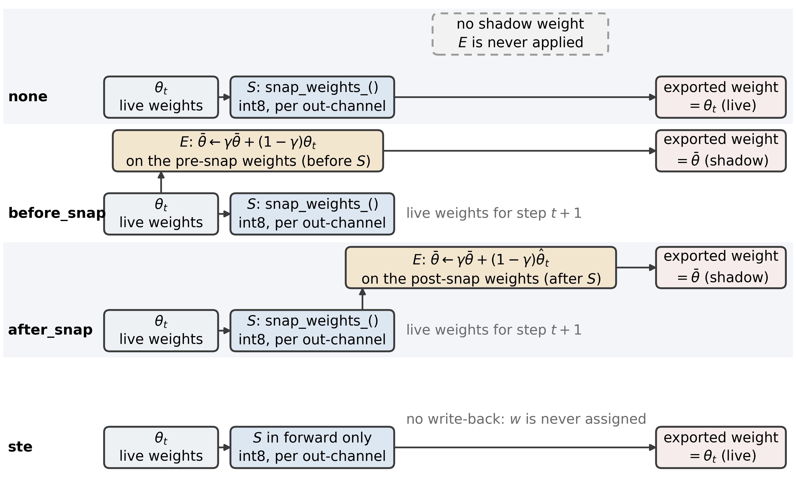
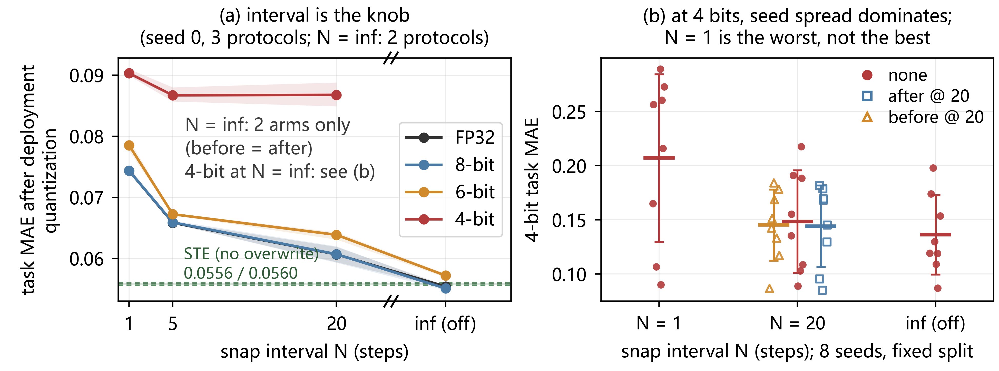
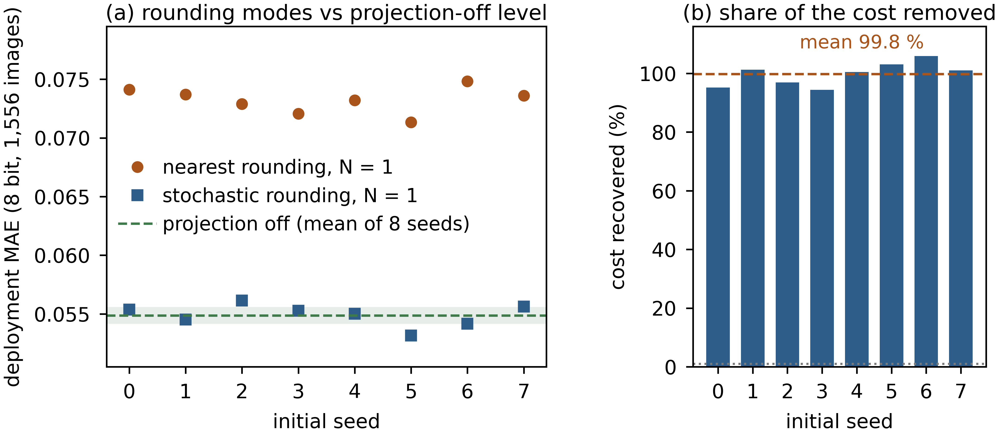

# What In-Place Weight Projection Costs at 8 Bits: An Evaluation Protocol for Quantized Deployment

Anonymous Author(s)
Anonymous Institution

## Abstract

Deployment-oriented quantization-aware training projects weights in place onto an int8 grid and keeps an exponential moving average (EMA) shadow. How these choices change deployment metrics is unmeasured. On UTKFace age regression we fix the recipe: symmetric per-output-channel int8, five sequences of eight seeds, one split, run-level inference.

Budget and learning rate set the scale. At 60 epochs the interval-1 cost is 0.0138 in all eight runs. Thirty times the learning rate gives 0.0055, below the resolution of eight seeds.

Against projection off, deployment mean absolute error (MAE) rises by 0.0185 at interval 1, about 1.85 years of age, on 1,556 held-out images. At interval 20 it rises by 0.0047, about 0.47 years. A straight-through control that fake-quantizes without overwriting finds no such cost; stochastic rounding per overwrite moves the cost from 0.0183 to 0.00004. At interval 20 the EMA shadow lowers MAE by 0.0014 in all eight paired runs. Averaging order is excluded only against a pre-specified 0.0016 bound, not proved zero.

Re-quantizing weights already on the deployment grid changes almost nothing. Fidelity scores therefore cannot rank models at 8 bits. We turn these checks into a five-rule evaluation protocol and test it on a target neural processing unit (NPU) compiler and two open-source runtimes. Confirmatory conclusions rest on one dataset and one model. ResNet-18 corroborates the interval ordering, while its order contrast, the data axis, cross-backend and 4 bit checks stay directional only.

**Keywords:** quantization-aware training; weight projection; deployment evaluation; stochastic rounding; equivalence testing

## 1. Introduction

Edge devices usually run neural networks with 8-bit integer weights. Some training loops also push the weights onto that grid while training. We call one such push a *projection*: every quantizable weight becomes $\mathrm{round}(W/s)\,s$, with $s = \max_j |W_{oj}|/127$ in the symmetric per-output-channel int8 setting used here. A projection can run after every optimizer step, or only every $N$ steps; setting $N$ to infinity switches it off. Most of these loops also keep a running average of the weights, $m \leftarrow \gamma m + (1-\gamma)W$ with $\gamma$ near 0.99, and export that average instead of the last iterate.

Each mechanism is well studied on its own. Their composition is not. Averaging first and projecting afterwards gives different weights from projecting first and averaging afterwards, because $S(E[W]) \ne E(S[W])$. Here $A \circ B$ applies $B$ first. *Average-then-project* averages unprojected iterates and projects once at export, while *project-then-average* averages projected iterates and stays near the grid throughout. Both orderings are shipped in practice. The exported weights differ by 4.3-9.1 % in relative L2 distance.

That raises a practical question. When two settings both look reasonable by every number a team usually reports, which weights should be shipped? At an 8-bit target the familiar fidelity scores cannot tell. Suppose the training projection and the deployment quantizer share the operator and the rounding rule, nothing clips, and the exported tensor already sits on the training grid. Requantizing at export then changes nothing. A centered cosine reads 1.0000 by construction, and a number that is constant cannot rank two models. We state that condition, and a check that applies it before any fidelity metric is quoted, as Proposition~\ref{prop:noinfo} and Algorithm~\ref{alg:precheck}. Our own deployment chains recompute the scale at export, so one condition fails, and the results below never depend on it.

We therefore audit the whole chain rather than a single number. One recipe is fixed: symmetric int8 weights, one quantizer, per-output-channel scales. Three things vary: how often the projection runs, whether the averaging shadow is kept, and the order of projection and averaging. Each setting is scored after export quantization, on images that took no part in choosing the training epoch. The unit of inference is the run, not the image, and eight paired seeds share one split. The same chain is then compiled for a target NPU and repeated on two independent open-source runtimes.

The paper contributes a way to decide which reported numbers may be used, and which knob to change first. Three results carry it:

* **A measured cost curve.** Projecting more often raises deployment mean absolute error (MAE). Against projection off, projecting every step costs 0.0185 MAE, about 1.85 years of age, and projecting every 20 steps costs 0.0047, about 0.47 years. Both hold in all eight paired runs and both survive Holm correction. Switching projection off is the best weight-only 8-bit setting under this recipe.
* **An attribution and a zero-cost fix.** The cost follows the in-place overwrite, not the presence of a grid. A control that fake-quantizes every step without overwriting shows no cost. Replacing nearest rounding with stochastic rounding removes almost all of it (0.0183 to 0.00004), with grid, interval and budget unchanged. Neither control measures the vanished updates directly, so the attribution is supported, not proved.
* **A five-rule evaluation protocol.** The rules say when a fidelity score may be quoted, why a per-node cosine must not rank models, which knob to drop first at 8 bits, how to report a null result with a stated margin and smallest detectable effect, and how to report a 4-6 bit ranking across seeds. Table 4 turns them into a decision table.

The scope is deliberately narrow. Confirmatory conclusions rest on one dataset, one architecture and one budget. A second network and a second dataset reproduce the direction of the interval effect, but not its magnitude. The order contrast on those axes, the cross-backend checks and the 4-bit ranking stay directional or cannot be decided. Training budget and learning rate change the size of the cost; we report how, in both directions, and do not claim a budget-independent mechanism.

## 2. Related work

Quantization-aware training widely uses straight-through estimation, explicitly used and popularized by Bengio et al. [1]. PACT learned the activation clipping threshold [2], LSQ learned the step size of the quantizer itself [3], and INQ raises the fraction of quantized weights in stages [4]. Low-precision training has long distinguished two routes. One keeps a high-precision master copy and fake-quantizes only in the forward pass; the other updates the low-precision weights directly. Under deterministic nearest rounding the second route erases any update smaller than half a grid step. Stochastic rounding and error feedback exist precisely to make that route work [5], [6]. Whether overwriting costs anything, and how much, therefore depends on the recipe and on the rounding mode. It is not an established principle either way.

Integer-inference practice tied training-time simulated quantization to deployment-time integer arithmetic. Jacob et al. give a formulation under which inference runs in integer arithmetic only, and align the training-time simulation with it [7]. The white papers of Krishnamoorthi [8] and Nagel et al. [9] turn the placement of the quantize/dequantize (QDQ) nodes into a design surface. Lee et al. model the transition of the quantizer itself as an explicit rate, and schedule it during training [10]. Text S6.1, item 5, and Table S12 compare that rate with our interval $N$. Our projection is the simplest and the only weight-only member of that family: symmetric, per-output-channel, step from the per-row maximum, no learned scale. The question here is not how to quantize but how quantization interacts with averaging.

On the averaging side, iterate averaging [11] and its exponential variant are standard practice, and Mean Teacher [12] popularized the EMA-shadow formulation. SWALP averages weights stochastically during low-precision training [13] and SQWA averages quantized weights to improve generalization [14]. Both average under quantization, but what they average is checkpoints or the trajectory. SWA takes equally weighted averages of iterates along the trajectory [15], and model soups add up fine-tunings of one pretrained model [16]. Both rest on separately trained models. The shadow studied here averages adjacent iterates inside one run and costs no extra training.

Reported "quantization error" numbers are often a cosine or a relative-L2 distance between float and quantized outputs. Such a metric stops separating good models from bad ones once it saturates, and whether it saturates depends on whether a projection was applied during training, not on deployment quality. MQBench turns deployability into a reproducible benchmark aligned with concrete deployment implementations [17], on the premise that a fidelity number detached from an implementation cannot summarize deployment quality. Our scope is narrower: only the criterion changes, to the task metric after explicit quantization. On the low-bit side, SmoothQuant folds activation outliers into a per-output-channel scale [18], and AdaRound learns a rounding direction per weight [19]. BRECQ widens the reconstruction target to a block [20]. HAWQ and HAWQ-V2 allocate bit widths from the spectrum of the Hessian [21, 22]. GPTQ decides each weight's rounding direction from a layer-wise reconstruction error [23]. AWQ protects a few salient channels with an activation-aware scale [24]. All of them change the quantizer. Here the quantizer and the scale granularity are held fixed over the whole sweep.

Every operator in our recipe is taken from existing practice. The projection is the plain symmetric per-output-channel snap, the shadow a standard exponential average, and the interval is swept rather than designed. The one setting that does move the outcome is borrowed. Replacing nearest with stochastic rounding recovers 99.8 % of the measured cost on average (94.4 % to 105.9 % per seed). That rule is not ours. It comes from [5], and the master-copy-free line of work that motivates overwriting uses the same one [6]. The two settings differ in the rounding mode. Two published readings of the same recipe differ in what the measurement supports. We therefore report the rounding mode, the interval and the evaluation basis next to every number.

Three questions decide whether a study covers the setting audited here. Are the weights overwritten in place onto the int8 grid with no high-precision master copy, and is the projection interval swept rather than fixed? Does a shadow average quantized weights, and is that average written after projection? Is the full int8 chain of a target NPU measured, and are the intervals reported across seeds? These are the six dimensions that Table S1 maps item by item, two to a question. No cited design answers all six. Further work from that search, discussed only in Text S1, is [25], [26], [27], [28], [29] and [30]. One of them takes a different route to the same grid. ProxQuant keeps the weights continuous and pulls them towards the grid with a proximal term [28]. BinaryRelax applies the same relaxation over a schedule of penalty strengths instead of projecting at all [31]. Both change the update rule. This paper keeps the projection and changes only when it is applied.

## 3. Method

### 3.1 Model and task

The model is a small architecture (4.41 M parameters) that keeps the *last* layers
quantization-friendly:

* regnety_008 backbone (RegNetY, from the RegNet design space [32]), as implemented in timm
  [33], feature levels 3 and 4, ImageNet-pretrained, input 224×224 (the UTKFace dataset,
  released with [34]);
* a lightweight FPN (1×1 lateral projections to 256 channels, bilinear ×2 upsampling, one
  shared GroupNorm(8) [35], additive fusion) and AdaptiveAvgPool2d to a 14×14 spatial grid (Text S2);
* a 2-layer TransformerEncoder (PyTorch's `nn.TransformerEncoder`; 8 heads, Pre-LN, feed-forward 4d; architecture of [36]);
* a ReLU-QAT control head: Linear(256→256) → RMSNorm → ReLU → Linear(256→1), 66.3 k
  parameters. RMSNorm [37] avoids mean subtraction; ReLU avoids transcendental operators.

Task: UTKFace age regression, target = age/100 (a MAE of 0.01 is one year), L1 loss, 23,708 images, random 15 %
validation split of 3,556 images.

### 3.2 The snap operator

For a weight matrix $W \in \mathbb{R}^{C_{out} \times C_{in}}$ quantized to $b$ bits, the integer range (two's complement, one extra step negative) and the per-output-channel scale are

$$q_b = 2^{b-1} - 1$$

$$s_o(W) = \frac{\max_j \left| W_{oj} \right|}{q_b}$$

and the projection is applied element-wise:

$$[S_b(W)]_{oj} = s_o(W)\cdot\mathrm{clip}\left(\mathrm{round}\left(\frac{W_{oj}}{s_o(W)}\right),\, -q_b-1,\, q_b\right)$$

The relative residual of one application over all projected tensors is

$$\varepsilon_b(W) = \frac{\left\| W - S_b(W) \right\|_2}{\left\| W \right\|_2}$$

and returned at every step. On a fixed grid the operator is a projection in the strict
sense: the channel maximum maps to $\pm q_b$ and is preserved by the clip, so $S_b(S_b(W)) =
S_b(W)$ holds to floating-point precision. Each application erases the sub-cell offset
inside a cell, not the row scale (§5.4). Drift between steps and the clip bound are in Text
S2.

The operator overwrites the parameters the optimizer holds, so gradients accumulate on the quantized weights and there is no full-precision master copy; the difference from straight-through fake quantization is set out in Text S2.

### 3.3 Three update protocols

With γ = 0.99, after every optimizer step (Table S4 of the ESM):

They differ only in the order of the two operations. With the EMA operator

$$E_\gamma(m, W) = \gamma m + (1-\gamma) W$$

at every optimizer step $t$ the three protocols compute

$$m_t = E_\gamma(m_{t-1}, W_t),\ \ \ \ W_t \leftarrow S_b(W_t)$$

$$W_t \leftarrow S_b(W_t),\ \ \ \ m_t = E_\gamma(m_{t-1}, W_t)$$

$$W_t \leftarrow S_b(W_t)$$

The first two lines export the shadow $m_T$, the third the live weights $W_T$. The two EMA protocols differ in *what is averaged*: before_snap averages iterates not yet projected at step $t$, after_snap projected ones. The two operations do not commute,

$$S_b(E_\gamma(m,W)) \neq E_\gamma(m, S_b(W))$$

which does not rest on the nonlinearity of $S_b$: $S_b$ acts on only one of the two terms, rounding the convex combination on the left and only $W$ on the right; the two sides agree only under narrow conditions (Text S2).

none still projects every $N$ steps and only omits the shadow; projection is switched off only by $N = \infty$ (--snap-every 0). Figure 1 draws the three protocols and the straight-through control.



**Figure 1.** Three in-place protocols and the straight-through estimator (STE) control. $S$ projects the weights onto a symmetric int8 grid every $N$ steps; $E$ updates the shadow; $N = \infty$ switches projection off.

### 3.4 Deployment measurement

Training-time projection and export-time quantization are measured separately: at export we take the deployed weights ($m_T$ or $W_T$) and apply a quantize-dequantize pass at $b$ bits with the same per-output-channel rule,

$$\hat{W} = S_b(W_{\mathrm{dep}}),\ \ \ \ W_{\mathrm{dep}} \in \{m_T, W_T\}$$

and evaluate the task metric on the validation split, mean absolute error over the $M$ validation images,

$$\mathrm{MAE} = \frac{1}{M}\sum_{i=1}^{M}{\left| \hat{y}_i - y_i \right|}$$

and read next to the zero baseline, the constant predictor that outputs the validation-split mean:

$$\mathrm{MAE}_0 = \frac{1}{M}\sum_{i=1}^{M}{\left| \bar{y} - y_i \right|},\ \ \ \ \bar{y} = \frac{1}{M}\sum_{j=1}^{M}{y_j^{\mathrm{val}}}$$

Weight-space differences are relative L2 distances between flattened vectors of projected tensors,

$$d(W, W') = \frac{\left\| W - W' \right\|_2}{\left\| W \right\|_2}$$

$b = 8$ reproduces the target 8 bit deployment; $b = 6, 4$ are stress tests. The controlled sweeps of §5.1–§5.4 rest on this weight-only simulation; the vendor toolchain is run in §5.5.

Notation used throughout: $\Delta$ is the tested quantity minus its reference, so a positive value means the tested one is worse; against FP32 the tested quantity is the quantized model (Tables 1 and 3 and Tables S16–S19).

## 4. Experimental setup

The validation split is rebuilt per run (Table S3). The run's seed sets both the data split and the parameter initialization, and the two are not decoupled: another seed changes both at once. All numbers here use each run's own split, and the FP32 column is checked against the training log's validation MAE (agreement within 0.005, the difference being the 400-image subsample). Two accounting bases have to stay apart. The training log and
history.csv report MAE on 2,000 images sampled at random from the 3,556-image validation
split (--val-windows defaults to 2000), while the zero baseline 0.1553 is computed on all
3,556 of them. The deployment table takes the first 400 images of the same split, whose own
zero baseline is 0.1625 for seed 0 and 0.1489 and 0.1483 for seeds 1 and 2. To remove the
split from cross-seed comparisons, the five main sequences share one fixed split (split_seed
= 0) and vary only the initial seed (seeds 0-7), so the run-to-run spread within those
sequences contains only initialization and batch-order differences; the remaining cells
still use a split per run and are read descriptively only (Text S2).

The basis for run-level inference is five main-configuration sequences of 8 initial
seeds each, 40 runs at 20 epochs; the run inventory, including the older batches, is in Text S2.

The deployment table covers 65 runs (quant_runs/deploy_table_v3.csv), 50 of which are evaluated on the 400 images shared with the main basis (quant_runs/deploy_table_v4.csv); the five main configuration sequences with 8 initial seeds each form the basis of the run-level inference (§5.2-§5.5), and 46 runs have a further re-evaluation on the 1,556-image external subset (quant_runs/heldout_eval_v3.csv, §5.2). Statistically, we treat three families plus one pre-specified equivalence test as confirmatory: the interval effect (intervals 1 and 20, contrasts a and b), the presence of the shadow (c), STE against in-place overwriting and against projection off (two contrasts), and the equivalence test for contrast d - six run-level contrasts in total (Table S14, collected in Online Resource 1, Text S7). Every other comparison in §5 is exploratory and uncorrected for multiplicity (Text S2).

Table S14 fixes the statistical identity of every claim in this paper: the inference unit and its
sample size, the number of contrasts, whether the comparison was pre-specified before the
run-level results were inspected, and whether a multiple-comparison correction was applied. Every subsection of §5 has a corresponding row in that table; wherever "pre-specified" reads "no", the reading is reported as exploratory only, and no conclusion rests on it.

What "pre-specified" rests on, since no timestamped registration was filed. The six confirmatory contrasts, their directions, the 1,556-image basis, the 8 bit primary width and the equivalence bound of 0.0016 were fixed in the analysis plan before the run-level readings on the external subset were computed, and the scripts that produce Table S14 and the run-level intervals are mapped in Table S13 of the Electronic Supplementary Material (Online Resource 1). What changed afterwards is the run inventory, not the hypotheses: the five main sequences were topped up from three seeds to eight, six STE seeds were added, and a third deployment backend was run, all of them entering contrasts that were already defined. Runs outside the plan are excluded by the rule stated in §3.3 rather than by a threshold chosen after seeing them, and the effect of the top-up is reported in Text S2.5. A reader who wants a formal registration should treat Table S14 together with this paragraph as the frozen statement, dated by the repository history rather than by an external registry.

The six confirmatory contrasts form one family because they are computed on the same
1,556-image external subset and the same eight paired seeds; Holm adjustment therefore
controls the family-wise error rate at $\alpha = 0.05$ across the six, including the
equivalence test for contrast d.


## 5. Results

### 5.1 At 8 bits, the export quantizer is a no-op

At interval 1 the real-time weights the none protocol exports sit on the grid. At longer intervals the optimizer still steps after the last projection, so they are off it at export time (relative RMS residual 0.0037 at interval 20), while the averaging pushes the exported shadows off the grid (Fig. S2). Re-quantizing either kind leaves the metric unchanged at four decimal places. The first measurement is the weight's residual against its channel grid, in grid steps,

$$\rho_{oj} = \frac{\left| W_{oj} - [S_b(W)]_{oj} \right|}{s_o(W)}$$

the second, the fraction of weights indistinguishable from a grid point,

$$f_\tau(W) = \frac{1}{\left| W \right|}\sum_{oj}{\mathbf{1}\left[ \rho_{oj} < \tau \right]},\ \ \ \ \tau = 0.05$$

The residual column is the relative RMS of eq. (4), a norm over the weight vector, not the mean of $\rho$ (Table S5).

The raw cosine is dominated by the vector mean, so the informative form is the centered cosine, the Pearson correlation of the two flattened vectors ($\mu_W$ and $\mu_{\hat W}$ are the means over all entries):

$$\cos_c(W, \hat{W}) = \frac{\sum_{o,j}{\left(W_{oj} - \mu_W\right)\left(\hat{W}_{oj} - \mu_{\hat{W}}\right)}}{\sqrt{\sum_{o,j}{\left(W_{oj} - \mu_W\right)^2}}\ \sqrt{\sum_{o,j}{\left(\hat{W}_{oj} - \mu_{\hat{W}}\right)^2}}}$$

The centered cosine of eq. (16) is 1.0000 whenever $\hat{W} = W$, so it carries no fidelity
information. At 8 bits all protocols read 1.0000 at four decimals. Two distances have to be
kept apart here. The first is the one the export projection itself produces, between the
tensor it is given and the deployed weights: 8e-9 for live weights whose last step was a
projection, up to 3.7e-3 for the shadows at interval 20. The second is the task-level
difference between the FP32 and the 8 bit model on the same images (0.0000-0.0014, Table
S5). The cosine sees the first and not the second. The 6 bit and 4 bit readings below are
export-time post-training quantization (PTQ) with the training-time projection fixed at 8
bits (Table S3); their cosines are in Text S3.1.

Idempotence is a property of this convention, not an empirical finding, and Proposition~\ref{prop:noinfo}
states the four conditions it needs. Those conditions are properties of the exported tensor, not of the
chain. The deployment quantizer recomputes its scale from the tensor it exports (Text S2.1), so condition
(i) holds only where that tensor is already on the grid. At interval 1 the live weights are that case. A
projection preserves the per-row maximum, so
the export scale equals the scale of the last training step and the export moves nothing beyond
8e-9. The shadows at interval 20 are off-grid by up to 0.0037, so they receive a scale that no
training step used and move by up to 3.7e-3, which still leaves the centered cosine at 1.0000.
What makes the metric uninformative is not that the weights are identical. It is that these
distances sit one to two orders of magnitude below the differences between protocols
(Table S6). 3.6 % of the weights lie more than 0.45 grid steps away (Fig. S2).

```latex
\begin{proposition}[Non-informativeness of the export fidelity metric]
\label{prop:noinfo}
Let $S_b$ be the training projection of \S{}3.2 and $S^{\mathrm{dep}}_b$ the deployment
quantizer applied at export. Suppose (i) both use the symmetric per-output-channel rule with
the same step, (ii) both round to nearest, (iii) no clipping bound binds, and (iv) the
exported tensor $W_{\mathrm{dep}}$ already lies on the training grid. Then
$S^{\mathrm{dep}}_b(W_{\mathrm{dep}})=W_{\mathrm{dep}}$, the centered cosine of eq.~(16)
equals $1$, and every metric monotone in that cosine is constant on this regime.
\end{proposition}
\begin{proof}
Under (i)--(iii) $S^{\mathrm{dep}}_b$ is a nearest-grid-point projection with the step of
$S_b$, so on a grid point it returns that point and is idempotent there. By (iv)
$W_{\mathrm{dep}}$ is such a point, hence $S^{\mathrm{dep}}_b(W_{\mathrm{dep}})=W_{\mathrm{dep}}$
and $\hat W=W$ in eq.~(16), whose numerator and denominator then coincide. Monotonicity gives
the final clause.
\end{proof}

$S^{\mathrm{dep}}_b$ recomputes its step from the tensor it is given (Text S2.1), so in our
own deployment chains premise (i) is the one that fails. The residual is not zero but at most
$3.7\times10^{-3}$ in relative RMS, and the cosine still reads 1.0000 at four decimals. The
metric is then uninformative by resolution rather than by identity, and
Proposition~\ref{prop:noinfo} does not apply to it. Table S7 reports the residual per
protocol under both scale provenances.

\begin{algorithm}[!t]
\caption{Admissibility pre-check before a deployment fidelity metric is quoted}
\label{alg:precheck}
\begin{algorithmic}[1]
\Require training rule $S_b$, deployment quantizer $S^{\mathrm{dep}}_b$, exported $W_{\mathrm{dep}}$, tolerance $\tau$ (we use $\tau = 5\times10^{-3}$)
\Ensure an admissible metric, or the reason to drop one
\State $\rho \gets \lVert W_{\mathrm{dep}}-S^{\mathrm{dep}}_b(W_{\mathrm{dep}})\rVert_2 / \lVert W_{\mathrm{dep}}\rVert_2$
\If{operator, step or rounding differ between $S_b$ and $S^{\mathrm{dep}}_b$}
  \State \Return $\rho$ under the deployment step, eq.~(14); a cosine is not comparable
\EndIf
\If{$\rho \le \tau$}
  \State \Return drop the fidelity metric (Proposition~\ref{prop:noinfo}); report task MAE after export quantization
\EndIf
\State \Return the centered cosine, with its interval, bit width and evaluation basis
\end{algorithmic}
\end{algorithm}
```

The tolerance is the one free number in the check, and we fix it from measurement rather than from taste. The largest export residual observed in our chains is $3.7\times10^{-3}$ in relative RMS (Table S7), so $\tau = 5\times10^{-3}$ admits every checkpoint we report and leaves about 35 % headroom. A chain whose residual exceeds it is not idempotent in the sense above. Its cosine is then quoted only with the interval, bit width and evaluation basis attached, as the last line of the algorithm requires.

The no-op concerns the weight quantizer only: re-projecting already projected weights changes nothing (§3.2). A deployment compiler also quantizes *activations* into look-up tables, and that part is not idempotent. The full int8 pipeline on the same checkpoints (§5.5) costs +0.0034–0.0042 MAE across the ReLU-QAT and GLU heads (+0.0034–0.0038 on ReLU-QAT alone). That is an order of magnitude more than the 0.0004 of Table S5 (two additional runs aside), and it leaves the interval ranking intact (one protocol, so it says nothing about the ordering).

### 5.2 The cost of projection, and the endpoint that switches it off

Task MAE after deployment quantization, seed 0, three protocols per interval, plus the endpoint N = ∞ at which projection is switched off (Table 1):

**Table 1.** Task MAE after deployment quantization (seed 0, three intervals and the projection-off endpoint) on the 400-image subset, with the 1,556-image external subset in the last column.
| interval | protocol | FP32 | 8 bit | 6 bit | 4 bit | Held-out FP32 |
|---|---|---|---|---|---|---|
| 1 | none | 0.0741 | 0.0741 | 0.0785 | 0.0900 | 0.0741 |
| 1 | before_snap | 0.0741 | 0.0741 | 0.0776 | 0.0899 | 0.0738 |
| 1 | after_snap | 0.0748 | 0.0748 | 0.0794 | 0.0910 | 0.0738 |
| 5 | none | 0.0660 | 0.0662 | 0.0672 | 0.0857 | 0.0652 |
| 5 | before_snap | 0.0658 | 0.0658 | 0.0674 | 0.0880 | 0.0653 |
| 5 | after_snap | 0.0657 | 0.0657 | 0.0671 | 0.0864 | 0.0653 |
| 20 | none | 0.0619 | 0.0620 | 0.0642 | 0.0888 | 0.0591 |
| 20 | before_snap | 0.0607 | 0.0608 | 0.0643 | 0.0866 | 0.0579 |
| 20 | after_snap | 0.0594 | 0.0593 | 0.0631 | 0.0849 | 0.0573 |
| ∞ | none | 0.0552 | 0.0548 | 0.0575 | 0.1535 | 0.0543 |
| ∞ | after_snap | 0.0556 | 0.0554 | 0.0569 | 0.1040 | 0.0546 |
**Note:** Point estimates only; the paired differences, their 95 % confidence intervals and the 1,556-image basis are in Text S3.2 and quant_runs/paired_report.md.

The two N = ∞ rows mean no projection during training (snap_every = 0). before_snap and after_snap then collapse into the same algorithm, so only after_snap is listed; none keeps no shadow and exports the live weights directly. Their FP32 values, 0.0556 and 0.0552, differ by +0.00043 with an interval that contains zero (§5.3).



**Figure 2.** (a) Deployment MAE against projection interval; $N = \infty$ is projection off and the band is the range of the two shadow protocols. (b) 4 bit spread over eight seeds.

At the run level the drop becomes two contrasts against switching projection off. With eight
paired seeds on one fixed split (df = 7) and scored on the 1,556 images that took no part in
epoch selection, interval 1 reads $+0.0185$ and interval 20 $+0.0047$; neither interval
contains zero (Table 2). At 8 bit, projection is a *cost* paid in optimization noise. The
longer the interval, the smaller that cost, and both contrasts sit far above the run-to-run
dispersion (paired sd 0.0011 and 0.0008).

**Table 2.** Run-level contrasts: $\Delta$ is the tested quantity minus its reference in deployment MAE on the 1,556 images held out of epoch selection, brackets are 95 % paired $t$ intervals over eight seeds (df = 7), and the Holm values of the first block cover those six confirmatory contrasts; the 6 bit block is a post hoc family of four and the controls belong to neither family; off abbreviates projection switched off.
| Contrast | Setting | $\Delta$ MAE | 95 % CI | Same sign | $p$ | Holm |
|---|---|---|---|---|---|---|
| a: interval 1 $-$ off | 8 bit | $+0.0185$ | $[+0.0175, +0.0194]$ | 8/8 | $6.4\times10^{-10}$ | $3.9\times10^{-9}$ |
| b: interval 20 $-$ off | 8 bit | $+0.0047$ | $[+0.0040, +0.0054]$ | 8/8 | $8.8\times10^{-7}$ | $3.5\times10^{-6}$ |
| c: shadow at interval 20 | 8 bit | $-0.0014$ | $[-0.0018, -0.0010]$ | 8/8 | $1.1\times10^{-4}$ | $2.2\times10^{-4}$ |
| d: order at interval 20 | 8 bit | $+0.00003$ | $[-0.00025, +0.00031]$ | 5/8 | $1.5\times10^{-6}$ (TOST) | $4.6\times10^{-6}$ |
| STE minus in-place overwrite | 8 bit | $-0.0184$ | $[-0.0196, -0.0173]$ | 8/8 | $2.1\times10^{-9}$ | $1.0\times10^{-8}$ |
| STE minus projection off | 8 bit | $-0.0001$ | $[-0.0008, +0.0006]$ | 4/8 negative | $0.76$ | $0.76$ |
| a: interval 1 $-$ off | 6 bit | $+0.0214$ | $[+0.0195, +0.0234]$ | 8/8 | $3.3\times10^{-8}$ | $1.3\times10^{-7}$ |
| b: interval 20 $-$ off | 6 bit | $+0.0060$ | $[+0.0042, +0.0079]$ | 8/8 | $9.8\times10^{-5}$ | $2.9\times10^{-4}$ |
| c: shadow at interval 20 | 6 bit | $-0.0027$ | $[-0.0044, -0.0009]$ | 7/8 | $0.070$ | $0.018$ |
| d: order at interval 20 | 6 bit | $-0.00029$ | $[-0.00109, +0.00051]$ | 4/8 | $0.42$ | $0.42$ |
| a at 60 epochs | 8 bit | $+0.0138$ | $[+0.0127, +0.0149]$ | 8/8 | $1.1\times10^{-8}$ | - |
| a at 30-fold learning rate | 8 bit | $+0.0055$ | $[-0.0009, +0.0118]$ | 6/8 | $0.08$ | - |
| change in a: 60 vs 20 ep | 8 bit | $-0.0047$ | $[-0.0057, -0.0036]$ | 8/8 negative | - | - |
| change in a: lr 30-fold | 8 bit | $-0.0130$ | $[-0.0192, -0.0068]$ | 7/8 negative | - | - |
| a: stochastic rounding | 8 bit | $+0.00004$ | $[-0.0006, +0.0007]$ | 5/8 negative | $0.89$ | - |

The endpoint gives the lower end of the cost curve. With projection switched off the FP32
deployment MAE is 0.0552 (none) and 0.0556 (after_snap), 0.0189 and 0.0192 below interval 1
and about 0.0067 and 0.0037 below interval 20 (single-run point estimates, Table 1). At
$N = \infty$ the 8 bit minus FP32 difference is still only 0.0002-0.0004. Under the convention
of §3.4 it is written −0.00037 and −0.00023, the negative sign meaning 8 bit reads slightly
lower, and both intervals contain zero. Most finite-interval runs hold this difference within
0.0004 (0.0000 at interval 1), the two additional runs aside.

Hence at the weight-only 8 bit target training-time projection is a pure cost, and the optimal
setting is to switch it off. At 6 bits the same run-level contrasts are larger: $+0.0214$ at
interval 1 and $+0.0060$ at interval 20, 8/8 of one sign (Table 2). The cost is consistent
with the in-place overwrite rather than with weights resting on the grid; the two controls
support that reading without measuring it. On the 1,556-image basis the STE control reads
$-0.0001$ against switching projection off (§5.4). The three-seed, 400-image reading of 0.0008
is reported in Table S11 for completeness and is not the inferential basis.

The evaluations above use the first 400 images of each run's validation split, while the best
epoch was selected on the 2,000-image monitoring subset of that split (§4), so the two overlap.
The same deployment quantizer re-run on the 1,556 images that took no part in selection avoids
that overlap (zero filename overlap, predictions archived). Fig. S3 gives the per-seed paired
differences of the same runs under the two bases.

The interval effect is unchanged there. For none and seed 0 the FP32 MAE is 0.074110 at
interval 1 and 0.054271 at $N = \infty$. The per-image paired difference is $+0.01984$ (single
run, se 0.00138, 95 % CI $[+0.01713, +0.02255]$), as in the 0.0189 of Table 1. Intervals 5
and 20 read 0.065249 and 0.059096, i.e. $+0.01098$ and $+0.00483$ against the endpoint. The
ordering effect halves: at interval 20 and seed 0 the before-minus-after difference falls from
$+0.00132$ on 400 images to $+0.00066$ (se 0.00038, 95 % CI $[-0.00008, +0.00139]$,
containing zero), still within this test's resolution.

The optimism is measurable. Across the nine cells of Table 1 the FP32 MAE on 400 images
exceeds the external subset by 0.0012 on average. The gap grows with the interval ($+0.00044$
at 1, $+0.00055$ at 5, $+0.00256$ at 20), as a longer interval leaves more late epochs. The
shadow survives there: at interval 20, before and after against none read $-0.00118$ and
$-0.00184$, neither interval containing zero. It disappears at $N = \infty$ ($+0.00035$,
containing zero), consistent with §5.3. Epoch selection and the STE control: ESM, Text S5.

### 5.3 What the shadow and the averaging order change

Within one interval at seed 0 the three protocols span 0.0027 (8 bit, interval 20) and
0.0025 (FP32, interval 20), of which the ordering accounts for 0.0015 and 0.0013. At 6 bits
the run-level ordering contrast d is $-0.00029$, 4 of 8 positive (Table 2). The largest
ordering gap at seed 0 is 0.0018, at interval 1, from a single seed without pairing.

These are single-run descriptions, so the inferential unit becomes the run. Five main
configuration sequences (none at $N = 1$, $N = 20$ and $N = \infty$, plus before_snap and
after_snap at $N = 20$) each carry 8 initial seeds on the same fixed split, paired run by run.
Contrast d (before_snap $-$ after_snap at $N = 20$) reads $+0.00003$ on the 1,556 images that
never took part in epoch selection, 5 of 8 positive; on the 400-image subset it reads
$+0.00018$. The per-seed paired sds of the four run-level contrasts are 0.0011, 0.0008,
0.0005 and 0.0003.

The margin of the equivalence test is pre-specified and independent of the observations: 1 %
of the 0.1553 zero baseline, i.e. 0.0015526728, or 0.0016 to four decimals. We read it as a
maximum negligible degradation budget, 0.16 years of age on this task and two orders below the
0.0183 that the projection costs at interval 1. A two one-sided test (TOST) [38], with the
tutorial in [39], rules out an ordering effect of 0.0016 or more on the 1,556 images (raw
$p = 1.5\times10^{-6}$, Holm-adjusted $4.6\times10^{-6}$; Table 2) and on the 400 images
($p = 0.00064$). The minimum detectable effect at 80 % power is 0.000383 on 1,556 images and
0.000897 on 400. A post-hoc sensitivity analysis puts the critical bound at 0.000252, 6.4
times below the preset bound; at bounds from 0.0003 to 0.0032 the test returns $p$ between
$1.2\times10^{-8}$ and 0.027, so every bound leads to the same conclusion (Text S3.3). The
bound was not set so that the test would pass.

The 6 bit contrast d is reported for completeness only. Its paired standard error is 0.000338,
2.9 times the 0.000118 of the 8 bit basis, so the 80 % MDE rises to 0.0011 and 4 of the 8
seeds fall on each side. The pre-specified 0.0016 bound belongs to the 8 bit basis and is only
1.4 times the 6 bit MDE. No equivalence claim is therefore attached to 6 bits. Text S3.3
quotes the post-hoc number only to record what applying that bound there would return. The
other three 6 bit contrasts keep their direction at that basis: $+0.0214$ for a, $+0.0060$ for
b and $-0.0027$ for c, the last 7/8 of one sign. Treated as one post-hoc family of four and
corrected by Holm they give $1.3\times10^{-7}$, $2.9\times10^{-4}$, $0.018$ and $0.42$ (Table
2). The two interval contrasts and the shadow therefore survive correction at 6 bits. The
family is post hoc because it was declared after the 8 bit results were read. It shows that
these directions do not rest on an uncorrected multiplicity choice, and it promotes nothing to
confirmatory. Every sign test quoted beside these intervals is bounded below by
$p = 0.0078$ at $n = 8$, the smallest value attainable at that sample size.

The seven per-image paired comparisons made earlier are exploratory only: none exceeds 0.0014, the sign changes with the seed, and 0/7 survive Holm and Benjamini–Hochberg correction (Text S3.4).

The six confirmatory contrasts of Table S14 are also reported as one family. On the 1,556-image basis the paired $t$ statistics give $p = 6.4\times10^{-10}$ for a, $8.8\times10^{-7}$ for b, $1.1\times10^{-4}$ for c, $2.1\times10^{-9}$ for STE against in-place overwriting and $0.76$ for STE against projection off. Holm adjustment across the six leaves every conclusion unchanged (Table 2). The equivalence test of contrast d enters the same family at adjusted $4.6\times10^{-6}$. The uncorrected reading of the shadow contrast as 2 of 7 surviving is the per-image analysis of Text S3.4, a different unit.

The ordering is not a no-op on the weights. Relative L2 between exported weight vectors (Table S6):


In weight space the ordering moves the network by 4.3–9.1 %, yet the task metric moves by only +0.000029 (1,556-image basis, interval containing zero), whereas retraining with another seed moves 64–83 % (Fig. S6). A claim that one ordering is "safer" must be argued in function space, and this measurement does not support it.

Export quantization does not produce it either. Requantizing the exported weights of both orders at interval 20 with the deployment quantizer moves the relative L2 from 4.7 % ± 0.6 % to 4.8 % ± 0.6 %. After it, 98 % of the weights still land on different grid points. This uses 8
seeds with a fixed split, a different source from the 5 old-caliber run pairs of Table S6
(artifact in Table S13). The cross-seed share is 63.5 % both before and after requantization.
This 4.8 % is not the same quantity as $\rho$ in §5.1. The former is the overall relative L2
between two ordered weight sets, the latter the relative RMS residual of the deployed weights
to their grid ($\varepsilon$ of eq. 4, at most 0.0037 across the runs at interval 20; Table
S5).

Nor is the time constant of the average a knob explaining the ordering effect: with κ = N(1−γ), at interval 20 and seed 0, γ = 0.9, 0.99 and 0.999 give κ = 2, 0.2 and 0.02. The ordering differences read +0.0014, +0.0013 and 0.0000. That span is at most 0.0014 and does not grow monotonically with κ; with the cross-seed results of §5.3, the sign of the ordering difference is not stable.

The previous section detected no ordering effect at the run level, but the shadow left a
small, consistently signed reading. At interval 20 the paired difference of after_snap against
none is $-0.0014$ on the 1,556 held-out images, 8/8 runs of the same sign (Table 2). On the
400-image subset the same contrast is $-0.0012$, 7/8 of the same sign ($p = 0.070$). That
subset overlaps the 2,000-image monitoring subset used for epoch selection, which deflates
the run-to-run dispersion.

The shadow effect exists, with magnitude 0.0014, an order of magnitude below the interval
effect. It vanishes in the protocol mean: at interval 20 and seed 0 the protocols read 0.0619,
0.0607 and 0.0594 (none / before_snap / after_snap), and the mean coincides with before_snap.
Nor is it unconditionally useful: with projection switched off, after_snap against none reads
$+0.00043$ at the image level, an interval containing zero. Unlike SWA [15] or model soups
[16], the shadow needs no retraining and slides along a single trajectory, which is why its
magnitude is 0.0014. At 6 bits the contrast is twice as large ($-0.0027$), but only 7 of 8
runs share its sign, so we report the interval without treating it as stronger evidence.

### 5.4 Why the cost appears: the overwrite, not the grid

Three diagnostics — the per-event projection error, the fraction of projections that were fixed
points, and the shadow-to-live distance — are itemized in Text S4; none of them pins the model
to the grid.

Projection rewrites the parameters themselves; fake quantization does not. A standard
straight-through estimator (STE) puts the quantization in the forward pass, $w_q = w +
(\mathrm{snap}(w) - w).\mathrm{detach()}$, so the parameters stay float: the weights count as
quantized at every step, yet no step overwrites them. We ran three seeds with every other
hyperparameter identical to the interval-1 none protocol; Table S11 gives the result.

These three seeds were later extended to eight initial seeds on the fixed split, with three
projection modes: STE, in-place overwrite at interval 1, and projection switched off
($N = \infty$). The three are paired seed by seed on the 1,556 images that took no part in
checkpoint selection, under 8 bit weight-only quantization. STE sits 0.0184 below the
overwrite, 8/8 seeds; the overwrite sits 0.0183 above projection off, 8/8; and STE against
projection off reads $-0.0001$, 4 of 8 negative (Table 2). The group means are 0.0548 ±
0.0012, 0.0732 ± 0.0011 and 0.0549 ± 0.0007. Lying on the grid at every step costs nothing;
replacing the parameters with grid points costs two orders of magnitude more.

The cost co-varies with the number of overwrite events (6,280 worst, then 1,256, 314, zero
best). The interval also sets the single-step displacement (relative RMS 0.000 → 0.0012 →
0.0030), and the two vary in opposite directions, so only the co-variation is stated. Three
mechanism controls set the scale of the cost and place it on the rounding rule and on how
much progress each overwrite destroys.

Tripling the budget to 60 epochs lowers the interval-1 cost from $+0.0185$ to $+0.0138$, 8/8
in the same direction. Slower convergence accounts for a quarter of the cost, and a longer
budget does not remove it. Raising the learning rate 30-fold lowers it to $+0.0055$, which
eight seeds cannot separate from zero (6/8 positive), yet the contraction itself is resolved
against the same runs at $10^{-4}$: $-0.0130$, 7/8 negative. At 8 bits, replacing only the
rounding at each projection with stochastic leaves $+0.00004$ against projection off (5 seeds
negative, 3 positive) where nearest rounding reads $+0.0183$. With a per-seed recovery of
94.4 % to 105.9 % (mean 99.8 %, Fig. 3), stochastic rounding removes 99.8 % of that cost on
average under this recipe, and the fix costs nothing: grid, interval and budget stay the
same. The per-control intervals and sign tests are in Table 2 and Text S4.

Lining the three controls up against the prior lines of work shows which degree of freedom each
one changes, and what it costs under the same recipe (Table 3).

**Table 3.** Three ways of handling weights during training, the lines of prior work they correspond to, and the readings under this paper's recipe

| Handling during training | Counterpart | What that line changes | Reading under this recipe | Relation to the interval $N$ |
|---|---|---|---|---|
| Fake-quantize forward, parameters not overwritten (STE) | the straight-through estimator of standard QAT, e.g. [4], [26], [40] | forward quantization on the grid, straight-through backward; parameters stay float | -0.0001 [-0.0008, +0.0006] against projection off, 4/8 negative | never triggers an overwrite, so independent of $N$: forward quantized but never projected |
| Overwrite in place every step, nearest rounding | direct quantized training with no master copy; the deterministic-rounding baseline (the control case of [5]) | writes the parameters to the dequantized grid value every step | +0.0183 [+0.0176, +0.0191] against projection off, 8/8 | this is the $N = 1$ cell of this paper |
| Overwrite in place every step, stochastic rounding | DQT's stochastic rounding [5], ECO's master-copy-free training [6], analyses of stochastic rounding [41] | changes only the rounding rule; grid, interval and budget unchanged | +0.00004 [-0.0006, +0.0007] against projection off, 5 negative and 3 positive | exactly the $N = 1$ recipe, differing only in the rounding rule |
| Interval $N$ (the variable here) | when to project inside a weight-transfer schedule, e.g. [10] | how many optimizer steps separate two projections | $N{=}1$ +0.0183, $N{=}20$ +0.0047, $N{=}\infty$ 0 | the variable of this paper; its relation to schedules is discussed below |



**Figure 3.** (a) Per-seed deployment MAE under stochastic and nearest rounding, 8 bits; the band is one standard deviation of the projection-off seeds. (b) Share of the cost recovered, mean 99.8 %.

**Projection schedules and the interval $N$: where they agree and where they do not.** Work
such as [10] schedules how fast the weights move between grid cells while keeping
full-precision latent weights. Our $N$ only fixes how many optimizer steps separate two full
projections, and it is constant within a run. The two measure different objects, so their
numbers are not directly comparable (Table S12). A schedule that moves the weights only part
of the way to a grid cell writes points between cells. Then $S_b$ acts on one side of a convex
combination only, and §3 shows that averaging and projection do not commute (Eq. (9)). A
sparse-then-dense schedule is likewise not a linear interpolation between two fixed-$N$
readings. The longer argument is in Text S4.

With the shadow's averaging source switched to the forward fake-quantized weight (--ema-source
forward), the deployed FP32 MAE over three seeds is 0.0555 ± 0.0022 against 0.0560 ± 0.0035 for
the plain STE control. That difference of 0.0005 is far below the seed spread, so which
quantity the shadow averages is not resolved under STE either.

### 5.5 External validity: bit width, the target NPU, architecture, dataset and backends

Five checks ask whether the results above survive a change of bit width, of implementation chain, of network, of dataset and of deployment backend. Each is scored on its own basis, and each is read as directional unless it carries eight paired seeds and a run-level interval.

**Bit width.** At 4 bits the two evaluation bases disagree in sign: $-0.0635$ on the 21-run basis and
$+0.0710$ on the eight-seed fixed split. The within-interval seed sd ($0.0476$--$0.0626$) is
5--7 times the between-interval spread, so the per-seed direction, not the mean, is what this
design can speak to. The interval-1 contrast reads $+0.0710$ [$+0.0013$, $+0.1406$] with 2 of
the 8 seeds reversed: an exact two-sided sign test gives $p = 0.289$, the median is $+0.0777$
and the Hodges-Lehmann estimate $+0.0696$. A bootstrap interval over the 8 seeds is
$[+0.0149, +0.1245]$ (Text S4.2), and the paired sd of 0.0833 exceeds the effect itself. We
therefore report 4 bit as *non-decidable* under this design. The earlier single-seed reading
that a longer interval buys 4 bit robustness compared a lucky seed with an unlucky one.

Table S9 and Figure S5 use the 21-run basis (seeds 0–2, each run with its own split), which
ranks interval 1 lowest at 4 bits (0.1224). The primary basis — fixed split, 8 seeds — ranks
the opposite way: 0.2070 at interval 1, 0.1484 at interval 20 and 0.1361 at projection off
(Fig. 2b). In the 21-run basis seeds 1 and 2 degrade to 0.1267–0.2030 while seed 0 stays at
0.0849 (Fig. S5), so the three 4 bit means differ by no more than 0.0091 (0.1224 / 0.1248 /
0.1315) against a within-interval seed sd of 0.0476–0.0626. At 8 and 6 bits, by contrast,
interval 20 is the best of the three finite intervals; counting the projection-free endpoint,
N = $\infty$ is best (Table 1).

Topping the five main sequences up to eight seeds widens the 4 bit run-to-run sd to
0.0365–0.0774 against 0.0020 at 8 bit. This is therefore an observation about 21 runs (n = 5,
9 and 7), not a claim about 4 bit quantization in general. The median, Hodges–Lehmann and
bootstrap readings, the 22-run attribution checks and the seed-0 endpoints of projection-off
(0.1535 and 0.1040) are in Text S4.

**The target NPU chain.** Everything above isolates one knob by simulating the quantizer in
PyTorch. A deployment pipeline does more, so we also ran the vendor toolchain on five
checkpoints (four control-head exports plus one projection-off). Each goes through four stages. Export to a static ONNX graph; calibrate on 100 training-split images disjoint from the test subset; compile for the target BPU (latency mode, O2, one core); run the instruction stream on the vendor's x86 instruction-level simulator (Fig. S7).

Figure S7 shows the chain: the left blocks weight-only (the old simulation), the right blocks
the compiled int8 pipeline, which adds per-tensor percentile quantization of activations and
lowers unary elementwise ops to b30.lut. The middle bars put the two error magnitudes on one
axis (95 % intervals over 200 images paired image by image, single run). They read ≤ 0.0003
for weight-only quantization, the four control-head exports itemized in Table S15, and the
projection-off cell at $+0.0040$ $[-0.0012, +0.0093]$. The lower half counts the unary ops
lowered to b30.lut per head: ReLU-QAT 3, GELU 2, Bilinear-GLU 0.


All four exports are the after_snap protocol at seed 0 with shadow weights, the deployed-weight
definition of §3.4. Provenance was established by re-running every checkpoint on the same fixed
input and matching it against the ONNX output (max $| \Delta | = 9 \times 10^{-8}$ – $4 \times
10^{-7}$). Table S15 pairs 200 test images from a single checkpoint at batch 1, not the
400-image subset of Table 1, so the two sets of numbers cannot be subtracted from each other.


$\Delta$MAE averages $|y_{\text{sim}}-y|-|y_{\text{FP32}}-y|$ and $\Delta$ output bias averages
$y_{\text{sim}}-y_{\text{FP32}}$; the brackets are per-image paired 95 % t intervals (the full
note is in Text S4).


Figure S8 shows the three measurement groups in (a) and the output bias they introduce in (b),
against zero. ReLU-QAT at interval 1 is biased by +0.0171 (9.1 standard errors) and GLU by
+0.0144 (6.7 standard errors), while the former's per-node cosines are the cleanest in the
graph.

Removing the bias, ReLU-QAT's $\Delta$MAE at interval 1 falls from +0.0038 to +0.0020, roughly
halved, while at interval 20 it only falls from +0.0034 to +0.0031 (its bias there is +0.0026);
GLU goes the other way, from +0.0042 to +0.0050. The bias is part of the cost but not all of
it.

On the ReLU-QAT and GLU heads the compiled int8 model costs +0.0034–0.0042 MAE (GLU's 95 %
interval contains 0). That is an order of magnitude above the 0.0004 of §5.1, which is a
statement about the weight quantizer only, so the full pipeline is far from a no-op (Fig.
S8). The deployment grid is a larger error source (§7 item 7). These readings come from the
vendor toolchain, not from the same source as the confirmatory PyTorch-simulated contrasts of
§5.2. At eight initial seeds of the none arm the chain gives a paired per-seed delta of +0.002916 [+0.001698, +0.004134] at $N = 1$, 8/8 positive (sign test $p = 0.0078$). At $N = \infty$ it gives +0.001166 [-0.000400, +0.002732], 6/8 ($p = 0.289$). The two intervals overlap,
so this design does not separate the cost of projecting every step from the cost of not
projecting, and the single-checkpoint figures above are point estimates from seed 0 only.

Per-node cosine compares a node's quantized output with the FP32 output over the 200 test
images, aggregated per head as the head's minimum. The /head/ minima are 0.997010 (ReLU-QAT),
0.990574 (GELU) and 0.983052 (bilinear_glu) against mean int8 costs of +0.003834, -0.000157 and
+0.004233, so the order is neither the same nor reversed. Head identity and cost are
confounded, and the worst node in the whole graph sits in the backbone (minimum 0.9422), not in
the control head.

At the best finite interval under FP32 (N = 20) the compiled model still beats N = 1 by 0.0155
MAE. The paired per-image $\Delta$MAE is +0.0038 at N = 1 and +0.0034 at N = 20, a difference
of 0.0004, smaller than the standard error: no interaction was detected. The output bias, by
contrast, is 7× smaller at N = 20 (+0.0026) than at N = 1 (+0.0171).

The projection-off cell lets the interval result be read on the deployment chain. That
checkpoint (none, $N = \infty$, seed 0) moves from 0.0537 in FP32 to 0.0577 in the simulator, a
paired $\Delta$MAE of $+0.0040$ whose 95 % interval $[-0.0012, +0.0093]$ contains zero. The
three cells read $+0.0038$, $+0.0034$ and $+0.0040$: switching the projection off removes only
the cost the projection imposes, not the cost the chain imposes. What survives is the
difference between protocols: $N = 20$ beats $N = \infty$ by $+0.0068$ in FP32 and $+0.0065$ in
the compiled stream, i.e. 95.0 % of the training-side gain.

The four .hbm files were then re-measured on an RDK S100P (system 4.0.5-Beta, kernel
6.1.158-rt58-DR, HBDK runtime 4.7.5, one BPU core). Fed the 200 test images one at a time, the
board reproduces the simulator sample for sample: the largest absolute deviation over 800
inferences is 0, so the simulator stands in for the board. In latency, hrt_model_exec averages
1.13–1.20 ms per frame (820–878 FPS); single-stream python latency is 1.50–1.54 ms at the
median, at most 1.85 ms at P99, and four threads reach 1,092 FPS.

Two limits. The simulator reproduces the compiler's own fake-quant output to within 0.0009 MAE
on the three ReLU-QAT and GELU models and 0.0022 on the GLU head. The compiler's static
latency estimate (991.3–993.3 µs, 31.2 MB of DDR traffic) sits 12–18 % below the board.

**Architecture.** The main experiment contains one 4.41 M network and one dataset, so we ran two external axes. Table S16 keeps both at two endpoints — in-place overwriting at every step (interval 1) and projection switched off ($N = \infty$) — with two protocols (none, after_snap) and 8 initial seeds (0-7) at a learning rate of 1e-3. Its 8, 6 and 4 bit columns share that one training setting. At the main learning rate of 1e-4 the architecture axis is extended to four intervals and, at interval 20, to the third protocol (Table S17). Apart from the learning rate the settings match the main experiment: 20 epochs, batch 64, cosine annealing, shadow decay 0.99, exported weight as in §3.4. Each run rebuilds the split from its own seed: the endpoint cells of Table S16 use 400 validation images, while the 1e-4 cells of Table S17 are scored on the 1,556-image external subset, the same basis as the main experiment.

The architecture axis swaps in an ImageNet-pretrained ResNet-18 (11.18 M parameters, 2.5x the main network) and keeps UTKFace. BatchNorm is folded into the preceding convolution before deployment, changing the output by at most $6 \times 10^{-7}$, so the 8 bit numbers refer to folded weights. Table S16 gives the readings: pooled over protocols, projection off reads 0.0507 in FP32 and overwriting at every step 0.0580, a difference of $+0.0072$ (1.14x). The sign is the same at 8, 6 and 4 bits ($+0.0073$, $+0.0092$, $+0.0424$). Per-seed differences and the external-subset reading: ESM, Text S5.


At the main learning rate (1e-4) the architecture axis was run over four intervals and, at interval 20, all three protocols (Table S17). FP32 deployment MAE falls from 0.1290 at $N = 1$ through 0.0997 at $N = 5$ and 0.0702 at $N = 20$ to 0.0564 with projection off. Against projection off the paired differences are $+0.0726$ $[+0.0585, +0.0866]$, $+0.0432$ $[+0.0386, +0.0479]$ and $+0.0138$ $[+0.0130, +0.0146]$ over eight seeds, 8/8 positive in each case. The direction and the monotone ordering therefore survive a ten-fold lower learning rate, with a steeper slope: at 1e-4 a 20-epoch budget leaves the ResNet-18 under-trained, so each projection discards progress that has not been consolidated. Two readings stay null: the shadow at interval 20 is $-0.0002$ $[-0.0010, +0.0005]$ (2/8 positive) and the order at the same interval $[-0.0005, +0.0004]$ (5/8 positive). The order interval is 0.0009 wide against 0.0006 on the main basis, and the bound was pre-specified for the main basis, so this axis corroborates the null rather than testing it at that bound. Across the nine cells the 8 bit minus FP32 gap lies between $-0.0001$ and $+0.0003$, largest at the projection-off endpoint, so requantization is again nearly free. Each run rebuilds its own split, so these intervals also carry split-to-split variance and are not comparable cell by cell with the fixed-split intervals of the main basis. The endpoint cells of Table S16 stay at 1e-3 so that its 8, 6 and 4 bit columns share one training setting.


**Dataset.** The data axis replaces the dataset with KonIQ-10k [42] (10,073 natural images, label = five-level MOS divided by 100; 1,510 validation images, zero baseline 0.0044) and keeps the 4.41 M network. Table S18 gives the readings: pooled over protocols, projection off reads 0.0020 in FP32 and overwriting 0.0027, a difference of $+0.0007$ (1.36x, i.e. 16 % of that task's zero baseline). The same gap is $+0.0007$ at 8 bits, $+0.0005$ at 6 bits and $+0.0007$ on the disjoint 400 images. The none pair is 7/8 (exact two-sided $p = 0.070$) with its interval's lower end next to zero, and the after_snap pair 8/8 ($p = 0.0078$), so this axis is a direction only. At 4 bits the sign flips ($-0.0012$, interval containing zero), as in the main experiment. Per-seed details: ESM note, Text S5.


Both axes ask whether the direction of the endpoint comparison holds under a different network and a different dataset. Their absolute levels are not comparable with Table 1 cell by cell. The learning rate is set per task (1e-4 leaves KonIQ below its zero baseline after 20 epochs), BatchNorm is folded only before deployment, and the 1024x768 KonIQ images are resized to 224², which removes some quality signal. The architecture axis is a paired replication rather than a confirmatory test. At 1e-4 it covers four intervals, three protocols and eight paired seeds, and every interval contrast is of one sign on both evaluation bases, but each run rebuilds its own split and no part of this sweep was pre-registered. The data axis remains directional: at 8 bits projection off beats overwriting on both axes (1.14x and 1.36x), while at 4 bits the axes give opposite signs for this contrast ($+0.0424$ and $-0.0012$), consistent with §5.5.

**Backends.** Two of the deployment readings above come from a chain whose quantization grid is the same set of per-output-channel symmetric scales used in training, so the question is whether the conclusion is about projection or about this grid. The same 16 checkpoints (8 initial seeds × the interval-1 and projection-off cells, relu_qat head, none protocol, fixed split) were put through two unrelated open-source runtimes, each with its own post-training quantizer.

Both export the PyTorch weights to static ONNX, verify them in FP32 first, then quantize with the runtime's own quantizer on the same 200 test images as the vendor chain. ONNX Runtime 1.26.0 uses per-channel symmetric weights over the 66 convolutions; OpenVINO 2026.4.1 with NNCF 3.4.0 is mixed precision, keeping the weights of the 24 SE 1×1 convolutions and the 2 attention QK^T matrices in fp32.

The interval effect (interval 1 minus projection off, or interval 20 minus projection off on
the vendor chain) is positive on both sides of quantization. Per-seed pairing decides the
sign: 8/8 on ONNX Runtime and 8/8 on OpenVINO. The int8 differences are $+0.0203$
($[+0.0188, +0.0217]$) and $+0.0169$ ($[+0.0114, +0.0225]$), with retention ratios of 1.039
and 0.868 against their own FP32. The vendor chain's ratio is 0.950 (single run, §5.5). Three
chains with different implementations, quantizers and grids therefore give retention ratios
between 0.87 and 1.04. The conclusion of §5.2 is not a property of this grid: changing the
quantizer or the scale granularity, or moving to mixed precision, leaves the interval effect
at undiminished magnitude.

The quantization cost is only an observation, because the two chains disagree on which endpoint is pushed harder (per-configuration readings in ESM, Text S5). Both raise the two protocols together by 0.005–0.007. The retention ratios, one below 1 and one above, look like an interaction between the quantizer and the weight distribution.

Three boundaries. The whole-graph int8 ONNX Runtime row of Table S19 is a diagnostic whose collapse comes from a mismatched quantization configuration, not from projection (ESM, Text S5). Both open-source chains run on CPU, so their latencies are relative references only. And they cover only the relu_qat head, two endpoints and 200 test images, a coarser basis than the 1,556-image main protocol.


## 6. Discussion and conclusion

Two mechanisms are at work and they are not of the same size. The interval between projections is the main knob: at seed 0 the protocol mean falls from 0.0743 at interval 1 to 0.0607 at interval 20, and switching projection off reads 0.0552. At the run level the two finite intervals sit 0.0185 and 0.0047 above projection off, in all eight paired runs and after Holm correction. Nothing here depends on grid alignment, since every finite-interval configuration ends up on the grid. The control that fake-quantizes without overwriting the parameters is indistinguishable from switching projection off, while at the same interval overwriting costs 0.0184 more. The cost moves together with the number of overwrites, which is why it is measured as a curve rather than a single number.

The averaging order is the smaller knob, and at this budget it is below what the experiment can resolve. The two protocols' exported weights differ by 0.043-0.091 in relative L2, against 0.64-0.83 for a change of seed, and requantizing both orders leaves 4.8 % ± 0.6 % with 98 % of the weights on different grid points. In function space the paired contrast is +0.000029, and the equivalence test rules out order effects of 0.0016 or larger at a margin fixed before the analysis. The ordering is therefore a sub-seed perturbation at this budget. Why a 4.8 % weight difference is worth only 0.000029 MAE is not measured; the flat-basin reading is a conjecture. The shadow is separate from the ordering and smaller than the interval: at interval 20 it lowers MAE by 0.001377 on the 1,556 held-out images, in all eight runs.

Both conclusions are conditional. A 60-epoch budget lowers the cost by a quarter and leaves it in all eight runs; a thirty-fold learning rate lowers it to 0.0055, which eight seeds cannot separate from zero. The magnitude therefore belongs to this budget rather than to the mechanism. The 6-bit readings track the FP32 ones and the interval effect is larger there; two independent implementations retain most of it; but the architecture axis, the data axis and the cross-backend replication support the direction of the interval effect only, and the 4-bit ranking cannot be decided across seeds at all. The five rules below are what we claim travels.

### 6.1 Deployment evaluation checklist

A team that reports a quantized deployment has to answer five questions in order. Table 4 turns them into a decision table, with the check that has to pass and the action it implies.

**Table 4.** A decision table for 8-bit weight-only deployment evaluation: the situation, the check that decides it, the action it implies and where the evidence is.

| Situation | Check before quoting a number | Action | Evidence |
|---|---|---|---|
| A fidelity score is about to be quoted | Four preconditions: same operator and scale rule, same rounding rule, no clipping overflow, exported tensor on the training grid | If all four hold, drop the score and report task MAE after export quantization; if one fails, report the off-grid distance under the deployment scale | §5.1, Proposition~\ref{prop:noinfo}, Algorithm~\ref{alg:precheck} |
| Models are about to be ranked by per-node cosine | Does the cosine ordering match the measured cost ordering across heads? | Do not rank by cosine; use the task metric after export quantization | §5.5 |
| Projection is to be kept or removed | Projection off against a longer interval; if projection must stay, STE against in-place overwrite | Switch projection off first (0.0185 against 0.0047 MAE); if projection must stay, prefer STE, and if overwriting is unavoidable replace nearest rounding by stochastic rounding | §5.2, §5.4 |
| No ordering effect is to be claimed | Margin, its provenance, the smallest detectable effect and the corrected p | State the smallest effect that is excluded, and report the margin and the correction next to the claim | §5.3 |
| A 4-6 bit ranking is to be reported | Cross-seed sd, paired t interval, median and bootstrap checks | Report all three; do not rank configurations whose intervals overlap | §5.5 |

The rules are conditional in one more way. They describe what a number means, not which model to ship: the choice of architecture, dataset and training budget is outside them, and nothing here licenses deploying an age regressor in an access-control or identity-checking role (§8).

## 7. Threats to validity

The two zero-cost controls locate the cost on the overwrite rather than on the grid (§5.4), but neither records the updates that disappear: per-weight optimizer moments, the share of updates below half a grid step and the update norm were not measured, so the attribution is consistent with the overwrite rather than a direct demonstration of it.

The threats are numbered 1-8. Items 1, 2, 4 and 7 are stated here in full; items 3, 5
and 6 are carried in Text S6 (S6.1) with their numbering unchanged; item 8, on the NPU
head comparison, closes the list. Appendix A adds six further items, numbered 1-6
within itself (Text S6.2).

1. The main sweep covers one dataset: UTKFace, small, curated and near-frontal, with the
4.41 M-parameter network only. §5.5 adds endpoint comparisons on ResNet-18 and KonIQ-10k, 8
initial seeds each, and these keep the direction. At 1e-4 the architecture axis covers four
intervals and all three protocols, while the data axis covers two endpoints only, so other
domains, resolutions and architectures are untested beyond them.

2. Throughout §5.1–§5.5 the controlled variable is per-output-channel symmetric weight QDQ in
   PyTorch, independent of a compiler's heuristics. §5.5 adds the vendor toolchain on five
   checkpoints across three heads through a 100-image calibration set, and §5.5 two
   implementations — ONNX Runtime on the 66 convolutions, OpenVINO mixed precision — on the
   relu_qat head, two endpoints and 200 test images.

4. Checkpoint selection overlaps the evaluation subset: the best epoch is chosen on the
   2,000-image monitoring subset of each split, which the 400-image deployment subset
   overlaps, so the readings of the 400-image deployment tables are optimistic. The main basis is the 1,556 images
   that took no part in selection (§5.2–§5.3 report that basis): the shadow contrast at
   interval 20 is 8/8 with $p = 0.0078$ there against 7/8 and $p = 0.070$ on the 400, and the
   interval effect reads +0.018457 against +0.017750 (contrast a) and +0.004723 against
   +0.003800 (contrast b).

7. Every reading of §5.2–§5.5 uses the per-channel max grid that training also uses. §5.5
moves the same checkpoints onto per-tensor max and per-channel p99 clipping. The direction
survives (+0.0192 / +0.0181 / +0.0213), but p99 alone raises the absolute error by
0.0441–0.0544, 2.1–2.6 $\times$ the interval-1 effect and an order above the interval-20
effect (+0.0038). Only the direction transfers, not the MAE levels.

8. The four control-head checkpoints of Table S15 are seed 0 only, so the spread across
   heads there ($+0.0038$ / $+0.0034$ / $-0.0002$ / $+0.0042$) is descriptive and cannot
   be resolved into head effects; the run-level vendor reading that does carry eight
   seeds covers the relu_qat head at two endpoints only.

## 8. Data, Ethics and Broader Impact

**Data and ethics.** The aligned, cropped UTKFace subset [34], taken on 2026-10-26 from a
HuggingFace mirror, holds 23,708 JPEG images (SHA-256 over name-ordered filenames with byte
sizes: 493950cf…). The official page says "non-commercial research purposes only" and the mirror
MIT, so we follow the stricter. We read only age, the age label released with the images.

The seeded 15 % split carries no identity labels, so one person may fall on both sides and no
number here is evidence about unseen identities. The part of that leakage which can be
measured is duplication of photographs. The corpus holds 390 byte-identical copies in 375
groups (at most four copies of one image), and under the split used here 44 of the 1,556
external images (2.8 %) are byte-identical to a training image while 56 (3.6 %) have a
near-duplicate under a 64-bit gradient hash followed by a pixel check (median Hamming
distance 6 bits against 26 bits for unrelated pairs). Recomputing the four contrasts on the
same eight seeds without those 56 images moves them by at most 0.00013 (2.7 % of contrast b):
a +0.018457 to +0.018538, b +0.004723 to +0.004852, c −0.001377 to −0.001466, d +0.000029 to
+0.000031. Contrasts a, b and c keep 8/8 of one sign, and d stays inside the pre-specified
0.0016 margin. Duplicates therefore do not drive the readings; what remains unmeasured is one
person photographed differently, which the released labels cannot separate.

**Broader impact.** Age regression feeds targeting, access control and identity
checks, and an error lands on the person judged. We report no error broken down by age, sex or
race, so this paper says nothing about group-wise disparities — the quantity that matters most
where such an estimate gates access. The contribution is evaluation only, with no detector,
rejection rule or correction; nothing here prevents those uses, and nothing here supports
deploying them.

## 9. Reproducibility and compute

Every number here is produced by a script in this repository, and Table S13 in Text S6 (S6.3)
maps each claim to its artifact, script and figure or table. Training one run takes 834–891 s on
a single RTX 4080 Laptop (7,875 MiB free) at 20 epochs and batch 64; the four additional runs of
the 3 × 3 design take about 57 min in total.

```latex
\section*{Acknowledgements}
The authors thank the maintainers of the UTKFace and KonIQ-10k benchmarks for releasing them and for documenting their licence terms. No external funding was received for this work.
```

## Statements and Declarations

### Corresponding author

Correspondence and requests for materials should be addressed to the corresponding author.

### Funding

This work received no specific grant from any funding agency in the public, commercial or not-for-profit sectors.

### Competing interests

The authors declare that they have no competing interests.

### Ethics approval and consent to participate

Not applicable. The study is a secondary analysis of two publicly available benchmark datasets (UTKFace and KonIQ-10k); no participants were recruited and no new human data were collected.

### Consent for publication

Not applicable.

### Data availability

The UTKFace and KonIQ-10k datasets are publicly available from their original distributors and are not redistributed here because of their license terms; the exact files, splits and checkpoints used are recorded in the anonymized repository https://github.com/una393/utkface-snap-order, together with the scripts that regenerate every reported number. Table S13 of the Electronic Supplementary Material maps each claim to its artifact.

### Code availability

All training, quantization, compilation and analysis code, and the derived result files, are available in the same anonymized repository (666 files, about 11 MB, with `manifest.json` giving per-file SHA-256). The code is released under the MIT license; data and weights follow the upstream non-commercial terms, as stated in the NOTICE file.

### Authors' contributions

Conceptualization, Methodology, Software, Validation, Formal analysis, Investigation, Data
curation, Writing — original draft, Writing — review and editing, Visualization: all authors.
All authors read and approved the final manuscript.

## 10. References
[1] Bengio Y, Léonard N, Courville A (2013) Estimating or propagating gradients through stochastic neurons for conditional computation. arXiv preprint arXiv:1308.3432
[2] Choi J, Wang Z, Venkataramani S, Chuang PI-J, Srinivasan V, Gopalakrishnan K (2018) PACT: parameterized clipping activation for quantized neural networks. arXiv preprint arXiv:1805.06085
[3] Esser SK, McKinstry JL, Bablani D, Appuswamy R, Modha DS (2020) Learned step size quantization. In: International conference on learning representations (ICLR). arXiv:1902.08153
[4] Zhou A, Yao A, Guo Y, Xu L, Chen Y (2017) Incremental network quantization: towards lossless CNNs with low-precision weights. In: International conference on learning representations (ICLR). arXiv:1702.03044
[5] Zhao K, Tabaru T, Kobayashi K, Honda T, Yamazaki M, Tsuruoka Y (2025) Direct quantized training of language models with stochastic rounding. In: Proceedings of the 17th Asian conference on machine learning (ACML), PMLR vol 304, pp 1150–1165
[6] Nikdan M, Zandieh A, Alistarh D, Mirrokni V (2026) ECO: quantized training without full-precision master weights. arXiv preprint arXiv:2601.22101
[7] Jacob B, Kligys S, Chen B, Zhu M, Tang M, Howard A, Adam H, Kalenichenko D (2018) Quantization and training of neural networks for efficient integer-arithmetic-only inference. In: Proceedings of the IEEE/CVF conference on computer vision and pattern recognition (CVPR), pp 2704–2713. https://doi.org/10.1109/CVPR.2018.00286
[8] Krishnamoorthi R (2018) Quantizing deep convolutional networks for efficient inference: a whitepaper. arXiv preprint arXiv:1806.08342
[9] Nagel M, Fournarakis M, Amjad RA, Bondarenko Y, van Baalen M, Blankevoort T (2021) A white paper on neural network quantization. arXiv preprint arXiv:2106.08295
[10] Lee J, Jeon J, Kim D, Ham B (2025) Scheduling weight transitions for quantization-aware training. In: Proceedings of the IEEE/CVF international conference on computer vision (ICCV). arXiv:2404.19248
[11] Polyak BT, Juditsky AB (1992) Acceleration of stochastic approximation by averaging. SIAM J Control Optim 30:838–855. https://doi.org/10.1137/0330046
[12] Tarvainen A, Valpola H (2017) Mean teachers are better role models: weight-averaged consistency targets improve semi-supervised deep learning results. In: Advances in neural information processing systems (NIPS), vol 30. arXiv:1703.01780
[13] Yang G, Zhang T, Kirichenko P, Bai J, Wilson AG, De Sa C (2019) SWALP: stochastic weight averaging in low-precision training. In: Proceedings of the international conference on machine learning (ICML). arXiv:1904.11943
[14] Shin S, Boo Y, Sung W (2021) SQWA: stochastic quantized weight averaging for improving the generalization capability of low-precision deep neural networks. In: Proceedings of the IEEE international conference on acoustics, speech and signal processing (ICASSP). arXiv:2002.00343
[15] Izmailov P, Podoprikhin D, Garipov T, Vetrov D, Wilson AG (2018) Averaging weights leads to wider optima and better generalization. In: Proceedings of the conference on uncertainty in artificial intelligence (UAI). arXiv:1803.05407
[16] Wortsman M, Ilharco G, Gadre SY, Roelofs R, Gontijo-Lopes R, Morcos AS, Namkoong H, Farhadi A, Carmon Y, Kornblith S, Schmidt L (2022) Model soups: averaging weights of multiple fine-tuned models improves accuracy without increasing inference time. In: Proceedings of the international conference on machine learning (ICML). arXiv:2203.05482
[17] Li Y, Shen M, Ma J, Ren Y, Zhao M, Zhang Q, Gong R, Yu F, Yan J (2021) MQBench: towards reproducible and deployable model quantization benchmark. In: Proceedings of the neural information processing systems track on datasets and benchmarks (NeurIPS D&B). arXiv:2111.03759
[18] Xiao G, Lin J, Seznec M, Wu H, Demouth J, Han S (2023) SmoothQuant: accurate and efficient post-training quantization for large language models. In: Proceedings of the international conference on machine learning (ICML). arXiv:2211.10438
[19] Nagel M, Amjad RA, van Baalen M, Louizos C, Blankevoort T (2020) Up or down? Adaptive rounding for post-training quantization. In: Proceedings of the international conference on machine learning (ICML). arXiv:2004.10568
[20] Li Y, Gong R, Tan X, Yang Y, Hu P, Zhang Q, Yu F, Wang W, Gu S (2021) BRECQ: pushing the limit of post-training quantization by block reconstruction. arXiv preprint arXiv:2102.05426
[21] Dong Z, Yao Z, Gholami A, Mahoney M, Keutzer K (2019) HAWQ: Hessian AWare quantization of neural networks with mixed-precision. In: Proceedings of the IEEE/CVF international conference on computer vision (ICCV), pp 293–302. https://doi.org/10.1109/ICCV.2019.00038
[22] Dong Z, Yao Z, Cai Y, Arfeen D, Gholami A, Mahoney MW, Keutzer K (2019) HAWQ-V2: Hessian aware trace-weighted quantization of neural networks. arXiv preprint arXiv:1911.03852
[23] Frantar E, Ashkboos S, Hoefler T, Alistarh D (2023) GPTQ: accurate post-training quantization for generative pre-trained transformers. In: International conference on learning representations (ICLR). arXiv:2210.17323
[24] Lin J, Tang J, Tang H, Yang S, Chen W-M, Wang W-C, Xiao G, Dang X, Gan C, Han S (2024) AWQ: activation-aware weight quantization for LLM compression and acceleration. In: Proceedings of the conference on machine learning and systems (MLSys). arXiv:2306.00978
[25] Zhou S, Wu Y, Ni Z, Zhou X, Wen H, Zou Y (2016) DoReFa-Net: training low bitwidth convolutional neural networks with low bitwidth gradients. arXiv preprint arXiv:1606.06160
[26] Courbariaux M, Bengio Y, David J-P (2015) BinaryConnect: training deep neural networks with binary weights during propagations. arXiv preprint arXiv:1511.00363
[27] Wang N, Choi J, Brand D, Chen C-Y, Gopalakrishnan K (2018) Training deep neural networks with 8-bit floating point numbers. arXiv preprint arXiv:1812.08011
[28] Bai Y, Wang Y-X, Liberty E (2019) ProxQuant: quantized neural networks via proximal operators. In: International conference on learning representations (ICLR). arXiv:1810.00861
[29] Louizos C, Reisser M, Blankevoort T, Gavves E, Welling M (2018) Relaxed quantization for discretized neural networks. arXiv preprint arXiv:1810.01875
[30] Gholami A, Kim S, Dong Z, Yao Z, Mahoney MW, Keutzer K (2022) A survey of quantization methods for efficient neural network inference. In: Low-power computer vision. Chapman and Hall/CRC, pp 291–326. https://doi.org/10.1201/9781003162810-13. arXiv:2103.13630
[31] Yin P, Zhang S, Lyu J, Osher S, Qi Y, Xin J (2018) BinaryRelax: a relaxation approach for training deep neural networks with quantized weights. SIAM J Imaging Sci 11:2205–2223. https://doi.org/10.1137/18m1166134
[32] Radosavovic I, Kosaraju RP, Girshick R, He K, Dollár P (2020) Designing network design spaces. In: Proceedings of the IEEE/CVF conference on computer vision and pattern recognition (CVPR), pp 10425–10433. https://doi.org/10.1109/CVPR42600.2020.01044
[33] Wightman R (2019) PyTorch image models. GitHub repository. https://github.com/rwightman/pytorch-image-models. https://doi.org/10.5281/zenodo.4414861
[34] Zhang Z, Song Y, Qi H (2017) Age progression/regression by conditional adversarial autoencoder. In: Proceedings of the IEEE conference on computer vision and pattern recognition (CVPR), pp 4352–4360. https://doi.org/10.1109/CVPR.2017.463
[35] Wu Y, He K (2018) Group normalization. In: Proceedings of the European conference on computer vision (ECCV), LNCS vol 11217, pp 3–19. https://doi.org/10.1007/978-3-030-01261-8_1
[36] Vaswani A, Shazeer N, Parmar N, Uszkoreit J, Jones L, Gomez AN, Kaiser Ł, Polosukhin I (2017) Attention is all you need. In: Advances in neural information processing systems (NIPS), vol 30. arXiv:1706.03762
[37] Zhang B, Sennrich R (2019) Root mean square layer normalization. In: Advances in neural information processing systems (NeurIPS), vol 32. arXiv:1910.07467
[38] Schuirmann DJ (1987) A comparison of the two one-sided tests procedure and the power approach for assessing the equivalence of average bioavailability. J Pharmacokinet Biopharm 15:657–680. https://doi.org/10.1007/BF01068419
[39] Lakens D, Scheel AM, Isager PM (2018) Equivalence testing for psychological research: a tutorial. Adv Methods Pract Psychol Sci 1:259–269. https://doi.org/10.1177/2515245918770963
[40] Gupta S, Agrawal A, Gopalakrishnan K, Narayanan P (2015) Deep learning with limited numerical precision. In: Proceedings of the international conference on machine learning (ICML), pp 1737–1746. arXiv:1502.02551
[41] Ozkara K, Yu T, Park Y (2025) Stochastic rounding for LLM training: theory and practice. In: Proceedings of the international conference on artificial intelligence and statistics (AISTATS), PMLR vol 258, pp 4402–4410
[42] Hosu V, Lin H, Sziranyi T, Saupe D (2020) KonIQ-10k: an ecologically valid database for deep learning of blind image quality assessment. IEEE Trans Image Process 29:4041–4056. https://doi.org/10.1109/TIP.2020.2967829
