# The Cost Curve of In-Place Weight Projection at 8 Bits: Interval, Overwrite and Stochastic Rounding
Anonymous Author(s)
Anonymous Institution

---

## Abstract

Deployment-oriented quantization-aware training often projects weights in place onto an int8 grid during training and maintains an EMA shadow, yet how the projection interval, the moment at which the shadow is written and the averaging order change deployment metrics lacks a controlled measurement. On UTKFace age regression we fix the recipe (symmetric per-output-channel int8, 20 epochs, five main configuration sequences of 8 initial seeds each, a fixed split, the run as the unit of inference), sweep the interval and add the endpoint at which projection is switched off, and then attribute the cost with two zero-cost controls.

Against switching projection off, deployment MAE is 0.0047 and 0.0185 higher at intervals 20 and 1 (1,556 images that took no part in epoch selection; 0.0060 and 0.0214 at 6 bits, exploratory and not corrected across precisions); the STE control, which fake-quantizes at every step without overwriting, detects no difference from switching projection off, while replacing nearest rounding by stochastic rounding at each overwrite moves the same cost from 0.0183 to 0.00004 with the grid, the interval and the budget unchanged. Writing the shadow brings an improvement of 0.0014; the effect of the averaging order is ruled out by the pre-specified equivalence bound of 0.0016 (MDE 0.000383), which is not a proof that the two orders are equivalent. One caution follows: when training and deployment share the grid, export-time requantization is idempotent by construction, so 8 bit fidelity metrics carry no information under this convention and an evaluation should report the task metric after deployment quantization. These decisions are organised into five executable evaluation rules (§6.1). The conclusions are limited to a single dataset, a single model and a fixed budget; the cross-backend replication and the extrapolation axes are directional observations only.

**Keywords:** quantization-aware training; grid projection; interval; EMA ordering; deployment evaluation; fidelity metrics; straight-through estimator; equivalence test; UTKFace

---

## 1. Introduction

Deployment-oriented training code that targets an integer inference engine tends to
accumulate two mechanisms. The first is *grid projection*: after each optimizer step the
weights of quantizable layers are pushed onto the grid that the deployment compiler will
use. For symmetric per-output-channel int8 that grid is W ← round(W/s)·s with
s = max|W_row|/127. We call this step snap; the snap interval N is the number of optimizer steps
between successive projections, and N = ∞ denotes projection switched off (snap_every = 0 in the
implementation). This replaces (or accompanies)
straight-through fake quantization when the compiler quantizes weights only. The second is a
*moving-average shadow*, typically m ← γm + (1−γ)W with γ ≈ 0.99–0.999, evaluated during
training and exported at the end because averaged weights are usually better behaved than the
last iterate.

Each mechanism is individually well studied; their *composition* is not. Because
S(E[W]) ≠ E(S[W]), the two orderings ship different weights. Here A∘B applies B first, i.e. (A∘B)(W) = A(B(W)):

* average-then-project (S∘E, "before_snap" here): the shadow is a moving average of
  unprojected iterates, projected once at export;
* project-then-average (E∘S, "after_snap"): the shadow is a moving average of projected
  iterates and stays near the grid throughout.

The question deployment evaluation actually has to answer is narrower: when both knobs change
the exported weights, which metric says which setting is better? At an 8 bit target this
judgement often does not land on these metrics at all, because they carry no information by
construction: when the training-time projection and the deployment quantizer are the same
per-output-channel symmetric int8 operator, with the same scale, the same rounding rule and no
clipping overflow, export-time requantization is idempotent and a quantization cosine reads 1
while a relative L2 reads 0.0000-0.0001 at four-decimal resolution, whether the model is better or worse. A per-node cosine,
defined over the whole network, does not rank the measured cost in the same order at the four
check points (Fig. 10, §5.7): the head with the cleanest node cosines pays a systematic positive
bias of +0.0171 ± 0.0019, the GELU head with cosines in the middle shows no measurable cost at
all, and the GLU head with the lowest cosines has the highest point estimate (+0.0042, an
interval that contains 0). Of the two fidelity numbers an 8 bit study most often reports, one is
therefore fixed by construction and the ordering of the other neither matches nor inverts the
measured cost; what carries information is the task metric after explicit quantization at
deployment time.

This paper introduces no new QAT algorithm. It audits 8 bit deployment evaluation itself: on
one controlled sweep it reports weight-space, function-space and compiler-level readings side
by side, separates the metrics that carry no information at this bit width by construction from
the conclusions that survive a controlled measurement, and turns the latter into an evaluation
protocol (§6).

1. **A dose-response cost curve (the main result)**: under the fixed recipe we sweep the projection
   interval and add the endpoint at which projection is switched off; deployment MAE falls from 0.0743
   at interval 1 to 0.0607 at interval 20, and projection off reads 0.0552 (seed 0, the 400-image
   deployment subset); at the run level (n = 8) intervals 1 and 20 sit 0.0185 and 0.0047 above
   projection off, and both contrasts are 8/8 of one sign. Projection off is therefore both the
   endpoint of this curve and the optimal setting at weight-only 8 bits; at 6 bits the same
   contrasts are larger at the run level and still 8/8 of one sign (exploratory, not corrected across precisions; §5.2).
2. **An attribution of the cost, and one zero-cost fix**: the cost belongs to the in-place overwrite
   step rather than to the weights resting on the grid - the STE control, which fake-quantizes at every
   step without overwriting, shows no detected difference from switching projection off (−0.0001, 4/8
   negative), and in-place overwriting sits 0.0184 above it; replacing nearest rounding by stochastic
   rounding at the overwrite, with the grid, the interval and the training budget unchanged, moves the
   same cost from 0.0183 to 0.00004 (8 seeds, 5 negative and 3 positive). This is the only zero-cost
   change within this recipe (§5.6).
3. **An observability boundary of non-commutativity**: $S(E[W]) \ne E(S[W])$ is a provable algebraic
   fact, and the ordering moves the exported weights by 4.3–9.1 % in relative L2, a displacement that
   survives export requantization (4.8 % ± 0.6 %, with 98 % of the weights on different grid points);
   yet once the unit of observation is the run (n = 8, df = 7, paired, fixed split), the consequence in
   function space falls below 0.0016: contrast d reads +0.000029 (1,556 images that took no part in
   epoch selection, [−0.000249, +0.000307]), the equivalence test at the pre-specified margin of 0.0016
   rules out order effects of magnitude 0.0016 or larger (p < 1e-4), and the minimum detectable effect
   at 80 % power is 0.000383 (§5.3). The boundary is given by the precision of this design; the
   mechanism was not measured.
4. **An executable evaluation protocol**: the decisions above are collected into five rules -- report the task metric measured after deployment-time quantization rather than a fidelity metric; use switching projection off as the endpoint of the curve; report the interval effect paired at the run level and with an interval; judge the averaging order against a pre-specified equivalence bound that does not depend on the observation; and attribute a mechanism with zero-cost controls in the same recipe (STE, stochastic rounding) rather than by changing the quantizer (§6.1).

One class of reading belongs in the premises rather than among the findings: when the training-time projection and the deployment quantizer are both per-output-channel symmetric int8, with the same scale, the same rounding and no clipping overflow, export-time requantization is idempotent, and the 8 bit quantization cosine and relative L2 read 1 and 0.0000-0.0001 at four-decimal resolution. That is a consequence of the premise, not an empirical discovery, so it is not counted as a contribution; it only says under which conditions such metrics carry no information, and when they do need to be read (6 bits and below, or a training grid that differs from the deployment grid, §5.1). On the four export checkpoints (three control heads) the cosine ranking still disagrees with the measured cost (0.9970 / 0.9906 / 0.9831 against +0.0038 / -0.0002 / +0.0042, with the cost taken at each head's interval-1 checkpoint, §5.7); that one remains an empirical reading and stays in §5.7. The full int8 chain on the target NPU costs a further 0.0034-0.0042 MAE (§5.7); at 4 bits the run-to-run spread dominates (§5.5).

## 2. Related work

Quantization-aware training widely uses straight-through estimation, explicitly used and
popularized by Bengio et al. [1]; DoReFa-Net followed, quantizing weights, activations and
gradients alike [2]; PACT learned the
activation clipping threshold [3], LSQ the step size of the quantizer itself [4], and
incremental network quantization (INQ) raises the fraction of quantized weights in stages [5].
Pushing weights to very low precision during training is older still: BinaryConnect binarizes
the weights in the propagations while the update acts on a full-precision master copy [6],
Gupta et al. study limited numerical precision in training [7], Wang et al. make 8-bit floating
point a usable training format [8], stochastic rounding has been shown to preserve the sub-grid
information deterministic rounding discards, with a convergence analysis [9], and ECO removes
the master copy itself, keeping the parameters in low precision and feeding each step's
rounding error back through residual compensation [10]. A second line replaces hard rounding
with something differentiable: ProxQuant writes quantization as a proximal operator and
alternates rounding with descent [11], BinaryRelax approaches the discrete weights through a
penalty-based relaxation [12], and Relaxed Quantization relaxes the discrete constraint and
tightens it by annealing [13]. Both lines turn non-differentiable rounding into something
trainable. Low-precision training has long distinguished two routes: keep a high-precision
master copy and fake-quantize in the forward pass only (STE), or update the low-precision
weights directly; under deterministic nearest rounding the latter erases any update smaller
than half a grid step, and stochastic rounding and error feedback exist precisely to make that
route work [9], [10], so whether overwriting costs anything, and how much, depends on the
recipe and on the rounding mode rather than being an established principle. What this paper
joins in on is exactly that unmeasured position: under one fixed recipe (int8,
per-output-channel symmetric, one quantizer, a 20-epoch budget), isolate the overwriting as a
degree of freedom and measure how steep its cost curve is, where its endpoints fall, and how
the interval between overwrites (once every N steps) sets that curve, treating the rounding
mode as a separate third control (§5.6); the size of the effect and its dose-response relation
are reported, not the fact that overwriting is harmful.

Integer-inference practice then tied the simulated quantization used in training to deployment-
time integer arithmetic. Jacob et al. give a formulation under which inference runs in integer
arithmetic only, and align the training-time simulation with it [14]. The white papers of
Krishnamoorthi [15] and Nagel et al. [16] organize post-training quantization and quantization-
aware training into recipes covering granularity and the choice of quantization points, which
turns the placement of the quantize/dequantize (QDQ) nodes into a design surface with explicit
decisions; the survey [17] classifies this family by training cost and granularity. Lee et al.
model the transition of the quantizer itself as an explicit rate and schedule it during
training [18]; §7 item 5 and Table 15 compare that rate with our interval $N$. Our snap
operator is the simplest and only weight-only member of that family: symmetric, per-output-
channel, its step derived from the per-row maximum, no learned scale. We deliberately do not
learn the step, because what is at stake is the interaction of the operator with averaging, not
the design of the quantizer.

On the averaging side, iterate averaging (Polyak–Juditsky [19]) and its exponential variant are
standard practice, and Mean Teacher [20] popularised the EMA-shadow formulation in semi-
supervised training. Two papers come close: SWALP averages weights stochastically during low-
precision training [21], and SQWA averages quantized weights to improve generalization [22];
both average under quantization, but what they average is checkpoints or the trajectory, not
the order of projection and averaging studied here. A more recent strand averages several
models at once: stochastic weight averaging (SWA) takes equally weighted averages of a handful
of iterates along the trajectory [23], and model soups add up, in weight space, different fine-
tunings of one pretrained model [24]. Both rest on separately retrained models, so a flat
region of the loss can be sampled repeatedly; averaging then merely recombines training cost
already paid. The shadow studied here averages adjacent iterates inside one run, has never seen
a second model and pays no extra training cost, which fixes the order of magnitude to be
expected: the multi-model average lets errors of several models cancel, whereas the within-run
shadow only low-pass filters along a single trajectory; §5.4 reports what its presence changes.
Reported "quantization error" numbers are frequently a cosine or relative-L2 distance between
float and quantized outputs. In the 8-bit setting the problem is not that the number is
computed badly but that it saturates by construction: the exported real-time weights already
sit on the grid, so one more weight-side quantization is strictly idempotent and the cosine is
1 by construction, and a shadow, although off the grid, already lies within a small fraction of
one grid step, so the same number saturates as well. Once saturated it stops separating good
models from bad ones, and whether it saturates depends on whether a projection was applied
during training, not on deployment quality; §5.1 reports the measurements. Compressing
deployability into a single fidelity number has been questioned more systematically: MQBench
turns it into a reproducible benchmark aligned with concrete deployment implementations [25],
on the premise that one quantizer is realized differently across backends (granularity,
rounding, operator fusion) and that a fidelity number detached from an implementation cannot
summarize deployment quality. Our scope is far narrower - only the criterion changes, to the
task metric measured after explicit quantization at deployment time - but the direction is the
same.  On the low-bit side the criticism is older and more concrete: split the deployment error
into a proxy objective that can be optimized locally. SmoothQuant converts activation outliers
into a per-output-channel scale folded into the weights [26], so the difficulty moves in weight
space and what it amounts to in function space has to be measured; AdaRound learns a data-
driven rounding direction per weight [27]; BRECQ widens the reconstruction target from a single
layer to a block [28]. HAWQ characterizes layer sensitivity through the spectrum of the
Hessian, HAWQ-V2 through a trace-weighted variant, and both allocate bit widths from it [29],
[30]; a layer-wise proxy therefore cannot be just any quantity but must relate directly to that
layer's error, and once that relation depends on the recipe a ranking no longer transfers
across recipes. Our reporting follows: only the magnitude under this recipe is claimed, and no
reading of a proxy metric is treated as transferable. HAWQ and HAWQ-V2 address bit allocation,
not the scheduling of training-time projection, so they neither support nor refute the
magnitude claimed here.  GPTQ decides the rounding direction of each weight from a layer-wise
reconstruction error [31], and AWQ uses an activation-aware scale to protect a small number of
salient channels [32]. Both
show that whether low-bit quantization works at all depends mainly on the design of the
quantizer itself, not on some scheduling degree of freedom inside training. Our setting is
complementary rather than conflicting: the quantizer and the scale granularity are held fixed
over the whole sweep, and only the projection interval, the moment at which the shadow is written
and the averaging order move, with the rounding mode listed separately as a third control (§5.6);
the run-to-run variation of §5.5 therefore cannot be read as an evaluation of those methods.

This is where the present paper joins in: AdaRound and BRECQ optimize a local reconstruction
error that bears no monotone relation to the global task metric - a smaller local
reconstruction does not imply a better deployed model, and the two rankings can even be
reversed or indistinguishable. The criticism raised here against 8-bit fidelity metrics is the
same proposition at the other end of the scale: when the relation between a metric and the task
cost is not monotone, the metric ceases to be a criterion. A search of this manuscript's own
(arXiv, Semantic Scholar, Google Scholar and dblp; keywords: quantization-aware training, weight
projection, stochastic rounding, EMA of quantized weights; cutoff 2026-11-02; excluding work that
updates a full-precision master copy under simulated quantization only, with the four most recent such
works, together with two works that train directly with no master copy, listed in Table 17 as an
item-by-item comparison) found no published work
that satisfies all of the following conditions at once: the training-time weights the optimizer holds are really overwritten in place onto the int8 grid
(physical int8 storage happens at export and compile time) with no high-precision master copy kept, the projection interval is swept, the
shadow averages quantized weights, the EMA is written after projection, the full int8 chain of
the target NPU is run, and intervals are reported across seeds (the item-by-item comparison is
Table 17). Not finding it is not a proof that it does not exist.

## 3. Method

### 3.1 Model and task

The model is a deployment-oriented, deliberately small architecture (4.41 M parameters)
built to keep the *last* layers quantization-friendly:

* regnety_008 backbone (RegNetY, from the RegNet design space [33]), as implemented in timm
  [34], feature levels 3 and 4, ImageNet-pretrained, input 224×224 (the UTKFace dataset,
  released with [35]);
* a lightweight FPN: 1×1 lateral projections to 256 channels, bilinear ×2 upsampling, one
  shared GroupNorm(8) [36], additive fusion;
* AdaptiveAvgPool2d to a 14×14 spatial grid, flattened by mean over the width axis, a
  linear frame token and a learned positional embedding;
* a 2-layer TransformerEncoder (PyTorch's `nn.TransformerEncoder`; 8 heads, Pre-LN, feed-forward 4d; architecture of [37]);
* a ReLU-QAT control head: Linear(256→256) → RMSNorm → ReLU → Linear(256→1), 66.3 k
  parameters. RMSNorm [38] avoids mean subtraction; ReLU avoids transcendental operators.

Task: UTKFace age regression, target = age/100 (so a MAE of 0.01 is one year), L1 loss, 23,708 images, random 15 %
validation split (3,556 images) taken with the run's own seed.

### 3.2 The snap operator

For a weight matrix $W \in \mathbb{R}^{C_{out} \times C_{in}}$ quantized to $b$ bits, the integer range (two's complement, one extra step on the negative side) and the per-output-channel scale are

$$q_b = 2^{b-1} - 1$$

$$s_o(W) = \frac{\max_j \left| W_{oj} \right|}{q_b}$$

and the projection is applied element-wise:

$$[S_b(W)]_{oj} = s_o(W)\cdot\mathrm{clip}\left(\mathrm{round}\left(\frac{W_{oj}}{s_o(W)}\right),\, -q_b-1,\, q_b\right)$$

The relative residual of one application, which measures how far the projection moves the weights in L2 over all projected tensors, is

$$\varepsilon_b(W) = \frac{\left\| W - S_b(W) \right\|_2}{\left\| W \right\|_2}$$

and is returned by the operator at every step. On a fixed grid, $S_b$ is a projection in the strict sense: the channel maximum maps to $\pm q_b$ and is preserved by the clip, so the scale recomputed from $S_b(W)$ equals the one that produced it, and $S_b(S_b(W)) = S_b(W)$ holds to floating-point precision. The lower clip bound $-q_b-1$ never binds: a row's entries are bounded by $q_b s_o$ in magnitude, so the rounded value always lands in $[-q_b, q_b]$ and $S_b$ is the symmetric projection. Between steps, training moves the per-row maximum, and recomputing $s_o$ from the live weights reads that change in, so successive grids are not identical; a single projection, however, preserves the per-row maximum, from which $s_o$ is derived as that maximum divided by $q_b$, so the scale is invariant to the projection itself and the per-row scale drifts only slightly during training. What each projection erases is thus the sub-cell offset inside a cell, not the row scale; the magnitude of that offset is given in §5.6.

Only nn.Linear and nn.Conv2d weights are projected; normalization affine parameters and the positional embedding stay in floating point, because the target compiler does not quantize them.

Two levels have to be kept apart: the overwrite here acts on floating-point tensors—under bf16
autocast the parameters are still of a floating type, and what is written back is their dequantized
value at the grid point; physical int8 storage happens only at export and compile time.
   The operator overwrites in place the parameters the optimizer holds: there is no full-precision master copy and no straight-through gradient, and gradients accumulate on the quantized weights. It differs in mechanism from straight-through fake quantization (torch FakeQuant, Brevitas, LSQ and the like), where the optimizer updates only floating-point weights and quantize/dequantize happens in the forward pass alone; we do not claim the two are equivalent.

### 3.3 Three update protocols

With γ = 0.99, after every optimizer step (Table 1):

**Table 1.** Per-step order of operations, shadow maintenance and exported weights of the three update protocols.
| protocol | per-step order of operations | shadow | exported | eq. |
|---|---|---|---|---|
| none | optimizer step → $W_t \leftarrow S_b(W_t)$ | none | $W_T$ | (8) |
| before_snap | optimizer step → $m_t = E_\gamma(m_{t-1}, W_t)$ → $W_t \leftarrow S_b(W_t)$ | running average of unprojected iterates, $m_t$ | $m_T$ | (6) |
| after_snap | optimizer step → $W_t \leftarrow S_b(W_t)$ → $m_t = E_\gamma(m_{t-1}, W_t)$ | running average of projected iterates, $m_t$ | $m_T$ | (7) |

Written as operators, the protocols differ only in the order of the two operations. With the EMA operator

$$E_\gamma(m, W) = \gamma m + (1-\gamma) W$$

at every optimizer step $t$ the three protocols compute

$$m_t = E_\gamma(m_{t-1}, W_t),\ \ \ \ W_t \leftarrow S_b(W_t)$$

$$W_t \leftarrow S_b(W_t),\ \ \ \ m_t = E_\gamma(m_{t-1}, W_t)$$

$$W_t \leftarrow S_b(W_t)$$

The three lines are before_snap, after_snap and none, in that order; the first two export the shadow $m_T$, the third exports the live weights $W_T$. The two EMA protocols therefore differ in *what is averaged*: before_snap averages iterates that have not been projected at step $t$, after_snap averages iterates that have. The two operations do not commute,

$$S_b(E_\gamma(m,W)) \neq E_\gamma(m, S_b(W))$$

which does not rest on the nonlinearity of $S_b$ as such: $S_b$ acts on only one of the two terms. On the left it rounds the convex combination $\gamma m + (1-\gamma)W$; on the right only $W$ is rounded and the unprojected shadow $m$ is left off the grid. The two sides coincide only under narrow conditions — the combination lands back on a grid point, the per-row scale behind the projection matches, and $W$ is already projected. A one-dimensional instance shows that the two orders end at different points (not an estimate of a general magnitude): with unit grid step, $\gamma = 0.9$, $m = 0.3$ and $W = 0.7$, the left-hand side is $S_b(0.34) = 0.00$, while the right-hand side is $0.9 \times 0.3 + 0.1 \times S_b(0.7) = 0.37$. The right-hand side keeps the unprojected shadow $m$ and adds the projected increment; the left-hand side first averages the two, then projects the average.

none still projects every $N$ steps and only omits the shadow; projection is switched off only by $N = \infty$ (--snap-every 0). The distinction matters, because an earlier
version of this pipeline let none skip projection as well, which silently turned it into a
pure FP32 run and produced a spurious 30 % "win". The corrected protocol is the one
reported here; the buggy runs are archived and excluded (Fig. 1).

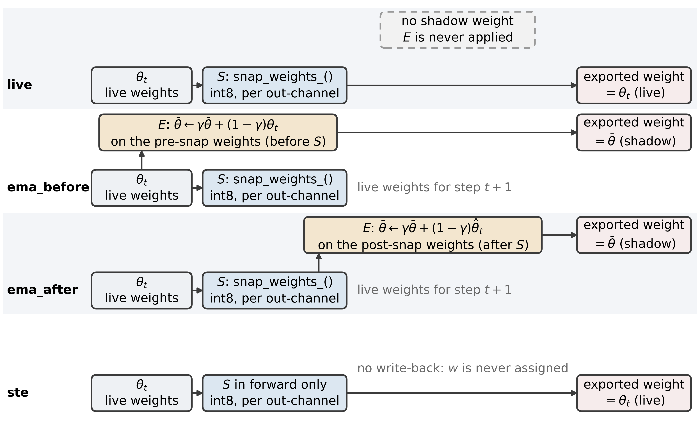

**Figure 1.** Three in-place protocols and the STE control. $S$ projects every weight onto a symmetric int8 grid, in place, every $N$ steps; $E$ is the shadow update of eq. (5). before_snap averages pre-projection iterates, after_snap post-projection ones; none keeps no shadow but still projects every $N$ steps, and projection is off only at $N = \infty$. The last row is the STE control introduced only in §5.6, placed here as a forward reference: $S$ applies in the forward pass only, nothing is overwritten, and the exported weights are the live ones.

### 3.4 Deployment measurement

Training-time projection and export-time quantization are different operations and are measured separately. At export we take the deployed weights ($m_T$ for the two EMA protocols, $W_T$ for none), apply an explicit quantize-dequantize pass at $b$ bits with the same per-output-channel symmetric rule,

$$\hat{W} = S_b(W_{\mathrm{dep}}),\ \ \ \ W_{\mathrm{dep}} \in \{m_T, W_T\}$$

and evaluate the task metric on the validation split. The metric is mean absolute error over the $M$ validation images,

$$\mathrm{MAE} = \frac{1}{M}\sum_{i=1}^{M}{\left| \hat{y}_i - y_i \right|}$$

and is read next to the zero baseline, the constant predictor that always outputs the validation-split mean:

$$\mathrm{MAE}_0 = \frac{1}{M}\sum_{i=1}^{M}{\left| \bar{y} - y_i \right|},\ \ \ \ \bar{y} = \frac{1}{M}\sum_{j=1}^{M}{y_j^{\mathrm{val}}}$$

Weight-space differences between two runs are reported as the relative L2 distance between their flattened vectors of projected tensors,

$$d(W, W') = \frac{\left\| W - W' \right\|_2}{\left\| W \right\|_2}$$

$b = 8$ reproduces the target 8 bit deployment; $b = 6, 4$ are stress tests. The controlled sweeps of §5.1–§5.6 all rest on this weight-only simulation; the vendor toolchain is run separately in §5.7.

Notation used throughout: $\Delta$ is the tested quantity minus its reference, so a positive value means the tested one is worse. Against FP32 the tested quantity is the quantized model (Tables 3, 8 and 9); against another protocol the reference is the one named in the sentence, so after_snap against none being negative means the shadow protocol is better.

## 4. Experimental setup

**Table 2.** Training and quantization configuration.
| item | value |
|---|---|
| optimizer | AdamW, lr 1e-4, cosine annealing over 20 epochs |
| batch / precision | 64, bf16 autocast, gradient clipping 1.0 |
| EMA decay | 0.99 |
| snap bits during training | 8 |
| initial seeds | 0-7 for the five main sequences (split_seed fixed at 0, initialization only); 0-2 elsewhere |
| zero baseline (predict validation-split mean) | 0.1553 on the fixed split (split_seed = 0); 0.1552 / 0.1516 on the older splits of seeds 1 and 2 |
| deployment-eval subset | primary basis: the 1,556-image external subset that took no part in epoch selection (the validation split minus the 2,000-image monitor subset, §5.8); comparison: the first 400 images of each run's own validation split (partly overlapping those 2,000) |
| compute | single RTX 4080 Laptop (12 GB, driver 617.14, CUDA 13.2 / PyTorch 2.12.0; timm 1.0.27, ONNX Runtime 1.26.0, OpenVINO 2026.4.1 + NNCF 3.4.0, hbdk 4.7.5), 834–891 s/run for training alone at 20 epochs (about 25 min including per-epoch monitoring evaluation and export) |

The validation split is rebuilt per run (Table 2). The run's seed sets both the data split and
the parameter initialization, and the two are not decoupled: another seed changes both at once,
and neither can be changed on its own. Our first version of the deployment table reused
the seed-0 split for every run; the seed-1/2 checkpoints had trained on part of it, and one has a true MAE of 0.0579, while the old fixed-split evaluation reported a value about 0.019 low (that table was not kept). All numbers here use each run's own
split, and the FP32 column is checked against the training log's validation MAE (agreement
within 0.005, the difference being the 400-image subsample). Two accounting bases have to stay
apart: the training log and history.csv report MAE on 2,000 images sampled at random from the
3,556-image validation split (--val-windows defaults to 2000), while the zero baseline 0.1553
is computed on all 3,556 of them; the deployment table takes the first 400 images of the same
split, whose own zero baseline is 0.1625 for seed 0 and 0.1489 and 0.1483 for seeds 1 and 2. To remove the split from cross-seed comparisons, the five main sequences share one fixed split (split_seed = 0) and vary only the initial seed (seeds 0-7), so the run-to-run spread within those sequences contains only initialization and batch-order differences and no longer mixes in evaluation-subset difficulty; the remaining cells (the three protocols at interval 5, after_snap at $N = \infty$, and the older runs at seeds above 0) still use a split per run and are read descriptively only.

Grid: the basis for run-level inference is five main-configuration sequences of 8 initial seeds each (none at intervals 1, 20 and infinity, after_snap and before_snap at interval 20; split_seed fixed at 0, only the initialization varying), 40 runs at 20 epochs. An earlier batch was run on the older basis: 15 main-sweep runs, namely 3 snap intervals {1, 5, 20} × 3 protocols at seed 0 (9 runs) plus
6 extra-seed runs (after_snap at seeds 1 and 2 for intervals 1 and 20, 4 runs; before_snap at
seeds 1 and 2 for interval 20, 2 runs), 20 epochs each. A further 15 runs: 2 at the projection-free
endpoint (none and after_snap), 6 extra seeds at interval 5 (three protocols × seeds 1, 2), 3 on a
fixed split (split_seed = 0, initial seeds 1, 2, 3, after_snap, interval 20), and 4 γ sweeps at
interval 20 and seed 0 (γ = 0.9 and 0.999, each for before_snap and after_snap).
The deployment table covers 65 runs (quant_runs/deploy_table_v3.csv), 50 of which are evaluated on the 400 images shared with the main basis (quant_runs/deploy_table_v4.csv); the five main configuration sequences with 8 initial seeds each form the basis of the run-level inference (§5.2-§5.5), and 46 runs have a further re-evaluation on the 1,556-image external subset (quant_runs/heldout_eval_v3.csv, §5.8). Statistically, we treat three families plus one pre-specified equivalence test as confirmatory: the interval effect (intervals 1 and 20, contrasts a and b), the presence of the shadow (c), STE against in-place overwriting and against projection off (two contrasts), and the equivalence test for contrast d - six run-level contrasts in total (Table 3). Every other comparison in §5 (the remaining pairings, the same contrasts at the 6 bit and 4 bit bases, and the two extrapolation axes of §5.9) is exploratory and uncorrected for multiplicity, and the tables report its point estimates and intervals as they stand. Unless marked otherwise, every cross-seed comparison is made on the fixed split, and the 4 bit section is not compared in absolute terms across bases: it reports only per-seed relative quantities, against that run's own zero baseline and against that run's FP32 deployment MAE.

Before turning to the results, Table 3 fixes the statistical identity of every claim in this paper: the inference unit and its sample size, the number of contrasts, whether the comparison was pre-specified before the run-level results were inspected, and whether a multiple-comparison correction was applied. Every subsection of §5 has a corresponding row in that table; wherever "pre-specified" reads "no", the reading is reported as exploratory only, and no conclusion rests on it.

**Table 3.** The statistical identity of each claim in this paper: inference unit, number of contrasts, pre-specification and multiple-comparison correction
| Claim | Inference unit ($n$, $df$) | Contrasts | Pre-specified | Multiplicity | Basis |
|---|---|---|---|---|---|
| Interval effect: interval 1 against switching projection off (contrast a) | run ($n = 8$, $df = 7$) | 1 | Yes, confirmatory | Not applicable | 1,556 images |
| Interval effect: interval 20 against switching projection off (contrast b) | run ($n = 8$, $df = 7$) | 1 | Yes, confirmatory | Not applicable | 1,556 images |
| Presence of the shadow: after_snap minus none at interval 20 (contrast c) | run ($n = 8$, $df = 7$) | 1 | Yes, confirmatory | Not applicable | 1,556 images |
| Averaging order: before_snap minus after_snap (contrast d) | run ($n = 8$, $df = 7$) | 1 | Yes, equivalence test | Not applicable | 1,556 images |
| STE against in-place overwriting and against projection off | run ($n = 8$, $df = 7$) | 2 | Yes, confirmatory | Not applicable | 1,556 images |
| The same contrasts at the 6 bit basis (a-d; the 6 bit equivalence test is post hoc) | run ($n = 8$, $df = 7$) | 4 | No | Uncorrected | 1,556 images |
| Mechanism controls: learning rate, budget, rounding rule | run (three groups, $n = 3$, 3, 8) | 3 | No | Uncorrected | 1,556 images |
| Per-image protocol pairing (seven groups) | image ($n = 400$) | 7 | No | Holm and BH | 400 images |
| Toolchain, vendor chain (see §5.7) | checkpoint (single run, $n = 199$–200 images per cell) | 5 checkpoints | No | Uncorrected | 200 images |
| Cross-backend replication (see §5.10) | run ($n = 8$, $df = 7$) | 3 chains | No | Uncorrected | 200 images |
| 4 bit ranking and degradation | run ($n = 8$) | 2 | No | Uncorrected | 1,556 images |
| Two extrapolation axes | run (two protocols x 8 seeds per axis, $n = 8$) | 4 | No | Uncorrected | 400 images per axis |

**Note:** "Pre-specified" means that the direction, the equivalence bound and the test of a contrast were fixed before the run-level results were inspected. Every reading other than the six comparisons marked "yes" in Table 3 (a, b, c, d and the two STE contrasts) — including the 6 bit row of Table 3, the mechanism controls of §5.6, the two extrapolation axes of §5.9 and the three deployment chains of §5.10) is reported as exploratory only and is not corrected across tables; the seven per-image pairs of §5.3 additionally report Holm- and Benjamini-Hochberg-corrected results.

## 5. Results

### 5.1 At 8 bits, the export quantizer is a no-op

At interval 1 the real-time weights the none protocol exports sit exactly on the grid; at longer
intervals the optimizer still takes steps after the last projection, so the live weights at export
time are off it (at interval 20 the residual reaches 0.0037 of a step), while the shadows the two
EMA protocols export are pushed off the grid continuously by the averaging (Fig. 2). Re-quantizing either kind still leaves the task metric unchanged
at four decimal places. The first measurement is the residual of an individual weight against
its own channel grid, in grid steps,

$$\rho_{oj} = \frac{\left| W_{oj} - [S_b(W)]_{oj} \right|}{s_o(W)}$$

the second, the fraction of weights indistinguishable from a grid point,

$$f_\tau(W) = \frac{1}{\left| W \right|}\sum_{oj}{\mathbf{1}\left[ \rho_{oj} < \tau \right]},\ \ \ \ \tau = 0.05$$

The residual column is the relative RMS of eq. (4), a norm over the whole weight vector, not
the mean of $\rho$ (Table 4).

The last column is the largest per-image paired difference between 8 bit and FP32 MAE on the
same 400 images, in absolute value over the runs of that interval ($\Delta$ = 8 bit − FP32,
positive meaning the 8 bit model reads higher). All 5 runs at interval 1 give 0.0000, the 9
runs at interval 5 stay within 0.0003, and 12 of the 14 runs at interval 20 within 0.0004, the
other two being −0.0010 (an interval containing 0) and +0.0014, the latter an additional run
(95 % CI [+0.00027, +0.00248], excluding 0); a single experiment cannot tell sampling
fluctuation from a real degradation.

**Table 4.** Grid residual of the deployed weights, the on-grid fraction, and the per-image 8 bit versus FP32 paired difference summarized per interval (largest absolute value).
| snap interval | relative RMS residual ε (eq. 4) | on-grid fraction f (eq. 15) | largest absolute 8 bit − FP32 paired difference |
|---|---|---|---|
| 1 | 0.0000 | 1.000 | 0.0000 |
| 5 | 0.0000 – 0.0004 | 0.951 – 1.000 | 0.0000–0.0003 |
| 20 | 0.0000 – 0.0037 | 0.571 – 1.000 | 0.0000–0.0014 |
**Note:** Each row gives the extremes over all main-configuration runs (γ = 0.99 and split_seed = seed, i.e. the older batch; the fixed-split subsets of the five main sequences are not included in this table) at that interval, including the none protocol. $\varepsilon$ and $f$ are residuals of the exported weights on the grid (eqs. 4 and 15); §5.6 reports the error of each projection event itself, which is also eq. 4 but acts on a different object.

The raw cosine is dominated by the vector mean, so the informative form is the centered cosine,
the Pearson correlation of the two flattened vectors ($\mu_W$ and $\mu_{\hat W}$ are the means
over all entries):

$$\cos_c(W, \hat{W}) = \frac{\sum_{o,j}{\left(W_{oj} - \mu_W\right)\left(\hat{W}_{oj} - \mu_{\hat{W}}\right)}}{\sqrt{\sum_{o,j}{\left(W_{oj} - \mu_W\right)^2}}\ \sqrt{\sum_{o,j}{\left(\hat{W}_{oj} - \mu_{\hat{W}}\right)^2}}}$$

The centered cosine of eq. (16) is 1.0000 whenever $\hat{W} = W$; the reading carries no
fidelity information, it only states that the two vectors are the same. At 8 bits all three
protocols read 1.0000 with relative L2 0.0000–0.0001, i.e. exported and floating-point weights
are indistinguishable below the resolution of this metric, not exactly coincident. Apparent
discrimination appears only at 6 bits (cosine ≈ 0.9962, relative L2 ≈ 0.088) and 4 bits (cosine
0.9792–0.9809, relative L2 0.197–0.206; Fig. 2). Every 6 bit and 4 bit number here and below
refers to export-time post-training quantization (PTQ): the projection width during training is
fixed at 8 bits (Table 2), and no 6 bit or 4 bit QAT model was trained.

Idempotence is a property of this convention by construction, not an empirical finding: it requires
the exported quantizer and the training-time projection to be the same operator (the same
per-output-channel scale rule), the same scale ($s_o$ taken from the same row and not recomputed at
deployment), the same rounding rule (nearest rounding), and no clipping overflow; break any one of
the four and it no longer holds. $S_b$ is itself a nearest-grid-point projection, so $\rho_{oj} \le
0.5$ holds almost by tautology (eq. (14)), and writing it as a "saturation condition" carries no
information; what decides whether the metric reads a constant is the four preconditions above. The
three 8 bit protocols of this paper satisfy them (strictly for the live weights, approximately for
the shadow), and only 3.6 % of the weights are more than 0.45 grid steps away (Fig. 2). 6 bit and
4 bit make the metric informative again because the deployment quantizer changes the grid - change
the bit width and both the scale and the grid points change, so the idempotence precondition
disappears outright - not because $\rho$ falls outside some interval; 0.9962 and 0.9792–0.9809 are
cosines after $q_b$ has been changed, and they are a different quantity from $\rho$. The same reason
explains the per-tensor and the p99 clipping readings of §5.7: once the scale changes, the absolute
error is dominated by the choice of grid.

Figure 2 spreads that distribution out: 3,984,480 weights in all, one point per interval
whereas Table 4 spans all three protocols. At interval 1 the weights sit on the grid within
numerical noise; at interval 20 the distribution broadens to relative RMS 0.0037 and on-grid
fraction 0.572. The tail above $\rho = 0.1$ is close to uniform; the leftmost bin also holds
weights with $0 < \rho < 10^{-8}$.

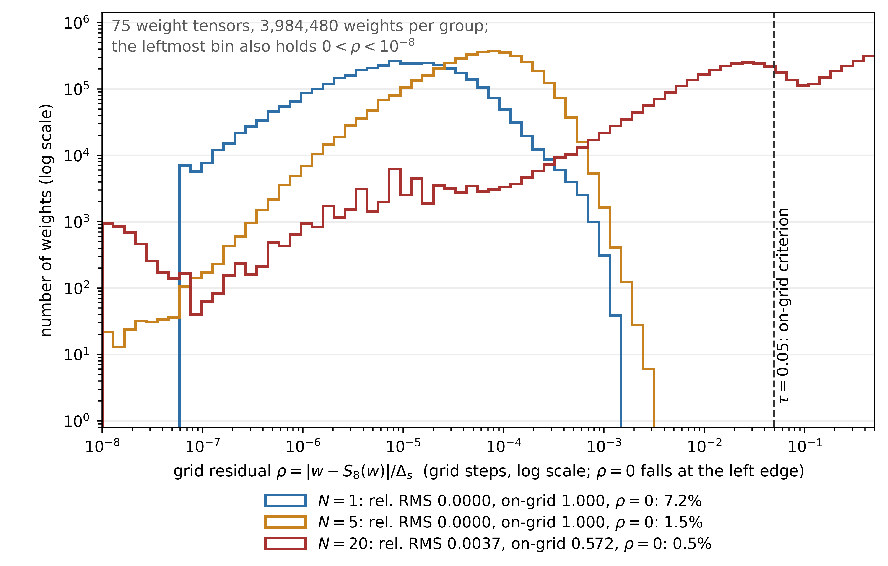

**Figure 2.** Distribution of the per-weight grid residual $\rho$ of eq. (14) over the 75 projected tensors, log-log axes, for the after_snap run at seed 0.

The no-op above concerns the weight quantizer only. Re-projecting weights the training loop has
already projected changes nothing, since the projection is idempotent (§3.2). A deployment
compiler also quantizes *activations* and lowers them to look-up tables, and that part is not
idempotent. The full int8 pipeline on the same checkpoints (§5.7) costs +0.0034–0.0038 MAE on
the ReLU-QAT head, an order of magnitude more than the 0.0004 in the last column of Table 4
(the two additional runs aside), and leaves the interval ranking intact (one protocol only, so
it says nothing about the ordering).

### 5.2 The cost of projection, and the endpoint that switches it off

Task MAE after deployment quantization, seed 0, three protocols per interval, plus the endpoint
N = ∞ at which projection is switched off (Table 5):

**Table 5.** Task MAE after deployment quantization (seed 0, three intervals × three protocols, plus the projection-free endpoint N = ∞); the last column is the external subset that took no part in epoch selection.
| interval | protocol | FP32 | 8 bit | 6 bit | 4 bit | Held-out FP32 |
|---|---|---|---|---|---|---|
| 1 | none | 0.0741 | 0.0741 | 0.0785 | 0.0900 | 0.0741 |
| 1 | before_snap | 0.0741 | 0.0741 | 0.0776 | 0.0899 | 0.0738 |
| 1 | after_snap | 0.0748 | 0.0748 | 0.0794 | 0.0910 | 0.0738 |
| 5 | none | 0.0660 | 0.0662 | 0.0672 | 0.0857 | 0.0652 |
| 5 | before_snap | 0.0658 | 0.0658 | 0.0674 | 0.0880 | 0.0653 |
| 5 | after_snap | 0.0657 | 0.0657 | 0.0671 | 0.0864 | 0.0653 |
| 20 | none | 0.0619 | 0.0620 | 0.0642 | 0.0888 | 0.0591 |
| 20 | before_snap | 0.0607 | 0.0608 | 0.0643 | 0.0866 | 0.0579 |
| 20 | after_snap | 0.0594 | 0.0593 | 0.0631 | 0.0849 | 0.0573 |
| ∞ | none | 0.0552 | 0.0548 | 0.0575 | 0.1535 | 0.0543 |
| ∞ | after_snap | 0.0556 | 0.0554 | 0.0569 | 0.1040 | 0.0546 |

**Note:** the table gives point estimates; the paired differences and their 95 % confidence intervals are in §5.2, §5.3, §5.4 and quant_runs/paired_report.md. The last column is the FP32 MAE of the same batch of runs on the external subset that took no part in epoch selection (1,556 images, i.e. the validation split minus the 2,000-image monitoring subset); the FP32 column of this table is no lower than it in every row (the interval-1 none row ties), and the difference is the epoch-selection optimism, which grows with the interval (§5.8). The unit of the intervals is the run: each of the five main configuration sequences has 8 initial seeds on a fixed split (split_seed = 0), n = 8, df = 7, paired run by run; each row of this table is still a single-run point estimate (seed 0). The inferential quantity takes the 1,556 images that took no part in epoch selection as the main basis and the 400-image subset as the control: against switching projection off, interval 1 reads +0.018457 [+0.017498, +0.019415] (run-level, $n = 8$, 1,556 images) and +0.017750 [+0.014973, +0.020527] (400 images), and interval 20 reads +0.004723 [+0.004028, +0.005417] and +0.003800 [+0.002243, +0.005357]; both contrasts are 8/8 of the same sign (sign test p = 0.0078).

The two N = ∞ rows of Table 5 mean no projection during training (snap_every = 0). before_snap
and after_snap then collapse into the same algorithm, so only after_snap is listed on the
projection side; none keeps no shadow and exports the live weights directly, so it is listed
separately as the no-shadow endpoint. Their FP32 values, 0.0556 and 0.0552, differ by +0.00043
with an interval that contains zero (§5.4).

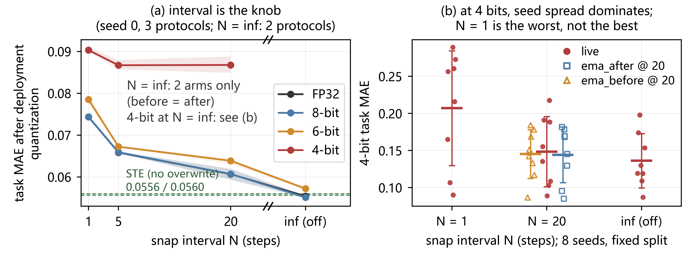

**Figure 3.** (a) Task MAE after deployment quantization versus snap interval (seed 0, three-protocol mean); N = ∞ is projection switched off, where the plotted point is the mean of the none and after_snap protocols and the shaded band is their range; the 4 bit curve stops at 20, endpoints unplotted. The green band is the §5.6 STE control (0.0556 at 8 bits, 0.0560 at FP32). (b) Per-seed 4 bit distribution on the 400-image deployment subset, fixed split (split_seed = 0) with 8 initial seeds: one marker per run, thick line the mean, error bar one standard deviation. The three none sequences read 0.2070, 0.1484 and 0.1361 at interval 1, 20 and projection off, and before and after read 0.1451 and 0.1441 at interval 20; interval 1 is the worst here, the reverse of the 21-run basis of Figure 7 (see §5.5).

Averaged over the three protocols at seed 0, interval 1 → 5 → 20 gives FP32 0.0743 → 0.0658 →
0.0607, an 18 % reduction, and 6 bit follows the same direction: 0.0785 → 0.0672 → 0.0639 (Fig.
3). Extending the interval from 1 to 5 and 20 leaves only 1,256 and 314 of the 6,280 training
steps followed by a projection, and the per-event projection error grows (0.000 → 0.0012 →
0.0030 relative RMS), yet the model gets better (Fig. 4). At the run level (n = 8, df = 7,
paired, fixed split) that drop quantifies into two contrasts: against switching projection off,
interval 1 reads +0.018457 [+0.017498, +0.019415] and interval 20 +0.004723 [+0.004028,
+0.005417] (1,556 images that took no part in epoch selection; the 400-image basis is in the
note to Table 5), neither interval containing zero. At 8 bit, projection is a *cost* paid in
optimization noise; the longer the interval the smaller that cost, far larger than the
run-to-run dispersion (sd of contrasts a and b 0.001147 and 0.000831 on the 1,556-image basis).

The endpoint gives the lower end of the cost curve: with projection switched off the FP32
deployment MAE is 0.0552 and 0.0556 (none / after_snap), 0.0189 and 0.0192 below interval 1 and
about 0.0067 and 0.0037 below interval 20 (single-run image-level point estimates, Table 5).
The paired difference shrinks as the interval grows and vanishes at N = ∞, the ordering of
these three point estimates agreeing with run-level contrasts a and b above. At N = ∞ the 8 bit
minus FP32 difference is still only 0.0002–0.0004: under the convention of §3.4 (tested term 8
bit, reference FP32) it is written −0.00037 and −0.00023, the negative sign meaning 8 bit reads
slightly lower; both intervals contain zero; most finite-interval runs hold this column within
0.0004 (0.0000 at interval 1), the two additional runs aside. Hence at the weight-only 8 bit target,
training-time projection is a pure cost, and the optimal setting is to switch it off; at 6 bits the same
run-level contrasts are larger (interval 1: +0.0214 [+0.0195, +0.0234]; interval 20: +0.0060
[+0.0042, +0.0079]; 8/8 of one sign, 1,556 images). That cost belongs to the in- place overwrite rather than
to lying on the grid:
the STE control that fake-quantizes at every step is only 0.0008 away (§5.6, Table 8).

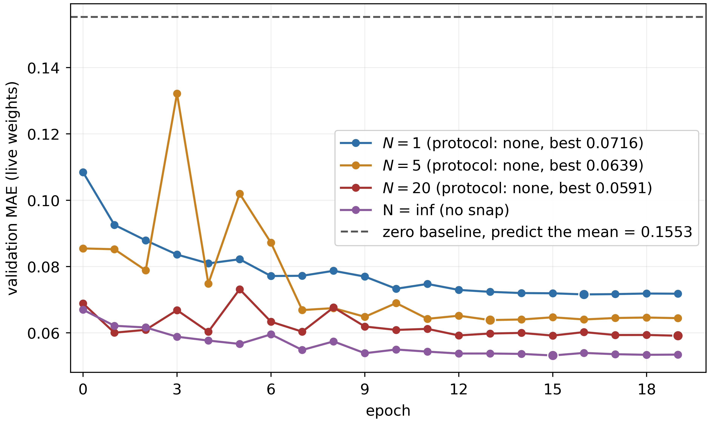

**Figure 4.** Validation MAE of the live weights (none, seed 0) over training, one curve per interval plus projection off (N = ∞); dashed is the zero baseline 0.1553. Best 0.0716 (1), 0.0639 (5), 0.0591 (20), 0.0532 (∞). From each run's history.csv (2,000 validation images), so the FP32 column of the §5.2 deployment table, on 400 images, reads 0.002–0.003 higher.

### 5.3 The averaging order is below the minimum detectable effect (MDE)

Within one interval at seed 0, the three protocols span 0.0027 (8 bit, interval 20) and 0.0025
(FP32, interval 20), of which the ordering accounts for 0.0015 and 0.0013; at 6 bits the run-level
ordering contrast d is −0.000290 [−0.001090, +0.000509], 4 of 8 positive and 4 of 8 negative, and the largest ordering gap
at seed 0 is 0.0018, at interval 1, from a single seed without per-image pairing.
These are single-run, image-level descriptions. The inferential unit for the ordering effect
therefore becomes the run: five main configuration sequences (none at N = 1, N = 20 and N = ∞,
plus before_snap and after_snap at N = 20), each 8 initial seeds trained on the same fixed
split, paired run by run, n = 8, df = 7. The main basis takes the 1,556 images that never took
part in epoch selection: contrast d (before_snap − after_snap at N = 20) reads +0.000029
[−0.000249, +0.000307], 5 of 8 positive (3 of 8 runs negative); on the 400-image subset +0.000175 [−0.000475,
+0.000825]. Both intervals contain zero. The per-seed paired sds of the four run- level
contrasts on the 1,556 images are 0.00115, 0.00083, 0.00050 and 0.00033.

The margin of the equivalence test is pre-specified and independent of the observations: 1 % of
the 0.1553 zero baseline, i.e. 0.0015526728, 0.0016 to four decimals. A two one-sided test
(TOST) [39], with the tutorial in [40], at that margin gives p < 1e-4 for contrast d on the 1,556 images and p = 0.00064 on
the 400, both passing at α = 0.05, i.e. an ordering effect of 0.0016 or more can be ruled out.
The minimum detectable effect (MDE) at 80 % power is 0.000383 (1,556 images) and 0.000897 (400
images). A post-hoc sensitivity analysis puts the critical bound at 0.000252, 6.4 times below
the preset bound; tightening the bound to 0.0005 still gives $p = 0.0026$; at bounds of 0.001 and 0.0003 the $p$ values are $3.7\times10^{-5}$ and 0.027, so all four bounds (the preset 0.0016 included) lead to the same conclusion. On the age scale 0.0016 corresponds to 0.16 years, and it is exactly 1 % of the zero baseline. The bound was not
set so that the test would pass. Applying the same 0.0016 bound post hoc to the 6 bit contrast d (4 of 8 positive, 4 of 8 negative) gives $p = 0.0030$, which still passes at $\alpha = 0.05$; but that bound was pre-specified for the 8 bit main basis, the 6 bit paired standard error is 0.000338 (2.9 times the 0.000118 of the main basis), the 80 % MDE rises to 0.0011, and the bound is only 1.4 times the MDE (at the main basis the preset bound is 6.4 times the critical bound and 4.2 times the MDE), so we report this reading as exploratory and it does not change the confirmatory claims here.

The seven per-image paired comparisons made earlier, at the image level on single runs, are
exploratory descriptions only, not protocol conclusions: none of the seven exceeds 0.0014 and
the sign changes with the seed (interval 1: −0.00070 [−0.00155, +0.00015]; the three seeds at
interval 5: +0.00015, −0.00045, +0.00011; the three seeds at interval 20: +0.00132 [+0.00002,
+0.00262], +0.00016, −0.00084). Uncorrected, 2/7 are nominally significant and of opposite sign
($+0.00132$, $p = 0.047$; $-0.00084$, $p = 0.037$); after Holm and Benjamini–Hochberg
correction 0/7 survive (smallest $p = 0.037$ against the first Holm step of $0.05/7 = 0.0071$).

The ordering is not, however, a no-op on the weights. Relative L2 between exported weight
vectors (Table 6):

**Table 6.** Relative L2 distance between exported weight vectors.
| comparison | n pairs | relative L2 range | reading |
|---|---|---|---|
| shadow vs live weights, same run | 12 | 0.0005 – 0.0483 | displacement of the shadow against the live weights |
| before_snap vs after_snap, same interval and seed | 5 | 0.0427 – 0.0909 | displacement due to the averaging order |
| same configuration, different seed | 9 | 0.6371 – 0.8349 | displacement due to retraining, about an order of magnitude larger |

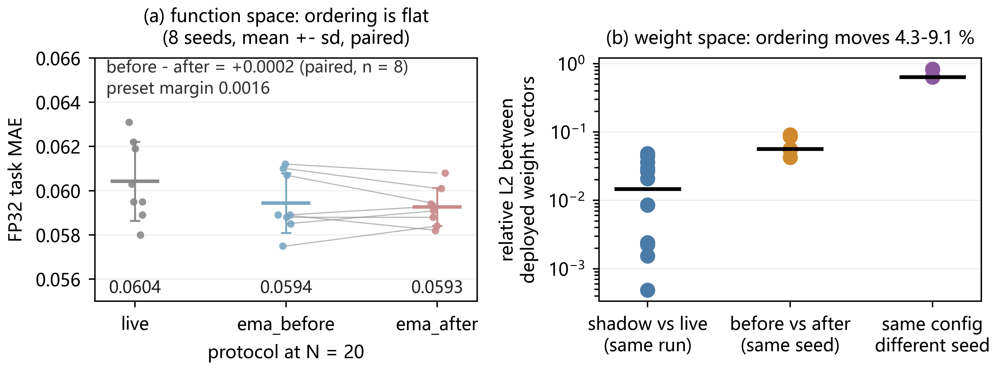

**Figure 5.** (a) FP32 task MAE of the three protocols at interval 20 (fixed split, 8 initial seeds): one marker per run, thick line the mean, error bar one standard deviation, grey lines pairing before and after within a seed; the paired difference before − after is +0.0002, far below the pre-specified equivalence margin of 0.0016 and far below the interval effect (none falls from 0.0744 at interval 1 to 0.0604 at interval 20). (b) Relative L2 between deployment weights (log scale): the ordering moves 4.3–9.1 %, retraining the same configuration with another seed moves 64–83 %, so the ordering is a sub-seed perturbation; the black line is the median.

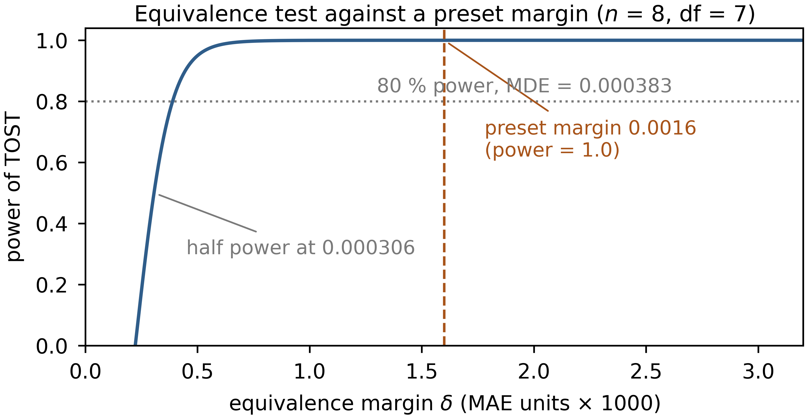

**Figure 6.** Power of the equivalence test (df = 7, standard error taken from the 1,556-image basis, $SE_{\bar D} = 0.000118$, with a paired sd of $\sigma_d = 0.000333$) as a function of the margin delta. The dashed line is the preset 0.0016 (power 1.0), the dotted line the MDE at 80 % power, 0.000383; the curve reaches half power at 0.000306.

In weight space the ordering moves the exported network by 4.3–9.1 %, yet the task metric moves
by only +0.000029 (1,556-image basis, interval containing zero), whereas retraining with
another seed moves 64–83 % (Fig. 5). A claim that one ordering is "safer" therefore has to be
argued in function space, and this measurement does not support it.

The displacement is not produced by export quantization either: requantizing the exported weights of
both orders at interval 20 with the deployment quantizer (8 seeds with a fixed split, a different source
from the 5 old-caliber run pairs of Table 6; artifact in Table 16) moves the relative L2 from
4.7 % ± 0.6 % to 4.8 % ± 0.6 %, and 98 % of the weights still land on different grid points (the
cross-seed share of weights on different grid points is 63.5 % before requantization and 63.5 % after
it). This 4.8 % is not the same quantity as $\rho$ in §5.1: the former is the overall relative L2 between
two differently ordered weight sets, the latter the sub-grid distance of one weight to its nearest grid
point (at most 0.0037 grid spacings); the grid is fine, so an overall displacement can be large while
the per-weight residual stays tiny.

Nor is the time constant of the average a knob that explains the ordering effect: with κ = N(1−γ), at
interval 20 and seed 0, γ = 0.9, 0.99 and 0.999 give κ = 2, 0.2 and 0.02. The ordering differences
read +0.0014, +0.0013 and 0.0000. That span is at most 0.0014 and does not grow monotonically with κ;
taken together with the cross-seed results of §5.3, the sign of the ordering difference is not stable.

### 5.4 The presence of the shadow: a small but consistently signed effect

The previous section detected no ordering effect at the run level (n = 8, df = 7), while the
presence of the shadow left a consistently signed reading of small magnitude. At interval 20
the paired difference of after_snap against none on the 1,556 images that took no part in epoch
selection is −0.001377 [−0.001798, −0.000957], 8/8 runs of the same sign, sign test p = 0.008.
The same contrast on the 400-image subset is −0.001162 [−0.002310, −0.000015], 7/8 of the same
sign, p = 0.070 — marginal evidence only, because that subset overlaps the 2,000-image
monitoring subset used for epoch selection, which deflates the run-to-run dispersion. The
main basis takes the 1,556 images, so the
shadow effect exists, with magnitude 0.0014, the same order as the largest observed ordering
gap (0.0014) and an order of magnitude below the interval effect. That difference is erased in
the protocol mean: at interval 20 and seed 0 the three protocols read 0.0619, 0.0607 and 0.0594
(none / before_snap / after_snap), and the mean coincides with before_snap. Nor is the shadow
unconditionally useful: with projection switched off, after_snap against none reads +0.00043
[−0.00114, +0.00199] at the image level, an interval that contains zero (the N = ∞ rows of
Table 5). Unlike the averaging of SWA [23] or model soups [24], the shadow requires no
retraining and only slides along a single trajectory, which is why its magnitude is only
0.0014. At 6 bits the same contrast is about twice as large (−0.0027 [−0.0044, −0.0009]),
but only 7 of the 8 runs share its sign (sign test p = 0.070), so we report the interval without
treating it as stronger evidence.

### 5.5 At 4 bits, run-to-run variation dominates both knobs

Counting in the seed replicates of the same configuration breaks the tidy 4 bit picture (Table 7):

**Table 7.** Task MAE after 4 bit quantization, summarized per interval (the 21 runs of the same configuration, with 5, 9 and 7 of them at the three intervals).
| interval | n | 4 bit MAE mean | range | sd | 95 % CI |
|---|---|---|---|---|---|
| 1 | 5 | 0.1224 | 0.0899 – 0.2337 | 0.0626 | [0.0447, 0.2002] |
| 5 | 9 | 0.1248 | 0.0857 – 0.2117 | 0.0510 | [0.0856, 0.1640] |
| 20 | 7 | 0.1315 | 0.0849 – 0.2030 | 0.0476 | [0.0875, 0.1756] |

**Note:** the 95 % CI is a t interval over the runs within each interval ($n$ = 5, 9 and 7, with $t_{0.975}$ at the corresponding degrees of freedom); $n$ is small, so the intervals only describe the spread. The 4 bit readings of these 21 runs take each run's own 400-image deployment subset inside its validation split, which overlaps the epoch-selection monitoring subset.

Among the three finite intervals, interval 20 is the best at 8 and 6 bits (counting the
projection-free endpoint, the best setting is N = ∞, see Table 5), and there seeds 1 and 2
degrade to 0.1267–0.2030 while seed 0 stays at 0.0849 (Fig. 7). The earlier single-seed reading
("a longer interval buys 4 bit robustness") came from comparing a lucky seed with an unlucky
one: the three 4 bit means differ by no more than 0.0091 (0.1224 / 0.1248 / 0.1315), while the
within-interval seed sd is 0.0476–0.0626, 5–7× the between-cluster spread. A descriptive sum-
of-squares decomposition of these 21 4 bit MAEs (an unbalanced design, interval first, seed
within interval second) puts 0.57 % on the interval, 88.4 % on the seed and 11.1 % on the
residual, i.e. standard deviations of 0.0119, 0.1492 and 0.0187. Table 14 shows this
between-run variation contains both the data split (56.6 %) and the initialization (10.0 %);
this design cannot separate their shares of the 4 bit spread. Interval 5 had an sd of 0.0012
when the first round held only 3 runs; counting in the 6 extra-seed runs raises its sd to
0.0510 and its mean to 0.1248, so "interval 5 is stable at 4 bits" was an artifact of an
insufficient sample. This is reported as an observation, not a claim about 4 bit quantization
in general (the three intervals hold n = 5, 9 and 7), and seed coverage is still uneven.

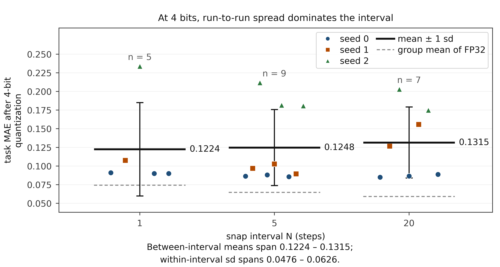

**Figure 7.** Task MAE after 4 bit quantization, by snap interval: one marker per run (21 runs, 5, 9 and 7 per interval), seeds 0–2 distinguished by marker color and shape. Three protocols are mixed within each interval, so one seed can appear more than once; means and standard deviations are taken over all runs in the group.

Figure 7 and Table 7 use the 21-run basis (seeds 0–2, each run with its own split), which
ranks interval 1 lowest at 4 bits (0.1224); this paper's primary basis — the fixed split with 8
initial seeds — ranks the opposite way: 0.2070 at interval 1, 0.1484 at interval 20 and 0.1361
at projection off (Fig. 3b). For the same cell pair (interval 1 against projection off) they
disagree in sign: -0.0635 under the single-run seed 0 basis (interval 1 better) and +0.0710
under the eight-seed fixed split (interval 1 worse): at 4 bit the ranking is decided by
run-to-run variation rather than by the knob.

Figure 7 spreads the same runs out, the thick horizontal line the mean of each interval. On
this seed 0–2 basis the three interval means differ by no more than 0.0091 while the
within-interval sd is 0.0476–0.0626. After topping each of the five main configuration
sequences up to 8 initial seeds on a fixed split, the run-to-run sd at 4 bit is 0.0365–0.0774
against 0.0020 at 8 bit, yet the direction of the mean agrees with 8 and 6 bit (the 6 bit pair is 8/8 of one sign and is reported in §5.2 on the same 1,556-image basis); the 4 bit readings in this section use the 400-image deployment subset: against switching projection off, the per-seed paired differences at interval 20 and interval 1 are +0.0047 and +0.0185 (1,556 images) on FP32, and +0.0123 [−0.0251, +0.0497] and +0.0710 [+0.0013, +0.1406] at 4 bit (3/8 and 2/8 reversed; the exact two-sided sign test for interval 1 gives $p =
0.289$). The t interval excludes zero only because the mean is large relative to its standard
error (its lower bound of +0.0013 sits 1.9 % of a half-width from zero, while the paired sd of
0.0833 exceeds the effect of 0.0710 itself), whereas the sign test asks whether the direction
is stable, and 2 of the 8 seeds reverse it. The median difference is $+0.0777$ and the Hodges-Lehmann estimate
$+0.0696$, with a bootstrap interval over the 8 seeds of $[+0.0149, +0.1245]$ (for the interval-20
contrast the same batch reads $+0.0107$, $+0.0102$ and $[-0.0180, +0.0404]$); the three summaries
agree in direction with the preceding sentence. For 4 bit the primary statistic is the per-seed
paired t interval (every 4 bit conclusion below uses it); the median, the Hodges-Lehmann estimate
and the bootstrap are robustness checks only and do not constitute post-hoc selection. All three
reach the same conclusion: the mean points positive, but the paired sd of 0.0833 exceeds the effect
and the per-seed direction cannot be resolved. The t interval is carried by a heavy tail: the two
largest positive pairs (+0.2024 and +0.1417) alone account for 61 % of the mean of +0.0710, and
dropping the largest lowers the mean to +0.0522. Read through the sign test, therefore, the reading
is indistinguishable: at 4 bit the degradation is the largest, and its per-seed direction cannot be
resolved.
The two 4 bit endpoints of projection-off (0.1535 and 0.1040) are still seed-0 single-run
readings, and cannot be used to compare protocols; over the eight seeds projection-off (none,
$N = \infty$) gives a 4 bit mean of 0.1361 with sd 0.0365. GPTQ [31] and AWQ [32] change the
quantizer itself, whereas the quantizer is fixed here and only the projection interval and the
averaging order are moved, so the run-to-run variation observed here cannot be read as an
evaluation of those methods.

Taking the 22 runs that have a 4 bit reading together (including the projection-off endpoint):
7 of them are worse than their own zero baseline; mae_4 has median 0.1027, mean 0.1267, sd
0.0484 and range 0.0849-0.2337; the degradation relative to each run's own FP32 has median
1.50x and maximum 3.56x. Three descriptive checks: the Spearman rho of mae_4 against the global
weight max is -0.131, against p95 +0.073, against the cross-run normalized extremity +0.194; at
n = 22 the two-sided 5 % threshold is |rho| >= 0.423 and none of the three is significant. This
paper therefore writes "no attribution was detected" rather than "attribution was ruled out".

### 5.6 Diagnostics

* Projection error per event, measured before the quantized weights are written back, gauging
the drift since the previous projection: at interval 1 it corresponds to a single optimizer
step of displacement and has no reason to be zero. Averaged over each run's whole history
rather than read off one converged event, it is 1.18–1.23e-3 across the nine interval-5 main-
configuration runs and 2.98–3.03e-3 across the seven at interval 20, relative RMS. The five
interval-1 runs predate this column and carry no reading. * Fraction of steps where projection
was a fixed point (frozen_frac): 0.000 in every run recording the column. The model is never
pinned to the grid, so "projection freezes learning" is not the mechanism behind the interval
effect either. * Shadow-vs-live distance grows with the interval (0.0005–0.0086 at interval 1,
0.021–0.048 at interval 20): with sparse projection the shadow averages drifting iterates —
precisely the regime in which the ordering *should* have mattered, and it still does not move
the metric.

Projection rewrites the parameters themselves; fake quantization does not. A standard
straight-through estimator (STE) puts the quantization in the forward pass, $w_q = w +
(\mathrm{snap}(w) - w).\mathrm{detach()}$, so the parameters stay float: the weights count as
quantized at every step, yet no step overwrites them. We ran three seeds with every other
hyperparameter identical to the interval-1 none protocol; Table 8 gives the result.

These three seeds have since been extended to eight initial seeds on the fixed split
(split_seed = 0), with three projection modes — STE, in-place overwrite at interval 1, and
projection switched off ($N = \infty$) — paired seed by seed, on the primary basis of the 1,556
images taking no part in checkpoint selection and with 8 bit weight-only quantization: STE sits
0.0184 below the overwrite ([−0.0196, −0.0173], all 8 seeds negative, sign test $p = 0.0078$),
the overwrite sits 0.0183 above projection off ([+0.0176, +0.0191], all 8 seeds), and STE
against projection off reads −0.0001 ([−0.0008, +0.0006], 4 of 8 negative, interval containing
zero). The three group means are 0.0548 ± 0.0012 (STE), 0.0732 ± 0.0011 (overwrite) and 0.0549
± 0.0007 (projection off). Lying on the grid at every step therefore costs nothing, replacing
the parameters with grid points costs about two orders of magnitude more. Table 8 keeps the
earlier 400-image, three-seed reading (0.0560 ± 0.0035 against 0.0741 and the single-run
0.0552), which points the same way.

**Table 8.** Deployment task MAE on the same 400 validation images for three ways of handling the weights during training (seed 0; the STE rows add seeds 1 and 2 and the three-seed mean)
| Treatment during training | Protocol | FP32 | 8 bit | 6 bit | 4 bit |
|---|---|---|---|---|---|
| In-place overwrite at every step | Projection, interval 1 | 0.0741 | 0.0741 | 0.0785 | 0.0900 |
| Fake quantization, no overwrite | STE, seed 0 | 0.0586 | 0.0579 | 0.0582 | 0.1265 |
| as above | STE, seed 1 | 0.0574 | 0.0568 | 0.0593 | 0.1035 |
| as above | STE, seed 2 | 0.0521 | 0.0522 | 0.0537 | 0.1323 |
| as above, three seeds | STE, mean ± sd | 0.0560 ± 0.0035 | 0.0556 ± 0.0030 | 0.0571 ± 0.0030 | 0.1208 ± 0.0152 |
| No projection | N = ∞ | 0.0552 | 0.0548 | 0.0575 | 0.1535 |

**Note:** The first and last rows are the interval-1 (none) and N = ∞ (none) rows of Table 5; all rows use 400 validation images, with the split rebuilt from each run's own seed, and the three STE rows are recomputed from ste_deploy_table.csv; the run-level three-mode pairing (eight seeds each, 1,556 images) is in quant_runs/ste_v3.csv and ste_runlevel.md. The 4 bit column is dominated by the seed-to-seed spread (sd 0.0152 across the STE seeds) and is not compared. The 400-image deployment subset of this table overlaps the epoch-selection monitoring subset (external-subset readings are in §5.8).

The cost co-varies with the number of overwrite events — 6,280 overwrites is worst, 1,256 next,
314 next, zero best — but the interval also changes the single-step displacement of a projection
(relative RMS 0.000 → 0.0012 → 0.0030), and the two vary in opposite directions, so this design
cannot separate the count from the magnitude; only the co-variation is stated here. Three mechanism controls
(weight-only 8-bit quantization (the paired FP32 interval effect is $+0.0185$, so the $+0.0183$
below is the 8-bit reading); the 1,556 held-out images as primary basis; the stochastic- and
nearest-rounding groups use 8 seeds, the learning-rate and budget groups 3 each). First,
raising the learning rate 30-fold (1e-4 to 3e-3) lowers the interval-1 cost against
projection-off from $+0.0183$ [$+0.0176, +0.0191$] to $+0.0066$ [$−0.0079, +0.0211$], a
per-seed difference-in-differences of $−0.0120$ [$−0.0292, +0.0051$] whose interval contains
zero, so at n = 3 the contraction itself is not resolved. Second, doubling the budget from 20
to 60 epochs lowers the cost from $+0.0183$ to $+0.0139$, a per-seed change of $−0.0047$
[$−0.0079, −0.0016$] excluding zero: slower convergence accounts for part of the cost. Third,
changing only the rounding at each projection to stochastic (interval still 1, 8 seeds) leaves
a gap of $+0.00004$ [$−0.0006, +0.0007$] against switching projection off (5 seeds negative, 3
positive, paired t test $p = 0.89$; exact two-sided sign test $p = 0.727$), where nearest rounding on the same seeds reads $+0.0183$
[$+0.0176, +0.0191$] (8/8 of the same sign); stochastic minus nearest is $−0.0183$ [$−0.0194,
−0.0172$] (8/8, paired t test $p = 1.4\times10^{-9}$; exact two-sided sign test $p = 0.0078$), and the per-seed recovery runs from 94.4 % to 105.9 %
(mean 99.8 %). Under this recipe (int8, symmetric per output channel, a fixed 20-epoch budget,
deployment MAE as the criterion), stochastic rounding removes nearly all of this cost — the
issue is not whether weights lie on the grid but that a deterministic rounding wipes small
updates out at every overwrite. Earlier work on direct low-precision training proved and
analysed it for convergence [9], [10], and stochastic rounding for LLM training has its own
theory-and-practice analysis [41]; what this section gives is its dose and recovery ratio on
an int8 deployment grid (Fig. 8), not the mechanism itself. The fix costs nothing: the grid, the
interval and the training budget all stay the same. These three mechanism controls (learning rate, budget, rounding rule) are run at 8 bits only; 4 and 6 bits are left uncovered, as is a per-event record of the optimizer moments.

Lining the three controls of this section up against the prior lines of work shows which degree of freedom each one changes, and what it costs under the same recipe (Table 9).

**Table 9.** Three ways of handling weights during training, the lines of prior work they correspond to, and the readings under this paper's recipe

| Handling during training | Counterpart | What that line changes | Reading under this recipe | Relation to the interval $N$ |
|---|---|---|---|---|
| Fake-quantize forward, parameters not overwritten (STE) | the straight-through estimator of standard QAT, e.g. [5]-[7] | forward quantization on the grid, straight-through backward; parameters stay float | -0.0001 [-0.0008, +0.0006] against projection off, 4/8 negative | never triggers an overwrite, so independent of $N$: forward quantized but never projected |
| Overwrite in place every step, nearest rounding | direct quantized training with no master copy; the deterministic-rounding baseline (the control case of [9]) | writes the parameters to the dequantized grid value every step | +0.0183 [+0.0176, +0.0191] against projection off, 8/8 | this is the $N = 1$ cell of this paper |
| Overwrite in place every step, stochastic rounding | DQT's stochastic rounding [9], ECO's master-copy-free training [10], analyses of stochastic rounding [41] | changes only the rounding rule; grid, interval and budget unchanged | +0.00004 [-0.0006, +0.0007] against projection off, 5 negative and 3 positive | exactly the $N = 1$ recipe, differing only in the rounding rule |
| Interval $N$ (the variable here) | when to project inside a weight-transfer schedule, e.g. [18] | how many optimizer steps separate two projections | $N{=}1$ +0.0183, $N{=}20$ +0.0046, $N{=}\infty$ 0 | the variable of this paper; its relation to schedules is discussed below |

**Note:** The first two columns record a shared line of work, not that those works use this paper's hyperparameters; the third column names what that line changes relative to overwriting every step. Readings use the main basis (weight-only 8 bit, the 1,556 images that took no part in epoch selection, eight initial seeds, fixed split, paired, $df = 7$): the first three rows come from §5.6, the last from contrasts a and b of §5.2; the STE and stochastic-rounding intervals contain zero, the nearest-rounding and interval-20 intervals do not. This paper compares against [9], [10] and [18] at the recipe level only and does not reproduce their original settings.

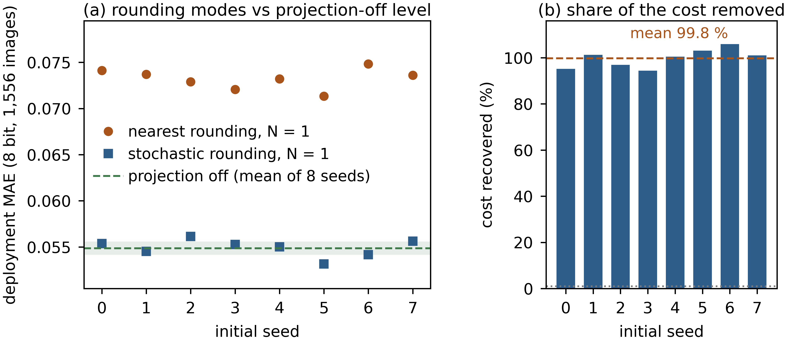

**Figure 8.** Per-seed deployment MAE under stochastic and nearest rounding ((a): 8 bit, 1,556 images, the green band is plus/minus one standard deviation of the eight projection-off seeds) and the share of the cost each seed recovers ((b): the stochastic-minus-nearest difference divided by the projection-off-minus-nearest difference; mean 99.8 %).

**Projection schedules and the interval $N$: where they agree and where they do not.** Work such as [18] arranges the process by which the weights move to their quantized values during training: at each step the parameters are written as $\alpha_t W + (1-\alpha_t) S(W)$, and the curve of $\alpha_t$ sets how fast the transfer runs. The interval $N$ here only fixes how many optimizer steps separate two full projections, is constant within a run, and involves no $\alpha_t$. The two coincide under a narrow condition: if a schedule degenerates to $\alpha_t \in \{0, 1\}$ and takes the value 1 once every $N$ steps, it is this paper's $N$ protocol bit for bit, and conclusions transfer directly -- that is the only equivalent case.

Two differences follow. First, a partial transfer ($0 < \alpha_t < 1$) writes points between grid cells rather than switching projection on or off; §3 shows that when $S_b$ acts on one side of a convex combination only, averaging and projection do not commute (Eq. (9)), so a partial transfer changes what is being averaged rather than lowering $N$. Second, a schedule may let projection density vary over training (sparse first, dense later), whereas $N$ is fixed within the 20 epochs and takes only 1, 5, 20 and $\infty$ here; cost falls monotonically with $N$ but moves in the opposite direction with the number of overwrites and with the per-event displacement (§5.6), and the two are collinear in this design, so a sparse-then-dense schedule cannot be read as a linear interpolation between two fixed-$N$ readings. What can be said is that a schedule which changes only the number of full projections, not the per-event displacement or the rounding rule, should land between the readings at the corresponding fixed $N$; that is not measured here and is offered only as a testable conjecture.

The averaging order under STE is measured as well. With the shadow's averaging source switched
from the float parameter to the forward fake-quantized weight (`--ema-source forward`), the
deployed FP32 MAE over three seeds is 0.0555 ± 0.0022 against 0.0560 ± 0.0035 for the plain STE
control — a difference of 0.0005, far below the seed spread on either side; at 8 bits the two
read 0.0555 and 0.0556. Both averaging targets land at the 0.0552 of switching projection off,
so which quantity the shadow averages is likewise not resolved under STE, and this is not an
equivalence proof either.

### 5.7 The complete toolchain on the target NPU

Everything above isolates one knob by simulating the weight quantizer in PyTorch. A deployment
pipeline does more, so we also ran the vendor toolchain end to end on five checkpoints (four
control-head exports plus one projection-off checkpoint): export to a static ONNX graph (input
$1 imes 1 imes 3 imes 224 imes 224$, grid $14 imes 14$, sequence length 1, the task of §4),
calibrate on 100 training-split images from the same run's split, disjoint from the test
subset, compile for the target BPU with our deployment settings (latency mode, optimization
level O2, one core), and execute the instruction stream on the vendor's instruction-level
simulator (Fig. 9).

Figure 9 shows this chain: the two left blocks weight-only (the old simulation) and the three
right blocks the compiled int8 pipeline, which adds per- tensor percentile quantization of
activations and lowers unary elementwise ops to b30.lut. The middle bars put the two error
magnitudes on one axis, with 95 % confidence intervals over 200 images paired image by image
(single run): ≤ 0.0003 for weight-only quantization, the per-head costs of the four
control-head exports itemized in Table 10, and the projection-off cell at $+0.0040$ $[-0.0012,
+0.0093]$. The lower half gives the unary ops each control head lowers to b30.lut: ReLU-QAT 3,
GELU 2, Bilinear-GLU 0. The measurement stage runs hbrt4-run-model-nash, an x86
instruction-level simulator; four resulting .hbm files are then re-measured on the target
board.

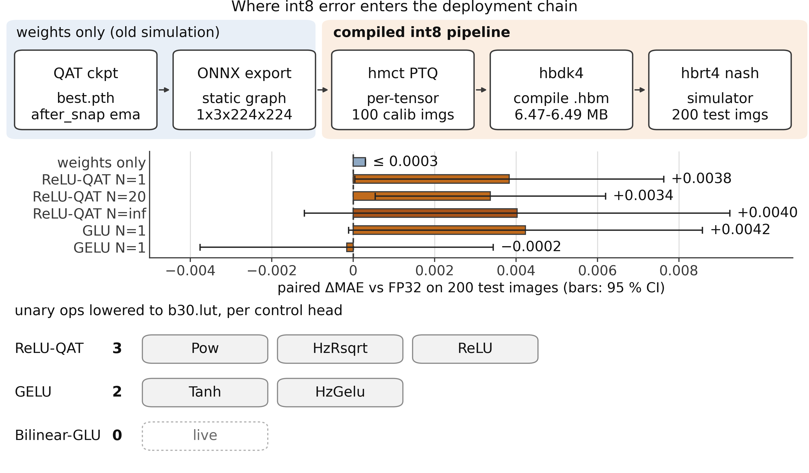

**Figure 9.** The compile chain from exported weights to a board instruction stream, and where int8 error enters: the upper half is the five-stage chain, the bars in the middle put the two error magnitudes on one axis with 95 % confidence intervals (six rows; the GLU and projection-off intervals contain zero), and the lower half counts the unary ops each control head lowers to b30.lut.

All four exports are the after_snap protocol at seed 0 with shadow weights, the deployed-weight
definition of §3.4 (Table 10). Provenance was established by re-running every checkpoint on the
same fixed input and matching it against the ONNX output (max $| \Delta | = 9 imes 10^{-8}$ –
$4 imes 10^{-7}$). Table 10 is a per-sample pairing over 200 test images from a single
checkpoint at batch 1; its source is not the 400-image subset of Table 5, and the two sets of
numbers cannot be subtracted from each other.

**Table 10.** Task MAE of the vendor toolchain on the 200 test images, the per-image paired differences, and the output bias.
| model | FP32 | fake-quant | simulator | paired $\Delta$MAE [95 % CI] | $\Delta$ output bias | de-biased $\Delta$MAE |
|---|---|---|---|---|---|---|
| ReLU-QAT N = 1 | 0.0756 | 0.0798 | 0.0794 | +0.0038 [+0.0000, +0.0076] | +0.0171 ± 0.0019 | +0.0020 |
| ReLU-QAT N = 20 | 0.0605 | 0.0629 | 0.0639 | +0.0034 [+0.0005, +0.0062] | +0.0026 ± 0.0016 | +0.0031 |
| GELU N = 1 | 0.0793 | 0.0785 | 0.0793 | −0.0002 [−0.0038, +0.0034] | +0.0010 ± 0.0020 | −0.00003 |
| GLU N = 1 | 0.0760 | 0.0780 | 0.0803 | +0.0042 [−0.0001, +0.0086] | +0.0144 ± 0.0021 | +0.0050 |

The first three columns are task MAE on the same 200 test images (FP32 on the ONNX graph, fake-
quant from the compiler's own per-node simulation, simulator on the compiled instruction
stream). The brackets are per-image paired 95 % t intervals. $\Delta$MAE averages $|y_{
ext{sim}}-y|-|y_{ ext{FP32}}-y|$ and $\Delta$ output bias averages $y_{ ext{sim}}-y_{
ext{FP32}}$. The FP32 column uses all 200 images, while the paired columns use the images the
simulator emitted successfully, dropped per model, so $n$ is 199 for the ReLU-QAT N = 20 and
GELU rows and 200 for the other two. The de-biased $\Delta$MAE subtracts the mean output bias
from the simulator predictions and recomputes the mean difference against FP32. These 200
images are a slice of that validation split (val[800:1000]) and overlap the 2,000-image
monitoring subset (112 of 200 at seed 0, 119 of 200 at seed 1), so they carry the optimism of
epoch selection as well. The lower end of the ReLU-QAT N = 1 interval is +0.00005 (+0.0000
after rounding), so it does not contain zero; N = 20 reads [+0.0005, +0.0062], also excluding
zero, while GELU [−0.0038, +0.0034] and GLU [−0.0001, +0.0086] contain zero. These intervals
pair the 200 images of a single run per cell, so they support no inference across checkpoints
or toolchains. §9 lists the scripts; Table 16 maps each claim to its artifact and script.

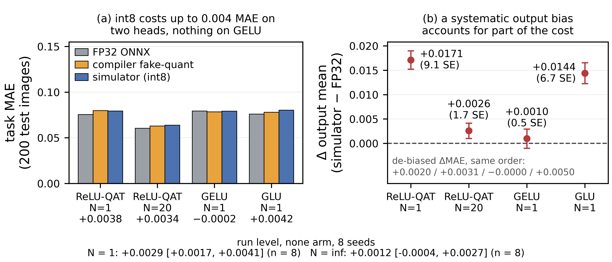

**Figure 10.** What the vendor toolchain measures. (a) Task MAE on the same 200 test images: FP32 on the ONNX graph, the compiler's own per-node fake quantization, and the compiled instruction stream executed on the instruction-level simulator. (b) The output bias the quantization introduces, with ±1 standard error as the error bars, against zero. The paired ΔMAE of each group is the third line of its tick label; in (b) the bottom row is the ΔMAE recomputed after removing that bias.

Figure 10 presents the two panels: (a) the three groups are the FP32 ONNX graph, the compiler's
per-node fake quantization and the compiled instruction stream on the simulator, the third line
of each tick label being the paired per-image difference (simulator − FP32); (b) the output
bias the quantization introduces (per-image mean of simulator − FP32) with its standard error,
against zero. The ReLU-QAT head at interval 1 is biased by +0.0171 (9.1 standard errors) and
the GLU head by +0.0144 (6.7 standard errors), while the former's per-node cosines are the
cleanest in the graph: at this check point the movement comes mainly from the bias.

Removing the bias and recomputing: ReLU-QAT's $\Delta$MAE at interval 1 falls from +0.0038 to
+0.0020, roughly halved, while at interval 20 the same head only falls from +0.0034 to +0.0031,
its own bias being small there (+0.0026). GLU goes the other way: subtracting its mean bias of
+0.0144 raises $\Delta$MAE from +0.0042 to +0.0050. GELU is near zero on both sides. The
systematic bias is therefore part of the cost but not all of it.

On the ReLU-QAT and GLU heads the compiled int8 model costs +0.0034–0.0042 MAE (GLU's 95 %
interval contains 0), an order of magnitude above the 0.0004 of §5.1 (the two additional runs
aside), so the full pipeline is far from a no-op (Fig. 10). The compiler also quantizes
activations (one percentile threshold per tensor) and lowers some unary elementwise ops to
look-up-table instructions, 3 in the ReLU-QAT control head (Pow, HzRsqrt, ReLU), 2 in the GELU
head (Tanh, HzGelu), none in the GLU head. §5.1's result is therefore a statement about the
weight quantizer only.

The deployment grid is a separate axis. Re-evaluating three checkpoints (none at N = 1, none at
N = $\infty$, after_snap at N = 20, all seed 0) on three deployment grids over 400 images: the
difference between N = 1 and N = $\infty$ is +0.0192 [+0.0140, +0.0245] on per-channel max,
+0.0181 [+0.0127, +0.0235] on per-tensor max and +0.0213 [+0.0109, +0.0318] on per-channel p99
clipping, none of the three intervals containing zero. But p99 clipping by itself raises MAE by
+0.0462 / +0.0441 / +0.0544, i.e. 2.1-2.6 times the interval-1 effect and an order of magnitude
above the interval-20 effect of +0.0038: saturated weights account for 1.4-1.5 %, the median
ratio of p99 to max is 0.86, and the loss concentrates in backbone.s3.b*.se.fc1. The grid
choice is itself a larger error source (§7 item 7).

Per-node cosine is the cosine between a node's quantized output and the
corresponding FP32 node's output over the 200 test images, as reported first-hand by
the compiler (*_quant_info.json). Aggregated by head we take the minimum over the
nodes of that head. The /head/ minima of the three heads are 0.997010 (ReLU-QAT),
0.990574 (GELU) and 0.983052 (bilinear_glu); the mean int8 cost on the same 200
images, $d = |y_{\mathrm{nash}} - y| - |y_{\mathrm{FP32}} - y|$, is +0.003834,
-0.000157 and +0.004233: the head with the highest cosine costs the middle, the
middle one costs the least, and the lowest-cosine head costs the most; over the
three points only the first two heads swap places, so the order is neither the same
nor reversed. Head differences cannot be resolved: the key pair ReLU-QAT - GELU is
+0.004128 [-0.000449, +0.008704], $p = 0.077$; ReLU-QAT - GLU is -0.000399
[-0.004858, +0.004061] and GELU - GLU is -0.004398 [-0.009815, +0.001019], all three
intervals containing zero. At FP32 the head ranking of task MAE agrees with the
cosine ranking (0.075218 / 0.076687 / 0.076829) and the three paired intervals
likewise all contain zero. The three heads differ in architecture and in LUT count
(ReLU-QAT 3, GELU 2, GLU 0, Fig. 9), so head identity and quantization cost are
confounded; we do not read this ranking as causal. The worst node in the whole graph
sits in the backbone (minimum 0.9422) and at the FPN normalization (0.9698-0.9801);
the lowest per-node cosine therefore falls in the backbone rather than in the
control head.

At the best finite interval under FP32 (N = 20) the compiled model still beats N = 1 by 0.0155
MAE, but the paired per-image $\Delta$MAE is +0.0038 at N = 1 and +0.0034 at N = 20, a
difference of 0.0004, smaller than the standard error: no interaction was detected. What the
compiler does move is the output bias, 7× smaller at N = 20 (+0.0026) than at N = 1 (+0.0171).

Adding the projection-off cell is what lets the interval result be read on the deployment
chain. That checkpoint (none protocol, $N = \infty$, seed 0) compiles through the same
toolchain (.hbm 6,487,504 B, static estimate 992.9 µs) and moves the deployment MAE from 0.0537
in FP32 to 0.0577 in the simulator, a paired $\Delta$MAE of $+0.0040$ with a 95 % interval of
$[-0.0012, +0.0093]$ containing zero, and an output bias of $-0.0040 \pm 0.0032$. Set beside
the interval 1 and interval 20 cells, the three read $+0.0038$, $+0.0034$ and $+0.0040$:
switching the training-time projection off does not remove the cost this chain imposes, only
the cost the projection imposes. What survives the chain is the difference between protocols:
$N = 20$ beats $N = \infty$ by $+0.0068$ in FP32 and by $+0.0065$ in the compiled stream, i.e.
95.0 % of the training-side gain, so the interval result of §5.2 holds on the target toolchain,
provided the cost of the chain itself does not depend on the interval.

One row of the per-node table reports a cosine of $-1.000000$ (the mean of one LayerNorm). That
row carries no cosine value of its own and its threshold belongs to a neighboring node; probing
the tensor directly on the calibrated model gives a cosine of 1.000000 against the float graph.
Excluding it, the worst node in the GELU graph is 0.9471, not −1. A per-node cosine must be
read with the operation-assignment and data-type columns, never as a bare ranking.
The four .hbm files from the control-head exports were then re-measured on an RDK S100P (system
4.0.5-Beta, kernel 6.1.158-rt58-DR, HBDK runtime 4.7.5, one BPU core). All four load, and the
compiled target nash-m matches the runtime on the board. Fed the 200 test images one at a time,
the board reproduces the simulator sample for sample: the largest absolute deviation over 800
inferences is 0, and the two images the simulator failed to emit come out normally on the
device, so on this platform the instruction-level simulator stands in for a board measurement.
In latency, hrt_model_exec averages 1.13–1.20 ms per frame over 200 frames on one thread
(820–878 FPS); repeats of the same model stay within 1.2 %, while the two batteries differ by
about 5 %, so we still make no latency comparison between heads. Driven one image at a time
through the python runtime, including python and data-loading overhead, single-stream latency
is 1.50–1.54 ms at the median and at most 1.85 ms at P99, and four threads on the single core
reach 1,092 FPS. Loading a model costs 0.76–0.82 s.

Two limits. First, the simulator reproduces the compiler's own fake-quant output to within
0.0009 MAE (below one standard error) on the three ReLU-QAT and GELU models, and to 0.0022
(about 1.1 standard errors) on the GLU head, correlating per sample at 0.993–0.998, so whatever
the look-up tables and fixed-point accumulation add is mostly under our resolution. Second, the
compiler's latency figure (991.3–993.3 µs per frame on a single core, 31.2 MB of DDR traffic)
is a static estimate for one image, 12–18 % below the 1.13–1.20 ms measured on the board; it
compares models on a single footing but is not an on-device latency, and the spread across the
four models is under 0.2 %, so we make no latency comparison between heads.

### 5.8 Re-evaluation on a subset that took no part in epoch selection

The deployment evaluations above use the first 400 images of each run's validation split, while the best epoch was selected on the 2,000-image monitoring subset of that same split (§4), so the two overlap. To estimate the optimism this introduces, the same deployment quantiser is re-run on the 1,556 images that took no part in selection (their filename intersection with the monitoring subset is zero, and the per-image predictions are archived); the per-seed paired differences of the same runs under the two bases are in Fig. 11.

The interval effect is unchanged on the external subset: for none and seed 0 the FP32 MAE is 0.074110 at interval 1 and 0.054271 at $N = \infty$, a per-image paired difference of $+0.01984$ (single run, image level; se 0.00138, 95 % CI $[+0.01713, +0.02255]$), the same direction and magnitude as the 0.0189 of Table 5; intervals 5 and 20 read 0.065249 and 0.059096, i.e. $+0.01098$ and $+0.00483$ against the endpoint, so the monotonicity holds. The ordering effect halves: at interval 20 and seed 0 the before-minus-after difference falls from $+0.00132$ on 400 images to $+0.00066$ (se 0.00038, 95 % CI $[-0.00008, +0.00139]$, which contains zero), still inside the resolution of this test.

The selection bias is itself measurable: across the nine cells of Table 5 (three protocols × three intervals, seed 0) the FP32 MAE on 400 images exceeds the external subset by 0.0012 on average, and the gap grows with the interval ($+0.00044$ at 1, $+0.00055$ at 5, $+0.00256$ at 20), because a longer interval leaves more late epochs to choose from. The effect of the shadow survives on the external subset (at interval 20, before and after against none read $-0.00118$ and $-0.00184$, neither interval containing zero) and disappears at $N = \infty$ (after minus none $+0.00035$, containing zero), consistent with §5.4. The epoch at which the monitor bottoms is recorded too: across the 40 runs of the five main sequences on the fixed split the median is 16.5 and the range 3-19; projection-off and interval 1 average 16.8 and 17.1, interval 20 reads 13.1 instead (two runs bottom out at epochs 3 and 6), and the shadow protocols come earlier (medians 10 and 10.5). The STE control is unchanged as well: over eight seeds its mean on the external subset is 0.0548 (sd 0.0012) against 0.0549 (sd 0.0007) for projection switched off, a gap of 0.0001, while in-place overwriting on the same subset reads 0.0732 (sd 0.0011), 0.0184 above STE.

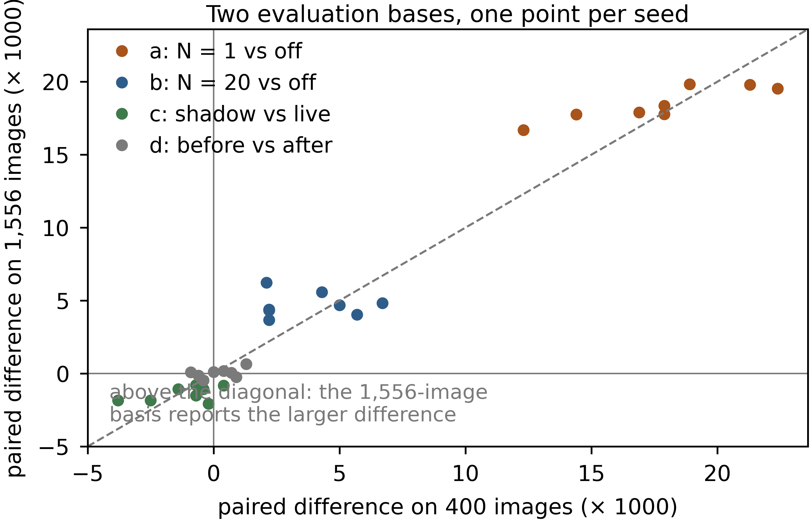

**Figure 11.** Per-seed paired differences under the 400-image and the 1,556-image bases (contrasts a–d, eight points each, dashed line = equality): the points of the shadow contrast c fall on both sides of the line, so the two bases support different significance conclusions.

### 5.9 Two external axes: a different architecture and a different dataset

The main experiment contains one 4.41 M network and one dataset, so we ran two external axes. Both hit only the two endpoints — in-place overwriting at every step (interval 1) and projection switched off ($N = \infty$) — with two protocols (none, after_snap) and 8 initial seeds (0-7); apart from the learning rate, the remaining settings match the main experiment (1e-3 on both axes, 1e-4 in the main experiment): 20 epochs, batch 64, cosine annealing, shadow decay 0.99, and the exported weight defined as in §3.4. Each cell uses 400 validation images with the split rebuilt from that run's own seed, and the same checkpoints are re-scored on a disjoint 400 images.

The architecture axis replaces the network with an ImageNet-pretrained ResNet-18 (11.18 M parameters, 2.5x the main network) and keeps UTKFace. It carries BatchNorm, which is always folded into the preceding convolution before deployment; folding changes the output by at most $6 \times 10^{-7}$ on the same input, so the 8 bit numbers refer to the folded weights. Table 11 gives the readings: pooled over the two protocols, switching projection off reads 0.0507 in FP32 and overwriting at every step 0.0580, a difference of $+0.0072$ (1.14x); at 8 bits $+0.0073$, at 6 bits $+0.0092$ and at 4 bits $+0.0424$ — the same sign at all four bit widths. The per-seed paired difference is $+0.0079$ $[+0.0061, +0.0096]$ under none and $+0.0066$ $[+0.0043, +0.0088]$ under after_snap, and both pairs are of one sign on all 8 initial seeds (exact two-sided $p = 0.0078$). On the 1,556 images that took no part in epoch selection the protocol-averaged difference is $+0.0071$.

**Table 11.** Deployed MAE on the architecture axis (ResNet-18, 11.18 M parameters): mean of 8 initial seeds, two protocols x two endpoints
| protocol | interval | FP32 | 8 bit | 6 bit | 4 bit |
|---|---|---|---|---|---|
| none | $N = 1$ | 0.0586 | 0.0586 | 0.0614 | 0.1025 |
| none | $N = \infty$ | 0.0507 | 0.0508 | 0.0509 | 0.0557 |
| after_snap | $N = 1$ | 0.0573 | 0.0574 | 0.0590 | 0.0939 |
| after_snap | $N = \infty$ | 0.0508 | 0.0507 | 0.0511 | 0.0559 |

**Note:** each cell is the mean of 8 initial seeds (0-7); each run uses 400 validation images with the split rebuilt from that run's own seed; for the sign of $\Delta$ see §3.4. The per-seed paired difference ($N = 1$ minus $N = \infty$) is $+0.0079$ $[+0.0061, +0.0096]$ under none and $+0.0066$ $[+0.0043, +0.0088]$ under after_snap, 8/8 of one sign in each pair (exact two-sided $p = 0.0078$); the protocol-averaged difference is $+0.0073$, $+0.0092$ and $+0.0424$ at 8, 6 and 4 bits. On the 1,556 images that took no part in epoch selection it is $+0.0071$ ($N = 1$ 0.0563, $N = \infty$ 0.0492). The zero baseline is computed on each run's own split; these 400 images overlap the 2,000-image monitoring subset used for epoch selection.

The data axis replaces the dataset with KonIQ-10k (10,073 natural images, label = five-level MOS divided by 100; 1,510 validation images, zero baseline 0.0044) and keeps the 4.41 M network. Table 12 gives the readings: pooled over the two protocols, switching projection off reads 0.0020 in FP32 and overwriting at every step 0.0027, a difference of $+0.0007$ (1.36x, i.e. 16 % of that task's zero baseline of 0.0044); at 8 bits $+0.0007$, at 6 bits $+0.0005$, and $+0.0007$ on the disjoint 400 images. The per-seed paired difference is $+0.0007$ $[-0.00003, +0.0015]$ under none (7/8 of one sign, exact two-sided $p = 0.070$) and $+0.0008$ $[+0.0001, +0.0014]$ under after_snap (8/8, $p = 0.0078$): 15 of the 16 paired differences are positive, the exception still being none with seed 1 ($-1.2 \times 10^{-5}$, i.e. a tie at machine precision), but the lower end of the none interval sits next to zero, so this axis is written as a direction only. At 4 bits the sign flips (protocol mean $-0.0012$, the interval containing zero, overwriting is better), as in the main experiment, driven by run-to-run variation and not interpreted here.

**Table 12.** Deployed MAE on the data axis (KonIQ-10k, label = MOS / 100): mean of 8 initial seeds, two protocols x two endpoints
| protocol | interval | FP32 | 8 bit | 6 bit | 4 bit |
|---|---|---|---|---|---|
| none | $N = 1$ | 0.00267 | 0.00267 | 0.00322 | 0.00990 |
| none | $N = \infty$ | 0.00197 | 0.00201 | 0.00298 | 0.01073 |
| after_snap | $N = 1$ | 0.00270 | 0.00270 | 0.00364 | 0.00858 |
| after_snap | $N = \infty$ | 0.00193 | 0.00196 | 0.00280 | 0.01010 |

**Note:** each cell is the mean of 8 initial seeds; each run uses 400 validation images; the zero baseline of this task is 0.0044 (validation set, predicting its own mean). The per-seed paired difference ($N = 1$ minus $N = \infty$) is $+0.0007$ $[-0.00003, +0.0015]$ under none (7/8 of one sign, exact two-sided $p = 0.070$) and $+0.0008$ $[+0.0001, +0.0014]$ under after_snap (8/8, $p = 0.0078$); 15 of the 16 paired differences are positive, the exception being none with seed 1 ($-1.2 \times 10^{-5}$). The protocol-averaged difference is $+0.0007$ and $+0.0005$ at 8 and 6 bits, and $-0.0012$ at 4 bits (the interval containing zero). On the external subset (the 400 images left after subtracting the 1,110-image monitoring subset from the validation split’s 1,510 images, disjoint from the images used for epoch selection) the protocol-averaged difference is $+0.0007$ ($N = 1$ 0.00264, $N = \infty$ 0.00195).

Both axes test one thing: whether the direction of the endpoint comparison holds under a different network and a different dataset. Their absolute levels are not comparable with those of Table 5 cell by cell, for three reasons: the learning rate is set per task (1e-3 on both axes, against 1e-4 in the main experiment — copying 1e-4 leaves KonIQ worse than its zero baseline after a full 20 epochs), BatchNorm is folded only before deployment, and the 1024x768 KonIQ images are resized to 224², which removes some of the quality signal. The conclusion is therefore directional: at 8 bits, switching projection off beats overwriting at every step on both new axes, and the size of the gain varies with the task (1.14x and 1.36x), while at 4 bits the two axes give opposite signs for this contrast (architecture axis $+0.0424$ same sign, data axis $-0.0012$ opposite), consistent with §5.5. On the architecture axis both pairs are of one sign on all 8 initial seeds (exact two-sided $p = 0.0078$), while on the data axis the after_snap pair is 8/8 ($p = 0.0078$) and the none pair 7/8 ($p = 0.070$) with the lower end of the interval sitting next to zero, so this axis is read as a direction only, not as an independent replication.

### 5.10 Across deployment backends: replication on two independent implementations

Two of the deployment readings above come from a chain whose quantization grid is the same set
of per-output-channel symmetric scales used in training. Is the conclusion about training-time
projection, or about this grid? The same 16 checkpoints (8 initial seeds × the interval-1 and
projection-off cells, relu_qat head, none protocol, fixed split) were therefore put through two
unrelated open-source runtimes, each with its own post-training quantizer, so the grid differs
from the training grid.

Both chains export the PyTorch weights to static ONNX, first clear them in FP32 (largest per-
image MAE difference against torch 1.8e-08 and 3.8e-08, against a threshold of 1e-4), then
post-training quantize with the runtime's own quantizer, on the same 100-image calibration set
and the same 200 test images as the vendor chain. ONNX Runtime 1.26.0 (CPU EP) uses the QDQ
format, with per-tensor asymmetric activations and per-channel symmetric weights; OpenVINO
2026.4.1 with NNCF 3.4.0 uses its default post-training preset. Two points must be stated
plainly. ONNX Runtime quantizes only the 66 convolutions, because a whole-graph run lets the
per-tensor scales of MatMul/Gemm be dragged down by activations of ±109 (the same exports
collapse from 0.0751 to 0.2815, and an earlier whole-graph export in the repository collapses
to 0.2749, so this is not a script defect); on the OpenVINO side the NNCF default keeps the
weights of the 24 SE 1×1 convolutions and the 2 attention QK^T matrices in fp32, so that chain
is mixed precision rather than full int8.

Table 13 sets the three chains side by side. The interval effect (interval 1 minus projection
off, or interval 20 minus projection off on the vendor chain) is positive on both sides of
quantization, with the direction decided by per-seed pairing: 8/8 of the same sign on ONNX
Runtime and 8/8 on OpenVINO, int8 differences of $+0.0203$ ($[+0.0188, +0.0217]$) and $+0.0169$
($[+0.0114, +0.0225]$), retention ratios against their own FP32 of 1.039 and 0.868. With the
vendor chain's 0.950 (single run, §5.7), three chains with different implementations,
quantizers and grids give retention ratios between 0.87 and 1.04, so the conclusion of §5.2 is
not a property of this grid on the three backends tested here: change the quantizer or the scale granularity (per-tensor instead
of per-channel), or even move to mixed precision, and the interval effect is still there at
undiminished magnitude.

The quantization cost is recorded here only as an observation, because the two chains do not
agree. On OpenVINO the cost at the projection-off endpoint is $+0.0065$ (8/8 of the same sign, i.e. 8 positive and 0 negative)
and only $+0.0039$ at interval 1 (7/1); on the ONNX Runtime convolutional chain the opposite
holds, $+0.0058$ at the projection-off endpoint and $+0.0066$ at interval 1, pooled $+0.0062$.
Both chains show quantization raising the two protocols together (0.005–0.007), but which
endpoint is pushed harder depends on the quantizer, which is also where the retention ratios
come from, one below 1 (0.868) and one slightly above it (1.039). It looks more like an
interaction between the quantizer and the weight distribution, and we have not measured the
layer at which a mechanism could be specified.

Three boundaries. First, the whole-graph int8 ONNX Runtime version is one diagnostic row of
Table 13: its interval effect is inflated to $+0.1375$ and its quantization cost is above
$+0.20$, a collapse caused by a mismatched quantization configuration, not evidence that more
projection is more afraid of quantization. Second, both open-source chains run on CPU, so their
latencies are only relative references (OpenVINO reads 15.36 and 3.90 ms per image in FP32 and
int8) and no hardware conclusion rests on them. Third, they cover only the relu_qat head, the
interval-1 and projection-off endpoints, and 200 test images, a coarser basis than the
1,556-image main protocol, so absolute levels are not compared cell by cell with Table 5; only
the within-chain comparison, before against after quantization, is made.

**Table 13.** Interval effect on three deployment chains: same checkpoints, same 200 test images
| deployment chain and quantizer | interval effect FP32 | interval effect int8 | retention ratio | quantization cost $\Delta$MAE | note |
|---|---|---|---|---|---|
| vendor chain hbdk4 4.7.5 (nash instruction-level simulation) | +0.0068 | +0.0065 | 0.950 | $N{=}1$ +0.0038, $N{=}20$ +0.0034, $N{=}\infty$ +0.0040 | per-output-channel symmetric, the training grid itself; single run |
| ONNX Runtime 1.26.0 (66 convolutions only) | +0.0195 | +0.0203 | 1.039 | pooled +0.0062 (16 readings) | per-tensor asymmetric activations, per-channel weights; 8 seeds |
| OpenVINO 2026.4.1 with NNCF 3.4.0 | +0.0195 | +0.0169 | 0.868 | $N{=}1$ +0.0039, $N{=}\infty$ +0.0065 | mixed precision: 24 SE convolutions and 2 QK^T weight matrices kept in fp32; 8 seeds |
| ONNX Runtime, whole-graph int8 (diagnostic) | +0.0195 | +0.1375 | 7.04 | — | per-tensor scales of MatMul/Gemm dragged down by activations of ±109; not a deployment claim |

**Note:** the interval effect is interval 20 minus projection off on the vendor chain and interval 1 minus projection off on the two open-source chains; the absolute value of the former is not comparable with the latter (§3.4 sign convention: a positive value means more projection is worse). Retention ratio = the int8 interval effect ÷ the interval effect of the same batch in FP32. Per-image intervals and per-node cosines for the vendor row are in §5.7 and Table 10; the intervals of the two open-source chains come from the per-seed paired differences over the 8 seeds ($df = 7$, $t_{0.975} = 2.3646$), with an exact two-sided sign test. The FP32 column of the two open-source chains is the same because they read the same exports and the same 200 images. Artifacts: `quant_runs/backend2_report.md`, `quant_runs/backend_ov_report.md`.

## 6. Discussion and Conclusion

The ordering effect is not detected at the run level: the paired contrast d at n = 8, df = 7 is
+0.000029 [-0.000249, +0.000307] (1,556-image basis), and the equivalence test at the
pre-specified margin of 0.0016 rules out order effects of magnitude 0.0016 or larger ($p < 10^{-4}$); that margin is 1 % of the 0.1553 zero
baseline and independent of the observations, and the minimum detectable effect at 80 % power is
0.000383 (Fig. 6), so we claim only that no ordering effect was observed at this threshold. The two
protocols deliver weights that differ by 0.043–0.091, while retraining the same configuration with
another seed moves them by 0.64–0.83: both sit inside the flat directions of the loss, which makes the
ordering a *sub-seed* perturbation. That displacement is not produced by export quantization either:
requantizing the exported weights of both orders with the deployment quantizer leaves a relative L2
of 4.8 % ± 0.6 % and 98 % of the weights on different grid points (§5.3); as for why a 4.8 %
displacement in weight space is worth only +0.000029, this paper did not measure the optimization
process and offers no causal account, and the flat-basin reading is a conjecture. To be kept apart from the ordering is the
presence of the shadow: at the same interval, after_snap against none reads -0.001377 [-0.001798,
-0.000957] (1,556 images, 8/8 of the same sign, p = 0.008; on the 400 images only 7/8, p = 0.070),
the same order as the largest observed ordering gap; with projection switched off that difference
falls to +0.00043.

The interval effect, by contrast, is clearly visible, and it is not a separate curve but the front
section of the same cost curve. At seed 0 the protocol mean over the three finite intervals falls
from 0.0743 to 0.0607, and at the endpoint with projection off none reads 0.0552: each extension of the interval removes one dose of perturbation from training, and the cost
follows it down to zero at the endpoint. Its magnitude (0.074 -> 0.055) is an order of magnitude above the largest
observed ordering gap (0.0014), and it cannot be explained by grid alignment, since every
finite-interval configuration ends up on the grid. The STE control (§5.6) rules out the reading that
the weights rest on the grid: sitting on the grid at every step without ever overwriting the
parameters is indistinguishable from switching projection off, while at the same interval overwriting
versus not overwriting differs by 0.0184. The cost co-varies with the number of overwrites, but the
single-step displacement moves in the opposite direction at the same time, so the two are collinear in
this design; hence the cost belongs to the in-place overwrite step, and the count cannot be called the
mechanism. The 6 bit metric tracks the FP32 metric closely (0.0785 -> 0.0639 at 6 bit against
0.0743 -> 0.0607 at FP32; a descriptive reading at seed 0), and the interval effect is larger at 6 bits
(run level +0.0214 against +0.0185), consistent with "what changes is how well the network is trained, not how
closely the weights fit the grid", but a coarser quantizer also amplifies weight differences; this paper did not
measure optimizer state and does not specify a mechanism on this basis.
The interval effect is also not a property of one toolchain: on two independent implementations
with their own post-training quantizers and a different scale granularity, the int8 interval
effect still retains 87–104 % (§5.10).

- Target is the weight-only 6-8 bit setting (activations kept in FP32): switch training-time
projection off (the run-level differences are +0.0185 and +0.0047 at 8 bits, and larger at 6 bits,
+0.0214 and +0.0060, 8/8 of one sign; the 6 bit readings are exploratory and not corrected across bit widths).
- Projection must be kept: report the interval as a hyper-parameter; from 1 to 20 it still moves
the metric by 0.0137.
- Deployment switches to a per-tensor scale or percentile clipping: the interval effect keeps its
direction, but the absolute error is dominated by the grid choice (p99 clipping alone raises it by
0.0441-0.0544).
- EMA is used: no ordering effect reaching 0.0016 in absolute value was detected (n = 8, df = 7,
margin 0.0016 pre-specified, equivalence test passes at $p < 10^{-4}$, MDE 0.000383; this is still
not a proof that the two orderings are equivalent); verify the presence of the shadow separately
at the 0.0014 magnitude (8/8 of the same sign).
- Working at 4-6 bits: the seed spread must be reported as well (within-interval sd
0.0476-0.0626).
- Weights must stay quantized during training: use STE fake quantization, do not overwrite the
parameters (the two differ by 0.0184).
- If overwriting is unavoidable: replace nearest rounding by stochastic rounding at each projection
(the cost on the 1,556 images falls from 0.0183 to 0.00004 over 8 seeds, recovering 94.4 %-105.9 % of it).

This yields an actionable evaluation protocol, given as §6.1.

### 6.1 Deployment evaluation checklist

* **1.** Before reporting an 8 bit fidelity figure, confirm the four preconditions first: the
training-time projection and the deployment quantizer are the same operator, with the same scale, the
same rounding rule and no clipping overflow. When all four hold, the quantization cosine and the
relative L2 read 1 and 0.0000–0.0001 (strictly for live weights, approximately for the shadow; the
resolution comes from reporting four decimals, so at a higher precision a non-zero residual remains),
and at any checkpoint they should simply be dropped - they carry no information by construction
(§5.1). Break any one of them (a different bit width, a per-tensor scale, p99 clipping) and the metric
carries information again; then look first at the distribution of the off-grid distance $\rho$
(eq. (14)): at a representative checkpoint (after_snap, interval 20, seed 0, 75 projected tensors)
more than 96 % of the weights in this paper satisfy $\rho_{oj} < 0.45$.
* **2.** Do not rank candidate models by per-node cosine: our three heads' node-cosine ranking does not
agree with the measured cost ranking - only ReLU-QAT and GELU swap places, so the full order is
neither the same nor reversed - and the head-to-head paired tests cannot resolve a difference,
while the heads also differ in architecture and in the number of LUT ops (§5.7).
* **3.** To drop one knob at 8 bit, switch projection off first and do not tune the interval (§5.2); if
projection must be kept, use STE fake quantization instead of in-place overwriting (trigger: weight-only, activations kept in FP32): in-place
overwriting sits 0.0184 above STE, and STE is within 0.0001 of switching projection off (§5.6).
* **4.** Before claiming that the averaging order has no effect, state the smallest effect you can
exclude, the margin you used and the corrected significance, and say whether the margin was
derived from the data themselves (§5.3); the power this checklist requires comes from the n = 8 fixed-split sequences, and the n = 3 controls are descriptive only.
* **5.** Any 4-6 bit ranking must be reported across seeds with its sd: a single-run 4 bit ranking is not
trustworthy in this test (§5.5). The primary statistic is the per-seed paired t interval; the median and the bootstrap are robustness checks only.

Under our setting three conclusions follow: the interval is the main knob, any finite interval sitting above the endpoint at which projection is switched off; no ordering effect of absolute size at least 0.0016 was detected; and the cost belongs to the in-place overwrite step, while weights that merely rest on the grid pay nothing. These conclusions are limited to a single dataset, a single model and a fixed budget; the cross-backend replication and the two extrapolation axes are directional observations only (Appendix A).

## 7. Threats to validity

1. The main sweep covers one dataset. UTKFace is a small, curated, near-frontal face dataset, and the main controlled sweep (eight initial seeds per main configuration) takes it together with the 4.41 M-parameter network only; §5.9 adds endpoint comparisons on ResNet-18 and on KonIQ-10k with 8 initial seeds each, which keep the same direction, but each covers two endpoints only, so the behaviour of the interval on other data domains, at other resolutions or on other architectures is not tested beyond those endpoint comparisons.

2. Throughout §5.1–§5.5 the controlled variable is per-output-channel symmetric weight QDQ
   in PyTorch, so that the two knobs can be swept independently of a compiler's heuristics.
   §5.7 adds the vendor toolchain, but only on five checkpoints across three heads (an interval pair for the ReLU-QAT head, one GELU checkpoint, one bilinear-GLU checkpoint, plus a projection-off none checkpoint), only through a 100-image
   calibration set, measured on an instruction-level *simulator* and then re-checked on the
   target board; only these four checkpoints ran on silicon, so the latency and throughput
   figures stay limited to them. In addition, cross-backend replication was carried out on two
   independent implementations (§5.10): ONNX Runtime quantizes only the 66 convolutions
   (quantizing the whole graph collapses the per-tensor scales of MatMul/Gemm, so that version
   is diagnostic only), while OpenVINO uses the NNCF default preset and is therefore mixed
   precision. Both chains cover only the relu_qat head, two endpoints and 200 test images, and
   their latencies are CPU-relative references only.

3. The seed is not decoupled: it sets both the data split and the parameter initialization, so
   the spread across seeds carries a split difference and an initialization difference at once.
   To separate them we ran a 3 × 3 design over split_seed and initial seed (Table 14): the mean
   deployment FP32 MAE over the nine cells is 0.0583, and a two-way sum-of-squares decomposition
   gives 56.6 % for the split, 10.0 % for the initialization and 33.4 % for the residual
   (interaction included), which reads as variance components of 0.0008, 0 (truncated) and
   0.0009. The residual has only 4 degrees of freedom and neither factor is significant at the
   5 % level (F = 3.39 and 0.60 against a critical value of 6.94), so the ordering is
   descriptive: the split matters more than the initialization, but nine runs do not settle it.
   The split difference is largely a difference of evaluation subsets: split 2 sits about 0.0016
   lower for all three initial seeds, in step with its lower zero baseline (0.1516 against
   0.1552), while within a split the three initial seeds span 0.0011, 0.0024 and 0.0007. On the
   training-time live MAE instead (full validation split, best epoch) the same runs decompose as
   2.9 % split, 50.2 % initialization and 46.9 % residual, so the attribution depends on the
   metric reported. Within the fixed-split sequences of §5.3 and §5.5 the cross-seed dispersion therefore
   contains only initialization and batch-order differences, while the 3 × 3 cross above shows
   that when the split varies with the seed the split contribution is comparable, so
   initialization is not claimed to dominate.

**Table 14.** Deployment FP32 task MAE of the 3 × 3 design over data split and parameter initialization.
| split split_seed | initial seed 1 | initial seed 2 | initial seed 3 | mean |
|---|---|---|---|---|
| 0 | 0.0582 | 0.0593 | 0.0588 | 0.0588 |
| 1 | 0.0593 | 0.0598 | 0.0574 | 0.0588 |
| 2 | 0.0569 | 0.0570 | 0.0576 | 0.0572 |
| mean | 0.0581 | 0.0587 | 0.0579 | 0.0583 |

**Note:** All nine cells use after_snap, interval 20, γ = 0.99 and 20 epochs; each entry is the deployment FP32 task MAE over 400 validation images, with the split rebuilt from that run's own split_seed. Cells (0,1), (0,2) and (0,3) are the fixed-split runs of §5, (1,1) and (2,2) are main-configuration runs, and the remaining four were run for this table. The last cell is the mean of all nine. The sum-of-squares decomposition and its significance are in item 3 of §7; on the same 400 images the per-image 8 bit-minus-FP32 difference runs from −0.0001 to +0.0018 (positive means 8 bit is worse), with the maximum at (2, 1).

4. Checkpoint selection overlaps the evaluation subset. The best epoch is chosen on the
2,000-image monitoring subset of each split, and the 400-image deployment subset overlaps it, so
the readings of Tables 4-7 carry the optimism of epoch selection. The main basis has moved to the
1,556 images that took no part in epoch selection: the intervals and tests of §5.2-§5.4 all report
that basis, with the 400 images only as a control column. The difference between the two bases is
not a decimal-place wobble: the shadow contrast at interval 20 is 8/8 of the same sign with a sign
test p = 0.008 on the 1,556 images, but only 7/8 with p = 0.070 on the 400, i.e. marginal evidence
there; the interval effect itself reads +0.018457 against +0.017750 (contrast a) and +0.004723
against +0.003800 (contrast b), the same direction with a difference of 0.0007-0.0009. The
row-by-row values of Tables 4-7 remain point estimates on 400 images; absolute levels should be
read from the 1,556-image basis.

5. Relation to transition-rate scheduling. Lee et al. model the transition of the quantizer itself as an explicit rate parameter and schedule it during training [18]. Our interval $N$ sits in the same place — both ask how often training should bring the weights into contact with low precision — but they measure different objects, so the numbers of the two cannot be compared directly (Table 15).

6. Protocol of the external axes. The two axes of §5.9 use their own learning rate (1e-3 on both axes, against 1e-4 in the main experiment) and their own image size, and BatchNorm is folded only before deployment; they test whether the direction of the endpoint comparison reproduces under a different network and a different dataset, not whether absolute levels match those of Table 5. Each axis covers two endpoints only and does not cover the intermediate intervals.

7. Extrapolation when the deployment grid differs from the training quantizer. Every reading of
§5.2-§5.5 uses the per-channel max grid that training also uses; the grid-sensitivity paragraph of
§5.7 moves the same checkpoints onto per-tensor max and per-channel p99 clipping: the interval
effect keeps its direction (+0.0192 / +0.0181 / +0.0213), but p99 clipping alone raises the absolute error by 0.0441-0.0544, which is 2.1-2.6 times the interval-1 effect quoted just above (+0.0181 to +0.0213) and an order of magnitude above the interval-20 effect (+0.0038). Our absolute MAE therefore holds
only on the per-channel max cell; if deployment uses a per-tensor scale or percentile clipping,
what transfers is the direction and the conclusion that switching projection off is better, not
the MAE levels reported here.

**Table 15.** Our interval $N$ against the transition rate of QAT
| axis | our interval $N$ | transition-rate scheduling [18] | what it implies for reading this paper |
| --- | --- | --- | --- |
| what is scheduled | the number of steps between two in-place projections; $N = 1$ projects every step, $N = \infty$ turns projection off | the rate at which weights move from float to quantized, i.e. how far each step advances | same role, different quantity; the numbers of the two cannot be compared directly |
| whether the weights are overwritten | yes: $W_t \leftarrow S_b(W_t)$, with no full-precision master copy | no: the optimizer holds float weights and quantization is applied in the forward pass only | the cost attribution of this paper applies to overwriting implementations only (§5.6) |
| whether shadow-versus-projection order is an independent variable | yes (before_snap / after_snap / none) | not treated as one | the ordering results of this paper say nothing about transition-rate scheduling |
| whether the conclusions transfer | projection off is best at 8 bit | not tested here | this paper cannot be read as saying that transition-rate scheduling does not work |

**Note:** "does not transfer" means only that the mechanistic conclusions of this paper cannot be carried over to a non-overwriting implementation; it does not say that transition-rate scheduling fails. Comparing the two requires re-running both under one implementation.

## 8. Data, Ethics and Broader Impact

Data and ethics. The data are the aligned and cropped UTKFace subset [35], taken on
2026-10-26 from a HuggingFace mirror; it holds 23,708 JPEG images. Hashing each filename
together with its byte size, in name order, gives SHA-256 493950cf.... The official dataset
page states, verbatim, "non-commercial research purposes only", while the mirror declares
the licence MIT and disclaims ownership of the data; the two statements conflict, so we
follow the stricter one. Filenames encode age, gender and race, of which we read only age;
the labels themselves are DEX estimates double-checked by a human annotator, not
self-reports. Our validation split is a seeded 15 % random split, and the dataset carries no
identity labels, so one person may fall on both sides of the split and an across-split
number is not evidence of generalization to unseen identities. We neither synthesize nor
edit images, we release none of them, and we report aggregate metrics only.

Broader impact. Age regression feeds advertising targeting, access control and identity
checks, and an error does not stay in a table: it lands on the person being judged. Our
contribution is confined to a deployment-evaluation criterion. A downstream team that first
asks, under the protocol used here, whether a fidelity metric still carries information
about cost will not mistake the numbers that saturate at 8 bits for evidence about
deployment, which makes misuse easier to audit. The improvement is in evaluation only. We
propose no detector, no rejection rule and no correction for a wrong prediction, and nothing
here prevents the model from being used in the settings above; reading this as a safer age
estimator would be a mistake.

## 9. Reproducibility map

Every number in this paper is produced by a script in this repository (Table 16), and the per-image predictions are archived with the artifacts. Training one run takes 834–891 s on a single RTX 4080 Laptop (7,875 MiB free) at 20 epochs and batch 64; the four additional runs of the 3 × 3 design take about 57 min in total.

**Table 16.** Mapping of each claim to its artifact, script and figure or table.
| claim | artifact | script | figure or table |
|---|---|---|---|
| 8 bit no-op, grid residual, on-grid fraction | quant_runs/paper2_facts.json | scripts/paper2_diagnostics.py | Table 4, Fig. 2 |
| deployment MAE (see §5.2–5.5) | quant_runs/deploy_table_v3.csv (65 runs), quant_runs/deploy_table_v4.csv (50 runs on the shared 400 images) | scripts/deploy_table.py, scripts/round20_table_v4.py | Table 5, Table 7, Fig. 3, Fig. 7 |
| per-image pairing and interval estimates | quant_runs/paired_report.md, quant_runs/perimage/*.npz | scripts/paper2_paired.py | note to Table 5, §5.3 |
| multiple-comparison correction (see §5.3) | quant_runs/perimage/*.npz | scripts/holm_paired.py | see §5.3 |
| order-effect equivalence test | quant_runs/runlevel2_stats.json, quant_runs/dual_basis_report.json | scripts/round20_runlevel.py, scripts/round20_dual_basis.py | §5.3 |
| equivalence margins, one-sided $p$ values and power ($\sigma_d$, $\alpha$, non-central $t$) | quant_runs/mde_power.json | scripts/round20_mde.py | §5.3 and Fig. 6 |
| split versus initialization variance attribution | quant_runs/split_cross_table.csv (9 runs) | scripts/run_split_cross.py, scripts/split_cross_table.py | Table 14, item 3 of §7 |
| external-subset re-evaluation (see §5.8) | quant_runs/heldout_eval_v3.csv (46 runs × 2 subsets) | scripts/heldout_eval.py, scripts/round20_heldout.py | see §5.8 |
| interval sweep, interval-20 seed replication | results/utk-relu_qat-* | scripts/run_snapfreq.py, scripts/run_snap20_seeds.py | Fig. 4 |
| STE fake-quantization control (see §5.6) | results/utk-relu_qat-none-ste-s{0..7}-*, quant_runs/ste_deploy_table.csv, quant_runs/ste_v3.csv, quant_runs/ste_runlevel.json | quant/ste.py, scripts/run_ste_queue.py, scripts/ste_deploy.py, scripts/round20_ste_runlevel.py | Table 8, last row of Fig. 1 |
| operator definitions | quant/qat.py (snap_weights_), quant/ema_snap.py (SnapEMA.update_) | — | eqs. (1), (5) |
| training and evaluation protocol | train.py (--snap-every, --ema-mode, --ema-decay, --quant-mode) | — | Table 2 |
| vendor-toolchain int8 (see §5.7) | npu_quant/out/*.json, npu_quant/out/tables.md, npu_quant/out/paired_stats.md, npu_quant/out/paired_stats.json, npu_quant/REPORT.md | npu_quant/export_npu_onnx.py, npu_quant/make_calib.py, npu_quant/gen_hb_configs.py, npu_quant/hb_patch_fold.py | Table 10, Fig. 9, Fig. 10 |
| Cross-backend replication (see §5.10) | quant_runs/backend2_report.md, quant_runs/backend_ov_report.md, quant_runs/backend2_preds.npz, quant_runs/backend_ov_onnx/ | scripts/round20_backend2.py, scripts/round20_backend_ov.py | Table 13 |
| Run-level statistics and dual basis (including the 6 bit basis) | quant_runs/runlevel2_stats.json, quant_runs/dual_basis_report.json, quant_runs/heldout_eval_v3.csv, quant_runs/deploy_table_v4.csv | scripts/round20_runlevel.py, scripts/round20_dual_basis.py, scripts/round20_heldout.py, scripts/round20_table_v4.py | Tables 5–7 |
| Mechanism controls (learning rate, budget, stochastic rounding) | quant_runs/mechanism_stats.json, quant_runs/mechanism_report.md | scripts/round20_mechanism.py, scripts/run_stochastic_rounding.py (stochastic-rounding injection) | see §5.6 |
| Weight distance between the two averaging orders before and after requantization | quant_runs/order_requant.json, quant_runs/order_requant.md | scripts/round20_order_requant.py | §5.3, §6 |
| Deployment grid and head pairings | quant_runs/grid_report.md, quant_runs/head_int8_report.md, quant_runs/head_eval_report.md | scripts/round20_grid.py, scripts/round20_head_int8.py, scripts/round20_head_eval.py | see §5.7 |
| External axes | quant_runs/ext_deploy_arch.csv, quant_runs/ext_deploy_koniq.csv | scripts/run_ext_queue.py, scripts/ext_deploy.py, scripts/ext_tables.py | Tables 10 and 11 |
| STE x EMA variant | results/utk-relu_qat-after_snap-ste-s{0,1,2}-*, quant_runs/ext_deploy_ste_ema.csv | scripts/run_ste_ema_queue.py, quant/ema_snap.py (--ema-source) | Table 8, §5.6 |
| eleven figures | drafts/figs/*.png | scripts/paper2_figs.py (Figs. 3, 5), scripts/paper2_figs_add.py (Figs. 1, 2, 4), scripts/paper2_figs_extra.py (Figs. 7, 9), scripts/paper2_figs_r22.py (Figs. 6, 8, 11), scripts/paper2_figs_npu.py (Fig. 10) | Figs. 1–11 |
| full experiment log | experiments.md | — | — |

Code and artifact availability. The code, the scripts and every intermediate artifact are
provided in an anonymous repository, https://github.com/una393/utkface-snap-order (public, a single anonymized root commit whose author metadata is stripped;
file-for-file identical to the current commit of the main repository). The repository is a git repository of 599 files, about 11 MB: training and
export code (`train.py`, `models/`, `quant/`), experiment and statistics scripts
(`scripts/`), the reported tables and statistics (`*.csv`, `*.json`, `*.md` under
`quant_runs/` plus the per-image predictions in `perimage/*.npz`), the vendor-toolchain
configuration and node-wise reports (`npu_quant/`), and the manuscript sources with their
figures (`drafts/`). The code is released under the MIT licence; UTKFace images and pixel
caches, the ImageNet-pretrained weights, the per-run checkpoints and the compiled artifacts
(`*.hbm`, `*.bc`, `*.onnx`) are not distributed, because of upstream terms and size,
and that boundary is stated in the repository's `NOTICE`. The data were obtained from the HuggingFace
mirror UTKFace-Cropped, which tags the licence MIT, whereas the upstream UTKFace page states
"non-commercial research purposes only"; we use the data under the latter and distribute
neither images nor pixel caches. Table 16 maps each claim to its artifact and script:
deployment readings in `quant_runs/deploy_table_v3.csv` (65 runs, 50 of them on the shared 400 images, see `quant_runs/deploy_table_v4.csv`), per-image predictions and
paired statistics in `quant_runs/perimage/*.npz` and `quant_runs/paired_report.md`, grid
residual and on-grid fraction in `quant_runs/paper2_facts.json`, the order-effect
equivalence test in `quant_runs/runlevel2_stats.json` and `quant_runs/mde_power.json`,
split-versus-initialization variance attribution in `quant_runs/split_cross_table.csv`, the
external-subset re-evaluation in `quant_runs/heldout_eval_v3.csv`, the STE control in
`quant_runs/ste_deploy_table.csv`, vendor-toolchain int8 in `npu_quant/out/` (`tables.md`,
`paired_stats.md`, `REPORT.md`), the eleven figures in `drafts/figs/*.png`, and the full
experiment log in `experiments.md`.

## 10. Appendix A: Further threats to validity

The six items below also bound what this paper can claim, but they affect only how individual numbers are read and none of the conclusions in §5; they moved here to keep the main text in proportion. Their numbering (1–6) is independent of the seven items in §7.

1. Each protocol was trained for 20 epochs and the best epoch was selected per metric, which favors
   heads that converge early. The interval comparisons used the same budget and their best
   epochs differ (the distribution is given in §5.8). The net effect of that difference is measurable: on the held-out subset the interval-1 gap against projection-off rises from $+0.0178$ on 400 images to $+0.0185$, so the 400-image basis is optimistic: in this sequence and for this metric, the interval effect is underestimated by about 4 %.

2. Seed coverage is uneven: at interval 20 the two EMA protocols hold 3 seeds each and none
   holds 1; at interval 5 all three protocols hold 3 seeds; the projection-free endpoint holds
   1 seed. The run-level contrasts a-d and the two STE contrasts are therefore available, while every other cell is descriptive, and conclusions about 4 bit robustness are limited to what §5.5 shows.

3. The none protocol's shadow is undefined, so its val_mae_ema column is meaningless
   (it evaluates an un-updated copy). Only its live column is used.

4. No comparison against 4 bit-specific quantizers. The 4 bit column of this paper comes only
   from the per-output-channel symmetric weight quantizer fixed here; it is not compared
   against quantizers designed for low bit widths, such as GPTQ [31] or AWQ [32], and their
   grouping and scaling strategies are not adopted either. The conclusion of §5.5 about
   run-to-run variation therefore holds only for the quantizer used here, and does not carry
   over to those methods.

5. Coverage of the STE family. The main table carries only --quant-mode ste x --ema-mode none; the one ste x after_snap variant, in which the shadow's averaging source is the forward fake-quantized weight rather than the float parameter (--ema-source forward, three seeds), has its readings and conclusions in §5.6, and the numbers are not repeated here. What remains untested is the overwriting schedule itself (overwriting only some layers, or choosing scales per tensor rather than per channel) and other EMA decays under STE, so the attribution of the cost holds for the in-place overwriting implementation studied here.

6. Multiple comparisons. The seven paired comparisons of §5.3 were not pre-registered as a single hypothesis; uncorrected, 2 of 7 are nominally significant and of opposite sign, and under Holm and Benjamini–Hochberg none of the seven survives. We therefore report per-group intervals together with the corrected result and base no conclusion on a single nominally significant group.

**Table 17.** Item-by-item differences from related work (search cutoff 2026-11-02)
| work | optimizer weights projected in place onto the int8 grid during training | high-precision master copy kept | interval treated as a variable | shadow averages quantized weights | EMA written after projection | full target-NPU chain | per-seed intervals reported |
|---|---|---|---|---|---|---|---|
| SWALP [21] | yes | yes | — | — | — | — | — |
| SQWA [22] | yes | yes | — | yes | — | — | — |
| BinaryRelax [12] | yes | yes | — | — | — | — | — |
| TR scheduling [18] | yes | yes | yes (per-layer transition rate) | — | — | — | — |
| DQT [9] | yes | no (low-precision weights updated directly) | — | — | — | — | — |
| ECO [10] | yes | no (no master copy; the rounding error is injected into the momentum) | — | — | — | — | — |
| this paper | yes (in-place overwriting is one variable; physical int8 storage happens at export and compile time) | no (no full-precision master copy; the EMA shadow is an export-only copy that never enters the optimizer update) | yes (1, 5, 20, ∞) | yes | yes (before / after) | yes (hbdk4 and two runtimes) | yes (n = 8, paired run by run) |

**Note:** each cell is judged only from what each paper’s text says about its training loop, not as an evaluation of the method itself; "—" means that the paper did not treat that dimension as a variable or did not report it, not that it is absent from its pipeline. The first column asks whether the weights the optimizer holds are overwritten in place with dequantized grid values (under bf16 autocast the tensor stays floating point); physical int8 storage happens only at export and compile time. The master-copy column asks whether the optimizer holds full-precision parameters; the shadow of this paper averages quantized weights, serves export only and never enters the optimizer update, which is not the same object as the checkpoint averaging of SWALP and SQWA (see the column on whether the shadow averages quantized weights).

## 11. References

[1] Y. Bengio, N. Léonard, and A. Courville, "Estimating or propagating gradients through
stochastic neurons for conditional computation," arXiv preprint arXiv:1308.3432, Aug. 2013.

[2] S. Zhou, Y. Wu, Z. Ni, X. Zhou, H. Wen, and Y. Zou, "DoReFa-Net: Training low bitwidth
convolutional neural networks with low bitwidth gradients," arXiv preprint arXiv:1606.06160,
Jun. 2016.

[3] J. Choi, Z. Wang, S. Venkataramani, P. I.-J. Chuang, V. Srinivasan, and K. Gopalakrishnan,
"PACT: Parameterized clipping activation for quantized neural networks," arXiv preprint
arXiv:1805.06085, May 2018.

[4] S. K. Esser, J. L. McKinstry, D. Bablani, R. Appuswamy, and D. S. Modha, "Learned step
size quantization," in Proc. Int. Conf. Learn. Represent. (ICLR), 2020, arXiv:1902.08153.

[5] A. Zhou, A. Yao, Y. Guo, L. Xu, and Y. Chen, "Incremental network quantization: Towards
lossless CNNs with low-precision weights," in Proc. Int. Conf. Learn. Represent. (ICLR), 2017,
arXiv:1702.03044.

[6] M. Courbariaux, Y. Bengio, and J.-P. David, "BinaryConnect: Training Deep Neural
Networks with binary weights during propagations," arXiv preprint arXiv:1511.00363, Nov.
2015.

[7] S. Gupta, A. Agrawal, K. Gopalakrishnan, and P. Narayanan, "Deep learning with limited
numerical precision," in Proc. Int. Conf. Mach. Learn. (ICML), 2015, pp. 1737–1746,
arXiv:1502.02551.

[8] N. Wang, J. Choi, D. Brand, C.-Y. Chen, and K. Gopalakrishnan, "Training Deep Neural
Networks with 8-bit Floating Point Numbers," arXiv preprint arXiv:1812.08011, Dec. 2018.

[9] K. Zhao, T. Tabaru, K. Kobayashi, T. Honda, M. Yamazaki, and Y. Tsuruoka, "Direct Quantized Training of Language Models with Stochastic Rounding," in Proc. 17th Asian Conf. Machine Learning (ACML), PMLR vol. 304, 2025, pp. 1150–1165.
[10] M. Nikdan, A. Zandieh, D. Alistarh, and V. Mirrokni, "ECO: Quantized Training without Full-Precision Master Weights," arXiv preprint arXiv:2601.22101, Jan. 2026.
[11] Y. Bai, Y.-X. Wang, and E. Liberty, "ProxQuant: Quantized Neural Networks via Proximal Operators," in International Conference on Learning Representations (ICLR), 2019, arXiv:1810.00861.
Operators," arXiv preprint arXiv:1810.00861, Oct. 2018.

[12] P. Yin, S. Zhang, J. Lyu, S. Osher, Y. Qi, and J. Xin, "BinaryRelax: A Relaxation
Approach for Training Deep Neural Networks with Quantized Weights," SIAM J. Imaging Sci.,
vol. 11, no. 4, pp. 2205–2223, 2018, doi: 10.1137/18m1166134.

[13] C. Louizos, M. Reisser, T. Blankevoort, E. Gavves, and M. Welling, "Relaxed
Quantization for Discretized Neural Networks," arXiv preprint arXiv:1810.01875, Oct. 2018.

[14] B. Jacob, S. Kligys, B. Chen, M. Zhu, M. Tang, A. Howard, H. Adam, and D. Kalenichenko,
"Quantization and Training of Neural Networks for Efficient Integer-Arithmetic-Only Inference,"
in Proc. IEEE/CVF Conf. Comput. Vis. Pattern Recognit. (CVPR), 2018, pp. 2704–2713,
doi: 10.1109/CVPR.2018.00286.

[15] R. Krishnamoorthi, "Quantizing deep convolutional networks for efficient inference: A
whitepaper," arXiv preprint arXiv:1806.08342, Jun. 2018.

[16] M. Nagel, M. Fournarakis, R. A. Amjad, Y. Bondarenko, M. van Baalen, and T. Blankevoort,
"A White Paper on Neural Network Quantization," arXiv preprint arXiv:2106.08295, Jun. 2021.

[17] A. Gholami, S. Kim, Z. Dong, Z. Yao, M. W. Mahoney, and K. Keutzer, "A Survey of
Quantization Methods for Efficient Neural Network Inference," in Low-Power Computer Vision,
Chapman and Hall/CRC, 2022, pp. 291–326, doi: 10.1201/9781003162810-13, arXiv:2103.13630.

[18] J. Lee, J. Jeon, D. Kim, and B. Ham, "Scheduling weight transitions for quantization-aware
training," in Proc. IEEE/CVF Int. Conf. Comput. Vis. (ICCV), 2025. arXiv:2404.19248.

[19] B. T. Polyak and A. B. Juditsky, "Acceleration of stochastic approximation by averaging,"
SIAM J. Control Optim., vol. 30, no. 4, pp. 838–855, 1992, doi: 10.1137/0330046.

[20] A. Tarvainen and H. Valpola, "Mean teachers are better role models: Weight-averaged
consistency targets improve semi-supervised deep learning results," in Proc. Adv. Neural Inf.
Process. Syst. (NIPS), vol. 30, 2017, arXiv:1703.01780.

[21] G. Yang, T. Zhang, P. Kirichenko, J. Bai, A. G. Wilson, and C. De Sa, "SWALP: Stochastic
weight averaging in low-precision training," in Proc. Int. Conf. Mach. Learn. (ICML), 2019,
arXiv:1904.11943.

[22] S. Shin, Y. Boo, and W. Sung, "SQWA: Stochastic quantized weight averaging for improving the
generalization capability of low-precision deep neural networks," in Proc. IEEE Int. Conf. Acoust.
Speech Signal Process. (ICASSP), 2021, arXiv:2002.00343.

[23] P. Izmailov, D. Podoprikhin, T. Garipov, D. Vetrov, and A. G. Wilson, "Averaging Weights
Leads to Wider Optima and Better Generalization," in Proc. Conf. Uncertainty in Artif. Intell.
(UAI), 2018, arXiv:1803.05407.

[24] M. Wortsman, G. Ilharco, S. Y. Gadre, R. Roelofs, R. Gontijo-Lopes, A. S. Morcos,
H. Namkoong, A. Farhadi, Y. Carmon, S. Kornblith, and L. Schmidt, "Model soups: averaging weights
of multiple fine-tuned models improves accuracy without increasing inference time," in Proc.
Int. Conf. Mach. Learn. (ICML), 2022, arXiv:2203.05482.

[25] Y. Li, M. Shen, J. Ma, Y. Ren, M. Zhao, Q. Zhang, R. Gong, F. Yu, and J. Yan, "MQBench:
Towards Reproducible and Deployable Model Quantization Benchmark," in Proc. Neural Information
Processing Systems Track on Datasets and Benchmarks (NeurIPS D&B), 2021. arXiv:2111.03759.

[26] G. Xiao, J. Lin, M. Seznec, H. Wu, J. Demouth, and S. Han, "SmoothQuant: Accurate and
Efficient Post-Training Quantization for Large Language Models," in Proc. Int. Conf. Mach.
Learn. (ICML), 2023, arXiv:2211.10438.

[27] M. Nagel, R. A. Amjad, M. van Baalen, C. Louizos, and T. Blankevoort, "Up or down? Adaptive
rounding for post-training quantization," in Proc. Int. Conf. Mach. Learn. (ICML), 2020,
arXiv:2004.10568.

[28] Y. Li, R. Gong, X. Tan, Y. Yang, P. Hu, Q. Zhang, F. Yu, W. Wang, and S. Gu, "BRECQ:
Pushing the Limit of Post-Training Quantization by Block Reconstruction," arXiv preprint
arXiv:2102.05426, Feb. 2021.

[29] Z. Dong, Z. Yao, A. Gholami, M. Mahoney, and K. Keutzer, "HAWQ: Hessian AWare
Quantization of Neural Networks With Mixed-Precision," in Proc. IEEE/CVF Int. Conf. Comput.
Vis. (ICCV), 2019, pp. 293–302, doi: 10.1109/ICCV.2019.00038.

[30] Z. Dong, Z. Yao, Y. Cai, D. Arfeen, A. Gholami, M. W. Mahoney, and K. Keutzer,
"HAWQ-V2: Hessian Aware trace-Weighted Quantization of Neural Networks," arXiv preprint
arXiv:1911.03852, Nov. 2019.

[31] E. Frantar, S. Ashkboos, T. Hoefler, and D. Alistarh, "GPTQ: Accurate Post-Training
Quantization for Generative Pre-trained Transformers," in Proc. Int. Conf. Learn. Represent.
(ICLR), 2023, arXiv:2210.17323.

[32] J. Lin, J. Tang, H. Tang, S. Yang, W.-M. Chen, W.-C. Wang, G. Xiao, X. Dang, C. Gan, and
S. Han, "AWQ: Activation-aware Weight Quantization for LLM Compression and Acceleration," in
Proc. Conf. Mach. Learn. Syst. (MLSys), 2024, arXiv:2306.00978.

[33] I. Radosavovic, R. P. Kosaraju, R. Girshick, K. He, and P. Dollár, "Designing network
design spaces," in Proc. IEEE/CVF Conf. Comput. Vis. Pattern Recognit. (CVPR), 2020,
pp. 10425–10433, doi: 10.1109/CVPR42600.2020.01044.

[34] R. Wightman, "PyTorch Image Models," GitHub repository, 2019,
doi: 10.5281/zenodo.4414861. [Online]. Available:
https://github.com/rwightman/pytorch-image-models

[35] Z. Zhang, Y. Song, and H. Qi, "Age progression/regression by conditional adversarial
autoencoder," in Proc. IEEE Conf. Comput. Vis. Pattern Recognit. (CVPR), 2017, pp. 4352–4360,
doi: 10.1109/CVPR.2017.463.

[36] Y. Wu and K. He, "Group normalization," in Proc. Eur. Conf. Comput. Vis. (ECCV),
vol. 11217, LNCS, 2018, pp. 3–19, doi: 10.1007/978-3-030-01261-8_1.

[37] A. Vaswani, N. Shazeer, N. Parmar, J. Uszkoreit, L. Jones, A. N. Gomez, L. Kaiser, and
I. Polosukhin, "Attention is all you need," in Proc. Adv. Neural Inf. Process. Syst. (NIPS),
vol. 30, 2017, arXiv:1706.03762.

[38] B. Zhang and R. Sennrich, "Root mean square layer normalization," in Proc. Adv. Neural
Inf. Process. Syst. (NeurIPS), vol. 32, 2019, arXiv:1910.07467.

[39] D. J. Schuirmann, "A comparison of the two one-sided tests procedure and the power approach for assessing the equivalence of average bioavailability," Journal of Pharmacokinetics and Biopharmaceutics, vol. 15, no. 6, pp. 657–680, 1987, doi: 10.1007/BF01068419.

[40] D. Lakens, A. M. Scheel, and P. M. Isager, "Equivalence Testing for Psychological
Research: A Tutorial," Advances in Methods and Practices in Psychological Science, vol. 1,
no. 2, pp. 259–269, 2018, doi: 10.1177/2515245918770963.

[41] K. Ozkara, T. Yu, and Y. Park, "Stochastic Rounding for LLM Training: Theory and Practice," in Proc. Int. Conf. Artificial Intelligence and Statistics (AISTATS), PMLR vol. 258, 2025, pp. 4402–4410.
