# 8 bit 就地权重投影要付什么代价：面向量化部署的评估协议
作者：Anonymous Author(s)
单位：Anonymous Institution
## 摘要

面向部署的量化感知训练把权重就地投影到 int8 网格，并维护一份指数滑动平均（EMA）影子。这些选择如何改变部署指标，至今没有受控测量。在 UTKFace 年龄回归上本文固定配方：逐输出通道对称 int8、五个序列各 8 个种子、单一划分、以 run 为推断单位。预算与学习率决定量级。60 轮时间隔 1 的代价在全部八个 run 上为 0.0138。学习率放大三十倍后降到 0.0055，八个种子分辨不出。本文扫描间隔，并加入关闭投影的端点与两条零成本对照。

相对关闭投影，部署平均绝对误差（MAE）在 1,556 张未参与选轮的图像上于间隔 1 高出 0.0185（约合 1.85 岁年龄误差）。于间隔 20 高出 0.0047（约合 0.47 岁）。每步伪量化但不覆写的直通对照未测到代价；每次覆写改用随机舍入把代价从 0.0183 移到 0.00004，网格、间隔与预算都不变。在间隔 20 上 EMA 影子把 MAE 降低 0.0014（$-0.001377$，95 % 置信区间 $[-0.001798, -0.000957]$，八个配对 run 全部同号）。平均顺序只在预先指定的 0.0016 界下被排除（最小可检测效应 0.000383），不等于证明为零。

当部署量化器与训练网格一致时，导出期再量化几乎不改变任何东西，故 8 bit 上保真度指标无法区分模型。本文把这些判定整理成面向部署的五条评估规则，并在目标 NPU（neural processing unit，神经处理单元）编译器与两个开源运行时上实际执行。确认性结论只建立在一个数据集与一个模型上。ResNet-18 在四个间隔、八个配对种子上按方向复现了间隔排序，而它的顺序对比、数据轴、跨后端与 4 bit 检查仍是方向性观察或不可判定。

关键词：量化感知训练；网格投影；间隔；EMA 顺序；部署评估；保真度指标；直通估计；等价检验；UTKFace

## 1 引言

边缘设备通常用 8 bit 整数权重跑神经网络。一些训练流程还会在训练中把权重推上这个网格。本文把这样一次推上网格称为*投影*：每个可量化权重变成 $\mathrm{round}(W/s)\,s$，其中 $s = \max_j |W_{oj}|/127$（对称逐输出通道 int8）。投影可以每个优化步做一次，也可以每 $N$ 步做一次；把 $N$ 取无穷即关闭。这类流程多数还维护一份权重滑动平均，$m$ 按 $\gamma m + (1-\gamma)W$ 更新，$\gamma$ 取 0.99 附近，并在导出时给出这个平均值而不是最后一次迭代点。

两个机制各自都已被充分研究，它们的组合没有。先平均后投影与先投影后平均给出不同的权重，因为 $S(E[W]) \neq E(S[W])$。这里 $A \circ B$ 表示先作用 $B$，故*先平均后投影*平均的是未投影的迭代点、只在导出时投影一次，而*先投影后平均*平均的是已投影的迭代点、全程贴着网格。两种顺序在实践中都有人部署；导出的权重在相对 L2 距离上相差 4.3–9.1 %。

这就带出一个实际问题。当两种设置在团队通常报告的每个数字上都显得合理时，该发哪一份权重，又凭什么判断其中一个更好？在 8 bit 目标上，熟悉的保真度分数判断不了。若训练期投影与部署量化器用同一算子与同一舍入规则、不发生裁剪、导出的张量又落在训练网格上，则导出期再量化什么也不改；此时中心化余弦按构造读 1.0000，而一个恒定的数字无法给两个模型排序。本文把该条件、以及在引用任何保真度指标之前应用它的检查，写成命题 1 与算法 1。需要说明的是，本文自己的部署链违反对该条件的一条前提，故下文的结论从不依赖它。

因此本文审计整条链，而不是单个数字。配方固定：对称 int8 权重、一个量化器、逐输出通道的步长。变化的只有三件事：投影多久跑一次、是否保留平均的影子、以及投影与平均的顺序。每种设置都在导出量化之后评分，用的是没有参与选择训练轮次的图像，推断单位是 run 而不是图像。八个配对 seed 共享同一划分。同一条链随后被编译到一颗目标 NPU 上，并在两个独立的开源运行时上重复。

本文贡献的是一套判断方式：哪些公布的读数可以使用，以及先动哪个旋钮。三点结果支撑它：

* **一条测出的代价曲线。** 投影越频繁，部署平均绝对误差（MAE）越高。相对关闭投影，每步投影的代价是 0.0185（约 1.85 岁）、每 20 步投影的代价是 0.0047（约 0.47 岁），两者都在全部八个配对 run 上成立，也都在 Holm 校正后存活。在本配方下，关闭投影是权重侧 8 bit 的最优设置。
* **一次归因与一条零成本修法。** 代价跟着就地覆写走，不跟着网格是否存在走。每步伪量化但不覆写的对照没有代价；把就近舍入换成随机舍入几乎把它全部抹掉（0.0183 到 0.00004），网格、间隔与预算都不变。两个对照都没有直接测到被抹掉的更新，故归因是被支持的，不是被证明的。
* **一份五条规则的评估协议。** 规则说明保真度分数何时可以引用、为什么逐节点余弦不能用来给模型排序、8 bit 上先放弃哪个旋钮、如何报告带明示界与最小可检测效应的零结果、以及如何在 seed 之间报告 4–6 bit 的排序。表 15 把它们变成一张决策表。

范围是刻意收窄的。确认性结论建立在一个数据集、一个架构与一个预算上。第二个网络与第二个数据集复现了间隔效应的方向而不是幅度，这些轴上的顺序对比、跨后端检查与 4 bit 排序仍是方向性的或不可判定。训练预算与学习率会改变代价的大小；本文报告两个方向上的改变，而不主张一个与预算无关的机制。

## 2 相关工作

量化感知训练广泛使用直通估计，Bengio 等明确采用并推广了它 [1]。PACT 学习激活的裁剪阈值 [2]，LSQ 学习量化器本身的步长 [3]，INQ 分阶段提高被量化权重的比例 [4]。低精度训练长期分两条路线：一条保留高精度主副本、只在前向做伪量化；另一条直接更新低精度权重。在确定性就近舍入下，第二条路线会抹掉任何小于半个格距的更新，随机舍入与误差反馈正是为了让这条路线可行而提出的 [5]、[6]。因此覆写是否有代价、代价多大，取决于配方与舍入方式；它不是已被确立的原理。

整数推理的实践把训练期模拟量化与部署期整数算术绑在一起。Jacob 等给出一个推理只用整数算术的形式，并让训练期模拟与之对齐 [7]。Krishnamoorthi [8] 与 Nagel 等 [9] 的白皮书把量化与反量化（QDQ）节点的摆放变成一块设计面。Lee 等把量化器自身的转变建模成一个显式速率，并在训练中调度它 [10]。§7 第 5 条与表 17 把该速率与本文的间隔 $N$ 作对照。本文的投影是该族里最简单、也是唯一只作用于权重的一员：对称、逐输出通道、步长取自每行最大值、没有可学的尺度。这里的问题不在于怎么量化，而在于量化如何与平均相互作用。

在平均一侧，迭代平均 [11] 及其指数变体都是标准做法，Mean Teacher [12] 推广了 EMA 影子的写法。SWALP 在低精度训练中随机平均权重 [13]，SQWA 平均量化后的权重以改善泛化 [14]。两者都在量化之下做平均，但平均的对象是检查点或轨迹。SWA 对轨迹上的迭代点取等权平均 [15]，model soups 把一个预训练模型的多次微调相加 [16]。两者都建立在分别训练过的模型上。本文研究的影子在一个 run 内平均相邻迭代点，不增加任何训练成本。

被报告的「量化误差」常是浮点输出与量化输出之间的余弦或相对 L2 距离。这类指标一旦饱和就不再区分好模型与坏模型，而是否饱和取决于训练期是否做了投影，与部署质量无关。MQBench 把可部署性变成与具体部署实现对齐的可复现基准 [17]，前提是脱离实现的保真度数字无法概括部署质量。本文的范围更窄：只换判据，换成显式量化之后的任务指标。在低比特一侧，SmoothQuant 把激活离群值折进逐输出通道的尺度 [18]，AdaRound 学习每个权重的舍入方向 [19]。BRECQ 把重构目标扩展到块 [20]。HAWQ 与 HAWQ-V2 从 Hessian 的谱分配位宽 [21, 22]。GPTQ 由逐层重构误差决定每个权重的舍入方向 [23]。AWQ 用激活感知的尺度保护少数显著通道 [24]。它们都改量化器；本文在整个扫描中把量化器与尺度粒度固定住。

本文配方里的每个算子都取自既有实践。投影是最朴素的对称逐输出通道吸附，影子是标准的指数平均，间隔是被扫描的而不是被设计的。唯一真正移动结果的那项设置是借来的。把就近舍入换成随机舍入，平均恢复了测得代价的 99.8 %（逐 seed 94.4 % 到 105.9 %）。这条规则不是本文的，它来自 [5]，而主张无主副本更新的那条工作线用的是同一条 [6]。两种设置的区别在舍入方式。同一配方的两份已发表读数，区别在测量本身能支持什么。本文因此在每个数字旁边都写出舍入方式、间隔与评估口径。

三个问题决定一项研究是否覆盖本文审计的设置。权重是否被就地覆写到 int8 网格上、且没有高精度主副本，间隔是否被当作变量扫描而不是固定？影子平均的是否是量化后的权重，且平均值是否写在投影之后？是否测量了目标 NPU 的完整 int8 链，并在 seed 之间报告间隔？这六项就是附录 A 表 19 逐项映射的六个维度，每个问题各含两项（检索截止 2026-11-02）。没有任何一项被引设计同时满足六项。该检索中进一步的工作只在附录 A 里讨论，即 [2]、[6]、[8]、[11]、[13] 与 [17]。其中之一走的是同一条网格上的另一条路。ProxQuant 让权重保持连续、用近端项把它们拉向网格 [11]。BinaryRelax 在惩罚强度的一条调度上施加同样的松弛而不做投影 [12]。两者都改更新规则；本文保留投影，只改它何时被施加。

## 3 方法

### 3.1 模型与任务

模型是面向部署而刻意压缩的架构（4.41 M 参数），其设计目的是让*最后*若干层对量化友好：

* regnety_008 骨干网络（RegNetY，出自 RegNet 设计空间 [33]），按 timm [34] 的实现，特征层级 3 与 4，ImageNet 预训练，输入 224×224（UTKFace 数据集，随 [35] 发布）；
* 一个轻量特征金字塔：1×1 侧向投影至 256 通道，双线性 ×2 上采样，一个共享的 GroupNorm(8) [36]，加性融合；
* AdaptiveAvgPool2d 至 14×14 的空间网格，沿宽度轴取均值后展平，一个线性投影 token 与一个可学习的位置嵌入；
* 一个 2 层 TransformerEncoder（按 PyTorch `nn.TransformerEncoder` 实现；8 头，Pre-LN，前馈 4d；结构见 [37]）；
* 一个 ReLU-QAT 控制头（head）：Linear(256→256) → RMSNorm → ReLU → Linear(256→1)，66.3 k 参数。RMSNorm [38] 免去减均值；ReLU 避开超越算子。

任务：UTKFace 年龄回归，target = age/100（故 MAE 每 0.01 相当于 1 岁），L1 损失，23,708 张图像，按各 run 自身的随机种子抽取 15 % 作为验证划分（3,556 张）。

### 3.2 投影算子

对权重矩阵 $W \in \mathbb{R}^{C_{out}\times C_{in}}$ 与位宽 $b$，整数范围（二补码，负方向多一格）与逐输出通道尺度为

$$q_b = 2^{b-1} - 1$$

$$s_o(W) = \frac{\max_j \left| W_{oj} \right|}{q_b}$$

投影逐元素施加：

$$[S_b(W)]_{oj} = s_o(W)\cdot\mathrm{clip}\left(\mathrm{round}\left(\frac{W_{oj}}{s_o(W)}\right),\, -q_b-1,\, q_b\right)$$

单次施加的相对残差刻画投影把权重移动了多远，取全部被投影张量上的 L2：

$$\varepsilon_b(W) = \frac{\left\| W - S_b(W) \right\|_2}{\left\| W \right\|_2}$$

该量由算子在每一步返回。对固定网格而言，$S_b$ 是严格意义上的投影：通道最大值映射到 $\pm q_b$，并被裁剪保留，因此由 $S_b(W)$ 重算出的尺度与产生它的尺度相同，$S_b(S_b(W)) = S_b(W)$ 在浮点精度内成立。式 (3) 的裁剪下界 $-q_b-1$ 从不生效：行内元素的绝对值不超过 $q_b s_o$，取整后恒落在 $[-q_b, q_b]$ 内，故 $S_b$ 是对称投影。两次投影之间，训练改动了行最大值，尺度由实时权重重算把这个变化读进来，相邻两次投影的网格因此略有不同；但单次投影保留行最大值（$s_o$ 即该最大值除以 $q_b$），所以尺度对投影本身不变，逐行尺度在训练中的漂移很小。因此每次投影抹掉的是格内的亚格距位移，而不是行尺度，该位移的量级见 §5.6。只有 nn.Linear 与 nn.Conv2d 的权重被投影；归一化层的仿射参数与位置嵌入保持浮点，因为目标编译器不对它们量化。

导出时的尺度来源与此不同：部署量化器对**它导出的那个张量**重算尺度（行最大值除以 $q_b$），三条协议走到这一步时拿到的张量并不相同。`none` 导出的是最后一个已投影迭代点，其行最大值恰为 $q_b s_o$，导出尺度等于最后一步训练所用的尺度；`before_snap` 导出的是未投影的影平均，那一次导出投影用的是训练中从未出现过的尺度；`after_snap` 导出的是若干不同尺度下投影过的迭代点的平均，导出尺度同样是新的。导出权重随后按这个重算尺度归一化，这正是 8 bit 导出只在量化器与训练网格一致时才幂等的原因。

需要区分两个层级：这里的覆写发生在浮点张量上——bf16 autocast 下参数仍是浮点类型，被写回的是它到网格点的反量化取值；物理 int8 存储只发生在导出与编译阶段。本算子就地覆写优化器持有的参数本身：没有全精度主副本，也没有直通梯度，梯度累积在被量化后的权重上；这与直通式伪量化（torch FakeQuant、Brevitas、LSQ 一类）机制不同，那类做法里优化器只更新浮点权重、量化与反量化只发生在 forward，本文不主张两者等价。

### 3.3 三种更新协议

取 γ = 0.99，各步进之后的顺序如下（表 1）：

**表 1.** 三种更新协议每步的操作顺序、影子维护与导出权重
| 协议 | 每步操作顺序 | 影子 | 导出权重 | 式 |
|---|---|---|---|---|
| none | 优化器步进 → $W_t \leftarrow S_b(W_t)$ | 无 | $W_T$ | (8) |
| before_snap | 优化器步进 → $m_t = E_\gamma(m_{t-1}, W_t)$ → $W_t \leftarrow S_b(W_t)$ | 未投影迭代点的滑动平均 $m_t$ | $m_T$ | (6) |
| after_snap | 优化器步进 → $W_t \leftarrow S_b(W_t)$ → $m_t = E_\gamma(m_{t-1}, W_t)$ | 已投影迭代点的滑动平均 $m_t$ | $m_T$ | (7) |

写成算子形式，三种协议的区别只在两个操作的先后。取 EMA 算子

$$E_\gamma(m, W) = \gamma m + (1-\gamma) W$$

则第 $t$ 步优化之后，三者分别计算

$$m_t = E_\gamma(m_{t-1}, W_t),\ \ \ \ W_t \leftarrow S_b(W_t)$$

$$W_t \leftarrow S_b(W_t),\ \ \ \ m_t = E_\gamma(m_{t-1}, W_t)$$

$$W_t \leftarrow S_b(W_t)$$

前两者导出影子 $m_T$，第三种协议导出实时权重 $W_T$。两个 EMA 协议的差别在于*平均的对象*：before_snap 平均的是第 $t$ 步尚未投影的迭代点，after_snap 平均的是已投影的迭代点。两种顺序互不交换，

$$S_b(E_\gamma(m,W)) \neq E_\gamma(m, S_b(W))$$

不可交换性并不依赖 $S_b$ 的「非线性」本身，而是来自 $S_b$ 只作用于两端中的一个加项：左端对凸组合 $\gamma m + (1-\gamma)W$ 取整，右端只对 $W$ 取整、把未被投影的 $m$ 原样留在网格外。两端只在很窄的条件下相等——凸组合恰好落回格点、投影所用的逐行尺度与 $S_b(W)$ 一致、且 $W$ 本已在网格上。一维实例给出两种顺序的端点差异（只说明端点不同，不是一般量级的估计）：取单位格距、$\gamma = 0.9$、$m = 0.3$、$W = 0.7$，左端为 $S_b(0.34) = 0.00$，右端为 $0.9 \times 0.3 + 0.1 \times S_b(0.7) = 0.37$。右端保留的是未被投影的影子 $m$ 与已投影增量之和，左端则先把二者平均，再对平均值投影。

none 仍然投影，只是不维护影子；关闭投影只由 $N = \infty$（--snap-every 0）实现。图 1 画出三种协议与直通对照。

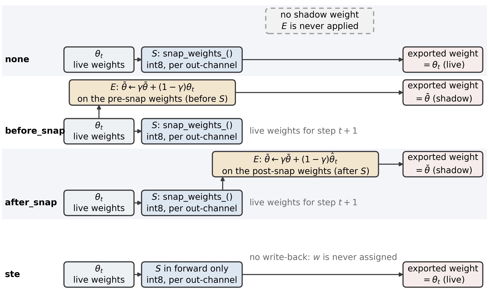

**图 1.** 三种覆写协议与直通估计（STE）对照。$S$ 每 $N$ 步按输出通道把权重对称投影到 int8 网格（原位施加），$E$ 为式 (5) 的影子更新、每步施加；before_snap 平均未投影的点，after_snap 平均已投影的点，none 不维护影子但仍在按 $N$ 投影，关闭投影的是 $N = \infty$。末行是 §5.6 详述的 STE 对照，此处前置仅作对照：同一个 $S$ 只在前向施加，参数不被覆写，导出的是实时权重。

### 3.4 部署测量

训练时的投影与导出时的量化是两种不同的操作，分别测量。导出时取部署权重（两个 EMA 协议取 $m_T$，none 取 $W_T$），按同一逐输出通道对称规则施加一次显式的量化-反量化：

$$\hat{W} = S_b(W_{\mathrm{dep}}),\ \ \ \ W_{\mathrm{dep}} \in \{m_T, W_T\}$$

并在验证划分上评估任务指标。指标为 $M$ 张验证图像（$M$ 为图像数）上的平均绝对误差，

$$\mathrm{MAE} = \frac{1}{M}\sum_{i=1}^{M}{\left| \hat{y}_i - y_i \right|}$$

与恒定输出验证划分均值的预测器并列读出，即零基线：

$$\mathrm{MAE}_0 = \frac{1}{M}\sum_{i=1}^{M}{\left| \bar{y} - y_i \right|},\ \ \ \ \bar{y} = \frac{1}{M}\sum_{j=1}^{M}{y_j^{\mathrm{val}}}$$

两个 run 之间的权重空间差异，以各自被投影张量的展平向量之间的相对 L2 距离报告：

$$d(W, W') = \frac{\left\| W - W' \right\|_2}{\left\| W \right\|_2}$$

$b = 8$ 复现目标 8 bit 部署；$b = 6, 4$ 为压力测试。§5.1–§5.6 的受控扫描都建立在这个仅权重的模拟之上；厂商工具链另见 §5.7。

此处统一记法：凡下文记作 $\Delta$ 的量，一律是被检验项减参照项，正值表示被检验项更差。与 FP32 比较时被检验项是量化后的模型（表 4、表 10、表 16）；与另一协议比较时参照项是句子里写明的那个，例如 after_snap 对 none 为负，表示影子协议更好。

## 4 实验设置

**表 2.** 训练与量化配置
| 项目 | 取值 |
|---|---|
| 优化器 | AdamW，lr 1e-4，20 轮余弦退火 |
| 批大小 / 精度 | 64，bf16 自动混合精度（autocast），梯度裁剪 1.0 |
| EMA 衰减 | 0.99 |
| 训练期投影位宽 | 8 |
| 初始 seed | 0–7（五个主配置序列，split_seed 固定为 0，只变初始化）；其余格子沿用 0–2 |
| 零基线（恒预测验证划分均值） | 固定划分（split_seed = 0）下为 0.1553；旧划分 seed 1/2 为 0.1552 / 0.1516 |
| 部署评估子集 | 主口径：未参与选轮的 1,556 张外部子集（验证划分去掉 2,000 张监控子集后的补集，§5.8）；对照：各 run 自身验证划分的前 400 张图像（与那 2,000 张部分重叠） |
| 算力 | 单张 RTX 4080 Laptop（12 GB，驱动 617.14，CUDA 13.2 / PyTorch 2.12.0；timm 1.0.27、ONNX Runtime 1.26.0、OpenVINO 2026.4.1 + NNCF 3.4.0、hbdk 4.7.5），20 轮训练本身 834–891 s/run（含每轮监控评估与导出约 25 min）|

按 run 各自重建划分（表 2）。seed 同时决定数据划分与参数初始化，两者未解耦：换一个 seed 会同时改变这两者，无法只改其中一项。此处所有数字都取自各 run 自身的划分，FP32 列与训练日志中的验证 MAE 相互核对（相差在 0.005 以内，差异来自 400 张图像的子采样）。另需区分统计口径：训练日志与 history.csv 报的是 3556 张验证划分中随机抽取的 2000 张上的 MAE（--val-windows 默认 2000），零基线 0.1553 则在全部 3556 张上计算；部署表取同一划分的前 400 张，该子集自身的零基线在 seed 0 上为 0.1625，在 seed 1 与 2 上为 0.1489 与 0.1483。为把划分从跨 seed 的比较里去掉，五个主配置序列改用同一固定划分（split_seed = 0）并只变初始 seed（seed 0–7），这些序列之间的 run 间离散度因此只含初始化与批顺序的差异，不再混入评估子集难度；其余格子（间隔 5 的三协议、$N = \infty$ 上的 after_snap、seed 大于 0 的旧 run）仍是各 run 自换划分，只作描述性读数。

组合：run 层推断的基础是五个主配置序列各 8 个初始 seed（none 在间隔 1、20 与 ∞，after_snap 与 before_snap 在间隔 20；split_seed 固定为 0，只变初始化），共 40 个 run、各 20 轮。更早的一批按旧口径跑成 15 个主扫描 run，即 3 个间隔 {1, 5, 20} × 3 种协议在 seed 0 上的 9 个，加 seed 补充 6 个（after_snap 在 seed 1 与 2 上各跑间隔 1 与 20 共 4 个，before_snap 在 seed 1 与 2 上跑间隔 20 共 2 个），各 20 轮。另补 15 个 run：关闭投影的端点 2 个（none 与 after_snap），间隔 5 的补跑 6 个（三种协议 × seed 1、2），固定划分 3 个（split_seed = 0，初始种子 1、2、3，after_snap、间隔 20），间隔 20、seed 0 上的 γ 扫描 4 个（γ = 0.9 与 0.999，各跑 before_snap 与 after_snap）。部署表覆盖 65 个 run（quant_runs/deploy_table_v3.csv），其中 50 个按与主口径共用的 400 张评估（quant_runs/deploy_table_v4.csv），五个主配置序列各 8 个初始 seed 构成 run 层推断的基础（§5.2–§5.5）；46 个 run 另有 1,556 张外部子集的复评（quant_runs/heldout_eval_v3.csv，§5.8）。统计口径上，本文只把三条确认性族与一条预指定等价检验视为确认性：间隔效应（间隔 1 与间隔 20 各一条，即表 3 的 a 与 b）、影子有无（c）、STE 与就地覆写及关闭投影（两条），再加上对比 d 的等价检验，共六条逐 run 对比。§5 中的其余比较（其它配对、6 bit 与 4 bit 位宽口径下的同一组对比、§5.9 的两条外推轴）一律为探索性、未做多重比较校正，表中按点估计与区间原样报告。除另行标注外，所有跨 seed 的比较都在固定划分上进行；4 bit 一节不与其它口径互比绝对值，只给逐 seed 的相对量——相对该 run 自身的零基线，以及相对该 run 的 FP32 部署 MAE 的退化倍数。

在进入结果之前，表 3 把全文每一条主张的统计身份固定下来：推断单位与样本量、对比个数、是否在查看 run 层结果之前预先指定、以及是否做过多重比较校正。§5 的每一小节都在该表里有对应行；凡「预先指定」为「否」的行，读数一律只作探索性报告，不据以下结论。

**表 3.** 全文各主张的统计身份：推断单位、对比个数、预先指定与多重比较校正

| 主张 | 推断单位（$n$、$df$） | 对比数 | 预先指定 | 多重比较 | 评估口径 |
|---|---|---|---|---|---|
| 间隔效应：间隔 1 相对关闭投影（对比 a） | run（$n = 8$，$df = 7$） | 1 | 是，确认性 | 不适用 | 1,556 张 |
| 间隔效应：间隔 20 相对关闭投影（对比 b） | run（$n = 8$，$df = 7$） | 1 | 是，确认性 | 不适用 | 1,556 张 |
| 影子有无：间隔 20 上 after_snap 减 none（对比 c） | run（$n = 8$，$df = 7$） | 1 | 是，确认性 | 不适用 | 1,556 张 |
| 平均顺序：before_snap 减 after_snap（对比 d） | run（$n = 8$，$df = 7$） | 1 | 是，等价检验 | 不适用 | 1,556 张 |
| STE 与就地覆写、关闭投影 | run（$n = 8$，$df = 7$） | 2 | 是，确认性 | 不适用 | 1,556 张 |
| 6 bit 位宽口径下的同一组对比（a–d；6 bit 的等价检验为事后套用） | run（$n = 8$，$df = 7$） | 4 | 否 | Holm，四项（事后） | 1,556 张 |
| 机制对照：学习率、预算、舍入方式 | run（三组，$n = 3$、3、8） | 3 | 否 | 未校正 | 1,556 张 |
| 逐图协议配对（七组） | 图像（$n = 400$） | 7 | 否 | Holm 与 BH | 400 张 |
| 厂商工具链（§5.7） | 检查点（单次运行，每格 $n = 199$–200 张图） | 5 个检查点 | 否 | 未校正 | 200 张 |
| 跨后端复现（§5.10） | run（$n = 8$，$df = 7$） | 3 条链 | 否 | 未校正 | 200 张 |
| 4 bit 的名次与退化 | run（$n = 8$） | 2 | 否 | 未校正 | 1,556 张 |
| 架构轴（ResNet-18，主学习率 1e-4，见 §5.9） | run（$n = 8$、$df = 7$，每 run 重建自己的划分） | 5 | 否 | 未校正 | 1,556 张 |
| 数据轴（KonIQ-10k，1e-3，见 §5.9） | run（$n = 8$、$df = 7$，每 run 重建自己的划分） | 1 | 否 | 未校正 | 400 张 |

**注：** 「预先指定」指该对比的方向、等价界与检验方式在查看 run 层结果之前写定。除表 3 中标为「是」的六条对比（a、b、c、d 与 STE 的两条）之外的全部读数（含 §5.6 的机制对照、§5.9 的架构轴与数据轴、§5.10 的三条部署链）都只作探索性报告，未做跨表的校正；表 3 的 6 bit 行是唯一例外：四条对比按自设的事后族做 Holm 校正，但这不使其成为预先指定；§5.3 的七组逐图配对另报 Holm 与 Benjamini–Hochberg 校正后的结果。

## 5 结果

### 5.1 8 bit 下导出量化器是空操作

间隔 1 时 none 的实时权重逐位落在网格上；间隔更长时最后一次投影之后仍有优化器步进，导出时刻的实时权重已离格（间隔 20 的相对 RMS 残差可达 0.0037），两个 EMA 协议的影子则被平均持续推离格点（图 2）；再做一次 8 bit 量化，任务指标在四位小数上不变。第一个量是相对本通道网格的残差（以格距为单位），

$$\rho_{oj} = \frac{\left| W_{oj} - [S_b(W)]_{oj} \right|}{s_o(W)}$$

第二个是近到与格点无法区分的权重占比，

$$f_\tau(W) = \frac{1}{\left| W \right|}\sum_{oj}{\mathbf{1}\left[ \rho_{oj} < \tau \right]},\ \ \ \ \tau = 0.05$$

残差列给出式 (4) 的相对 RMS（整个权重向量的范数），与 $\rho$ 的均值是两个量（表 4）。

**表 4.** 部署权重的网格残差、在网格上的比例，以及按间隔汇总的 8 bit 与 FP32 逐图配对差（取绝对值最大）
| 间隔 | 相对 RMS 残差 ε（式 (4)） | 落在网格上的比例 f（式 (15)） | 8 bit 与 FP32 配对差的最大绝对值 |
|---|---|---|---|
| 1 | 0.0000 | 1.000 | 0.0000 |
| 5 | 0.0000–0.0004 | 0.951–1.000 | 0.0000–0.0003 |
| 20 | 0.0000–0.0037 | 0.571–1.000 | 0.0000–0.0014 |

**注：** 表中各行为该间隔下全部主配置 run（γ = 0.99 且 split_seed = seed，即旧口径那批；五个主配置序列的固定划分子集未纳入本表）的极值（含 none 协议）。ε 与 f 为导出权重在网格上的残差（式 (4)、(15)）；§5.6 报的是每次投影事件自身的误差，同为式 (4) 但作用对象不同。

最后一列是同一批 400 张上 8 bit 减 FP32 的逐图配对差（正值更差）按间隔取绝对值最大者：间隔 1 的 5 个 run 全为 0.0000，间隔 5 的 9 个 run ≤ 0.0003，间隔 20 的 14 个中 12 个 ≤ 0.0004，另两个为 −0.0010（区间含 0）与 +0.0014（补跑 run，95 % CI [+0.00027, +0.00248]，单次实验无法判定是波动还是劣化）。

原始余弦被均值主导，有信息量的是中心化余弦，即两条展平向量的 Pearson 相关（$\mu_W$、$\mu_{\hat W}$ 为元素均值）：

$$\cos_c(W, \hat{W}) = \frac{\sum_{o,j}{\left(W_{oj} - \mu_W\right)\left(\hat{W}_{oj} - \mu_{\hat{W}}\right)}}{\sqrt{\sum_{o,j}{\left(W_{oj} - \mu_W\right)^2}}\ \sqrt{\sum_{o,j}{\left(\hat{W}_{oj} - \mu_{\hat{W}}\right)^2}}}$$

式 (16) 在 $\hat{W} = W$ 时取 1.0000，只声明两向量相同，不带保真度信息。8 bit 下三种协议都读到 1.0000；按权重口径，导出投影对实时权重只移动 8e-9 量级、对间隔 20 的影子最多 3.7e-3，而同批图像上 FP32 与 8 bit 的任务 MAE 差为 0.0000–0.0014。余弦看到的是前者，看不到后者；区分度只在 6 bit（余弦 ≈ 0.9962，相对 L2 ≈ 0.088）与 4 bit（余弦 0.9792–0.9809，相对 L2 0.197–0.206）下出现（图 2）。下文 6/4 bit 数字均指导出期量化（PTQ），训练期投影位宽固定 8 bit（表 2）。

幂等是这一口径的构造性质，不是经验发现：命题 1 给出它所需的四条前提。这四条问的是导出张量本身，不是整条链：部署量化器会从导出张量重算尺度（§3.2），故前提 (i) 只对已落在网格上的张量成立；四条缺一即不再幂等。$S_b$ 本身即最近格点投影，故 $\rho_{oj} \le 0.5$ 近乎恒成立（式 (14)），把它写成「饱和条件」没有信息量；真正决定指标是否读到常数的是上述四条。本文 8 bit 的间隔 1 实时权重满足全部四条（导出尺度等于最后一步训练尺度，再投影只移动 8e-9 量级）；间隔 20 的影子离格最多 0.0037，导出时重算尺度，位移最多 3.7e-3，余弦仍读到 1.0000——这些距离比协议之间的差（相对 L2 0.04–0.09）低一到两个数量级，所以指标不带信息的理由是分辨率不够，不是权重相同。6 bit 与 4 bit 之所以让指标重新携带信息，是因为部署量化器换了网格——位宽一变，尺度与格点全变，幂等前提直接消失——而不是 $\rho$ 落到了某个区间之外；0.9962 与 0.9792–0.9809 是换了 $q_b$ 之后的余弦，与 $\rho$ 是两个量。同一条理由也解释了 §5.7 的 per-tensor 与 p99 裁剪读数：尺度一换，绝对误差由网格选择主导。

**命题 1（导出保真度指标的非信息性）。** 设 $S_b$ 为 §3.2 的训练期投影，$S_b^{\mathrm{dep}}$ 为导出时施加的部署量化器。若 (i) 两者都是逐输出通道对称量化且步长相同，(ii) 同为就近舍入，(iii) 没有裁剪约束被触发，(iv) 导出张量 $W_{\mathrm{dep}}$ 已落在训练网格上，则 $S_b^{\mathrm{dep}}(W_{\mathrm{dep}}) = W_{\mathrm{dep}}$，式 (16) 的中心化余弦等于 1，任何关于该余弦单调的指标在这一口径上恒定。

**证明。** 由 (i)–(iii)，$S_b^{\mathrm{dep}}$ 是以 $S_b$ 的步长做的最近格点投影，在格点上返回该点，故在该点幂等。由 (iv)，$W_{\mathrm{dep}}$ 正是这样一个格点，于是 $S_b^{\mathrm{dep}}(W_{\mathrm{dep}}) = W_{\mathrm{dep}}$，且式 (16) 中 $\hat W = W$，分子与分母相同。单调性给出最后一句。$\square$

**注。** 部署量化器从它拿到的张量重算步长（§3.2），故本文自己的部署链上失败的是前提 (i)：残差不是 0，而是至多 $3.7\times10^{-3}$ 的相对 RMS，余弦在四位小数下仍读到 1.0000。此时指标不带信息的理由是分辨率不够而不是权重相同，命题 1 不适用；表 4 按协议与间隔给出这些残差。

**算法 1（引用保真度指标之前的可采纳性前置检查）。** 输入为训练期规则 $S_b$、部署量化器 $S_b^{\mathrm{dep}}$、导出张量 $W_{\mathrm{dep}}$ 与容差 $\tau$（本文取 $\tau = 5\times10^{-3}$）；输出为一个可采纳的指标，或应当弃用该指标的理由。

- **1** 计算 $\rho = \lVert W_{\mathrm{dep}} - S_b^{\mathrm{dep}}(W_{\mathrm{dep}}) \rVert_2 / \lVert W_{\mathrm{dep}} \rVert_2$。
- **2** 若 $S_b$ 与 $S_b^{\mathrm{dep}}$ 的算子、步长或舍入规则不同，返回部署步长下的 $\rho$（式 (14)）；此时余弦不可比。
- **3** 否则若 $\rho \le \tau$，弃用保真度指标（命题 1），改报导出量化后的任务 MAE。
- **4** 否则返回中心化余弦，并同时标注其间隔、位宽与评估口径。

容差是这项检查里唯一的自由参数，本文按实测固定而非凭经验取值：自家链上观测到的最大导出残差为相对 RMS $3.7\times10^{-3}$（§5.1），故取 $\tau = 5\times10^{-3}$，既纳入本文报告的全部检查点，又留下约 35 % 余量。残差超出该容差的链在上面的意义上不再幂等，其余弦只能连同间隔、位宽与评估口径一起引用，即算法最后一步的要求。

图 2 铺开这一分布：75 个被投影张量共 3,984,480 个权重，取 seed 0 的 after_snap run，每间隔一个点；表 4 跨三种协议。间隔 1 只差数值噪声，间隔 20 展宽到 0.0037 与 0.572，$\rho > 0.1$ 的尾部近于均匀；最左一格另含 $0 < \rho < 10^{-8}$ 的权重。

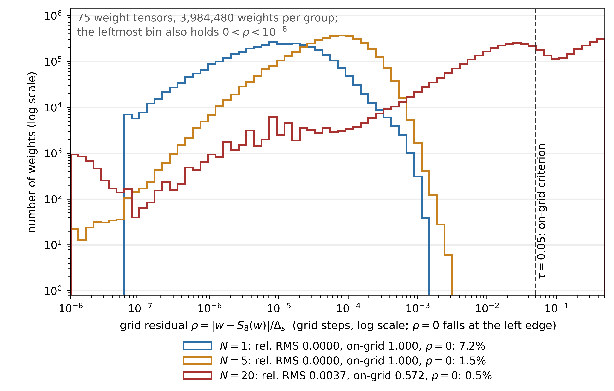

**图 2.** 逐权重网格残差 $\rho$（式 (14)）在 75 个被投影张量上的分布，双对数坐标，取 seed 0 的 after_snap run。

这条结论只适用于权重量化器：训练循环已投影过权重，再投影一次不改变任何东西（§3.2）。部署编译器还量化*激活*并把激活函数降到查找表：完整 int8 流水线在 ReLU-QAT 头上代价 +0.0034–0.0038 MAE，比上表末列的 0.0004（除两个补跑 run 外）大一个数量级（§5.7）；那一轮只覆盖一种协议，对平均顺序不置一词。

### 5.2 投影的代价与关闭它的端点

部署量化之后的任务 MAE 见表 5（seed 0，每个间隔三种协议，另列关闭投影的端点 N = ∞）：

**表 5.** 部署量化后的任务 MAE（seed 0，三个间隔 × 三种协议，另加关闭投影的端点 N = ∞；末列为未参与选轮的外部子集）
| 间隔 | 协议 | FP32 | 8 bit | 6 bit | 4 bit | 外部子集 FP32 |
|---|---|---|---|---|---|---|
| 1 | none | 0.0741 | 0.0741 | 0.0785 | 0.0900 | 0.0741 |
| 1 | before_snap | 0.0741 | 0.0741 | 0.0776 | 0.0899 | 0.0738 |
| 1 | after_snap | 0.0748 | 0.0748 | 0.0794 | 0.0910 | 0.0738 |
| 5 | none | 0.0660 | 0.0662 | 0.0672 | 0.0857 | 0.0652 |
| 5 | before_snap | 0.0658 | 0.0658 | 0.0674 | 0.0880 | 0.0653 |
| 5 | after_snap | 0.0657 | 0.0657 | 0.0671 | 0.0864 | 0.0653 |
| 20 | none | 0.0619 | 0.0620 | 0.0642 | 0.0888 | 0.0591 |
| 20 | before_snap | 0.0607 | 0.0608 | 0.0643 | 0.0866 | 0.0579 |
| 20 | after_snap | 0.0594 | 0.0593 | 0.0631 | 0.0849 | 0.0573 |
| ∞ | none | 0.0552 | 0.0548 | 0.0575 | 0.1535 | 0.0543 |
| ∞ | after_snap | 0.0556 | 0.0554 | 0.0569 | 0.1040 | 0.0546 |

**注：** 表中为点估计；各配对差及其 95 % 置信区间见 §5.2、§5.3、§5.4 与 quant_runs/paired_report.md。末列是同一批 run 在未参与选轮的外部子集（1,556 张，即验证划分去掉 2,000 张监控子集后的补集）上的 FP32 MAE；本表 FP32 列逐行都不低于它（间隔 1 的 none 一行持平），差值即选轮乐观偏差，且随间隔增大（§5.8）。区间单位 = run：五个主配置序列各 8 个初始 seed、固定划分（split_seed = 0），n = 8、df = 7、逐 run 配对；本表逐行仍是单 run 的点估计（seed 0）。推断量以未参与选轮的 1,556 张为主口径，400 张子集为对照：间隔 1 相对关闭投影的差为 +0.018457 [+0.017498, +0.019415]（run 层、$n = 8$、1,556 张）与 +0.017750 [+0.014973, +0.020527]（400 张），间隔 20 相对关闭投影的差为 +0.004723 [+0.004028, +0.005417] 与 +0.003800 [+0.002243, +0.005357]，两个对比都是 8/8 同号（符号检验 p = 0.0078）。

表 5 中 N = ∞ 两行指训练期不投影（snap_every 取 0）：此时 before_snap 与 after_snap 退化同一算法，投影侧只列 after_snap；none 不维护影子、直接导出实时权重，另列为无影子端点。两者 FP32 为 0.0556 与 0.0552，配对差 +0.00043，区间含 0（§5.4）。

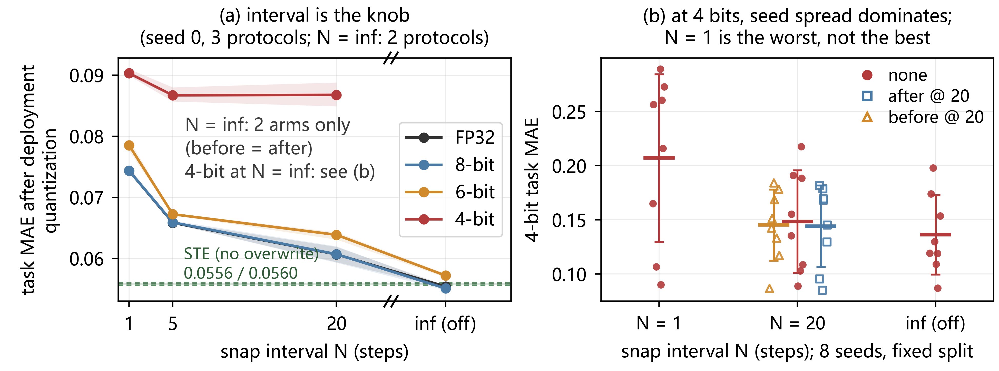

**图 3.** (a) 部署后的任务 MAE 随间隔（seed 0，三协议均值）；N = ∞ 即关闭投影，该点取 none 与 after_snap 两协议的均值、阴影带为两协议极差；4 bit 止于 20，端点未画。绿色虚线为 §5.6 的 STE 对照（8 bit 0.0556、FP32 0.0560）。(b) 4 bit 下的逐 seed 分布（400 张部署子集）：固定划分（split_seed = 0）、8 个初始 seed，每点为一个 run，粗线为均值、误差棒为标准差。三条 none 序列在间隔 1、20 与关闭投影上的均值为 0.2070、0.1484 与 0.1361，before 与 after 在间隔 20 上为 0.1451 与 0.1441；间隔 1 在这里最差，与图 7 的 21 run 口径名次相反（见 §5.5）。

在 seed 0 上对三种协议取平均，间隔 1 → 5 → 20 对应 FP32 的 0.0743 → 0.0658 → 0.0607（降幅 18 %），6 bit 同向为 0.0785 → 0.0672 → 0.0639（图 3）。延长间隔意味着 6,280 个训练步中只有 1,256 与 314 步之后跟随一次投影，每次投影的误差仍在增大（相对 RMS 0.000 → 0.0012 → 0.0030），模型却变好了（图 4）。run 层（n = 8、df = 7、配对、固定划分）的两个对比：间隔 1 相对关闭投影为 +0.018457 [+0.017498, +0.019415]，间隔 20 为 +0.004723 [+0.004028, +0.005417]（1,556 张；400 张口径见表 5 注），两个区间都不含 0。投影因此是以优化噪声偿付的*代价*，间隔越长代价越小；对比 a 与 b 的 run 间标准差 0.001147 与 0.000831 远小于效应。

端点给出代价曲线的下端：关闭投影后 FP32 部署 MAE 为 0.0552 与 0.0556（none / after_snap），比间隔 1 低 0.0189 与 0.0192，比间隔 20 低约 0.0067 与 0.0037（单 run 图像层点估计，表 5），配对差在 N = ∞ 处归零，与 run 层的对比 a、b 一致。8 bit 与 FP32 的差仍只有 0.0002–0.0004（按 §3.4 的约定写成 −0.00037 与 −0.00023，负值表示 8 bit 略低，两区间都含 0）；多数有限间隔 run 把这一列压到 0.0004 以内（间隔 1 为 0.0000），两个补跑 run 除外。故在仅权重量化的 8 bit 目标下，训练期投影是一笔纯代价，最优设置是关闭；6 bit 上同一组 run 层对比更大（间隔 1 为 +0.0214 [+0.0195, +0.0234]、间隔 20 为 +0.0060 [+0.0042, +0.0079]，均 8/8 同号，1,556 张）；这笔代价属于就地覆写这一步（§5.6 的 STE 对照只差 0.0008，表 8）。

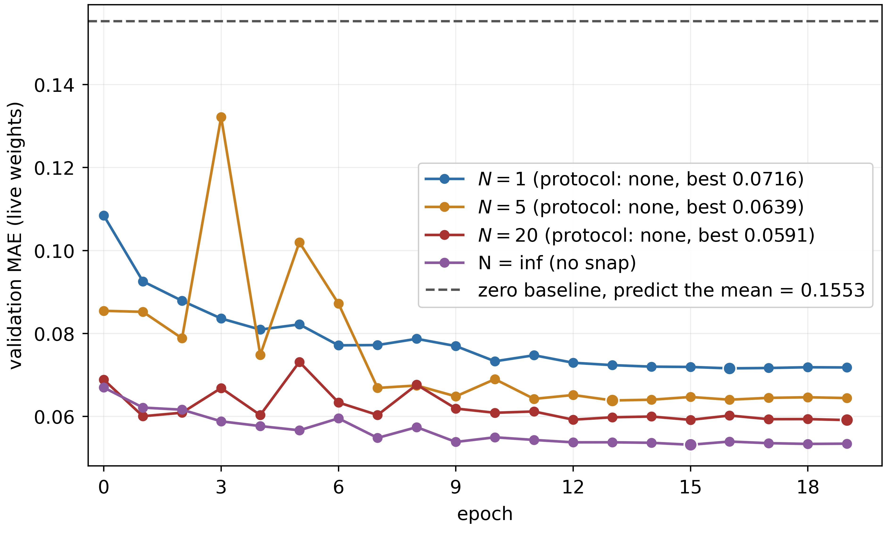

**图 4.** 验证 MAE（none，seed 0）：每种间隔一条，另加 N = ∞（关闭投影）；虚线为零基线 0.1553。最优依次 0.0716、0.0639、0.0591、0.0532（1、5、20、∞）。取自各 run 的 history.csv（2,000 张子集），§5.2 部署表 FP32 列（400 张）比它高 0.002–0.003。

### 5.3 平均顺序低于最小可检测效应（MDE）

同一间隔、seed 0 之下，三种协议的跨度 0.0027（8 bit，间隔 20）与 0.0025（FP32，间隔 20），其中顺序只占 0.0015 与 0.0013；6 bit 上 run 层的对比 d 为 −0.000290 [−0.001090, +0.000509]（4/8 为正、4/8 为负），seed 0 的最大顺序差 0.0018（单 seed、未配对）。顺序效应的推断单位因此改为 run：五个主配置序列（none 的 N = 1、N = 20、N = ∞，以及 N = 20 上的 before_snap 与 after_snap）各 8 个初始 seed、同一固定划分，逐 run 配对，n = 8、df = 7。主口径取未参与选轮的 1,556 张：对比 d（before_snap − after_snap @ N = 20）为 +0.000029 [−0.000249, +0.000307]，5/8 为正（3/8 为负）；400 张子集上 +0.000175 [−0.000475, +0.000825]，两区间都含 0。四条对比的配对 sd 为 0.00115、0.00083、0.00050 与 0.00033。6 bit 上其余三条对比保持方向（a $+0.0214$、b $+0.0060$、c $-0.0027$，c 为 7/8 同号，精确双侧 $p = 0.070$）；把这四条当作同一个事后族做 Holm 校正，得 $1.3\times10^{-7}$、$2.9\times10^{-4}$、$0.018$ 与 $0.42$，两个间隔对比与影子在 6 bit 上仍存活。该族是事后声明的（在看到 8 bit 结果之后），因此它只说明这些方向不依赖未校正的多重比较选择，不把任何一条升格为确认性。

等价检验的 margin 预先指定、与观测无关：零基线 0.1553 的 1 %，即 0.0015526728，保留四位为 0.0016。以该 margin 做双单侧检验（TOST）[39]，教程见 [40]，对比 d 在 1,556 张上原始 $p = 1.5\times10^{-6}$（Holm 校正后 $4.6\times10^{-6}$）、400 张上 $p = 0.00064$，均在 $\alpha = 0.05$ 下通过，即排除「顺序效应达到或超过 0.0016」。80 % 功效下的 MDE 为 0.000383（1,556 张）与 0.000897（400 张）：小于 0.000383 的效应本设计分辨不出（图 6）。恰能通过检验的临界界宽 0.000252，预设界是它的 6.4 倍；收紧到 0.0005，$p$ 仍为 0.0026；继续收紧到 0.001、0.0003 与 0.0032 时为 $3.7\times10^{-5}$、0.027 与 $1.2\times10^{-8}$，五个界（含预设的 0.0016）下结论相同。0.0016 在年龄尺度上相当于 0.16 岁，也恰是零基线的 1 %。6 bit 的对比 d 只作完整性报告：其配对 SE 为 0.000338（8 bit 主口径的 2.9 倍）、80 % 功效的 MDE 升到 0.0011，8 个 seed 中 4 正 4 负，而 0.0016 界是为 8 bit 主口径预先指定的、只有 6 bit MDE 的 1.4 倍（主口径下预设界是临界界宽的 6.4 倍、是 MDE 的 4.2 倍），故本文不对 6 bit 主张等价、也不主张方向；事后套用该界得到的 $p = 0.0030$，只为记录该操作会返回什么，不构成 6 bit 上的等价证据。

早先的七组逐图配对只作探索性描述：七组都不超过 0.0014，符号随 seed 改变（间隔 1 为 −0.00070 [−0.00155, +0.00015]；间隔 5 的三个 seed 为 +0.00015、−0.00045、+0.00011；间隔 20 的三个 seed 为 +0.00132 [+0.00002, +0.00262]、+0.00016、−0.00084）。未校正时 2/7 名义显著且方向相反（$+0.00132$，$p = 0.047$；$-0.00084$，$p = 0.037$），按 Holm 与 Benjamini–Hochberg 校正后 0/7 显著（最小 $p = 0.037$ 对 Holm 首步阈值 $0.05/7 = 0.0071$）。

然而，顺序在权重上并非空操作。导出权重向量之间的相对 L2 为（表 6）：

**表 6.** 导出权重向量之间的相对 L2 距离
| 比较 | 配对数 n | 相对 L2 范围 | 解释 |
|---|---|---|---|
| 影子权重对实时权重，同一 run | 12 | 0.0005–0.0483 | 影子相对实时权重的位移 |
| before_snap 对 after_snap，同间隔、同 seed | 5 | 0.0427–0.0909 | 平均顺序本身的位移 |
| 同配置、不同 seed | 9 | 0.6371–0.8349 | 重训带来的位移，比顺序约大一个数量级 |

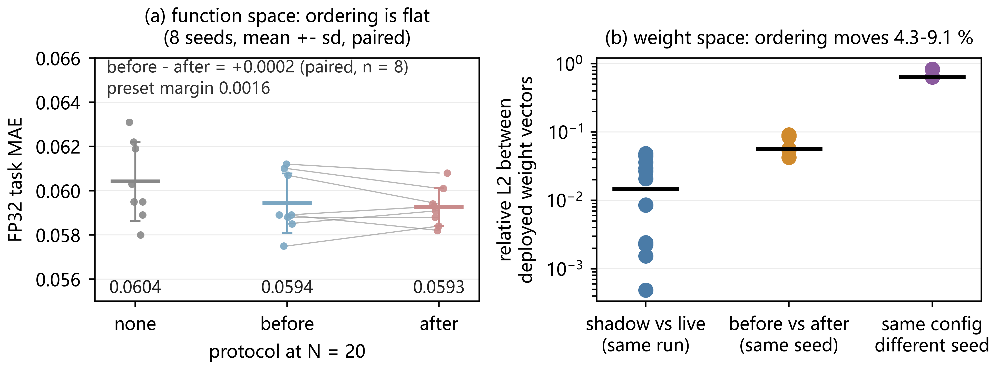

**图 5.** (a) 间隔 20 上三种协议的 FP32 任务 MAE（固定划分、8 个初始 seed）：每点一个 run，粗线为均值、误差棒为标准差，灰线连接同一 seed 的 before 与 after；配对差 before − after = +0.0002，远低于预先指定的等价界 0.0016，也远低于间隔效应（none 从间隔 1 的 0.0744 降到间隔 20 的 0.0604）。(b) 部署权重间的相对 L2（对数坐标）：顺序移动 4.3–9.1 %，同一配置换 seed 重训移动 64–83 %，顺序是亚 seed 级扰动；黑线为中位数。

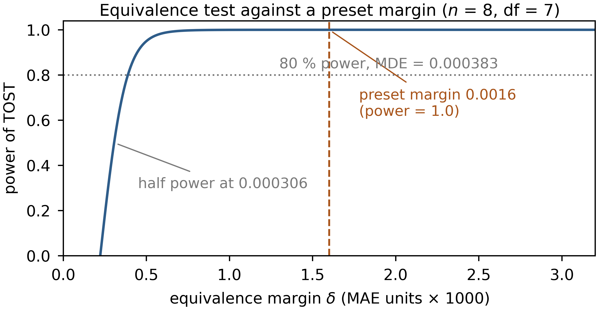

**图 6.** 等价检验的功效曲线：$df = 7$、标准误取 1,556 张口径的实测值 $SE_{\bar{D}} = 0.000118$（配对 sd $\sigma_d = 0.000333$），横轴为 margin $\delta$。虚线是预设的 0.0016（功效 1.0），点线是 80 % 功效下的 MDE 0.000383；曲线在 0.000306 处达到半功效，故预设界远离本检验的分辨极限。

顺序在权重空间把导出的网络移动了 4.3–9.1 %，任务指标只移动 +0.000029（1,556 张口径，区间含 0），而换一个 seed 重训会移动 64–83 %（图 5）；「某种顺序更安全」必须在函数空间中论证，现有测量不支持它。这一位移也不是导出量化造成的：把间隔 20 的两组导出权重各按部署量化器再量化一次（8 个固定划分 seed，与表 6 的 5 对旧口径 run 不同源，产物见表 18），相对 L2 由 4.7 % ± 0.6 % 变为 4.8 % ± 0.6 %，98 % 的权重仍落在不同格点上（跨 seed 的不同格点比例在再量化前为 63.5 %，再量化后仍为 63.5 %）。这个 4.8 % 与 §5.1 的 $\rho$ 不是同一个量：前者是两组不同顺序权重之间的整体相对 L2，后者是导出权重对各自网格的相对 RMS 残差（式 (4)，间隔 20 上至多 0.0037，见表 4）；网格很细，故整体位移大而单点残差极小，两者并不矛盾。

平均的时间常数也不是解释顺序效应的旋钮：以 $\kappa = N(1-\gamma)$ 计，间隔 20、seed 0 上 γ = 0.9、0.99、0.999 对应 κ = 2、0.2、0.02，顺序差为 +0.0014、+0.0013、0.0000，跨度不超过 0.0014，未随 κ 单调放大；把它们与 §5.3 的跨 seed 结果合起来看，顺序差的符号并不稳定。

### 5.4 影子的有无：效应很小但方向一致

上一节在 run 层（n = 8、df = 7）上未检测到顺序效应，影子的有无则留下方向一致的读数，量级很小。间隔 20 上 after_snap 对 none 的配对差在 1,556 张未参与选轮的图像上为 −0.001377 [−0.001798, −0.000957]，8/8 同号，符号检验 p = 0.0078；400 张子集上为 −0.001162 [−0.002310, −0.000015]、7/8、p = 0.070，只算边缘证据——该子集与选轮用的 2,000 张监控子集重叠，重叠压低 run 间离散。故写影子效应存在、量级 0.0014，与最大观测顺序差同量级，比间隔效应小一个数量级。它在协议均值里恰好被抹掉：间隔 20、seed 0 的三个协议为 0.0619、0.0607 与 0.0594（none / before_snap / after_snap），均值与 before_snap 重合。影子也不是无条件有效：关闭投影后 after_snap 对 none 为 +0.00043 [−0.00114, +0.00199]，区间含 0（表 5 的 N = ∞ 行）。与随机权重平均 [23]、模型汤 [24] 不同，影子不重训、只在同一条轨迹上滑动，效应量级因此只有 0.0014。6 bit 上同一对比的量级约为两倍（−0.0027 [−0.0044, −0.0009]），但 8 个 run 里只有 7 个同号（符号检验 p = 0.070），故只报区间、不据此加强结论。

### 5.5 4 bit 下 run 间变异压过两个旋钮

把同一配置下各 seed 的重复全部计入之后，原先整齐的 4 bit 图景不再成立（表 7）：

**表 7.** 4 bit 量化后的任务 MAE 按间隔汇总（同一配置的 21 个 run，三个间隔分别为 5、9、7 个）
| 间隔 | n | 4 bit MAE 均值 | 范围 | sd | 95 % CI |
|---|---|---|---|---|---|
| 1 | 5 | 0.1224 | 0.0899–0.2337 | 0.0626 | [0.0447, 0.2002] |
| 5 | 9 | 0.1248 | 0.0857–0.2117 | 0.0510 | [0.0856, 0.1640] |
| 20 | 7 | 0.1315 | 0.0849–0.2030 | 0.0476 | [0.0875, 0.1756] |

**注：** 95 % CI 为各间隔内 run 的 t 区间（$n$ = 5、9、7，$t_{0.975}$ 取相应自由度）；$n$ 小，区间只作离散度的描述。这 21 个 run 的 4 bit 读数取各 run 验证划分内的 400 张部署子集，与选轮监控子集重叠。

三个有限间隔中，间隔 20 是 8 bit 与 6 bit 下的最优间隔（算上端点，最优设置是 N = ∞，表 5），该间隔上 seed 1 与 seed 2 退化到 0.1267–0.2030，seed 0 停在 0.0849–0.0888（图 7）。早先「更长的间隔换来 4 bit 稳健性」只是拿走运的 seed 比倒霉的 seed：三个间隔的 4 bit 均值相差不超过 0.0091（0.1224 / 0.1248 / 0.1315），而间隔内 seed 标准差为 0.0476–0.0626，簇内是簇间的 5–7 倍。21 个 run 的描述性平方和分解（不平衡设计，分解顺序固定为间隔在前、seed 在后）：间隔 0.57 %、seed 88.4 %、残差 11.1 %，标准差 0.0119、0.1492、0.0187；表 16 表明这份 run 间变异同时含划分（56.6 %）与初始化（10.0 %），本设计不能分辨两者。间隔 5 的 sd 由 3 个 run 时的 0.0012 变为计入补跑 6 个 seed 后的 0.0510（均值 0.1248），「间隔 5 稳定」源于样本不足。本结果只作观察（n = 5、9、7）。

22 个有 4 bit 读数的 run（含关闭投影端点）中 7 个差于自身零基线；mae_4 中位数 0.1027、均值 0.1267、sd 0.0484、范围 0.0849–0.2337，相对各自 FP32 的退化中位数 1.50×、最大 3.56×。三条描述性检验：mae_4 与全局权重 max 的 Spearman ρ 为 −0.131、与 p95 为 +0.073、与极端度为 +0.194；n = 22 时双侧 5 % 需 |ρ| ≥ 0.423，三条都不显著。故只写「未检出归因」。

图 7 与表 7 是 21 个 run 的旧口径（seed 0–2、各换划分），4 bit 上间隔 1 最低（0.1224）；本文主口径（固定划分、8 个初始 seed）给出相反名次：间隔 1 为 0.2070、间隔 20 为 0.1484、关闭投影为 0.1361（图 3b）。同一对格子连符号都相反：旧口径 −0.0635（间隔 1 更好），固定划分口径 +0.0710（间隔 1 更差）。4 bit 的名次因此只在各自口径内陈述——它由 run 间变异决定，而非旋钮。

图 7 把同一批 run 铺开（颜色区分 seed，粗横线为间隔均值）：三个间隔的均值相差不超过 0.0091，间隔内标准差 0.0476–0.0626。补到 8 个 seed 后，4 bit 的 run 间 sd 为 0.0365–0.0774（8 bit 为 0.0020），均值方向与 8 bit、6 bit 一致（6 bit 的两条逐 seed 配对差见 §5.2，同为 1,556 张口径、均 8/8 同号）；本节 4 bit 读数取 400 张部署子集，相对关闭投影，间隔 20 与间隔 1 的逐 seed 配对差在 4 bit 上为 +0.0123 [−0.0251, +0.0497] 与 +0.0710 [+0.0013, +0.1406]（3/8 与 2/8 反向；后者精确符号检验 $p = 0.289$）。t 区间不含 0 只说明均值相对标准误够大（下界 +0.0013 距 0 为半宽的 1.9 %，配对差 sd 0.0833 比效应 0.0710 还大）；符号检验问方向，8 个 seed 里 2 个反向。中位数差 $+0.0777$、Hodges–Lehmann 估计 $+0.0696$，对 8 个 seed 重采样的 bootstrap 区间为 $[+0.0149, +0.1245]$（间隔 20 的同批读数为 $+0.0107$、$+0.0102$、$[-0.0180, +0.0404]$）；三种口径与前一句同向。4 bit 的主统计量取逐 seed 配对 t 区间（下文 4 bit 的结论都以它为准），中位数、Hodges–Lehmann 与 bootstrap 只作稳健性检查，不构成事后择优；三者结论相同：均值方向为正，但配对差 sd 0.0833 大于效应，逐 seed 方向不可分辨。区间由重尾撑着：最正的两个差（+0.2024、+0.1417）占均值 +0.0710 的 61 %，去掉最大者降到 +0.0522。故按符号检验读作不可分辨：4 bit 上退化幅度最大，逐 seed 方向不可分辨。关闭投影的两个 4 bit 端点（0.1535、0.1040）仍是 seed 0 单 run、不能据以比较协议；八个 seed 上关闭投影的 4 bit 均值为 0.1361、sd 0.0365。GPTQ [31] 与 AWQ [32] 改的是量化器本身，本文固定量化器只动两个旋钮，故这些变异不能读成对它们的评价。

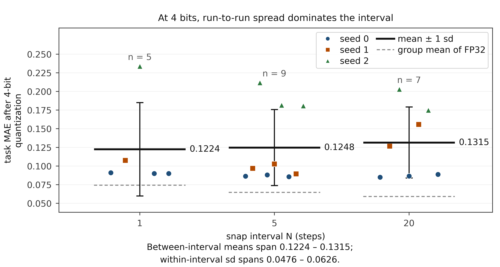

**图 7.** 4 bit 量化后的任务 MAE 随间隔的分布：每点一个 run（共 21 个，三个间隔 5、9、7 个），seed 以颜色与形状区分。组内混有三种平均顺序与三个 seed，故同一 seed 在同一间隔上可有多点；均值与标准差按组内全部 run 计算。

### 5.6 诊断与机制对照：代价来自覆写，不来自网格

投影误差在赋值回权重前测量，衡量上次投影以来的漂移，间隔 1 时即单步位移，不应为零。按各 run 全程平均（非收敛时单次读数），间隔 5 的 9 个 run 为 1.18–1.23e-3、间隔 20 的 7 个为 2.98–3.03e-3（相对 RMS）；间隔 1 的 5 个 run 早于该列加入记录，无读数。frozen_frac 在记录的 run 中都是 0.000：「投影冻结学习」也不是机制。

影子与实时权重的距离随间隔增大（间隔 1 为 0.0005–0.0086，间隔 20 为 0.021–0.048）：稀疏投影下影子平均的是漂移中的迭代点，顺序本该起作用，指标却没动（§5.3）。

投影改写参数本身，伪量化不写。标准 STE 把量化放进前向（$w_q = w + (\mathrm{snap}(w) - w).\mathrm{detach()}$），参数始终为浮点值，每步视作已量化却无一步被覆写；三个 seed、其余超参与间隔 1 的 none 协议一致（表 8）。

该对照现补到固定划分（split_seed = 0）上的 8 个初始 seed，STE、就地覆写（间隔 1）、关闭投影（$N = \infty$）各 8 个 run、同批 seed 配对，主口径取未参与选轮的 1,556 张、8 bit 仅权重量化：STE 比就地覆写低 0.0184 [−0.0196, −0.0173]，8/8 同号（$p = 0.0078$）；就地覆写比关闭投影高 0.0183 [+0.0176, +0.0191]，8/8；STE 与关闭投影为 −0.0001 [−0.0008, +0.0006]，4/8 为负，区间含 0。三者均值 0.0548 ± 0.0012、0.0732 ± 0.0011、0.0549 ± 0.0007：每步都在网格上不付代价，把参数换成格点才付代价（0.018 对 0.0001）。表 8 是同一对照在 400 张、三个 seed 上的描述性读数（0.0560 ± 0.0035 对 0.0741、0.0552），与 run 层同向。

**表 8.** 同一批 400 张验证图上三种训练期权重处理的部署 MAE（seed 0；STE 行另给 seed 1、2 与三 seed 均值）
| 训练期权重处理 | 协议 | FP32 | 8 bit | 6 bit | 4 bit |
|---|---|---|---|---|---|
| 每步就地覆写 | 投影，间隔 1 | 0.0741 | 0.0741 | 0.0785 | 0.0900 |
| 每步伪量化、不覆写 | STE，seed 0 | 0.0586 | 0.0579 | 0.0582 | 0.1265 |
| 同上 | STE，seed 1 | 0.0574 | 0.0568 | 0.0593 | 0.1035 |
| 同上 | STE，seed 2 | 0.0521 | 0.0522 | 0.0537 | 0.1323 |
| 同上，三 seed | STE，均值 ± sd | 0.0560 ± 0.0035 | 0.0556 ± 0.0030 | 0.0571 ± 0.0030 | 0.1208 ± 0.0152 |
| 不投影 | N = ∞ | 0.0552 | 0.0548 | 0.0575 | 0.1535 |

**注：** 首行与末行分别是表 5 的间隔 1（none）与 N = ∞（none）行；各行同为 400 张验证图、各按自己 seed 重建划分。STE 三行由 quant_runs/ste_deploy_table.csv 复算；run 层的三种投影方式配对（各 8 个 seed、1,556 张）见 quant_runs/ste_v3.csv 与 ste_runlevel.md。4 bit 一列由 seed 抽取主导（STE 的 sd 为 0.0152），不作比较；表中的 400 张部署子集与选轮监控子集重叠（外部子集读数见 §5.8）。

代价与覆写次数共变——6,280 次最差、1,256 次次之、314 次再次、0 次最好；但间隔同时改变单次投影的位移（相对 RMS 0.000 → 0.0012 → 0.0030），两者反向共变，本设计不能把次数与幅度分开，故这里只陈述共变。三项机制对照（8 bit 仅权重量化；同批 FP32 的间隔效应 $+0.0185$，下文 $+0.0183$ 为 8 bit 口径；1,556 张；随机与最近舍入各 8 个 seed，学习率与预算各 8 个）：其一，学习率放大 30 倍（1e-4 → 3e-3）后代价由 $+0.0183$ 降到 $+0.0055$ [$−0.0009, +0.0118$]，八个 seed 分辨不出它与零的差别（6/8 为正，$p = 0.08$）；同一批 run 上的逐 seed 差中差为 $−0.0130$ [$−0.0192, −0.0068$]（7/8 为负），即收缩本身是被分辨出来的。其二，预算由 20 轮加到 60 轮，代价降到 $+0.0138$ [$+0.0127, +0.0149$]（8/8，$p = 1.1\times10^{-8}$），逐 seed 变化 $−0.0046$ [$−0.0056, −0.0036$]（8/8 为负）：收敛慢是代价的一部分。其三，只换舍入方式（间隔仍为 1，8 个 seed）：与关闭投影的差为 $+0.00004$ [$−0.0006, +0.0007$]（5 负 3 正，配对 t 检验 $p = 0.89$；精确双侧符号检验 $p = 0.727$），同批 seed 的就近舍入为 $+0.0183$ [$+0.0176, +0.0191$]（8/8），两者之差 $−0.0183$ [$−0.0194, −0.0172$]（8/8，配对 t 检验 $p = 1.4\times10^{-9}$；精确双侧符号检验 $p = 0.0078$）。在本配方（int8、逐输出通道对称、固定 20 轮、以部署 MAE 为判据）下，随机舍入几乎抹掉全部代价——代价与「覆写时确定性舍入抹掉亚格距更新」这一机制一致，而非来自权重落在网格上这一状态（被抹掉的更新本身未逐事件记录）；机制在直接量化训练里已有证明与收敛分析 [9]、[10]，随机舍入在大模型训练上的理论与实测分析另见 [41]，本节只报本网格的剂量与恢复比例（图 8）。修法零成本：网格、间隔与预算都不变。上述三项机制对照（学习率、预算、随机舍入）只在 8 bit 上做，未覆盖 4 bit 与 6 bit，也未做优化器矩的逐事件记录。

把本节的三个对照与既有路线并排，能看清每项改的是哪一个自由度、在同一配方下付多少代价（表 9）。

**表 9.** 三种训练期权重处理与既有路线的照应，及本文同配方下的读数

| 训练期权重处理 | 对应路线 | 该路线改的是什么 | 本文同配方读数 | 与间隔 $N$ 的关系 |
|---|---|---|---|---|
| 前向伪量化、参数不覆写（STE） | 标准 QAT 的直通估计，如 [5]–[7] | 前向按网格量化、反向直通；参数始终是浮点值 | 对关闭投影 −0.0001 [−0.0008, +0.0006]，4/8 为负 | 从不触发覆写，与 $N$ 无关：相当于前向已量化、但从不投影 |
| 每步就地覆写，就近舍入 | 无主副本的直接量化训练，确定性舍入的基线（[9] 的对照情形） | 每步把参数写成格点的反量化值 | 对关闭投影 +0.0183 [+0.0176, +0.0191]，8/8 | 即本文 $N = 1$ 这一格 |
| 每步就地覆写，随机舍入 | DQT 的随机舍入 [9]、ECO 的无主副本训练 [10]、随机舍入的分析 [41] | 只把舍入由就近改为随机；网格、间隔与预算不变 | 对关闭投影 +0.00004 [−0.0006, +0.0007]，5 负 3 正 | 与 $N = 1$ 严格同配方，唯一差别是舍入方式 |
| 间隔 $N$（本文主变量） | 权重转移调度里的何时投影，如 [18] | 相邻两次投影之间隔几个优化步 | $N{=}1$ +0.0183、$N{=}20$ +0.0046、$N{=}\infty$ 0 | 本文自变量；与调度的关系见下文 |

**注：** 前两列的对应只表示路线相同，不表示这些工作采用了本文的超参；第三列列出该路线相对每步覆写改动了哪一项。读数为主口径（8 bit 仅权重量化、1,556 张未参与选轮的图像、8 个初始 seed、固定划分、配对、$df = 7$）：前三行取自 §5.6，末行为 §5.2 的对比 a 与 b；STE 与随机舍入两行区间含 0，就近舍入与间隔 20 两行不含 0。本文对 [9]、[10]、[18] 只做配方层面的对照，未复现其原始设置。

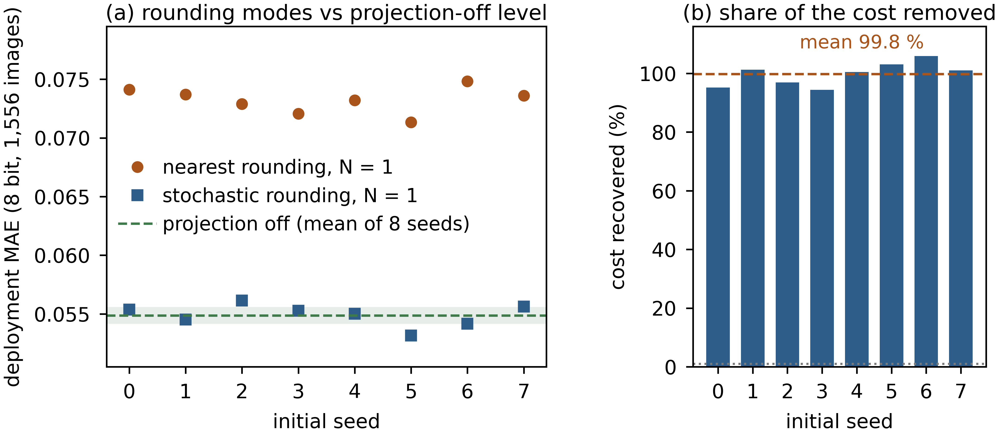

**图 8.** 随机舍入与最近舍入的逐 seed 部署 MAE（(a)：8 bit、1,556 张，绿色带为关闭投影 8 个 seed 的 1 个标准差）与各自恢复的代价比例（(b)：随机舍入减最近舍入的差除以关闭投影减最近舍入的差，均值 99.8 %）。

**投影调度与本文的间隔 $N$：什么等价、什么不等价。** [18] 一类做法在训练中安排权重向量化值转移的过程：每一步把参数写成 $\alpha_t W + (1-\alpha_t) S(W)$，由 $\alpha_t$ 的曲线决定转移多快。本文的 $N$ 只决定两次完整投影之间隔几个优化步，run 内固定，不出现 $\alpha_t$。两者在一个很窄的条件下重合：若某个调度退化为 $\alpha_t \in \{0, 1\}$、且每 $N$ 步取一次 1，它就是本文 $N$ 的协议，逐位相同，结论可直接互换——这是唯一的等价情形。

两处不等价。其一，部分转移（$0 < \alpha_t < 1$）写出的是格点之间的点，而不是投影与不投影的二元操作；§3 说明 $S_b$ 只作用于凸组合的一侧时平均与投影并不对易（式 (9)），故部分转移改变的是被平均的对象，不是把 $N$ 调小。其二，调度可以让投影的疏密随时间变化（先疏后密），而本文 20 轮内 $N$ 固定、只有 1、5、20 与 $\infty$ 四个水平；代价随 $N$ 单调，但同时随覆写次数与单次位移反向变化（§5.6），两者在本设计里共线，故不能把先疏后密读成两个固定 $N$ 之间的线性插值。我们能说的是：若某调度只改变完整投影的次数、不改变单次位移与舍入方式，它的代价应落在对应固定 $N$ 的读数之间；这一条本文没有测，只作为可检验的推测列出。

STE 下的平均顺序也已补测：影子平均源换成前向伪量化权重（`--ema-source forward`），三 seed 的部署 FP32 MAE 为 0.0555 ± 0.0022，纯 STE 为 0.0560 ± 0.0035，差 0.0005，远小于两侧离散度；8 bit 上为 0.0555 与 0.0556。两者都停在 0.0552 附近，故「影子平均的是什么」同样未检测到差异（不是等价证明）。

### 5.7 目标 NPU 上的完整工具链

以上各节在 PyTorch 里模拟权重量化器以隔离单一变量；真实流水线更多，故用五个检查点做端到端实验（四个来自三种控制头的导出，第五个关闭投影）：导出静态 ONNX 图（输入 $1 \times 1 \times 3 \times 224 \times 224$，网格 $14 \times 14$，序列长度 1，即 §4 的任务），用自身划分的 100 张训练图像校准（与测试子集不相交），按部署配置（latency 模式、O2、单核）编译到 BPU，再把指令流跑在厂商的指令级仿真器上（图 9）。

图 9 画出这条链路：左两块只涉及权重量化（旧仿真口径），右三块是编译后的 int8 流水线，多出激活的 per-tensor 百分位量化与一元算子降到 b30.lut；中段两类误差中仅权重量化 ≤ 0.0003，编译后各格见表 10（95 % 置信区间；200 张、逐图配对、单 run），关闭投影那一格为 $+0.0040$ $[-0.0012, +0.0093]$；一元算子数为 3、2、0 条。测量先跑 hbrt4-run-model-nash（x86 仿真器），再把同一批 .hbm 送板卡。

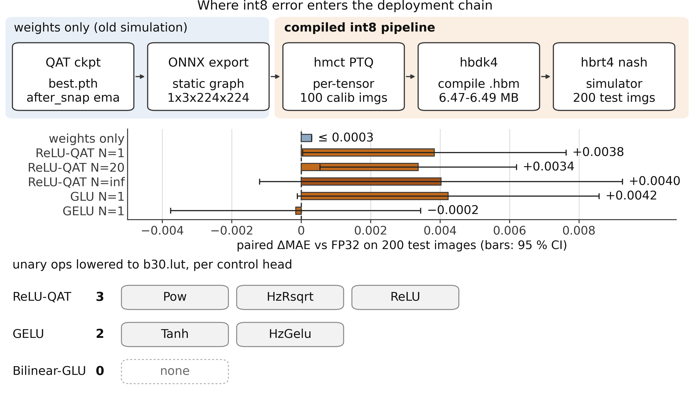

**图 9.** 从导出权重到板端指令流的编译链路，以及 int8 误差进入的位置：上半是五阶段链路，中段横条并置两类误差（六行，误差棒为 95 % 置信区间；GLU 与关闭投影两行含 0），下半是各控制头降到 b30.lut 的一元算子数。

前四个导出取自 seed 0 的 after_snap 协议（影子权重，即 §3.4 的部署权重，表 10）；第五个取自 none 的关闭投影检查点（$N = \infty$），只回答 §5.2 的间隔结论能否穿过部署链，不参与表 10。权重来源已核对：同一输入上重跑检查点并与 ONNX 输出比对，最大 $| \Delta |$ 为 $9 \times 10^{-8}$ 至 $4 \times 10^{-7}$。表 10 是 200 张、单检查点、batch 1 的逐样本配对，与表 5 的 400 张子集不同源，不可相减。

**表 10.** 厂商工具链在 200 张测试图上的任务 MAE、逐图配对差与输出偏置
| 模型 | FP32 | 伪量化 | 仿真器 | 配对 $\Delta$MAE [95 % CI] | $\Delta$ 输出偏置 | 去偏置 $\Delta$MAE |
|---|---|---|---|---|---|---|
| ReLU-QAT N=1 | 0.0756 | 0.0798 | 0.0794 | +0.0038 [+0.0000, +0.0076] | +0.0171 ± 0.0019 | +0.0020 |
| ReLU-QAT N=20 | 0.0605 | 0.0629 | 0.0639 | +0.0034 [+0.0005, +0.0062] | +0.0026 ± 0.0016 | +0.0031 |
| GELU N=1 | 0.0793 | 0.0785 | 0.0793 | −0.0002 [−0.0038, +0.0034] | +0.0010 ± 0.0020 | −0.00003 |
| GLU N=1 | 0.0760 | 0.0780 | 0.0803 | +0.0042 [−0.0001, +0.0086] | +0.0144 ± 0.0021 | +0.0050 |

前三列是 200 张测试图上的任务 MAE（FP32 为 ONNX 图、伪量化为编译器的逐节点模拟、仿真器为编译后指令流）；后两列为逐图配对统计：$\Delta$MAE $= |y_{\text{sim}}-y| - |y_{\text{FP32}}-y|$ 的均值，$\Delta$ 输出偏置 $= y_{\text{sim}}-y_{\text{FP32}}$ 的均值。FP32 列按 200 张算，配对列按仿真器成功输出的图算，故 ReLU-QAT N=20 与 GELU 两行 $n$ 为 199、其余 200；方括号为 95 % t 区间，去偏置 $\Delta$MAE 先减平均偏置再重算。这 200 张是 val[800:1000] 切片，与 2,000 张监控子集重叠（seed 0 重 112 张、seed 1 重 119 张），含选轮乐观偏差。下界 +0.00005（表内 +0.0000）与 [+0.0005, +0.0062] 不含 0，[−0.0038, +0.0034] 与 [−0.0001, +0.0086] 含 0。这些区间是单检查点内部的描述性逐图区间：配对单位是图像、每格只有一次运行，因此不能用来做跨检查点或跨工具链的推断（脚本见 §9，映射见表 18）。

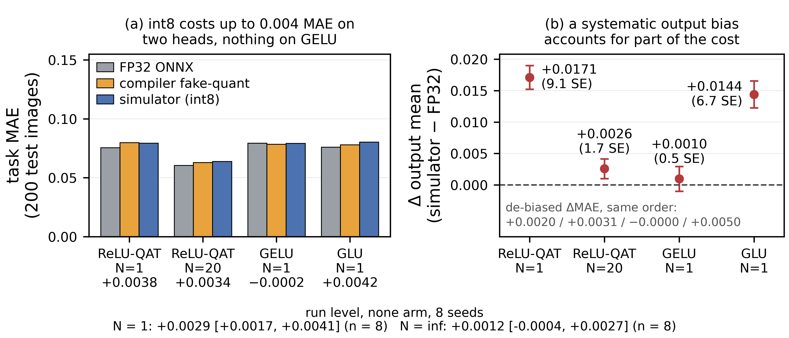

**图 10.** 厂商工具链的量测结果。(a) 同一 200 张测试图上的任务 MAE（灰：FP32 ONNX 图；橙：逐节点伪量化；蓝：编译后指令流的仿真器实测）。(b) 量化引入的输出偏置及其 ±1 标准误（误差棒），虚线为零。各组的配对 ΔMAE 写在刻度标签第三行；(b) 底部一行是去掉该偏置后重算的 ΔMAE。

图 10 逐样本呈现这两列：(a) 三根柱为 FP32 ONNX 图、逐节点伪量化与编译后指令流，刻度标签第三行是配对差；(b) 输出偏置及标准误。ReLU-QAT 在间隔 1 上的偏置 +0.0171（9.1 个标准误），GLU 头 +0.0144（6.7 个标准误）；前者的控制头恰是全网余弦最干净的区域，该检查点上指标移动主要来自偏置。

剔掉偏置可量出份额：ReLU-QAT 在间隔 1 上的 $\Delta$MAE 由 +0.0038 降到 +0.0020，约减半；间隔 20 上由 +0.0034 只降到 +0.0031（偏置本就小，+0.0026）。GLU 头相反：减掉 +0.0144 后由 +0.0042 升到 +0.0050。GELU 头两侧都近零。故系统性偏置是代价的一部分，不能解释全部。

完整流水线并非空操作。ReLU-QAT 与 GLU 头上编译后 int8 的代价点估计为 +0.0034–0.0042 MAE（GLU 的 95 % 区间含 0），比 §5.1 权重量化器的 0.0004（不含两个补跑 run）大一个数量级（图 10）：编译器还量化激活（每张量一个百分位阈值）并把部分一元算子降到查找表（ReLU-QAT 3 条：Pow / HzRsqrt / ReLU；GELU 2 条：Tanh / HzGelu；GLU 0 条）。§5.1 因此只算关于权重量化器的陈述。

部署网格是另一条轴。三个检查点（none 的 N = 1、none 的 N = ∞、after_snap 的 N = 20，均 seed 0）换三种网格在 400 张上重评：N = 1 与 N = ∞ 的差在 per-channel max 上 +0.0192 [+0.0140, +0.0245]、per-tensor max 上 +0.0181 [+0.0127, +0.0235]、per-channel p99 裁剪上 +0.0213 [+0.0109, +0.0318]，三区间都不含 0。但 p99 裁剪本身把 MAE 抬高 +0.0462 / +0.0441 / +0.0544，是间隔 1 效应的 2.1–2.6 倍、间隔 20 效应的一个数量级以上：被饱和的权重占 1.4–1.5 %，p99 与 max 的中位比 0.86，损失集中在 backbone.s3.b*.se.fc1。网格选择因此是更大的误差源（§7 第 7 条）。

节点余弦指该节点量化输出与其 FP32 图对应节点在 200 张测试图上的余弦（编译器 *_quant_info.json），按 head 取最小值。三个头的 /head/ 最小值为 0.997010（ReLU-QAT）、0.990574（GELU）、0.983052（bilinear_glu）；同一批 200 张上的 int8 平均代价 $d = |y_{\mathrm{nash}} - y| - |y_{\mathrm{FP32}} - y|$ 为 +0.003834、−0.000157、+0.004233：余弦最高者居中、居中者最省、最低者最贵，只有前两个头互换，既非同序也非反序。头间差分辨不出：ReLU-QAT − GELU 为 +0.004128 [−0.000449, +0.008704]，$p = 0.077$；ReLU-QAT − GLU 为 −0.000399 [−0.004858, +0.004061]，GELU − GLU 为 −0.004398 [−0.009815, +0.001019]，三区间全含 0；FP32 下名次与余弦一致（0.075218 / 0.076687 / 0.076829），配对区间也全含 0。头身份与 LUT 条数（3、2、0 条，图 9）混淆，不读成因果。全图最差节点在骨干（最小 0.9422）与 FPN 归一化处（0.9698–0.9801）。

在 FP32 下最优的有限间隔（N = 20）上，编译后 MAE 仍比 N = 1 低 0.0155，但逐样本配对 $\Delta$MAE 为 +0.0034 与 +0.0038，相差 0.0004，小于标准误，即没测到交互。真正穿过编译器的是输出偏置：ReLU-QAT 头在 N = 1 与 N = 20 上为 +0.0171 与 +0.0026，约 7 倍。

这一格把间隔结论读到部署链上。该检查点（none、$N = \infty$、seed 0）走同一套工具链（.hbm 6,487,504 B，静态估算 992.9 µs），部署 MAE 由 FP32 的 0.0537 升到仿真器的 0.0577，配对 $\Delta$MAE $+0.0040$，95 % 区间 $[-0.0012, +0.0093]$ 含 0，输出偏置 $-0.0040 \pm 0.0032$。与间隔 1、20 并排为 $+0.0038$、$+0.0034$、$+0.0040$：关掉训练期投影消掉的是投影施加的代价，不是这条链自身的代价。真正穿过链的是协议差——$N = 20$ 比 $N = \infty$ 在 FP32 下好 $+0.0068$，编译后仍好 $+0.0065$，保留训练侧收益的 95.0 %，故 §5.2 的间隔结论在目标工具链上成立。

逐节点表中有一行的余弦报告为 $-1.000000$（某个 LayerNorm 的均值）：该行自身无余弦值，阈值属于相邻节点；直接探测该张量，与浮点图的余弦为 1.000000，剔除后 GELU 图最差节点为 0.9471。逐节点余弦须与算子分配列、数据类型列一起读。

同一批 .hbm 中的四个（关闭投影那一格未送板）原样送 RDK S100P 板复测（系统 4.0.5-Beta、内核 6.1.158-rt58-DR、HBDK 运行时 4.7.5、单 BPU 核）：全部装载成功，编译目标 nash-m 与板端一致；200 张测试图逐张送入，板端预测与仿真器逐样本完全相同（800 次推理最大绝对偏差为 0，含仿真器未能输出的两张图），故本平台上仿真器可替代板端测量。时延上 hrt_model_exec 单线程 200 帧平均 1.13–1.20 ms（820–878 FPS），同模型三次重复极差 ≤ 1.2 %，两轮间差约 5 %，不作头间比较；python 逐张串行、含装载开销的中位时延 1.50–1.54 ms、P99 ≤ 1.85 ms，单核 4 线程 1,092 FPS，首次装载 0.76–0.82 s。

其一，仿真器复现编译器自己的伪量化输出：ReLU-QAT 与 GELU 三个模型在 0.0009 MAE 以内（低于一个标准误），GLU 头差 0.0022（约 1.1 个标准误），逐样本相关 0.993–0.998，故查找表与定点累加的差异低于现有分辨率。其二，编译器的延迟数字（单核每帧 991.3–993.3 µs、31.2 MB DDR 流量）是单张图像的静态估算，比板端 1.13–1.20 ms 低 12–18 %，只可作同口径相对比较；四个模型差异不足 0.2 %，头间延迟比较因此不做。

### 5.8 在未参与选轮的子集上的复评

以上各节的部署评估取各 run 验证划分的前 400 张，而最佳轮次是在同一划分的 2,000 张监控子集上选出的（§4），两者重叠。为估计这一重叠带来的乐观偏差，另在从未参与选轮的 1,556 张图像上重跑同一部署量化（与监控子集的文件名交集为 0，逐图预测已落盘）；同一批 run 在两套基数上的逐 seed 配对差见图 11。

间隔效应在外部子集上不变：none、seed 0 的 FP32 MAE 在间隔 1 与 $N = \infty$ 上为 0.074110 与 0.054271，逐图配对差 $+0.01984$（单 run、图像层；se 0.00138，95 % CI $[+0.01713, +0.02255]$），与表 5 的 0.0189 同向同量级；间隔 5 与 20 为 0.065249 与 0.059096，相对端点分别 $+0.01098$ 与 $+0.00483$，单调性保持。顺序效应则减半：间隔 20、seed 0 的 before 减 after 从 400 张上的 $+0.00132$ 降到 $+0.00066$（se 0.00038，95 % CI $[-0.00008, +0.00139]$，含 0）；这是单 run、图像层的读数，run 层对比 d 见 §5.3。

选轮偏差本身可以量化：表 5 那九个格（三种协议 × 三个间隔，seed 0）的 FP32 MAE 在 400 张上平均比外部子集高 0.0012，且随间隔增大（间隔 1 为 $+0.00044$、间隔 5 为 $+0.00055$、间隔 20 为 $+0.00256$）——间隔越长，可供挑选的晚期轮次越多，偏差越大。影子的有无在外部子集上方向相同（单 run、图像层：间隔 20 的 before 与 after 相对 none 为 $-0.00118$ 与 $-0.00184$，两个区间都不含 0），而在 $N = \infty$ 上消失（after 减 none 为 $+0.00035$，含 0），与 §5.4 的口径一致。选轮落在哪个轮次也一并记录：固定划分上五个主序列共 40 个 run 的选轮轮次中位为 16.5、范围 3–19；关闭投影与间隔 1 的均值分别为 16.8 与 17.1，间隔 20 反而是 13.1（两个 run 在第 3 与第 6 轮就见底），影子协议更早（两组中位 10 与 10.5）。STE 对照在外部子集上同样不变：8 个 seed 的 STE 均值为 0.0548（sd 0.0012）、关闭投影为 0.0549（sd 0.0007），两者差 0.0001；同一子集上就地覆写为 0.0732（sd 0.0011），比 STE 高 0.0184。

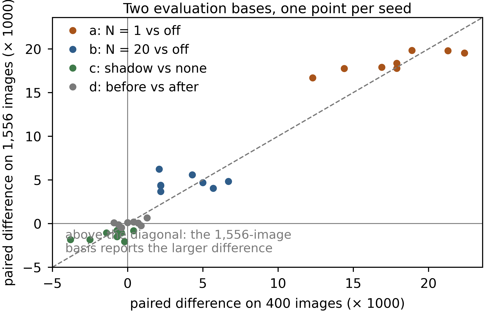

**图 11.** 同一批 run 在 400 张与 1,556 张两套基数上的逐 seed 配对差（对比 a–d 各 8 点，虚线为等值线）：影子对比 c 的点落在等值线两侧，故两套基数给出不同的显著性结论。

### 5.9 两条外推轴：换架构与换数据集

主实验只含一个 4.41 M 参数的自建网与一个数据集，因此另跑两条外推轴。表 11 把它们都留在两端点——每步就地覆写（间隔 1）与关闭投影（$N = \infty$）——各两种协议（none、after_snap）与 8 个初始 seed（0–7），学习率取 1e-3，使 8/6/4 bit 三列共用一套训练设定；在主实验的学习率 1e-4 上，架构轴再扩到四个间隔，并在间隔 20 上补第三种协议（表 12）。除学习率外其余设定与主实验一致：20 轮、batch 64、余弦退火、影子衰减 0.99，导出权重的口径与 §3.4 相同。每个 run 按自己的 seed 重建划分：表 11 的两端点各格为 400 张验证图，表 12 的 1e-4 各格则评在主实验同一口径的 1,556 张外部子集上。

架构轴把网络换成 ImageNet 预训练的 ResNet-18（11.18 M 参数，是主实验网的 2.5 倍），数据仍是 UTKFace。它带 BatchNorm，部署前一律把 BN 折进前一层卷积再量化；折前折后在同一输入上的最大差为 $6 \times 10^{-7}$，因此 8 bit 的读数对应的就是折后的权重。表 11 给出读数：两种协议合计，关闭投影的 FP32 MAE 为 0.0507、每步覆写为 0.0580，差 $+0.0072$（1.14 倍）；8 bit 上 $+0.0073$、6 bit 上 $+0.0092$、4 bit 上 $+0.0424$，四个比特宽度同号。逐 seed 配对差在 none 协议为 $+0.0079$ $[+0.0061, +0.0096]$、after_snap 为 $+0.0066$ $[+0.0043, +0.0088]$，两组在 8 个初始 seed 上全部同号（精确双侧 $p = 0.0078$）。未参与选轮的 1,556 张上协议平均差为 $+0.0071$。

**表 11.** 架构轴（ResNet-18，11.18 M 参数）上的部署 MAE：8 个初始 seed 的平均，两种协议 × 两个端点
| 协议 | 间隔 | FP32 | 8 bit | 6 bit | 4 bit |
|---|---|---|---|---|---|
| none | $N = 1$ | 0.0586 | 0.0586 | 0.0614 | 0.1025 |
| none | $N = \infty$ | 0.0507 | 0.0508 | 0.0509 | 0.0557 |
| after_snap | $N = 1$ | 0.0573 | 0.0574 | 0.0590 | 0.0939 |
| after_snap | $N = \infty$ | 0.0508 | 0.0507 | 0.0511 | 0.0559 |

**注：** 每格为 8 个初始 seed（0–7）的平均，每 run 400 张验证图、按该 run 自己的 seed 重建划分；Δ 的符号约定见 §3.4。逐 seed 配对差（$N = 1$ 减 $N = \infty$）在 none 协议为 $+0.0079$ $[+0.0061, +0.0096]$、after_snap 为 $+0.0066$ $[+0.0043, +0.0088]$，两组各 8/8 同号（精确双侧 $p = 0.0078$）；8 bit、6 bit、4 bit 的协议平均差为 $+0.0073$、$+0.0092$、$+0.0424$。未参与选轮的 1,556 张上协议平均差为 $+0.0071$（$N = 1$ 为 0.0563、$N = \infty$ 为 0.0492）。零基线按各 run 自己的划分计算；这 400 张与选轮所用的 2,000 张监控子集重叠。

在主学习率（1e-4）上，架构轴跑满四个间隔，间隔 20 上还补了第三种协议（表 12）。FP32 部署 MAE 从 $N = 1$ 的 0.1290 经 0.0997（$N = 5$）、0.0702（$N = 20$）降到关闭投影的 0.0564；相对关闭投影，8 个 seed 上的配对差为 $+0.0726$ $[+0.0585, +0.0866]$、$+0.0432$ $[+0.0386, +0.0479]$ 与 $+0.0138$ $[+0.0130, +0.0146]$，三档皆 8/8 同号；同一批 run 在 400 张部署子集上为 $+0.0722$、$+0.0426$ 与 $+0.0129$。方向与单调序在低十倍学习率下不变，斜率更陡：1e-4 下 20 轮预算让 ResNet-18 明显欠训练，每次投影都丢掉尚未固化的进展。两条读数仍为零：间隔 20 上影子为 $-0.0002$ $[-0.0010, +0.0005]$（2/8 为正），同一间隔上的顺序为 $-0.0000$ $[-0.0005, +0.0004]$（5/8 为正）；顺序区间宽 0.0009，而主口径为 0.0006，且 0.0016 的界是为固定划分的主口径预先指定的，故这条轴只与零的方向相容，并未在该界上检验它。九个格上 8 bit 减 FP32 的差落在 $-0.0001$ 与 $+0.0003$ 之间，最大值在关闭投影端点，再量化在这条轴上同样近乎免费。每个 run 重建自己的划分，故正文引用的区间同时含划分间与初始化方差。

**表 12.** 主学习率（1e-4）下架构轴（ResNet-18）的部署 MAE：8 个初始 seed 的均值，三种协议 × 四个间隔，评在 1,556 张外部子集上
| 协议 | 间隔 | FP32 | 8 bit |
|---|---|---|---|
| none | $N = 1$ | 0.1290 | 0.1290 |
| none | $N = 5$ | 0.0997 | 0.0996 |
| none | $N = 20$ | 0.0702 | 0.0702 |
| none | $N = \infty$ | 0.0564 | 0.0567 |
| after_snap | $N = 1$ | 0.1297 | 0.1297 |
| after_snap | $N = 5$ | 0.0985 | 0.0987 |
| after_snap | $N = 20$ | 0.0700 | 0.0702 |
| after_snap | $N = \infty$ | 0.0561 | 0.0563 |
| before_snap | $N = 20$ | 0.0700 | 0.0701 |

**注：** 每格为 8 个初始 seed 的均值；8 bit 一列是导出后再量化的部署读数；400 张部署子集上的同一批格子对关闭投影为 $+0.0722$、$+0.0426$ 与 $+0.0129$，该子集与选轮监控集重叠，属偏乐观的口径。

数据轴把数据集换成 KonIQ-10k [42]（10,073 张自然图像，标签为 5 级 MOS 除以 100；验证划分 1,510 张，零基线 0.0044），网络仍是 4.41 M 的自建网。表 13 给出读数：两种协议合计，关闭投影的 FP32 MAE 为 0.0020、每步覆写为 0.0027，差 $+0.0007$（1.36 倍，相当于该任务零基线 0.0044 的 16 %）；8 bit 上 $+0.0007$，6 bit 上 $+0.0005$，互不相交的 400 张上协议平均差同为 $+0.0007$。逐 seed 配对差在 none 协议为 $+0.0007$ $[\,-0.00003, +0.0015]$（7/8 同号，精确双侧 $p = 0.070$）、after_snap 为 $+0.0008$ $[+0.0001, +0.0014]$（8/8，$p = 0.0078$）：16 个配对差里 15 个为正，唯一例外仍是 none 协议 seed 1（$-1.2 \times 10^{-5}$，即机器精度级的持平），但 none 协议的区间下界贴着 0，故这一轴只写方向一致。4 bit 上符号翻转（协议平均 $-0.0012$，区间含 0，每步覆写反而更好），与主实验一致，由 run 间变异主导，本文不作解释。

**表 13.** 数据轴（KonIQ-10k，标签为 MOS / 100）上的部署 MAE：8 个初始 seed 的平均，两种协议 × 两个端点
| 协议 | 间隔 | FP32 | 8 bit | 6 bit | 4 bit |
|---|---|---|---|---|---|
| none | $N = 1$ | 0.00267 | 0.00267 | 0.00322 | 0.00990 |
| none | $N = \infty$ | 0.00197 | 0.00201 | 0.00298 | 0.01073 |
| after_snap | $N = 1$ | 0.00270 | 0.00270 | 0.00364 | 0.00858 |
| after_snap | $N = \infty$ | 0.00193 | 0.00196 | 0.00280 | 0.01010 |

**注：** 每格为 8 个初始 seed 的平均，每 run 400 张验证图；该任务的零基线为 0.0044（验证集恒预测均值）。逐 seed 配对差（$N = 1$ 减 $N = \infty$）在 none 协议为 $+0.0007$ $[\,-0.00003, +0.0015]$（7/8 同号，精确双侧 $p = 0.070$）、after_snap 为 $+0.0008$ $[+0.0001, +0.0014]$（8/8，$p = 0.0078$）；16 个配对差里 15 个为正，唯一例外是 none 协议 seed 1（$-1.2 \times 10^{-5}$）。8 bit 与 6 bit 的协议平均差为 $+0.0007$ 与 $+0.0005$，4 bit 为 $-0.0012$（区间含 0）。外部子集（验证划分 1,510 张减去 1,110 张监控子集后余下的 400 张，与选轮所用图像互不相交）上协议平均差为 $+0.0007$（$N = 1$ 为 0.00264、$N = \infty$ 为 0.00195）。

两条轴的端点对比只检验一件事：方向能否在换网、换数据之后保持一致；架构轴在 1e-4 上多走的四个间隔，检验的是这条排序本身能否复现。它们的绝对水平不能与主实验的表 5 逐格相比，因为有三处口径差异：学习率按任务设定（表 11 的两轴端点取 1e-3，表 12 的架构轴四间隔取 1e-4；照抄 1e-4 时 KonIQ 上跑满 20 轮仍差于零基线），BN 只在部署前折叠，KonIQ 的 1024×768 原图统一缩到 224² 会压掉一部分画质信息。结论要分两层。架构轴在 1e-4 上是**成对复现**，不是确认性检验：四个间隔、三种协议、8 对 seed，两套评估基数上每个间隔对比都同号，但每个 run 重建自己的划分、这条轴也没有预先注册，故只作复现。数据轴仍是方向性的：8 bit 下「关闭投影优于每步覆写」在两个新轴上都方向一致，幅度随任务变化（1.14 与 1.36 倍）；4 bit 上这一对比在两轴给出的符号不一致（架构轴 +0.0424 同号、数据轴 −0.0012 反号），与 §5.5 的结论一致。架构轴两组在 8 个初始 seed 上全部同号（精确双侧 $p = 0.0078$），数据轴 after_snap 组 8/8（$p = 0.0078$）、none 组 7/8（$p = 0.070$）且区间下界贴着 0：故数据轴只算方向一致，不当作独立复现。

### 5.10 跨后端：两条独立实现上的复现

前面的部署读数有两条出自厂商工具链，其量化网格与训练期网格是同一套逐输出通道对称尺度。为把「训练期投影」与「这套网格」分开，同一批 16 个检查点（8 个初始 seed × 间隔 1 与关闭投影两格，relu_qat 头、none 协议、固定划分）另走两条互不相干的开源运行时，各自用自带训练后量化器，网格与训练网格**不同**。

两条链流程相同：PyTorch 权重导出静态 ONNX，先在 FP32 上过关（与 torch 逐图 MAE 差最大 1.8e-08 与 3.8e-08，门槛 1e-4），再用运行时自带量化器做训练后量化，校准集与厂商链同为 100 张、测试集同为 200 张。ONNX Runtime 1.26.0（CPU EP）走 QDQ，激活逐张量非对称、权重逐通道对称；OpenVINO 2026.4.1 配 NNCF 3.4.0，用默认训练后量化预设。ONNX Runtime 只量化 66 个卷积，整图量化会让 MatMul/Gemm 的逐张量尺度被 ±109 的激活拖垮（同一批导出在 0.0751 上崩到 0.2815，早前的全图导出崩到 0.2749）；OpenVINO 的 NNCF 默认预设把 24 个 SE 的 1×1 卷积与 2 个 attention 的 QKᵀ 权重留在 fp32，是混合精度而非全 int8。

表 14 并排三条链。间隔效应（间隔 1 减关闭投影，厂商链上为间隔 20 减关闭投影）量化前后都为正，方向由逐 seed 配对决定：ONNX Runtime 8/8、OpenVINO 8/8 同号，两条链的 int8 差值为 $+0.0203$（$[+0.0188, +0.0217]$）与 $+0.0169$（$[+0.0114, +0.0225]$），相对各自 FP32 的保留比例 1.039 与 0.868。加上厂商链的 0.950（单 run，§5.7），三条实现、量化器、网格都不同的链给出 0.87–1.04。故在本文三个后端上，§5.2 的结论不是「这套网格的性质」：换掉量化器与尺度粒度、甚至换成混合精度，间隔效应仍在。

量化代价本身也值得看一眼，但两条链的读数**不一致**，只记为观察。OpenVINO 上关闭投影一端的量化代价 $+0.0065$（8/8 同号，即 8 正 0 负），间隔 1 一端只有 $+0.0039$（7/1）；ONNX Runtime 的卷积链上相反，关闭投影 $+0.0058$、间隔 1 $+0.0066$，合并 $+0.0062$。两条链都表明量化把两个协议一起推高（0.005–0.007），但哪一端被推得更多取决于量化器，这也是保留比例一个低于 1（0.868）、一个高于 1（1.039）的来源；本文不把这条方向当作结论。

三条边界。其一，全图 int8 的 ONNX Runtime 版本在表 14 里只作诊断：间隔效应放大到 $+0.1375$、量化代价 $+0.20$ 以上，是量化配置失配导致的崩塌。其二，两条开源链都在 CPU 上跑，时延只作相对参考（OpenVINO 的 FP32 与 int8 为 15.36 与 3.90 ms 每张），不据以作硬件结论。其三，两条链只覆盖 relu_qat 头、两个端点、200 张测试图，粒度比 1,556 张主口径粗，绝对水平不与表 5 逐格比较，只比较链内量化前后。

**表 14.** 三条部署链上的间隔效应：同一批检查点、同一批 200 张测试图
| 部署链与量化器 | 间隔效应 FP32 | 间隔效应 int8 | 保留比例 | 量化代价 $\Delta$MAE | 说明 |
|---|---|---|---|---|---|
| 厂商链 hbdk4 4.7.5（nash 指令级仿真） | +0.0068 | +0.0065 | 0.950 | $N{=}1$ +0.0038、$N{=}20$ +0.0034、$N{=}\infty$ +0.0040 | 逐输出通道对称，与训练同一网格；单 run |
| ONNX Runtime 1.26.0（只量化 66 个卷积） | +0.0195 | +0.0203 | 1.039 | 合并 +0.0062（16 个读数） | 激活逐张量非对称、权重逐通道；8 个 seed |
| OpenVINO 2026.4.1 配 NNCF 3.4.0 | +0.0195 | +0.0169 | 0.868 | $N{=}1$ +0.0039、$N{=}\infty$ +0.0065 | 混合精度：24 个 SE 卷积与 2 个 QKᵀ 权重留 fp32；8 个 seed |
| ONNX Runtime，整图 int8（诊断用） | +0.0195 | +0.1375 | 7.04 | — | MatMul/Gemm 的逐张量尺度被 ±109 的激活拖垮，不作部署结论 |

**注：** 间隔效应在厂商链上是间隔 20 减关闭投影，在两条开源链上是间隔 1 减关闭投影；前者的绝对值不与后两者互比（§3.4 的符号约定：正值表示多投影更差）。保留比例 = int8 的间隔效应 ÷ 同批 FP32 的间隔效应。厂商链那一行的逐图区间与逐节点余弦见 §5.7 与表 10，两条开源链的区间由 8 个 seed 的逐 seed 配对差给出（$df = 7$，$t_{0.975} = 2.3646$），符号检验为精确双侧。两条开源链的 FP32 列相同，是因为它们读的是同一批导出、同一批 200 张图。产物：`quant_runs/backend2_report.md`、`quant_runs/backend_ov_report.md`。

## 6 讨论与结论

有两个机制在起作用，量级并不相同。投影之间的间隔是主旋钮：seed 0 上协议均值从间隔 1 的 0.0743 降到间隔 20 的 0.0607，关闭投影读到 0.0552。run 层上两个有限间隔分别高出关闭投影 0.0185 与 0.0047，在全部八个配对 run 上成立，且过 Holm 校正。这里没有一处依赖是否落在网格上，因为每个有限间隔的配置最终都落在网格上。每步伪量化但不覆写参数的对照与关闭投影无法区分，而同在间隔 1 上就地覆写要多付 0.0184。代价与覆写次数一起移动，这也是它被测量成一条曲线而不是单个数字的原因。

平均顺序是较小的旋钮，在这个预算下低于实验的分辨率。两种协议导出的权重在相对 L2 上相差 0.043–0.091，而换一个 seed 是 0.64–0.83；把两种顺序的权重都再量化一次，仍剩 4.8 % ± 0.6 %，98 % 的权重落在不同的格点上。在函数空间里配对对比是 +0.000029，等价检验在分析之前就定下的界上排除了 0.0016 及以上的顺序效应。故在这个预算下，顺序是一次比 seed 更小的扰动。4.8 % 的权重差为什么只值 0.000029 的 MAE，本文没有测到；平坦盆地的读法只是推测。影子与顺序是两回事，且小于间隔：在间隔 20 上它把 1,556 张外部图像上的 MAE 降低 0.001377，八个 run 全部同号。

两条结论都是有条件的。60 轮预算把代价降低四分之一，并让它在八个 run 上全部保留；学习率放大三十倍把它降到 0.0055，八个 seed 分辨不出它与零的差别。故量级属于这个预算，而不属于机制。6 bit 读数跟着 FP32 走，间隔效应在那里更大；两个独立实现保留了其中大部分；但架构轴、数据轴与跨后端复现只支持间隔效应的方向，4 bit 的排序在 seed 之间根本无法判定。下面五条规则才是本文主张可以搬走的东西。

### 6.1 部署评估清单

一个报告量化部署的团队要按顺序回答五个问题。表 15 把它们变成一张决策表，给出必须通过的检查与随之而来的动作。

**表 15.** 8 bit 仅权重量化部署评估的决策表：情形、决定它的检查、由此采取的动作与证据位置
| 情形 | 引用数字之前的检查 | 动作 | 依据 |
|---|---|---|---|
| 即将引用一个保真度分数 | 四条前提：同算子与同步长规则、同舍入规则、无裁剪溢出、导出张量落在训练网格上 | 四条全成立则弃用该分数，改报导出量化后的任务 MAE；有一条不成立则按部署步长报告离格距离 | §5.1、命题 1、算法 1 |
| 即将用逐节点余弦给模型排序 | 余弦的名次是否与实测代价的名次一致（跨控制头比较） | 不要用余弦排序，改用导出量化后的任务指标 | §5.7 |
| 投影要保留还是要关掉 | 关闭投影 对 更长的间隔；若投影必须保留，再比 STE 与就地覆写 | 先关投影（0.0185 对 0.0047 的 MAE）；投影必须保留则优先 STE，覆写无法避免时在覆写处把就近舍入换成随机舍入 | §5.2、§5.6 |
| 不打算声称任何顺序效应 | 界、界的由来、最小可检测效应与校正后的 $p$ | 写明被排除的最小效应，并把界与校正写在该声称旁边 | §5.3 |
| 要报告 4–6 bit 的排序 | 跨 seed 标准差、配对 $t$ 区间、中位数与自助法检查 | 三者都报；区间重叠的配置不排序 | §5.5 |

规则还有一层条件性。它们说明一个数字是什么意思，不说明该发哪个模型：架构、数据集与训练预算的选择在规则之外，本文也不为在门禁或身份核验中使用年龄回归器提供任何依据（§8）。

## 7 效度威胁

两条零成本对照把代价定位到就地覆写这一步、而不是权重停在网格上（§5.6），但它们都没有记录被抹掉的更新：逐权重的优化器动量、单次更新小于半格距的比例、以及更新范数都未测量，因此这是一条与覆写相一致的证据，而不是对它的直接演示。把这些量记录下来，是本文之后最应先补的一步。

1. 主扫描只覆盖一个数据集。UTKFace 是一个规模不大、经过精编、接近正脸的人脸数据集，主受控扫描（五个配置序列各 8 个 seed）只在它上面跑；§5.9 另在 ResNet-18 与 KonIQ-10k 上各用 8 个初始 seed 跑了端点对比，架构轴还在主学习率 1e-4 上扩到四个间隔与三种协议、方向与单调序都复现，但数据轴仍只覆盖两个端点，因此间隔在其他数据域、其他分辨率或其他架构上的行为，本文仍没有检验。

2. 量化口径。§5.1–§5.5 的受控变量始终是 PyTorch 中逐输出通道对称的权重 QDQ，这样两个旋钮才能独立于编译器的启发式规则被扫描。§5.7 补上了厂商工具链，但只有五个检查点、三种头（ReLU-QAT 头的间隔 1 与间隔 20 各一个、一个 GELU 检查点、一个 bilinear GLU 检查点，再加一个关闭投影的 none 检查点），校准集只有 100 张图像，测量先在*指令级仿真器*上完成，再在目标板卡上复核；板上只跑了这四个检查点，时延与吞吐的结论仅限这四个模型。此外在两条独立实现上做了跨后端复现（§5.10）：ONNX Runtime 只量化 66 个卷积（整图量化会让 MatMul/Gemm 的逐张量尺度崩坏，那一版只作诊断），OpenVINO 用的是 NNCF 默认预设，实际是混合精度。两条链都只有 relu_qat 头、两个端点、200 张测试图，时延只是 CPU 上的相对参考。

3. seed 未解耦。本文的 seed 同时决定数据划分与参数初始化，跨 seed 的离散度因此同时含划分差异与初始化差异。为把两者分开，本文补做了 split_seed × 初始 seed 的 3 × 3 交叉设计（表 16）：九个格子的部署 FP32 MAE 均值是 0.0583，双因素平方和分解给出划分为 56.6 %、初始化为 10.0 %、残差（含交互）为 33.4 %，按随机效应折算的方差分量是划分 0.0008、初始化截断为 0、残差 0.0009。残差只有 4 个自由度，两个因子在 5 % 水平上都不显著（F = 3.39 与 0.60，临界值 6.94），故这个次序只能读作描述性的：划分的影响大于初始化，九个 run 不足以把它定下来。跨划分的差主要是评估子集的差：split 2 的三个初始 seed 一致偏低约 0.0016，与它更低的零基线（0.1516 对 0.1552）同向；同一划分内三个初始 seed 的极差是 0.0011、0.0024、0.0007。若改用训练时的实时 MAE（全验证集、最佳轮次）口径，同一批 run 的分解变成划分 2.9 %、初始化 50.2 %、残差 46.9 %，说明这份归因依赖所报的指标。因此在 §5.3 与 §5.5 的固定划分序列里，跨 seed 离散度只含初始化与批顺序的差异；而上面这个交叉设计说明，换成划分随 seed 变的一般情形时，划分的贡献与之可比，故本文不主张初始化是主导来源。

**表 16.** 数据划分 × 参数初始化的 3 × 3 交叉设计的部署 FP32 任务 MAE
| 划分 split_seed | 初始 seed 1 | 初始 seed 2 | 初始 seed 3 | 均值 |
|---|---|---|---|---|
| 0 | 0.0582 | 0.0593 | 0.0588 | 0.0588 |
| 1 | 0.0593 | 0.0598 | 0.0574 | 0.0588 |
| 2 | 0.0569 | 0.0570 | 0.0576 | 0.0572 |
| 均值 | 0.0581 | 0.0587 | 0.0579 | 0.0583 |

**注：** 九格同为 after_snap、间隔 20、γ = 0.99、20 轮；数值为部署 FP32 任务 MAE，400 张验证图，各按该 run 自己的 split_seed 重建划分。其中 (0,1)、(0,2)、(0,3) 三格用固定划分（split_seed = 0），(1,1) 与 (2,2) 两格是主配置 run，其余四格为本次补跑。表末格为九格总均值。平方和分解与显著性见 §7 第 3 条；同一批 400 张图上 8 bit 减 FP32 的逐图配对差在 −0.0001 至 +0.0018 之间（正值表示 8 bit 更差），最大值出现在 (2, 1)。

4. 检查点选择与评估子集重叠。最佳轮次在每划分的 2,000 张监控子集上选出，而 400 张部署子集与它重叠，因此表 5 至表 8 的读数带有选轮带来的乐观偏差。主口径已迁到未参与选轮的 1,556 张：§5.2–§5.4 的区间与检验都报这一口径，400 张只作对照列。两种口径的差别不是小数点后的抖动：间隔 20 上的影子对比在 1,556 张上 8/8 同号、符号检验 p = 0.0078，在 400 张上只剩 7/8、p = 0.070，后者只是边缘证据；间隔效应本身两口径分别为 +0.018457 与 +0.017750（对比 a）、+0.004723 与 +0.003800（对比 b），方向不变而量级差 0.0007–0.0009。表 5 至表 8 的逐行数值仍是 400 张上的点估计，绝对水平应以 1,556 张为准。

5. 与 TR 调度的关系。Lee 等把量化器的转变过程建模成一个显式的速率参数，并在训练中调度它 [18]。本文的间隔 $N$ 与它落在同一个位置上——都问「训练期多频繁地让权重接触低精度」——但计量对象不同，因此两边的数字不可直接比较（表 17）。

6. 外推轴的口径。§5.9 两条轴的端点格取 1e-3（主实验 1e-4），架构轴另在 1e-4 上扩到四间隔与三协议、数据轴仍只覆盖两个端点；两轴各有自己的图像尺寸，BN 只在部署前折叠；它们检验的是端点对比的方向能否在换网、换数据之后复现，绝对水平不能与主实验的表 5 逐格相比。数据轴没有覆盖中间间隔。

7. 网格与训练量化器不一致时的外推限制。§5.2–§5.5 的全部读数都取训练同款的 per-channel max 网格；§5.7 的网格敏感性一段把同一批检查点换到 per-tensor max 与 per-channel p99 裁剪上：间隔效应方向不变（+0.0192 / +0.0181 / +0.0213），但 p99 裁剪本身把绝对误差抬高 0.0441–0.0544，是间隔 1 效应（+0.0181 至 +0.0213）的 2.1–2.6 倍，相对间隔 20 效应（+0.0038）高一个数量级以上。因此本文的绝对 MAE 只在 per-channel max 这一格上成立；若部署采用逐张量尺度或百分位裁剪，可迁移的是方向与「关闭投影更优」这一结论，不是本文报出的 MAE 水平。

**表 17.** 本文的间隔 $N$ 与 QAT 中转变速率的对照
| 维度 | 本文的间隔 $N$ | TR 调度 [18] | 对解释的影响 |
| --- | --- | --- | --- |
| 被调度的量 | 两次就地投影之间的步数；$N = 1$ 为每步投影，$N = \infty$ 为关闭 | 权重由浮点到量化的转变速率，即每步推进多少 | 同名不同量，两边的数字不可直接比较 |
| 权重是否被覆写 | 是：$W_t \leftarrow S_b(W_t)$，没有全精度主副本 | 否：优化器持有浮点权重，量化只在前向施加 | 本文的代价归因只适用于覆写式实现（§5.6） |
| 影子与投影的先后 | 是自变量之一（before_snap / after_snap / none） | 未作为自变量 | 本文关于顺序效应的结论与 TR 无关 |
| 本文的结论能否搬到对方 | 8 bit 下关闭投影最优 | 本文未测试 | 不能据本文说 TR 调度无效 |

**注：** 「不能搬」只指本文的机制结论不能套到不覆写的实现上，不表示 TR 调度无效；两者要在同一实现上重跑才能比较。

## 8 数据、伦理与更广泛影响

数据与伦理。数据为 UTKFace [35] 已裁剪子集，2026-10-26 取自 HuggingFace 镜像，23,708 张图像；「文件名+字节数」SHA-256 为 493950cf…。官方页写「non-commercial research purposes only」，镜像却标 MIT 且自述不拥有数据；两者冲突，本文从严。文件名编码年龄、性别与种族，本文只读年龄。划分按种子随机抽 15 %；无身份标签，同一人可横跨训练与验证两侧，跨划分读数非泛化证据。其中可测量的一部分是重复照片：语料内有 390 张与另一张逐字节相同的副本，分属 375 组（单组最多四份）；在本文划分下，1,556 张外部图像中有 44 张（2.8 %）与某张训练图像逐字节相同，56 张（3.6 %）在 64 位梯度哈希加像素核对下存在近重复（最近邻汉明距离中位数 6 位，无关图像对为 26 位）。把这 56 张去掉、在同样 8 个种子上重算四条对比，变动不超过 0.00013（为对比 b 的 2.7 %）：a 由 +0.018457 变为 +0.018538，b 由 +0.004723 变为 +0.004852，c 由 −0.001377 变为 −0.001466，d 由 +0.000029 变为 +0.000031；a、b、c 仍 8/8 同号，d 仍在预设的 0.0016 等价界内。故重复照片不驱动上述读数；仍未测量的是「同一人的不同照片」，发布标签无法区分。本研究不合成、不编辑、不发布任何个体图像，只报聚合指标。

更广泛影响。年龄回归可用于广告定向、门禁、身份核验；误差不停在指标上，而落在被判断的个人身上，人群间误差差异常比总体误差更受关注；本文未按年龄、性别或种族分组报告误差，因此对群体间差异不作任何陈述——而这恰恰是此类估计用于准入判断时最要紧的量。本文贡献限于部署评估口径：下游先按本文协议检查保真度指标是否仍携带代价信息，就不会把 8 bit 下饱和的数字当部署证据，误用更易被审计。改善只在评估环节，本文不提出检测或纠正误判的机制，也不防止其被滥用；读作更安全的年龄估计是误读。

## 9 可复现性映射

全部数字由本仓库的脚本产出（表 18），逐图预测已随产物落盘。单 run 训练在单张 RTX 4080 Laptop（7,875 MiB 可用）上耗时 834–891 s（20 轮、batch 64）；3 × 3 交叉补跑的四个 run 合计约 57 min。

**表 18.** 各主张与产物、脚本、图表位置的对应关系
| 主张 | 产物 | 脚本 | 图或表 |
|---|---|---|---|
| 8 bit 空操作、网格残差、落网比例 | quant_runs/paper2_facts.json | scripts/paper2_diagnostics.py | 表 4、图 2 |
| 部署 MAE（§5.2–§5.5） | quant_runs/deploy_table_v3.csv（65 个 run）、quant_runs/deploy_table_v4.csv（公共 400 张的 50 个 run） | scripts/deploy_table.py、scripts/round20_table_v4.py | 表 5、表 7、图 3、图 7 |
| 逐图配对与区间估计 | quant_runs/paired_report.md、quant_runs/perimage/*.npz | scripts/paper2_paired.py | 表 5 注、§5.3 |
| 多重比较校正（§5.3） | quant_runs/perimage/*.npz | scripts/holm_paired.py | §5.3 |
| 顺序效应的等价性检验 | quant_runs/runlevel2_stats.json、quant_runs/dual_basis_report.json | scripts/round20_runlevel.py、scripts/round20_dual_basis.py | §5.3 |
| 等价界、单侧 p 与功效（σ_d、α、非中心 t） | quant_runs/mde_power.json | scripts/round20_mde.py | §5.3、图 6 |
| 划分与初始化的方差归因 | quant_runs/split_cross_table.csv（9 个 run） | scripts/run_split_cross.py、scripts/split_cross_table.py | 表 16、见 §7 第 3 条 |
| 外部子集复评（§5.8） | quant_runs/heldout_eval_v3.csv（46 个 run × 2 个子集） | scripts/heldout_eval.py、scripts/round20_heldout.py | §5.8 |
| 间隔扫描、间隔 20 的 seed 重复 | results/utk-relu_qat-* | scripts/run_snapfreq.py、scripts/run_snap20_seeds.py | 图 4 |
| STE 伪量化对照（§5.6） | results/utk-relu_qat-none-ste-s{0..7}-*、quant_runs/ste_deploy_table.csv、quant_runs/ste_v3.csv | quant/ste.py、scripts/run_ste_queue.py、scripts/ste_deploy.py | 表 8、图 1 末行 |
| 算子定义 | quant/qat.py（snap_weights_）、quant/ema_snap.py（SnapEMA.update_） | — | 式 (1)、(5) |
| 训练与评估协议 | train.py（--snap-every、--ema-mode、--ema-decay、--quant-mode） | — | 表 2 |
| 厂商工具链 int8（§5.7） | npu_quant/out/*.json、npu_quant/out/tables.md、npu_quant/out/paired_stats.md、npu_quant/REPORT.md | npu_quant/export_npu_onnx.py、npu_quant/make_calib.py、npu_quant/gen_hb_configs.py、npu_quant/hb_patch_fold.py | 表 10、图 9、图 10 |
| 跨后端复现（§5.10） | quant_runs/backend2_report.md、quant_runs/backend_ov_report.md、quant_runs/backend2_preds.npz、quant_runs/backend_ov_onnx/ | scripts/round20_backend2.py、scripts/round20_backend_ov.py | 表 14 |
| run 层统计与双口径（含 6 bit 位宽口径） | quant_runs/runlevel2_stats.json、quant_runs/dual_basis_report.json、quant_runs/heldout_eval_v3.csv、quant_runs/deploy_table_v4.csv | scripts/round20_runlevel.py、scripts/round20_dual_basis.py、scripts/round20_heldout.py、scripts/round20_table_v4.py | 表 5 至表 7 |
| 机制对照（学习率、预算、随机舍入） | quant_runs/mechanism_stats.json、quant_runs/mechanism_report.md | scripts/round20_mechanism.py、scripts/run_stochastic_rounding.py（随机舍入注入） | §5.6 |
| 平均顺序在再量化前后的权重距离 | quant_runs/order_requant.json、quant_runs/order_requant.md | scripts/round20_order_requant.py | §5.3、§6 |
| 部署网格与头部配对 | quant_runs/grid_report.md、quant_runs/head_int8_report.md、quant_runs/head_eval_report.md | scripts/round20_grid.py、scripts/round20_head_int8.py、scripts/round20_head_eval.py | §5.7 |
| 架构与数据外推 | quant_runs/ext_deploy_arch.csv、quant_runs/ext_deploy_arch_lr1e4.csv、quant_runs/ext_deploy_arch_b_*.csv、quant_runs/ext_deploy_koniq.csv | scripts/run_ext_queue.py、scripts/run_ext_lr_queue.py、scripts/ext_deploy.py、scripts/ext_tables.py、scripts/round20_ext_runlevel.py | 表 11、表 12、表 13 |
| STE 对照与 STE × EMA 变体 | quant_runs/ste_v3.csv、quant_runs/ste_runlevel.json、results/utk-relu_qat-after_snap-ste-s{0,1,2}-*、quant_runs/ext_deploy_ste_ema.csv | scripts/round20_ste_runlevel.py、scripts/run_ste_ema_queue.py、quant/ema_snap.py（--ema-source） | 表 8、§5.6 |
| 十一张插图 | drafts/figs/*.png | scripts/paper2_figs.py（图 3、5）、scripts/paper2_figs_add.py（图 1、2、4）、scripts/paper2_figs_extra.py（图 7、9）、scripts/paper2_figs_r22.py（图 6、8、11）、scripts/paper2_figs_npu.py（图 10） | 图 1–11 |
| 完整实验日志 | experiments.md | — | — |

代码与产物可用性。代码、脚本与全部中间产物以匿名仓库提供：`https://github.com/una393/utkface-snap-order`（公开仓库，单一匿名根提交，作者信息已匿名化；内容与本稿所用的快照一致）。仓库是 git 仓库，共 666 个文件、约 11 MB（`manifest.json` 给出其余每个文件的 SHA-256）：训练与导出代码（`train.py`、`models/`、`quant/`）、实验与统计脚本（`scripts/`）、报告用的表格与统计（`quant_runs/` 下的 `*.csv`、`*.json`、`*.md` 与逐图预测 `perimage/*.npz`）、厂商工具链配置与逐节点报告（`npu_quant/`）、稿件源与插图（`drafts/`）。代码以 MIT 许可发布；UTKFace 图像与像素缓存、ImageNet 预训练权重、逐 run 检查点与编译产物（`*.hbm`、`*.bc`、`*.onnx`）因上游条款与体积不予分发，这条边界写在仓库的 `NOTICE` 里。数据经 HuggingFace 的 UTKFace-Cropped 镜像获取（该镜像把许可标为 MIT），上游 UTKFace 页写「non-commercial research purposes only」，本文按后者使用，且不随仓库分发任何图像或像素缓存。主结果与产物、脚本的对应关系见表 18：部署读数在 `quant_runs/deploy_table_v3.csv`（65 个 run，其中 50 个按公共 400 张评估，见 `quant_runs/deploy_table_v4.csv`），逐图预测与配对统计在 `quant_runs/perimage/*.npz` 与 `quant_runs/paired_report.md`，网格残差与落网比例在 `quant_runs/paper2_facts.json`，顺序效应的等价性检验与其功效在 `quant_runs/runlevel2_stats.json` 与 `quant_runs/mde_power.json`，划分与初始化方差归因在 `quant_runs/split_cross_table.csv`，外部子集复评在 `quant_runs/heldout_eval_v3.csv`，STE 对照在 `quant_runs/ste_deploy_table.csv`，厂商工具链 int8 在 `npu_quant/out/`（`tables.md`、`paired_stats.md`、`REPORT.md`），十一张插图在 `drafts/figs/*.png`，完整实验日志在 `experiments.md`。

## 10 附录 A：补充的效度威胁

下列六条同样限制本文的外推范围，但只影响对个别数字的解释，不改变 §5 的任何一条结论；为控制正文长度移至此处；本节编号 1–6，与 §7 的 1–7 各自独立。

1. 20 轮、最佳检查点选择。协议按指标挑选最佳轮次，这偏向收敛较早的控制头；间隔之间的比较使用同样的预算，而它们的最佳轮次并不相同（§5.8 给出 40 个 run 的选轮轮次分布）。这一差异对间隔效应的净影响可以测：在未参与选轮的子集上，间隔 1 相对关闭投影的差由 400 张的 $+0.0178$ 升到 $+0.0185$，即 400 张口径偏乐观：在本序列、本指标上，间隔效应被低估约 4 %。

2. seed 覆盖不均。五个主配置序列（none 在 $N = \infty$、1、20 上，after_snap 与 before_snap 在 20 上）在固定划分上各有 8 个初始 seed，run 层对比 a–d 与 STE 的两条因此可用；但其余格子仍是旧口径——间隔 5 三种协议各 3 个 seed，$N = \infty$ 的 after_snap 只有 1 个 seed，seed 大于 0 的旧 run 又各自换了划分。故本文的 run 层推断只覆盖这五个序列构成的四条对比，其他格子只作描述，4 bit 的稳健性结论也仅限于 §5.5 所展示的范围。

3. none 协议的影子未定义，故其 val_mae_ema 列无意义（它评估的是一份从未更新的副本）。只使用它的实时（live）列。

4. 未与 4 bit 专用量化器对照。本文 4 bit 一列只由本文固定下来的逐输出通道对称权重量化器给出，没有与 GPTQ [31]、AWQ [32] 这类为低比特设计的量化器对照，也没有换用它们的分组与缩放策略。§5.5 关于 run 间变异的结论因此只适用于本文的量化器，不外推到那些方法。

5. STE 一族的覆盖范围。主表只放 --quant-mode ste × --ema-mode none；ste × after_snap 的一个变体（影子的平均源从前向伪量化后的权重取得，--ema-source forward，三 seed）读数与结论都在 §5.6，此处不重复数值。未测的是覆写时机本身——只覆写部分层、或按张量而非按通道定尺度——以及 STE 下的其他 EMA 衰减；因此代价归因只对本文这种就地覆写实现成立。

6. 多重比较。§5.3 的七组配对比较没有预先声明为单一假设：未校正时 2/7 名义显著且方向相反，Holm 与 Benjamini–Hochberg 校正后 0/7 显著。本文因此只报告逐组区间与校正结果，不依据单个名义显著的组下结论。

**表 19.** 与相近工作的逐项差异（检索截止 2026-11-02）
| 工作 | 训练期优化器权重被就地投影到 int8 网格 | 保留高精度主副本 | 投影间隔作为变量 | 影子平均的是量化后权重 | EMA 写入在投影之后 | 走目标 NPU 完整链 | 跨 seed 报区间 |
|---|---|---|---|---|---|---|---|
| SWALP [21] | 是 | 是 | — | — | — | — | — |
| SQWA [22] | 是 | 是 | — | 是 | — | — | — |
| BinaryRelax [12] | 是 | 是 | — | — | — | — | — |
| TR 调度 [18] | 是 | 是 | 是（按层的跨级速率） | — | — | — | — |
| DQT [9] | 是 | 否（直接更新低精度权重） | — | — | — | — | — |
| ECO [10] | 是 | 否（无主副本，误差注入动量） | — | — | — | — | — |
| 本文 | 是（就地覆写为自变量之一；物理 int8 存储发生在导出与编译阶段） | 否（无全精度主副本；EMA 影子仅为导出副本，不参与优化器更新） | 是（1、5、20、∞） | 是 | 是（before / after 两种） | 是（hbdk4 与两条运行时） | 是（n = 8，逐 run 配对） |

**注：** 各格的判据只取各文正文对训练流程的描述，不评价其方法本身；「—」表示该文未把这一维度作为变量或未报告，不表示其流程中不存在。「保留高精度主副本」一列按「优化器是否持有全精度参数」判定；第一列问的是训练期优化器持有的权重是否被就地写成网格点的反量化值（bf16 autocast 下张量仍是浮点类型），物理 int8 存储只发生在导出与编译阶段；本文的影子平均的是量化后权重，仅用于导出，从不参与优化器更新，与 SWALP、SQWA 的检查点平均不是同一对象（见「影子平均的是量化后权重」一列）。

## 11 参考文献

[1] Y. Bengio, N. Léonard, and A. Courville, "Estimating or propagating gradients through
stochastic neurons for conditional computation," arXiv preprint arXiv:1308.3432, Aug. 2013.

[2] S. Zhou, Y. Wu, Z. Ni, X. Zhou, H. Wen, and Y. Zou, "DoReFa-Net: Training low bitwidth
convolutional neural networks with low bitwidth gradients," arXiv preprint arXiv:1606.06160,
Jun. 2016.

[3] J. Choi, Z. Wang, S. Venkataramani, P. I.-J. Chuang, V. Srinivasan, and K. Gopalakrishnan,
"PACT: Parameterized clipping activation for quantized neural networks," arXiv preprint
arXiv:1805.06085, May 2018.

[4] S. K. Esser, J. L. McKinstry, D. Bablani, R. Appuswamy, and D. S. Modha, "Learned step
size quantization," in Proc. Int. Conf. Learn. Represent. (ICLR), 2020, arXiv:1902.08153.

[5] A. Zhou, A. Yao, Y. Guo, L. Xu, and Y. Chen, "Incremental network quantization: Towards
lossless CNNs with low-precision weights," in Proc. Int. Conf. Learn. Represent. (ICLR), 2017,
arXiv:1702.03044.

[6] M. Courbariaux, Y. Bengio, and J.-P. David, "BinaryConnect: Training Deep Neural Networks with binary weights during propagations," arXiv preprint arXiv:1511.00363, Nov. 2015.

[7] S. Gupta, A. Agrawal, K. Gopalakrishnan, and P. Narayanan, "Deep learning with limited numerical precision," in Proc. Int. Conf. Mach. Learn. (ICML), 2015, pp. 1737–1746, arXiv:1502.02551.

[8] N. Wang, J. Choi, D. Brand, C.-Y. Chen, and K. Gopalakrishnan, "Training Deep Neural Networks with 8-bit Floating Point Numbers," arXiv preprint arXiv:1812.08011, Dec. 2018.

[9] K. Zhao, T. Tabaru, K. Kobayashi, T. Honda, M. Yamazaki, and Y. Tsuruoka, "Direct Quantized Training of Language Models with Stochastic Rounding," in Proc. 17th Asian Conf. Machine Learning (ACML), PMLR vol. 304, 2025, pp. 1150–1165.
[10] M. Nikdan, A. Zandieh, D. Alistarh, and V. Mirrokni, "ECO: Quantized Training without Full-Precision Master Weights," arXiv preprint arXiv:2601.22101, Jan. 2026.
[11] Y. Bai, Y.-X. Wang, and E. Liberty, "ProxQuant: Quantized Neural Networks via Proximal Operators," in International Conference on Learning Representations (ICLR), 2019, arXiv:1810.00861.

[12] P. Yin, S. Zhang, J. Lyu, S. Osher, Y. Qi, and J. Xin, "BinaryRelax: A Relaxation Approach for Training Deep Neural Networks with Quantized Weights," SIAM J. Imaging Sci., vol. 11, no. 4, pp. 2205–2223, 2018, doi: 10.1137/18m1166134.

[13] C. Louizos, M. Reisser, T. Blankevoort, E. Gavves, and M. Welling, "Relaxed Quantization for Discretized Neural Networks," arXiv preprint arXiv:1810.01875, Oct. 2018.

[14] B. Jacob, S. Kligys, B. Chen, M. Zhu, M. Tang, A. Howard, H. Adam, and D. Kalenichenko,
"Quantization and Training of Neural Networks for Efficient Integer-Arithmetic-Only Inference,"
in Proc. IEEE/CVF Conf. Comput. Vis. Pattern Recognit. (CVPR), 2018, pp. 2704–2713,
doi: 10.1109/CVPR.2018.00286.

[15] R. Krishnamoorthi, "Quantizing deep convolutional networks for efficient inference: A
whitepaper," arXiv preprint arXiv:1806.08342, Jun. 2018.

[16] M. Nagel, M. Fournarakis, R. A. Amjad, Y. Bondarenko, M. van Baalen, and T. Blankevoort,
"A White Paper on Neural Network Quantization," arXiv preprint arXiv:2106.08295, Jun. 2021.

[17] A. Gholami, S. Kim, Z. Dong, Z. Yao, M. W. Mahoney, and K. Keutzer, "A Survey of
Quantization Methods for Efficient Neural Network Inference," in Low-Power Computer Vision,
Chapman and Hall/CRC, 2022, pp. 291–326, doi: 10.1201/9781003162810-13, arXiv:2103.13630.

[18] J. Lee, J. Jeon, D. Kim, and B. Ham, "Scheduling weight transitions for quantization-aware
training," in Proc. IEEE/CVF Int. Conf. Comput. Vis. (ICCV), 2025. arXiv:2404.19248.

[19] B. T. Polyak and A. B. Juditsky, "Acceleration of stochastic approximation by averaging,"
SIAM J. Control Optim., vol. 30, no. 4, pp. 838–855, 1992, doi: 10.1137/0330046.

[20] A. Tarvainen and H. Valpola, "Mean teachers are better role models: Weight-averaged
consistency targets improve semi-supervised deep learning results," in Proc. Adv. Neural Inf.
Process. Syst. (NIPS), vol. 30, 2017, arXiv:1703.01780.

[21] G. Yang, T. Zhang, P. Kirichenko, J. Bai, A. G. Wilson, and C. De Sa, "SWALP: Stochastic
weight averaging in low-precision training," in Proc. Int. Conf. Mach. Learn. (ICML), 2019,
arXiv:1904.11943.

[22] S. Shin, Y. Boo, and W. Sung, "SQWA: Stochastic quantized weight averaging for improving the
generalization capability of low-precision deep neural networks," in Proc. IEEE Int. Conf. Acoust.
Speech Signal Process. (ICASSP), 2021, arXiv:2002.00343.

[23] P. Izmailov, D. Podoprikhin, T. Garipov, D. Vetrov, and A. G. Wilson, "Averaging Weights
Leads to Wider Optima and Better Generalization," in Proc. Conf. Uncertainty in Artif. Intell.
(UAI), 2018, arXiv:1803.05407.

[24] M. Wortsman, G. Ilharco, S. Y. Gadre, R. Roelofs, R. Gontijo-Lopes, A. S. Morcos,
H. Namkoong, A. Farhadi, Y. Carmon, S. Kornblith, and L. Schmidt, "Model soups: averaging weights
of multiple fine-tuned models improves accuracy without increasing inference time," in Proc.
Int. Conf. Mach. Learn. (ICML), 2022, arXiv:2203.05482.

[25] Y. Li, M. Shen, J. Ma, Y. Ren, M. Zhao, Q. Zhang, R. Gong, F. Yu, and J. Yan, "MQBench: Towards Reproducible and Deployable Model Quantization Benchmark," in Proc. Neural Information Processing Systems Track on Datasets and Benchmarks (NeurIPS D&B), 2021. arXiv:2111.03759.

[26] G. Xiao, J. Lin, M. Seznec, H. Wu, J. Demouth, and S. Han, "SmoothQuant: Accurate and
Efficient Post-Training Quantization for Large Language Models," in Proc. Int. Conf. Mach. Learn.
(ICML), 2023, arXiv:2211.10438.

[27] M. Nagel, R. A. Amjad, M. van Baalen, C. Louizos, and T. Blankevoort, "Up or down? Adaptive
rounding for post-training quantization," in Proc. Int. Conf. Mach. Learn. (ICML), 2020,
arXiv:2004.10568.

[28] Y. Li, R. Gong, X. Tan, Y. Yang, P. Hu, Q. Zhang, F. Yu, W. Wang, and S. Gu, "BRECQ: Pushing the Limit of Post-Training Quantization by Block Reconstruction," arXiv preprint arXiv:2102.05426, Feb. 2021.

[29] Z. Dong, Z. Yao, A. Gholami, M. Mahoney, and K. Keutzer, "HAWQ: Hessian AWare Quantization of Neural Networks With Mixed-Precision," in Proc. IEEE/CVF Int. Conf. Comput. Vis. (ICCV), 2019, pp. 293–302, doi: 10.1109/ICCV.2019.00038.

[30] Z. Dong, Z. Yao, Y. Cai, D. Arfeen, A. Gholami, M. W. Mahoney, and K. Keutzer, "HAWQ-V2: Hessian Aware trace-Weighted Quantization of Neural Networks," arXiv preprint arXiv:1911.03852, Nov. 2019.

[31] E. Frantar, S. Ashkboos, T. Hoefler, and D. Alistarh, "GPTQ: Accurate Post-Training
Quantization for Generative Pre-trained Transformers," in Proc. Int. Conf. Learn. Represent.
(ICLR), 2023, arXiv:2210.17323.

[32] J. Lin, J. Tang, H. Tang, S. Yang, W.-M. Chen, W.-C. Wang, G. Xiao, X. Dang, C. Gan, and
S. Han, "AWQ: Activation-aware Weight Quantization for LLM Compression and Acceleration," in
Proc. Conf. Mach. Learn. Syst. (MLSys), 2024, arXiv:2306.00978.

[33] I. Radosavovic, R. P. Kosaraju, R. Girshick, K. He, and P. Dollár, "Designing network
design spaces," in Proc. IEEE/CVF Conf. Comput. Vis. Pattern Recognit. (CVPR), 2020,
pp. 10425–10433, doi: 10.1109/CVPR42600.2020.01044.

[34] R. Wightman, "PyTorch Image Models," GitHub repository, 2019,
doi: 10.5281/zenodo.4414861. [Online]. Available:
https://github.com/rwightman/pytorch-image-models

[35] Z. Zhang, Y. Song, and H. Qi, "Age progression/regression by conditional adversarial
autoencoder," in Proc. IEEE Conf. Comput. Vis. Pattern Recognit. (CVPR), 2017, pp. 4352–4360,
doi: 10.1109/CVPR.2017.463.

[36] Y. Wu and K. He, "Group normalization," in Proc. Eur. Conf. Comput. Vis. (ECCV),
vol. 11217, LNCS, 2018, pp. 3–19, doi: 10.1007/978-3-030-01261-8_1.

[37] A. Vaswani, N. Shazeer, N. Parmar, J. Uszkoreit, L. Jones, A. N. Gomez, L. Kaiser, and
I. Polosukhin, "Attention is all you need," in Proc. Adv. Neural Inf. Process. Syst. (NIPS),
vol. 30, 2017, arXiv:1706.03762.

[38] B. Zhang and R. Sennrich, "Root mean square layer normalization," in Proc. Adv. Neural
Inf. Process. Syst. (NeurIPS), vol. 32, 2019, arXiv:1910.07467.

[39] D. J. Schuirmann, "A comparison of the two one-sided tests procedure and the power approach for assessing the equivalence of average bioavailability," Journal of Pharmacokinetics and Biopharmaceutics, vol. 15, no. 6, pp. 657–680, 1987, doi: 10.1007/BF01068419.

[40] D. Lakens, A. M. Scheel, and P. M. Isager, "Equivalence Testing for Psychological Research: A Tutorial," Advances in Methods and Practices in Psychological Science, vol. 1, no. 2, pp. 259–269, 2018, doi: 10.1177/2515245918770963.

[41] K. Ozkara, T. Yu, and Y. Park, "Stochastic Rounding for LLM Training: Theory and Practice," in Proc. Int. Conf. Artificial Intelligence and Statistics (AISTATS), PMLR vol. 258, 2025, pp. 4402–4410.

[42] V. Hosu, H. Lin, T. Sziranyi, and D. Saupe, "KonIQ-10k: An Ecologically Valid Database for Deep Learning of Blind Image Quality Assessment," IEEE Trans. Image Process., vol. 29, pp. 4041–4056, 2020, doi: 10.1109/TIP.2020.2967829.
